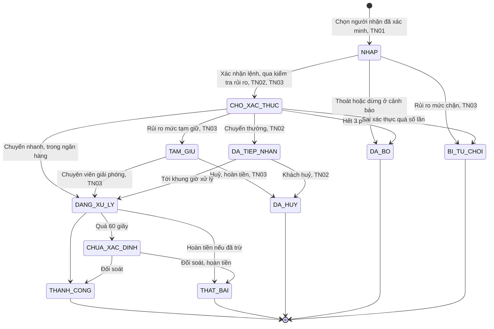
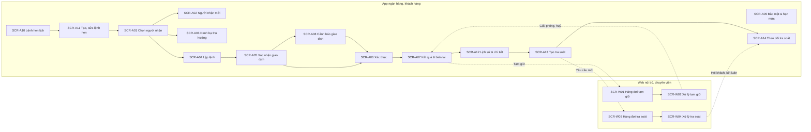

# Đề 7 · Chuyển khoản qua app ngân hàng

> **Mã:** DE07 · **Độ khó:** 7/8 · **Vai trò:** 3 (khách hàng, chuyên viên phòng chống gian lận, chuyên viên tra soát) · **Nền tảng:** App ngân hàng iOS / Android · Web nội bộ ngân hàng (desktop)

Tính năng chuyển khoản bằng số tài khoản, số thẻ trong app ngân hàng: chọn và xác minh người nhận, lập lệnh và xác thực theo mức rủi ro, cảnh báo và tạm giữ giao dịch đáng ngờ, chuyển khoản hẹn lịch và định kỳ, lịch sử và tra soát. Đây là đề có **phía khách hàng và phía nội bộ ngân hàng cùng xử lý một giao dịch**, nhiều trạng thái trung gian (tạm giữ, chờ xử lý, chưa xác định) và ràng buộc quy định. Đề gồm 5 tính năng; mỗi tính năng có 1 PRD và 1 SRS riêng.

## Tính năng

| **Mã** | **Tính năng** | **Phạm vi** | **PRD** | **SRS** |
| --- | --- | --- | --- | --- |
| TN01 | Người thụ hưởng & danh bạ | Chọn người nhận, gần đây, tài khoản của tôi, người nhận mới, gợi ý ngân hàng, tra tên, danh bạ | [PRD](docs/TN01-nguoi-thu-huong/PRD.md) | [SRS](docs/TN01-nguoi-thu-huong/SRS.md) |
| TN02 | Lập lệnh & xác thực | Số tiền, nội dung, chuyển nhanh hoặc thường, phí, hạn mức, xem lại, PIN / sinh trắc / khuôn mặt, kết quả, biên lai | [PRD](docs/TN02-lap-lenh-xac-thuc/PRD.md) | [SRS](docs/TN02-lap-lenh-xac-thuc/SRS.md) |
| TN03 | Cảnh báo & phòng chống gian lận | Chấm điểm rủi ro, màn cảnh báo, tạm giữ và gọi xác minh (web nội bộ), khoá nhanh, hạn mức tự đặt, thiết bị mới | [PRD](docs/TN03-canh-bao-gian-lan/PRD.md) | [SRS](docs/TN03-canh-bao-gian-lan/SRS.md) |
| TN04 | Chuyển khoản hẹn lịch & định kỳ | Một lần, hằng tuần, hằng tháng; nhắc trước, thử lại, chờ khách xác nhận; tạm dừng, bỏ qua, sửa, huỷ | [PRD](docs/TN04-chuyen-khoan-hen-lich/PRD.md) | [SRS](docs/TN04-chuyen-khoan-hen-lich/SRS.md) |
| TN05 | Lịch sử, tra soát & khiếu nại | Lịch sử, chi tiết, tạo và theo dõi tra soát; hàng đợi, xử lý, hỏi khách, kết luận, hoàn tiền (web nội bộ) | [PRD](docs/TN05-tra-soat-khieu-nai/PRD.md) | [SRS](docs/TN05-tra-soat-khieu-nai/SRS.md) |

Thứ tự làm gợi ý: TN01 → TN02 → TN03 → TN05 → TN04.

## Vòng đời giao dịch chuyển khoản (dùng chung cả đề)



Lệnh hẹn lịch (TN04) tạo một giao dịch theo vòng đời trên ở mỗi kỳ chạy. Giao dịch `THANH_CONG` hoặc `THAT_BAI` có thể có **yêu cầu tra soát** (TN05) với vòng đời riêng.

## Bản đồ màn hình



## Bối cảnh chung

Chuyển khoản bằng số tài khoản là giao dịch hằng ngày, nhưng cũng là kênh chính của lừa đảo: nạn nhân tự tay xác thực theo hướng dẫn của kẻ gian. Ngân hàng phải vừa giữ trải nghiệm nhanh cho đa số giao dịch bình thường, vừa tạo đủ ma sát cho giao dịch đáng ngờ, vừa tuân thủ quy định xác thực (Quyết định 2345/QĐ-NHNN), vừa có quy trình nội bộ xử lý tạm giữ và tra soát đúng hạn. Bài toán thiết kế chính là **ma sát tỉ lệ với rủi ro** và **trạng thái rõ ràng cho cả khách lẫn chuyên viên**.

| **Nhóm người dùng** | **Nhu cầu chính** |
| --- | --- |
| Khách hàng cá nhân, hộ kinh doanh | Chuyển nhanh cho người quen, khoản định kỳ; biết khi nào tiền tới; có biên lai |
| Người lớn tuổi, dễ bị lừa | Cảnh báo dễ hiểu, khoá nhanh, hạn mức thấp |
| Chuyên viên phòng chống gian lận | Hàng đợi tạm giữ theo hạn, đủ dữ liệu để gọi xác minh và quyết định |
| Chuyên viên tra soát | Hàng đợi theo mức ưu tiên, trao đổi với khách trong hệ thống, kết luận có lưu vết |

Ngoài phạm vi cả đề: mở tài khoản, đăng nhập và cài Smart OTP, đăng ký sinh trắc khuôn mặt (chỉ dẫn link), chuyển khoản QR (xem Đề 4), chuyển ngoại tệ và quốc tế, chuyển theo lô, thanh toán hoá đơn, kết nối kỹ thuật với Napas, mô hình chấm điểm rủi ro chi tiết, báo cáo quản trị.

## Quy ước dùng chung

- Màn App mã `SCR-A..`, Web nội bộ `SCR-W..`.
- Tiền tệ VND, không có số lẻ; định dạng `12.500.000 ₫`; số tiền luôn kèm cách đọc bằng chữ ở màn nhập và xác nhận.
- Ngày làm việc theo lịch ngân hàng (thứ Hai – thứ Sáu, trừ ngày lễ); mọi giờ là giờ Việt Nam (UTC+7).
- Ngưỡng xác thực, hạn mức, phí, ngưỡng rủi ro là **cấu hình**; giá trị trong tài liệu là giá trị hiện hành.
- Số tổng đài, số khẩn hiển thị dạng `{số}`.
- Mã BR, MSG, UC đánh số liên tục trong cả đề: TN01 dùng BR-01–10, MSG-01–08, UC-01–03; TN02 dùng BR-11–24, MSG-09–20, UC-04–05; TN03 dùng BR-25–37, MSG-21–32, UC-06–08; TN04 dùng BR-38–48, MSG-33–40, UC-09–11; TN05 dùng BR-49–60, MSG-41–50, UC-12–13.

## Danh sách màn hình

| **Mã** | **Màn hình** | **Nền tảng** | **Mô tả chi tiết ở** |
| --- | --- | --- | --- |
| SCR-A01 | Chọn người nhận | App | SRS TN01 |
| SCR-A02 | Người nhận mới | App | SRS TN01 |
| SCR-A03 | Danh bạ thụ hưởng | App | SRS TN01 |
| SCR-A04 | Lập lệnh chuyển tiền | App | SRS TN02 |
| SCR-A05 | Xác nhận giao dịch | App | SRS TN02 |
| SCR-A06 | Xác thực giao dịch | App | SRS TN02 |
| SCR-A07 | Kết quả & biên lai | App | SRS TN02 |
| SCR-A08 | Cảnh báo giao dịch | App | SRS TN03 |
| SCR-A09 | Bảo mật & hạn mức | App | SRS TN03 |
| SCR-W01 | Hàng đợi giao dịch tạm giữ | Web nội bộ | SRS TN03 |
| SCR-W02 | Xử lý giao dịch tạm giữ | Web nội bộ | SRS TN03 |
| SCR-A10 | Lệnh hẹn lịch | App | SRS TN04 |
| SCR-A11 | Tạo / sửa lệnh hẹn | App | SRS TN04 |
| SCR-A12 | Lịch sử & chi tiết giao dịch | App | SRS TN05 |
| SCR-A13 | Tạo yêu cầu tra soát | App | SRS TN05 |
| SCR-A14 | Theo dõi yêu cầu | App | SRS TN05 |
| SCR-W03 | Hàng đợi tra soát | Web nội bộ | SRS TN05 |
| SCR-W04 | Xử lý tra soát | Web nội bộ | SRS TN05 |

## Cấu trúc repo

```text
de07-chuyen-khoan-ngan-hang/
├── README.md
└── docs/
    ├── TN01-nguoi-thu-huong/         PRD.md · SRS.md
    ├── TN02-lap-lenh-xac-thuc/       PRD.md · SRS.md
    ├── TN03-canh-bao-gian-lan/       PRD.md · SRS.md
    ├── TN04-chuyen-khoan-hen-lich/   PRD.md · SRS.md
    └── TN05-tra-soat-khieu-nai/      PRD.md · SRS.md
```

## Cách dùng bộ tài liệu

1. Đọc README để nắm vòng đời giao dịch: mọi tính năng đều bám theo sơ đồ trạng thái ở trên.
2. Với mỗi tính năng: đọc PRD, rồi SRS. Với TN03 và TN05, thiết kế **cả App và Web nội bộ**: khách thấy gì, chuyên viên thấy gì ở cùng một thời điểm.
3. Đặc biệt chú ý các trạng thái trung gian (`TAM_GIU`, `DA_TIEP_NHAN`, `CHUA_XAC_DINH`, `CHO_BO_SUNG`): mỗi trạng thái phải nói rõ cho khách tiền đang ở đâu và họ cần làm gì.
4. Thiết kế màn hình theo đúng mã SCR, mã MSG trong SRS để dễ đối chiếu khi review.
5. Sơ đồ viết bằng Mermaid, xem trực tiếp trên GitHub hoặc trình xem Markdown có hỗ trợ Mermaid.
