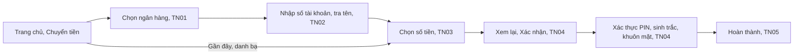
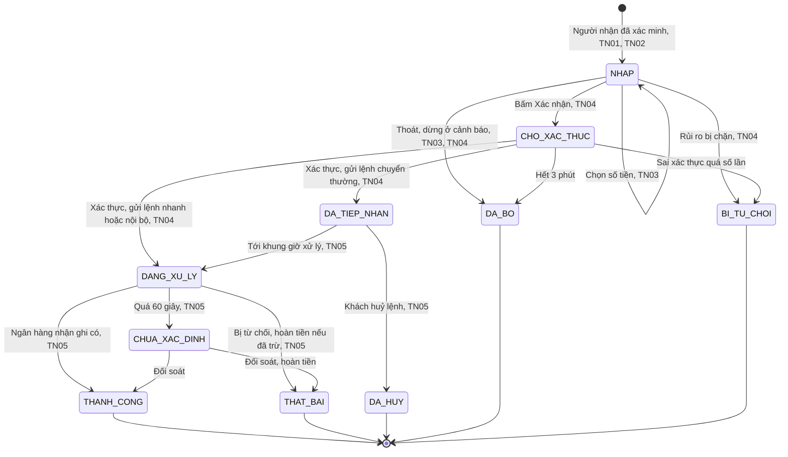
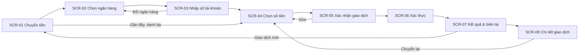

# Đề 7 · Chuyển khoản qua app ngân hàng

> **Mã:** DE07 · **Độ khó:** 7/8 · **Vai trò:** 1 (khách hàng chuyển tiền) · **Nền tảng:** App ngân hàng iOS / Android

Tính năng chuyển khoản bằng số tài khoản hoặc số thẻ trong app ngân hàng, theo đúng các bước người dùng làm: **chọn ngân hàng → nhập số tài khoản → chọn số tiền → xác thực và xác nhận chuyển khoản → hoàn thành chuyển khoản**. Đề khó hơn Đề 4 vì có nhiều ngân hàng nhận, tra tên liên ngân hàng, hai hình thức chuyển (nhanh 24/7 và thường), phí, hạn mức, cảnh báo lừa đảo và nhiều trạng thái kết quả (đã tiếp nhận, chưa xác định). Đề gồm 5 tính năng, mỗi bước là một tính năng; mỗi tính năng có 1 PRD và 1 SRS riêng.

## Tính năng

| **Mã** | **Bước** | **Phạm vi** | **PRD** | **SRS** |
| --- | --- | --- | --- | --- |
| TN01 | Chọn ngân hàng | Màn chuyển tiền, đi tắt từ gần đây, danh bạ, tài khoản của tôi; danh sách ngân hàng, hay dùng, tìm, trạng thái bảo trì | [PRD](docs/TN01-chon-ngan-hang/PRD.md) | [SRS](docs/TN01-chon-ngan-hang/SRS.md) |
| TN02 | Nhập số tài khoản | Số tài khoản hoặc số thẻ, dán, tra tên chủ tài khoản, thẻ không khớp ngân hàng, cảnh báo tài khoản | [PRD](docs/TN02-nhap-so-tai-khoan/PRD.md) | [SRS](docs/TN02-nhap-so-tai-khoan/SRS.md) |
| TN03 | Chọn số tiền | Số tiền bằng chữ, nội dung, tài khoản nguồn, chuyển nhanh hoặc thường, phí, thời gian tới, hạn mức | [PRD](docs/TN03-chon-so-tien/PRD.md) | [SRS](docs/TN03-chon-so-tien/SRS.md) |
| TN04 | Xác thực & xác nhận chuyển khoản | Xem lại, xác nhận, cảnh báo lừa đảo và chuyển trùng, PIN / sinh trắc / khuôn mặt, gửi lệnh | [PRD](docs/TN04-xac-thuc-xac-nhan/PRD.md) | [SRS](docs/TN04-xac-thuc-xac-nhan/SRS.md) |
| TN05 | Hoàn thành chuyển khoản | Đang xử lý, thành công, đã tiếp nhận, thất bại, chưa xác định, huỷ lệnh chuyển thường, biên lai, lưu danh bạ, chi tiết | [PRD](docs/TN05-hoan-thanh-chuyen-khoan/PRD.md) | [SRS](docs/TN05-hoan-thanh-chuyen-khoan/SRS.md) |

Thứ tự làm: TN01 → TN02 → TN03 → TN04 → TN05, đúng thứ tự các bước của luồng.

## Luồng chuyển khoản



Người nhận quen (Gần đây, Danh bạ) và tài khoản của chính khách đi tắt từ màn chuyển tiền tới bước chọn số tiền (TN01 BR-07, BR-08).

## Vòng đời giao dịch (dùng chung cả đề)



## Bản đồ màn hình



## Bối cảnh chung

Chuyển khoản bằng số tài khoản dùng cho khoản lớn và quan trọng: tiền nhà, học phí, tiền hàng, tiền cọc. Khách cần chọn đúng ngân hàng, nhập đúng số tài khoản, thấy tên người nhận thật, nhập đúng số tiền, biết phí và **biết khi nào tiền tới**. Đây cũng là kênh chính của lừa đảo, khi nạn nhân tự tay xác thực theo hướng dẫn của kẻ gian. Bài toán thiết kế chính là giữ mỗi bước rõ ràng, khó nhầm, cảnh báo đúng lúc, và tuân thủ quy định xác thực của Ngân hàng Nhà nước.

| **Nhóm người dùng** | **Nhu cầu chính** |
| --- | --- |
| Người chuyển định kỳ (tiền nhà, học phí) | Đi tắt người nhận quen, biên lai gửi người nhận |
| Chủ hộ kinh doanh | Chuyển khoản lớn, biết hình thức, phí, thời gian tới |
| Người nhận số tài khoản qua tin nhắn | Dán số, thấy tên người nhận ngay |
| Người lớn tuổi, dễ bị lừa | Chữ to, số tiền bằng chữ, cảnh báo rõ |

Ngoài phạm vi cả đề: mở tài khoản, đăng nhập và cài Smart OTP, đăng ký sinh trắc khuôn mặt (chỉ dẫn link), chuyển khoản QR (xem Đề 4), ví điện tử, số điện thoại, ngoại tệ và quốc tế, hẹn lịch và định kỳ, chuyển theo lô, lịch sử giao dịch đầy đủ, tra soát, quản lý danh bạ, đổi hạn mức.

## Quy ước dùng chung

- Tiền tệ VND, không có số lẻ; định dạng `12.500.000 ₫`; số tiền luôn kèm cách đọc bằng chữ ở màn nhập và xác nhận.
- Ngày làm việc theo lịch ngân hàng (thứ Hai – thứ Sáu, trừ ngày lễ); mọi giờ là giờ Việt Nam.
- Ngưỡng xác thực, hạn mức, phí là **cấu hình**; giá trị trong tài liệu là giá trị hiện hành (ngưỡng xác thực theo Quyết định 2345/QĐ-NHNN).
- Số tổng đài hiển thị dạng `{số}`.
- Mã BR, MSG, UC đánh số liên tục trong cả đề: TN01 dùng BR-01–08, MSG-01–05, UC-01–02; TN02 dùng BR-09–17, MSG-06–12, UC-03; TN03 dùng BR-18–28, MSG-13–20, UC-04; TN04 dùng BR-29–38, MSG-21–30, UC-05–06; TN05 dùng BR-39–48, MSG-31–39, UC-07–08.

## Danh sách màn hình

| **Mã** | **Màn hình** | **Bước** | **Mô tả chi tiết ở** |
| --- | --- | --- | --- |
| SCR-01 | Chuyển tiền (bắt đầu) | Chọn ngân hàng | SRS TN01 |
| SCR-02 | Chọn ngân hàng | Chọn ngân hàng | SRS TN01 |
| SCR-03 | Nhập số tài khoản | Nhập số tài khoản | SRS TN02 |
| SCR-04 | Chọn số tiền | Chọn số tiền | SRS TN03 |
| SCR-05 | Xác nhận giao dịch (gồm màn cảnh báo) | Xác thực & xác nhận | SRS TN04 |
| SCR-06 | Xác thực giao dịch | Xác thực & xác nhận | SRS TN04 |
| SCR-07 | Kết quả & biên lai | Hoàn thành | SRS TN05 |
| SCR-08 | Chi tiết giao dịch | Hoàn thành | SRS TN05 |

## Cấu trúc repo

```text
de07-chuyen-khoan-ngan-hang/
├── README.md
└── docs/
    ├── TN01-chon-ngan-hang/            PRD.md · SRS.md
    ├── TN02-nhap-so-tai-khoan/         PRD.md · SRS.md
    ├── TN03-chon-so-tien/              PRD.md · SRS.md
    ├── TN04-xac-thuc-xac-nhan/         PRD.md · SRS.md
    └── TN05-hoan-thanh-chuyen-khoan/   PRD.md · SRS.md
```

## Cách dùng bộ tài liệu

1. Đọc README để nắm luồng 5 bước và vòng đời giao dịch.
2. Với mỗi bước: đọc PRD, rồi SRS. Thiết kế đủ trạng thái lỗi của từng bước (ngân hàng bảo trì, không tìm thấy tài khoản, thiếu số dư, chỉ chuyển thường, cảnh báo, sai PIN, đã tiếp nhận, chưa xác định).
3. Ghép các màn thành một prototype liền mạch từ **SCR-01** tới **SCR-07**, cả luồng người nhận mới và luồng đi tắt.
4. Thiết kế màn hình theo đúng mã SCR, mã MSG trong SRS để dễ đối chiếu khi review.
5. Sơ đồ viết bằng Mermaid, xem trực tiếp trên GitHub hoặc trình xem Markdown có hỗ trợ Mermaid.
