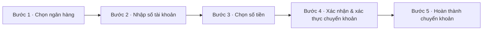
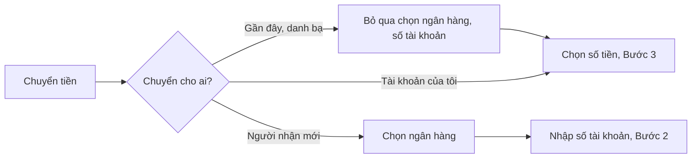
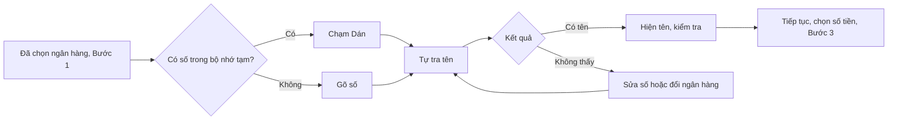
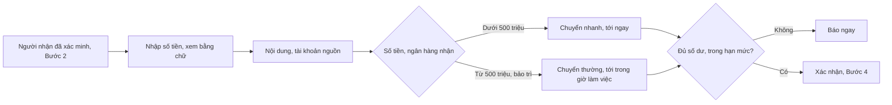
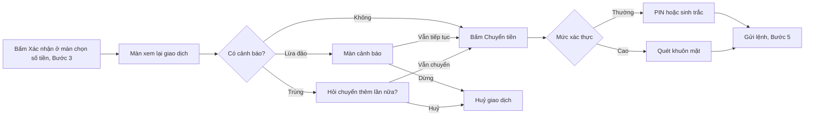
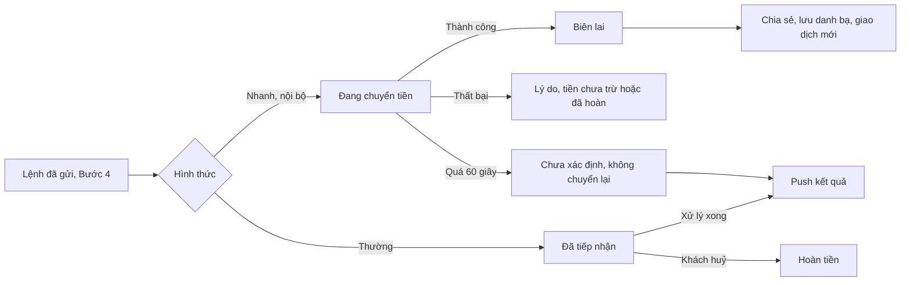

> **Mã:** DE07-PRD · **Trạng thái:** đã chốt · **Người viết:** Design · **SRS:** [SRS.md](SRS.md)

# PRD Chuyển khoản qua app ngân hàng

> Đề gồm **1 tính năng**, là **1 luồng** gồm 5 bước và các màn hình: Chọn ngân hàng → Nhập số tài khoản → Chọn số tiền → Xác nhận & xác thực chuyển khoản → Hoàn thành chuyển khoản. Sơ đồ chung xem [README](../README.md).

## 1. Bối cảnh và vấn đề

### 1.1 Bối cảnh

Tính năng chuyển khoản bằng số tài khoản hoặc số thẻ trong app ngân hàng, theo đúng các bước người dùng làm: **chọn ngân hàng → nhập số tài khoản → chọn số tiền → xác nhận, xem lại và xác thực chuyển khoản → hoàn thành chuyển khoản**. Đề khó hơn Đề 4 vì có nhiều ngân hàng nhận, tra tên liên ngân hàng, hai hình thức chuyển (nhanh 24/7 và thường), phí, hạn mức, cảnh báo lừa đảo và nhiều trạng thái kết quả (đã tiếp nhận, chưa xác định).

Chuyển khoản bằng số tài khoản dùng cho khoản lớn và quan trọng: tiền nhà, học phí, tiền hàng, tiền cọc. Khách cần chọn đúng ngân hàng, nhập đúng số tài khoản, thấy tên người nhận thật, nhập đúng số tiền, biết phí và **biết khi nào tiền tới**. Đây cũng là kênh chính của lừa đảo, khi nạn nhân tự tay xác thực theo hướng dẫn của kẻ gian. Bài toán thiết kế chính là giữ mỗi bước rõ ràng, khó nhầm, cảnh báo đúng lúc, và tuân thủ quy định xác thực của Ngân hàng Nhà nước.

### 1.2 Vấn đề

| **Vấn đề** | **Hệ quả** |
| --- | --- |
| Danh sách 50 ngân hàng xếp theo bảng chữ cái, cuộn mãi | Chọn chậm, chọn nhầm |
| Chỉ nhớ tên viết tắt, ô tìm chỉ tìm tên đầy đủ | Không tìm thấy ngân hàng |
| Ngân hàng nhận đang bảo trì nhưng chỉ biết sau khi chuyển | Giao dịch lỗi, khách bực |
| Chuyển cho người quen mà vẫn phải chọn lại ngân hàng, gõ lại số tài khoản | Mất thời gian, dễ sai |
| Chuyển giữa các tài khoản của chính mình cũng phải đi đủ các bước | Bất tiện |
| Gõ dãy số dài, nhầm một số | Tra ra tên người khác, có thể chuyển nhầm |
| Dán số kèm khoảng trắng, dấu chấm | Báo lỗi định dạng khó hiểu |
| Nhập số thẻ nhưng đã chọn sai ngân hàng | Tra tên thất bại, không biết vì sao |
| Tên chủ tài khoản hiện nhỏ, dễ bỏ qua | Không phát hiện nhầm người |
| Người nhận bị báo cáo lừa đảo nhưng app không nói gì | Mất tiền |
| Gõ thừa, thiếu số 0 | Chuyển sai số tiền |
| Không biết tiền tới ngay hay ngày mai | Người nhận hỏi liên tục, trễ hạn thanh toán |
| Khoản lớn bị từ chối chuyển nhanh, không giải thích | Khách tưởng app lỗi |
| Nội dung bị cắt, mất dấu | Người nhận không đối chiếu được |
| Biết thiếu tiền, vượt hạn mức ở bước cuối | Phải quay lại từ đầu |
| Không có bước xem lại, sai một số mới phát hiện | Chuyển nhầm, khó đòi lại |
| Không rõ khi nào phải quét khuôn mặt | Người dùng bất ngờ, tưởng app lỗi, bỏ dở |
| Bị kẻ gian gọi điện hướng dẫn chuyển tiền | Mất tiền |
| Vừa chuyển xong lại chuyển thêm lần nữa vì tưởng chưa đi | Chuyển trùng |
| Nhập sai PIN nhiều lần không biết còn bao nhiêu lần | Bị khoá Smart OTP bất ngờ |
| Màn "Đang xử lý" quay mãi | Khách chuyển lại, bị trừ tiền hai lần |
| Chuyển thường chỉ báo "Thành công" khi tiền chưa tới | Người nhận nói chưa nhận được, khách hoang mang |
| Thất bại nhưng không biết tiền đã bị trừ chưa | Gọi tổng đài |
| Muốn gửi bằng chứng phải chụp màn hình | Lộ số dư |
| Người nhận mới phải nhập lại lần sau | Mất thời gian |

### 1.3 Mục tiêu

- Thời gian chọn ngân hàng ≤ 5 giây (trung vị).
- ≥ 70% lần chọn ngân hàng nằm trong 5 ngân hàng hay dùng hoặc tìm kiếm (không cuộn danh sách).
- ≥ 50% lệnh chuyển bắt đầu bằng đi tắt từ Gần đây hoặc Danh bạ.
- Thời gian từ khi vào màn tới khi có tên người nhận ≤ 12 giây (trung vị).
- Tỉ lệ tra tên thất bại do sai định dạng ≤ 3%.
- 100% người nhận mới được tra tên trước khi sang bước chọn số tiền.
- Khiếu nại chuyển sai số tiền giảm 40%.
- 100% lệnh hiện thời gian tiền tới dự kiến trước khi xác nhận.
- Thời gian ở bước chọn số tiền ≤ 20 giây (trung vị).
- Thời gian từ màn xem lại tới gửi lệnh ≤ 7 giây (trung vị) với giao dịch dưới ngưỡng khuôn mặt.
- ≥ 30% giao dịch gặp cảnh báo lừa đảo được khách tự dừng.
- Tỉ lệ bỏ dở ở bước xác thực khuôn mặt ≤ 10%.
- ≥ 99% giao dịch chuyển nhanh, trong ngân hàng có kết quả cuối trong 60 giây.
- Giao dịch chuyển trùng do "Đang xử lý" lâu giảm 70%.
- ≥ 40% người nhận mới được lưu danh bạ sau khi chuyển thành công.

## 2. Người dùng

| **Nhóm** | **Nhu cầu với tính năng này** |
| --- | --- |
| Người chuyển định kỳ (tiền nhà, học phí) | Chạm người nhận quen là xong bước này |
| Người chuyển cho người mới | Tìm ngân hàng bằng tên viết tắt |
| Người có nhiều tài khoản | Chuyển giữa tài khoản của mình nhanh; Chọn tài khoản nguồn, thấy số dư |
| Người lớn tuổi | Logo ngân hàng to, dễ nhận ra; Tên người nhận to, rõ; Số tiền bằng chữ, rõ ràng; Xem lại rõ ràng, chữ to |
| Người nhận số qua tin nhắn | Dán vào là xong |
| Người gõ tay | Thấy số theo nhóm dễ đối chiếu |
| Người có thể bị lừa | Biết ngay nếu tài khoản bị báo cáo; Được cảnh báo đủ mạnh để dừng lại |
| Người trả tiền nhà, học phí | Nội dung đúng mẫu người nhận yêu cầu |
| Chủ hộ kinh doanh | Chuyển khoản lớn, biết tiền tới khi nào, biết phí |
| Người chuyển tiền nhà, học phí | Xem lại kỹ, xác nhận, sinh trắc vân tay hoặc Face ID; Biên lai rõ ràng gửi chủ nhà, nhà trường |
| Người chuyển số tiền lớn | Biết trước phải quét khuôn mặt, được hướng dẫn |
| Chủ hộ kinh doanh chuyển khoản lớn | Biết lệnh chuyển thường đã tiếp nhận, bao giờ tới; huỷ được nếu cần |
| Người gặp lỗi | Biết tiền ở đâu, phải làm gì |
| Người chuyển định kỳ cho cùng người | Lưu danh bạ, chuyển lại nhanh |

## 3. Phạm vi

### 3.1 Trong phạm vi (MVP)

**Bước 1 · Chọn ngân hàng**

- Màn bắt đầu chuyển tiền: Người nhận mới (chọn ngân hàng), Gần đây, Danh bạ, Tài khoản của tôi.
- Danh sách ngân hàng: logo, tên viết tắt, tên đầy đủ; 5 ngân hàng hay dùng ở đầu; ngân hàng của mình được ghim.
- Tìm ngân hàng theo tên viết tắt, tên đầy đủ, không dấu.
- Trạng thái ngân hàng: đang bảo trì chuyển nhanh.

**Bước 2 · Nhập số tài khoản**

- Nhập số tài khoản hoặc số thẻ; tự nhận ra số thẻ.
- Dán từ bộ nhớ tạm, tự làm sạch.
- Tra tên chủ tài khoản tại ngân hàng nhận; hiện tên to, rõ.
- Báo không tìm thấy, lỗi tra tên, số thẻ không khớp ngân hàng.
- Gợi ý người nhận đã lưu khi số trùng danh bạ.
- Cảnh báo tài khoản bị báo cáo lừa đảo.

**Bước 3 · Chọn số tiền**

- Nhập số tiền; bằng chữ; gợi ý nhanh.
- Nội dung chuyển khoản.
- Tài khoản nguồn, số dư khả dụng.
- Hình thức: trong ngân hàng, chuyển nhanh 24/7, chuyển thường; phí; thời gian tới dự kiến.
- Kiểm tra số dư, hạn mức ngay khi nhập.

**Bước 4 · Xác nhận & xác thực chuyển khoản**

- Màn xem lại: người nhận, số tiền và bằng chữ, nội dung, tài khoản nguồn, hình thức chuyển, thời gian tới, phí, tổng trừ, cách xác thực sẽ dùng.
- Cảnh báo người nhận đáng ngờ, giao dịch bất thường; cảnh báo chuyển trùng.
- Xác thực theo mức: PIN Smart OTP hoặc sinh trắc thiết bị; sinh trắc khuôn mặt khi vượt ngưỡng hoặc thiết bị mới.
- Giới hạn số lần sai, thời gian chờ xác thực.
- Gửi lệnh chuyển tiền an toàn (không gửi trùng).

**Bước 5 · Hoàn thành chuyển khoản**

- Màn đang xử lý; kết quả: thành công, đã tiếp nhận (chuyển thường), thất bại, chưa xác định.
- Đối soát tự động; thông báo khi có kết quả cuối.
- Huỷ lệnh chuyển thường chưa xử lý.
- Biên lai; chia sẻ dạng ảnh hoặc PDF.
- Lưu người nhận vào danh bạ; chuyển lại; giao dịch mới.
- Chi tiết giao dịch.

### 3.2 Ngoài phạm vi

- Chuyển tới ví điện tử, số điện thoại, ngân hàng nước ngoài.
- Quản lý danh bạ (sửa, xoá) – tính năng sẵn có của app.
- Đoán ngân hàng từ số tài khoản → phase sau.
- Quét ảnh, chụp số tài khoản (OCR) → phase sau.
- Chuyển tới số điện thoại, ví.
- Ngoại tệ, chuyển quốc tế.
- Hẹn lịch, định kỳ, chuyển theo lô.
- Đổi hạn mức (dẫn link tới cài đặt sẵn có).
- Đăng ký, cài Smart OTP, đăng ký sinh trắc khuôn mặt (chỉ dẫn link).
- Tạm giữ giao dịch để nhân viên gọi xác minh.
- Lịch sử giao dịch đầy đủ, tìm kiếm (tính năng sẵn có của app).
- Tra soát, khiếu nại (dẫn tới kênh hỗ trợ sẵn có).
- Hẹn lịch, định kỳ.

## 4. Nguyên tắc sản phẩm

### 4.1 Người quen đi tắt

Màn bắt đầu cho thấy Gần đây và Danh bạ trước; chạm là bỏ qua bước chọn ngân hàng và nhập số tài khoản.

### 4.2 Tìm theo cách người dùng gọi

"VCB", "vietcom", "ngoai thuong" đều ra cùng một ngân hàng.

### 4.3 Báo trước khi có sự cố

Ngân hàng đang bảo trì được ghi nhãn ngay trong danh sách.

### 4.4 Tên người nhận là bằng chứng

Không có tên tra được thì không đi tiếp. Tên hiện to nhất màn, ngay dưới số tài khoản.

### 4.5 Ít gõ, ít lỗi

Dán một chạm, tự bỏ khoảng trắng, tự nhận số thẻ, tự tra khi gõ xong.

### 4.6 Cảnh báo sớm

Tài khoản bị báo cáo được cảnh báo ngay khi có tên, trước khi khách nhập tiền.

### 4.7 Số tiền phải đọc được hai lần

Số lớn và bằng chữ luôn đi cùng nhau.

### 4.8 Nói rõ khi nào tiền tới

Mỗi hình thức chuyển hiện thời gian tới; khoản lớn, ngân hàng bảo trì, ngoài giờ đều được giải thích.

### 4.9 Báo lỗi trước khi bấm

Thiếu tiền, vượt hạn mức báo ngay khi nhập.

### 4.10 Xác nhận rồi xem lại, sau đó mới xác thực

Bấm "Xác nhận" ở màn chọn số tiền xong mới hiện màn xem lại. Màn xem lại là một bước riêng, đọc từ trên xuống; bấm "Chuyển tiền" ở màn này mới sang xác thực.

### 4.11 Nói trước khi đòi

Nếu cần quét khuôn mặt, màn xem lại báo trước, kèm lý do.

### 4.12 Cảnh báo phải làm người dùng dừng lại

Cảnh báo lừa đảo là màn riêng, có thời gian chờ ngắn; nút chính là "Dừng giao dịch".

### 4.13 Mỗi kết quả nói rõ tiền đang ở đâu

Thành công, đã tiếp nhận, thất bại, chưa xác định: mỗi trạng thái kèm một câu về tiền và việc khách nên làm.

### 4.14 "Đã tiếp nhận" không phải "Thành công"

Chuyển thường hiện trạng thái riêng với thời gian tiền tới dự kiến; chỉ báo thành công khi ngân hàng nhận đã ghi có.

### 4.15 Chưa rõ thì đừng chuyển lại

Khi chưa xác định, app nói thẳng "Vui lòng không chuyển lại".

## 5. Quy tắc nghiệp vụ

| **Quy tắc** | **Giá trị** |
| --- | --- |
| Danh sách ngân hàng | Mọi ngân hàng thành viên Napas nhận chuyển khoản |
| Hay dùng | 5 ngân hàng khách chuyển thành công nhiều nhất trong 90 ngày |
| Gần đây | 10 người nhận gần nhất, không trùng |
| Danh bạ | Tối đa 200 người nhận đã lưu |
| Tìm kiếm | Tên viết tắt, tên đầy đủ, từ khoá phổ biến; không dấu |
| Số tài khoản | 6–19 chữ số |
| Số thẻ | 16 hoặc 19 chữ số, thẻ nội địa thành viên Napas |
| Tra tên | Tự động sau khi ngừng gõ 0,8 giây với độ dài hợp lệ; kết quả hiệu lực 10 phút |
| Giới hạn tra tên | 30 lần người nhận mới mỗi giờ |
| Tên hiển thị | Tên chủ tài khoản do ngân hàng nhận trả về, in hoa không dấu |
| Số tiền tối thiểu | 1.000 ₫ |
| Chuyển nhanh 24/7 | Liên ngân hàng qua Napas, mỗi giao dịch < 500.000.000 ₫, tới trong vài giây |
| Chuyển thường | Liên ngân hàng, mọi số tiền; xử lý 08:00–16:00 ngày làm việc; bắt buộc khi ≥ 500.000.000 ₫ hoặc ngân hàng nhận bảo trì chuyển nhanh; "Đã tiếp nhận" → xử lý 08:00–16:00 ngày làm việc → thành công hoặc thất bại |
| Trong ngân hàng | Tức thì 24/7 |
| Hạn mức mặc định | 500.000.000 ₫/giao dịch, 1.000.000.000 ₫/ngày |
| Phí | Trong ngân hàng, chuyển nhanh: 0 ₫; chuyển thường: 0,02%, tối thiểu 10.000 ₫, tối đa 500.000 ₫ |
| Nội dung | 1–160 ký tự; liên ngân hàng tự bỏ dấu |
| Xác thực thường | Mã PIN Smart OTP 6 số, hoặc sinh trắc thiết bị nếu đã bật |
| Xác thực khuôn mặt | Giao dịch > 10.000.000 ₫, hoặc tổng trong ngày > 20.000.000 ₫, hoặc giao dịch đầu tiên trên thiết bị mới |
| Thời gian xác thực | 3 phút |
| Sai PIN | 5 lần liên tiếp → khoá Smart OTP |
| Khuôn mặt thất bại | 3 lần liên tiếp → tạm khoá 15 phút |
| Cảnh báo trùng | Cùng người nhận, cùng số tiền trong 5 phút |
| Màn cảnh báo | Chờ 5 giây và tích ô xác nhận mới tiếp tục được |
| Chờ kết quả | 60 giây với trong ngân hàng, chuyển nhanh; quá thì "Chưa xác định" |
| Huỷ lệnh chuyển thường | Khi chưa vào xử lý; hoàn số tiền và phí ngay |
| Đối soát | Có kết quả trong tối đa 1 ngày làm việc |
| Thất bại đã trừ tiền | Hoàn tự động về tài khoản nguồn |

- Hạn mức, phí là **cấu hình**.
- Ngưỡng là **cấu hình** theo quy định Ngân hàng Nhà nước.

## 6. Luồng trải nghiệm

### 6.1 Toàn bộ luồng

### 6.2 Bước 1 · Chọn ngân hàng

| **Bước** | **Giai đoạn** | **Trải nghiệm** | **Đầu ra** |
| --- | --- | --- | --- |
| 1 | Mở chuyển tiền | Gần đây, Danh bạ, Tài khoản của tôi, Người nhận mới | Hướng đi |
| 2 | Chọn ngân hàng | Hay dùng ở đầu, ô tìm, danh sách logo | Ngân hàng nhận |
| 3 | Tiếp | Sang nhập số tài khoản | – |

### 6.3 Bước 2 · Nhập số tài khoản

| **Bước** | **Giai đoạn** | **Trải nghiệm** | **Đầu ra** |
| --- | --- | --- | --- |
| 1 | Nhập | Dán hoặc gõ; số chia nhóm 4 | Số tài khoản |
| 2 | Tra tên | Tự động, có vòng chờ nhỏ | Tên chủ tài khoản |
| 3 | Kiểm tra | Tên to, cảnh báo nếu có | Người nhận đã xác minh |
| 4 | Tiếp tục | Sang chọn số tiền | – |

### 6.4 Bước 3 · Chọn số tiền

| **Bước** | **Giai đoạn** | **Trải nghiệm** | **Đầu ra** |
| --- | --- | --- | --- |
| 1 | Số tiền | Bàn phím số, bằng chữ, gợi ý | Số tiền |
| 2 | Nội dung, nguồn | Nội dung mặc định, tài khoản, số dư | Lệnh nháp |
| 3 | Hình thức | Nhanh hoặc thường, phí, thời gian tới | Khách biết khi nào tiền tới |
| 4 | Xác nhận | Kiểm tra số dư, hạn mức | Bấm Xác nhận, sang màn xem lại |

### 6.5 Bước 4 · Xác nhận & xác thực chuyển khoản

| **Bước** | **Giai đoạn** | **Trải nghiệm** | **Đầu ra** |
| --- | --- | --- | --- |
| 1 | Xem lại | Toàn bộ thông tin, cách xác thực | Người dùng chắc chắn |
| 2 | Cảnh báo (nếu có) | Màn cảnh báo, thời gian chờ | Dừng hoặc tiếp tục có ý thức |
| 3 | Chuyển tiền | Bấm "Chuyển tiền" trên màn xem lại | Lệnh chờ xác thực |
| 4 | Xác thực | PIN, sinh trắc, khuôn mặt | Lệnh được ký, gửi đi |

### 6.6 Bước 5 · Hoàn thành chuyển khoản

| **Bước** | **Giai đoạn** | **Trải nghiệm** | **Đầu ra** |
| --- | --- | --- | --- |
| 1 | Chờ | "Đang chuyển tiền…" hoặc "Đã tiếp nhận" | – |
| 2 | Kết quả | Biểu tượng lớn, số tiền, người nhận, giờ, mã | Khách yên tâm |
| 3 | Sau đó | Chia sẻ biên lai, lưu danh bạ | Bằng chứng, lần sau nhanh hơn |
| 4 | Ngoại lệ | Push khi có kết quả cuối; huỷ lệnh chuyển thường | Biết chắc tiền đi hay hoàn |

## 7. Use Cases, User Stories và Acceptance Criteria

### Bước 1 · Chọn ngân hàng

#### UC1. Bắt đầu chuyển tiền

##### US1.1 Chuyển cho người quen

User Story: Là người trả tiền nhà hằng tháng, tôi muốn chạm vào "Chủ trọ" để chuyển ngay.

AC01: Màn bắt đầu: nút "Người nhận mới", Gần đây (cuộn ngang), Danh bạ (A–Z), Tài khoản của tôi (khi có ≥ 2 tài khoản).

AC02: Chạm người nhận quen → tra lại tên rồi sang chọn số tiền.

AC03: Ô tìm lọc danh bạ, gần đây theo tên, số tài khoản.

#### UC2. Chọn ngân hàng

##### US2.1 Chọn nhanh

User Story: Là người chuyển cho người mới, tôi muốn gõ "tcb" là thấy ngân hàng.

AC01: 5 ngân hàng hay dùng ở đầu; ngân hàng của mình ghim trên cùng.

AC02: Ô tìm nhận tên viết tắt, tên đầy đủ, không dấu; kết quả hiện ngay khi gõ.

AC03: Mỗi ngân hàng có logo, tên viết tắt, tên đầy đủ.

##### US2.2 Biết ngân hàng đang bảo trì

AC01: Ngân hàng đang bảo trì chuyển nhanh có nhãn "Đang bảo trì"; vẫn chọn được, sẽ chuyển thường (Bước 3).

AC02: Ngân hàng tạm dừng nhận mọi chuyển khoản → không chọn được, ghi lý do.

### Bước 2 · Nhập số tài khoản

#### UC3. Nhập và tra tên

##### US3.1 Dán số tài khoản

User Story: Là người nhận số qua tin nhắn, tôi muốn dán vào và thấy ngay tên người nhận.

AC01: Bộ nhớ tạm có dãy số hợp lệ → chip "Dán {số che giữa}".

AC02: Dán xong tự bỏ khoảng trắng, dấu chấm, gạch ngang; tự tra tên.

##### US3.2 Gõ tay

AC01: Bàn phím số; số hiện theo nhóm 4 chữ số.

AC02: Ngừng gõ 0,8 giây với độ dài hợp lệ → tự tra tên; hoặc bấm "Tiếp tục".

AC03: Nhập 16 hoặc 19 số hợp lệ của thẻ → nhận là số thẻ; thẻ không thuộc ngân hàng đã chọn → báo và gợi ý ngân hàng đúng.

##### US3.3 Thấy tên người nhận

AC01: Có tên → tên in đậm cỡ lớn, dấu tích; nút Tiếp tục bật.

AC02: Không tìm thấy → báo kiểm tra lại số và ngân hàng, nút "Đổi ngân hàng".

AC03: Lỗi tra tên → nút Thử lại.

AC04: Số trùng người trong danh bạ → hiện "Đã lưu: {tên gợi nhớ}".

#### UC4. Cảnh báo

AC01: Tài khoản bị báo cáo lừa đảo → banner đỏ dưới tên; vẫn tiếp tục được, cảnh báo toàn trang ở bước xác nhận (Bước 4).

AC02: Nhập số tài khoản của chính mình → báo và chuyển sang chuyển giữa tài khoản của tôi.

### Bước 3 · Chọn số tiền

#### UC5. Chọn số tiền

##### US5.1 Nhập không nhầm

AC01: Số tiền tự định dạng, hiện bằng chữ; gợi ý nhanh nhân 1.000, 10.000, 100.000.

AC02: Dưới 1.000 ₫, thiếu số dư, vượt hạn mức → báo ngay, nút Xác nhận tắt.

##### US5.2 Nội dung, nguồn

AC01: Nội dung mặc định "{TÊN} chuyen tien"; đếm ký tự; ghi chú sẽ bỏ dấu khi liên ngân hàng.

AC02: Chọn tài khoản nguồn; hiện số dư khả dụng.

##### US5.3 Biết khi nào tiền tới

User Story: Là chủ hộ kinh doanh, tôi muốn biết khoản 600 triệu sẽ tới khi nào.

AC01: Dưới 500 triệu, liên ngân hàng → mặc định Chuyển nhanh; đổi sang Chuyển thường được.

AC02: Từ 500 triệu → chỉ Chuyển thường, ghi lý do.

AC03: Ngân hàng nhận bảo trì chuyển nhanh → chỉ Chuyển thường, ghi lý do.

AC04: Mỗi hình thức hiện phí và thời gian tới ("Ngay lập tức", "Trong ngày làm việc hôm nay", "Từ 08:00 thứ Hai 23/11").

AC05: Chuyển trong ngân hàng → không có lựa chọn hình thức, ghi "Ngay lập tức · Miễn phí".

### Bước 4 · Xác nhận & xác thực chuyển khoản

#### UC6. Xem lại giao dịch

##### US6.1 Xem lại trước khi chuyển

User Story: Là khách, tôi muốn xem lại người nhận và số tiền trước khi xác thực để sửa kịp nếu sai.

AC01: Màn xem lại hiện: số tiền lớn và bằng chữ, tên người nhận, ngân hàng, số tài khoản, nội dung, hình thức chuyển và thời gian tới, tài khoản nguồn, phí, tổng trừ.

AC02: Có dòng "Xác thực bằng {PIN / sinh trắc / khuôn mặt}".

AC03: Nút "Sửa" quay lại chọn số tiền, giữ dữ liệu.

##### US6.2 Được cảnh báo

AC01: Người nhận bị báo cáo lừa đảo hoặc giao dịch bất thường → màn cảnh báo toàn trang, nút chính "Dừng giao dịch"; "Tiếp tục" bật sau 5 giây và khi đã tích ô.

AC02: Vừa chuyển cùng người, cùng số tiền trong 5 phút → hỏi lại.

#### UC7. Xác thực

##### US7.1 Xác thực nhanh

AC01: Đã bật sinh trắc thiết bị → hỏi vân tay hoặc Face ID ngay khi bấm Chuyển tiền.

AC02: Sinh trắc thất bại hoặc huỷ → nhập PIN 6 số.

AC03: Sai PIN → báo số lần còn lại; sai 5 lần → khoá Smart OTP, hướng dẫn mở khoá.

##### US7.2 Xác thực khuôn mặt

AC01: Hướng dẫn trước khi mở camera (nhìn thẳng, đủ sáng, bỏ khẩu trang).

AC02: Thất bại → cho thử lại; 3 lần → tạm khoá 15 phút.

AC03: Chưa đăng ký khuôn mặt → báo ngay ở màn xem lại, dẫn tới đăng ký, không cho chuyển.

##### US7.3 Không gửi trùng

AC01: Mạng chập chờn, bấm lại nhiều lần → chỉ một lệnh được gửi.

### Bước 5 · Hoàn thành chuyển khoản

#### UC8. Nhận kết quả

##### US8.1 Thành công

AC01: Dấu tích lớn, "Chuyển tiền thành công", số tiền, tên người nhận, ngân hàng, thời gian tới giây, mã giao dịch; không có số dư.

##### US8.2 Đã tiếp nhận (chuyển thường)

User Story: Là chủ hộ kinh doanh, tôi muốn biết lệnh 600 triệu đã được ngân hàng nhận và bao giờ tiền tới.

AC01: "Lệnh đã được tiếp nhận", thời gian xử lý dự kiến, "Tiền đã được trừ, chúng tôi sẽ báo khi người nhận nhận được".

AC02: Khi xử lý xong → push kết quả.

AC03: Chưa vào xử lý → nút "Huỷ lệnh"; huỷ cần PIN, hoàn ngay.

##### US8.3 Thất bại, chưa xác định

AC01: Thất bại → lý do, "Tiền chưa bị trừ" hoặc "Tiền đã được hoàn"; nút "Thử lại".

AC02: Chưa xác định → khuyên không chuyển lại; push khi có kết quả cuối.

#### UC9. Sau khi thành công

AC01: Chia sẻ biên lai dạng ảnh hoặc PDF.

AC02: Người nhận mới → gợi ý lưu danh bạ với tên gợi nhớ.

AC03: "Giao dịch mới" mở màn chuyển tiền; "Về trang chủ".

AC04: Chi tiết giao dịch có "Chuyển lại" (người nhận, số tiền, nội dung cũ).

## 8. Chỉ số theo dõi

| **Chỉ số** | **Định nghĩa** | **Mục tiêu MVP** |
| --- | --- | --- |
| Thời gian chọn ngân hàng | Mở **SCR-02** → chọn xong (trung vị) | ≤ 5 giây |
| Chọn không cuộn | Chọn từ Hay dùng hoặc tìm kiếm / tổng lần chọn | ≥ 70% |
| Đi tắt | Lệnh bắt đầu từ Gần đây, Danh bạ / tổng lệnh | ≥ 50% |
| Tìm không ra | Lượt tìm 0 kết quả / lượt tìm | ≤ 2% |
| Chọn sai ngân hàng | Lần tra tên không thấy ở Bước 2 rồi đổi ngân hàng / lần tra | Theo dõi |
| Thời gian tới có tên | Mở **SCR-03** → có tên (trung vị) | ≤ 12 giây |
| Dùng Dán | Lượt dán / lượt nhập | Theo dõi |
| Tra tên thất bại | Lượt không tìm thấy / lượt tra | Theo dõi |
| Sai định dạng | Lượt báo sai định dạng / lượt nhập | ≤ 3% |
| Dừng sau cảnh báo | Bỏ giao dịch sau banner cảnh báo / lượt có banner | Theo dõi |
| Thời gian chọn số tiền | Mở **SCR-04** → Xác nhận (trung vị) | ≤ 20 giây |
| Gặp lỗi số dư, hạn mức | Lượt hiện lỗi / lượt vào **SCR-04** | Theo dõi |
| Quay lại sửa từ Bước 4 | Lượt sửa / lượt tới Bước 4 | Theo dõi |
| Chuyển thường | Lệnh chuyển thường / lệnh liên ngân hàng | Theo dõi |
| Khiếu nại sai số tiền | Số khiếu nại / 10.000 giao dịch | Giảm 40% |
| Thời gian xác nhận | Mở **SCR-05** → gửi lệnh (dưới ngưỡng, trung vị) | ≤ 7 giây |
| Quay lại sửa | Lượt bấm Sửa / lượt mở **SCR-05** | Theo dõi |
| Dừng ở cảnh báo | Giao dịch dừng / giao dịch gặp cảnh báo lừa đảo | ≥ 30% |
| Bỏ ở khuôn mặt | Phiên bỏ / phiên cần khuôn mặt | ≤ 10% |
| Khoá Smart OTP | Số lần khoá / 10.000 giao dịch | Theo dõi |
| Có kết quả trong 60 giây | Giao dịch nhanh, nội bộ có kết quả ≤ 60 giây / tổng | ≥ 99% |
| Chuyển trùng | Cùng người nhận, cùng tiền trong 5 phút sau "Chưa xác định" | Giảm 70% |
| Lưu danh bạ | Người nhận mới được lưu / giao dịch thành công với người nhận mới | ≥ 40% |
| Chia sẻ biên lai | Giao dịch chia sẻ / giao dịch thành công | Theo dõi |
| Huỷ lệnh chuyển thường | Lệnh huỷ / lệnh chuyển thường | Theo dõi |

## 9. Phụ thuộc và rủi ro

| **Mục** | **Mô tả** | **Hướng xử lý** |
| --- | --- | --- |
| Danh sách Napas thay đổi | Ngân hàng sáp nhập, đổi tên | Cấu hình từ máy chủ, cache 1 ngày |
| Trạng thái bảo trì | Thông báo từ Napas trễ | Cập nhật mỗi 5 phút |
| Từ khoá tìm | Thiếu tên gọi phổ biến | Vận hành bổ sung theo báo cáo tìm 0 kết quả |
| Dịch vụ tra tên Napas | Chậm, lỗi | Timeout 5 giây, thử lại; không có tên thì không cho đi tiếp |
| Dò tài khoản | Kẻ xấu tra hàng loạt để lấy tên | Giới hạn 30 lần mỗi giờ |
| Bộ nhớ tạm | Lộ dữ liệu khác | Chỉ đọc khi khách chạm Dán hoặc theo quy định hệ điều hành |
| Lịch ngày làm việc | Lễ, Tết | Lịch nghỉ cấu hình |
| Số dư thay đổi | Giao dịch khác cùng lúc | Kiểm tra lại ở Bước 4 |
| Hệ thống chấm điểm rủi ro | Chậm, lỗi | Quá 800 ms coi như mức cảnh báo nhẹ, không chặn |
| Xác thực khuôn mặt | Máy cũ, thiếu sáng | Hướng dẫn rõ; cho thử lại |
| Quy định thay đổi | Ngưỡng xác thực | Cấu hình |
| Napas, ngân hàng nhận | Không phản hồi | Chưa xác định, đối soát tự động |
| Lịch xử lý chuyển thường | Lễ, Tết | Thời gian dự kiến theo lịch ngày làm việc |
| Push | Bị tắt | Chi tiết giao dịch luôn cập nhật; banner khi mở app |

## 10. Câu hỏi mở

> Mọi câu hỏi dưới đây đã được PO chốt ngày 20/11/2026; quyết định ghi sau mỗi câu và đã cập nhật vào SRS.

- Có cho nhập số tài khoản trước rồi chọn ngân hàng sau? → **Đã chốt:** Không; luồng chuẩn là chọn ngân hàng trước (SRS BR-03).
- Người nhận từ danh bạ có cần tra tên lại? → **Đã chốt:** Có, mỗi lần chuyển (SRS BR-07).
- Ngân hàng của mình xếp ở đâu? → **Đã chốt:** Ghim trên cùng, trên 5 ngân hàng hay dùng (SRS BR-04).
- Chuyển cho tài khoản của mình có tính hạn mức? → **Đã chốt:** Không tính vào hạn mức ngày (SRS BR-08).
- Tra tên tự động hay bấm nút? → **Đã chốt:** Tự động sau 0,8 giây ngừng gõ; nút Tiếp tục cũng kích hoạt tra (SRS BR-12).
- Có cho đi tiếp khi người nhận bị cảnh báo? → **Đã chốt:** Có, nhưng phải qua màn cảnh báo toàn trang ở Bước 4 (SRS BR-15).
- Có cần tab riêng cho số thẻ? → **Đã chốt:** Không; tự nhận ra số thẻ (SRS BR-09).
- Đổi ngân hàng có xoá số đã nhập? → **Đã chốt:** Không; giữ số và tra lại (SRS BR-14).
- Phí trừ vào số tiền chuyển hay trừ thêm? → **Đã chốt:** Trừ thêm; người nhận nhận đủ (SRS BR-25).
- Hạn mức ngày tính chung QR và chuyển khoản? → **Đã chốt:** Có (SRS BR-23).
- Có lưu nháp khi thoát? → **Đã chốt:** Không (SRS BR-28).
- Chuyển thường đặt ngoài giờ có huỷ được? → **Đã chốt:** Có, khi chưa được xử lý; xem Bước 5.
- Thứ tự xác nhận, xem lại, xác thực? → **Đã chốt:** Bấm "Xác nhận" ở màn chọn số tiền → màn xem lại → bấm "Chuyển tiền" → xác thực (SRS BR-29).
- Có cảnh báo trùng với giao dịch chưa xác định? → **Đã chốt:** Có (SRS BR-32).
- Rủi ro rất cao thì sao? → **Đã chốt:** Chặn giao dịch, hướng dẫn gọi tổng đài; không có tạm giữ ở MVP (SRS BR-31).
- Đổi tài khoản nguồn ở màn xem lại được không? → **Đã chốt:** Không; bấm Sửa để quay lại Bước 3 (SRS BR-29).
- Màn đang xử lý có cho thoát? → **Đã chốt:** Sau 10 giây; giao dịch vẫn xử lý, kết quả qua push (SRS BR-39).
- Huỷ lệnh chuyển thường cần xác thực? → **Đã chốt:** Có, PIN Smart OTP (SRS BR-47).
- Thất bại có hoàn phí? → **Đã chốt:** Có (SRS BR-41).
- "Thử lại" bắt đầu từ bước nào? → **Đã chốt:** Bước chọn số tiền, điền sẵn; tra tên lại tự động (SRS BR-46).
