> **Mã:** DE07-SRS · **Trạng thái:** đã chốt · **Người viết:** Design · **PRD:** [PRD.md](PRD.md)

# UC-DE07 - Chuyển khoản qua app ngân hàng

> SRS này mô tả **1 tính năng**, là **1 luồng** gồm 5 bước: Chọn ngân hàng → Nhập số tài khoản → Chọn số tiền → Xác thực & xác nhận chuyển khoản → Hoàn thành chuyển khoản. Mã BR, MSG, UC, SCR đánh số liên tục trong toàn tài liệu. Sơ đồ chung xem [README](../README.md).

## 1. Tổng quan

| **Mục** | **Nội dung** |
| --- | --- |
| Mục tiêu | Tính năng chuyển khoản bằng số tài khoản hoặc số thẻ trong app ngân hàng, theo đúng các bước người dùng làm: **chọn ngân hàng → nhập số tài khoản → chọn số tiền → xác thực và xác nhận chuyển khoản → hoàn thành chuyển khoản** |
| Actor | Khách hàng · App ngân hàng · Máy chủ ngân hàng · Napas (trạng thái ngân hàng) · Napas · Hệ thống chấm điểm rủi ro · Ngân hàng nhận |
| Luồng | Bước 1 Chọn ngân hàng → Bước 2 Nhập số tài khoản → Bước 3 Chọn số tiền → Bước 4 Xác thực & xác nhận chuyển khoản → Bước 5 Hoàn thành chuyển khoản |
| Ngoài phạm vi | Mở tài khoản, đăng nhập và cài Smart OTP, đăng ký sinh trắc khuôn mặt (chỉ dẫn link), chuyển khoản QR (xem Đề 4), ví điện tử, số điện thoại, ngoại tệ và quốc tế, hẹn lịch và định kỳ, chuyển theo lô, lịch sử giao dịch đầy đủ, tra soát, quản lý danh bạ, đổi hạn mức |
| Nền tảng | App ngân hàng iOS / Android |

### Các bước của luồng

| **Bước** | **Mục tiêu** | **Phạm vi** |
| --- | --- | --- |
| Bước 1 · Chọn ngân hàng | Khách chọn đúng ngân hàng nhận thật nhanh, hoặc đi tắt tới người nhận quen | Màn bắt đầu chuyển tiền, Gần đây, Danh bạ, Tài khoản của tôi, danh sách ngân hàng, tìm ngân hàng, ngân hàng hay dùng, trạng thái bảo trì |
| Bước 2 · Nhập số tài khoản | Khách nhập đúng số tài khoản, thấy tên chủ tài khoản thật trước khi chuyển | Nhập số tài khoản, số thẻ, dán, làm sạch, tra tên, kết quả tra tên, gợi ý từ danh bạ, cảnh báo tài khoản, chống dò |
| Bước 3 · Chọn số tiền | Khách nhập đúng số tiền, nội dung, tài khoản nguồn; biết hình thức chuyển, phí và thời gian tiền tới | Số tiền, bằng chữ, gợi ý nhanh, nội dung, tài khoản nguồn, số dư, hạn mức, hình thức chuyển, phí, thời gian tới |
| Bước 4 · Xác thực & xác nhận chuyển khoản | Khách hàng xem lại, xác nhận, xác thực đúng mức; dừng lại được khi có dấu hiệu lừa đảo | Màn xác nhận, cảnh báo lừa đảo, cảnh báo trùng, mức xác thực, PIN Smart OTP, sinh trắc thiết bị, sinh trắc khuôn mặt, khoá khi sai, gửi lệnh |
| Bước 5 · Hoàn thành chuyển khoản | Khách nhận kết quả rõ ràng, có biên lai, biết tiền đang ở đâu và nên làm gì | Đang xử lý, đã tiếp nhận, thành công, thất bại, chưa xác định, đối soát, hoàn tiền tự động, huỷ lệnh chuyển thường, push, biên lai, chia sẻ, lưu danh bạ, chi tiết giao dịch, chuyển lại |

## 2. User Story

| **ID** | **As a** | **I want** | **So that** |
| --- | --- | --- | --- |
| US-01 | Khách hàng | Chạm người nhận quen để chuyển ngay | Không phải chọn lại ngân hàng, số tài khoản |
| US-02 | Khách hàng | Thấy ngân hàng hay dùng ở đầu | Chọn trong một chạm |
| US-03 | Khách hàng | Tìm ngân hàng bằng tên viết tắt | Không phải cuộn danh sách dài |
| US-04 | Khách hàng | Biết ngân hàng nào đang bảo trì | Không bất ngờ khi chuyển |
| US-05 | Khách hàng | Chuyển giữa tài khoản của mình | Không phải nhập số |
| US-06 | Khách hàng | Dán số tài khoản từ tin nhắn | Không phải gõ |
| US-07 | Khách hàng | Thấy tên chủ tài khoản thật | Không chuyển nhầm người |
| US-08 | Khách hàng | Biết vì sao không tìm thấy tài khoản | Sửa đúng chỗ |
| US-09 | Khách hàng | Được cảnh báo tài khoản bị báo cáo | Tránh bị lừa |
| US-10 | Khách hàng | Thấy số tiền bằng chữ | Không gõ nhầm số 0 |
| US-11 | Khách hàng | Biết khi nào tiền tới | Báo đúng cho người nhận |
| US-12 | Khách hàng | Biết phí trước khi chuyển | Không bất ngờ |
| US-13 | Khách hàng | Biết ngay khi thiếu tiền, vượt hạn mức | Không mất công ở bước sau |
| US-14 | Khách hàng | Xem lại toàn bộ trước khi xác thực | Sửa kịp nếu sai |
| US-15 | Khách hàng | Biết trước cách xác thực | Không bất ngờ |
| US-16 | Người dùng | Được cảnh báo khi có dấu hiệu lừa đảo | Kịp dừng lại |
| US-17 | Khách hàng | Xác thực bằng sinh trắc | Chuyển nhanh, không phải nhớ PIN |
| US-18 | Khách hàng | Không bị chuyển trùng | Không mất tiền oan |
| US-19 | Khách hàng | Thấy kết quả rõ ràng | Biết tiền đã đi |
| US-20 | Khách hàng | Biết lệnh chuyển thường bao giờ xử lý | Báo đúng cho người nhận |
| US-21 | Khách hàng | Huỷ lệnh chuyển thường chưa xử lý | Sửa sai kịp thời |
| US-22 | Khách hàng | Biết không nên chuyển lại khi chưa rõ kết quả | Không bị trừ hai lần |
| US-23 | Khách hàng | Chia sẻ biên lai, lưu người nhận | Có bằng chứng, lần sau nhanh hơn |

## 3. Business Rules

| **Mã** | **Quy tắc** |
| --- | --- |
| BR-01 | **Màn bắt đầu** (**SCR-01**): ô tìm; nút "Người nhận mới"; Gần đây (10 người nhận gần nhất từ giao dịch thành công, không trùng); Tài khoản của tôi (khi có ≥ 2 tài khoản thanh toán VND); Danh bạ (A–Z theo tên gợi nhớ, tối đa 200) |
| BR-02 | **Dòng người nhận** (Gần đây, Danh bạ): ảnh đại diện chữ cái đầu, tên gợi nhớ (hoặc tên chủ tài khoản), logo và tên viết tắt ngân hàng, 4 số cuối tài khoản; nhãn cảnh báo nếu tài khoản bị báo cáo lừa đảo |
| BR-03 | **Thứ tự bước** với người nhận mới: chọn ngân hàng (**SCR-02**) → nhập số tài khoản (Bước 2). Không có luồng nhập số trước |
| BR-04 | **Danh sách ngân hàng** (**SCR-02**): mọi thành viên Napas nhận chuyển khoản; mỗi mục có logo, tên viết tắt, tên đầy đủ. Thứ tự: ngân hàng của chính app (ghim trên cùng) → 5 ngân hàng hay dùng (chuyển thành công nhiều nhất 90 ngày, nhóm "Hay dùng") → còn lại theo tên viết tắt A–Z |
| BR-05 | **Tìm ngân hàng**: không phân biệt dấu, hoa thường; khớp tên viết tắt, tên đầy đủ, từ khoá phổ biến do vận hành cấu hình (ví dụ "ngoai thuong"); lọc ngay khi gõ, từ 1 ký tự; 0 kết quả → MSG-02 |
| BR-06 | **Trạng thái ngân hàng**: `BINH_THUONG`; `BAO_TRI_NHANH` (nhãn "Đang bảo trì", chọn được, Bước 3 chỉ cho chuyển thường); `TAM_DUNG` (mờ, không chọn được, MSG-03). Cập nhật mỗi 5 phút |
| BR-07 | **Đi tắt từ Gần đây, Danh bạ**: chạm → tra tên lại (\[RecipientInquiry\], như Bước 2 BR-12); có tên → mở **SCR-04** (Bước 3); tên khác tên đã lưu → MSG-04; tài khoản không tồn tại → MSG-05 |
| BR-08 | **Tài khoản của tôi**: tài khoản thanh toán VND khác cùng chủ, đang hoạt động; không tra tên, không cảnh báo; mở thẳng **SCR-04**; không tính vào hạn mức ngày (Bước 3 BR-23) |
| BR-09 | **Định dạng**: chỉ chữ số. Số tài khoản 6–19 chữ số. Số thẻ: 16 hoặc 19 chữ số, đúng thuật toán Luhn và mã BIN của một ngân hàng nội địa → tự nhận là số thẻ, hiện biểu tượng thẻ. Hiển thị theo nhóm 4 chữ số |
| BR-10 | **Dán**: bộ nhớ tạm có dãy 6–19 chữ số (sau khi bỏ khoảng trắng, dấu chấm, gạch ngang) → chip "Dán {số che giữa}". Dán → làm sạch và tra tên ngay |
| BR-11 | **Gợi ý từ danh bạ**: số đã nhập trùng một người trong danh bạ hoặc gần đây cùng ngân hàng → dòng "Đã lưu: {tên gợi nhớ}" |
| BR-12 | **Tra tên** (\[RecipientInquiry\]): tự chạy sau 0,8 giây ngừng gõ khi độ dài hợp lệ, hoặc khi bấm "Tiếp tục". Cùng ngân hàng → tra nội bộ; khác → qua Napas. Timeout 5 giây. Kết quả có hiệu lực 10 phút (inquiry_id); sửa số hoặc ngân hàng → huỷ kết quả cũ |
| BR-13 | **Kết quả tra tên**: có tên → tên in hoa không dấu, chữ lớn, dấu tích; nút "Tiếp tục" bật. Không tồn tại, đã đóng, bị khoá → MSG-07. Lỗi, quá thời gian → MSG-08 kèm "Thử lại" |
| BR-14 | **Thẻ không khớp ngân hàng**: số thẻ có BIN của ngân hàng khác ngân hàng đã chọn → MSG-09 với nút "Đổi sang {ngân hàng đúng}". Đổi ngân hàng (nút ở **SCR-03** hoặc từ MSG-09) giữ số đã nhập và tra lại |
| BR-15 | **Cảnh báo**: kết quả có risk_flag (tài khoản trong danh sách bị báo cáo lừa đảo) → banner đỏ MSG-10 dưới tên; vẫn bật "Tiếp tục"; cờ đi theo giao dịch để Bước 4 hiện màn cảnh báo toàn trang |
| BR-16 | **Chống dò**: tối đa 30 lần tra tên người nhận mới mỗi giờ mỗi khách (không tính người trong danh bạ, gần đây); vượt → tạm khoá tra tên người nhận mới 1 giờ, MSG-11 |
| BR-17 | **Tài khoản của chính mình**: số trùng tài khoản của khách tại ngân hàng của app → MSG-12; "Tiếp tục" đi như Tài khoản của tôi (Bước 1 BR-08) |
| BR-18 | **Người nhận** ở đầu **SCR-04**: tên chủ tài khoản (hoặc tên gợi nhớ), ngân hàng, số tài khoản che giữa; banner cảnh báo nếu có cờ (Bước 2 BR-15); nút "Sửa" về **SCR-03** (người nhận mới) hoặc **SCR-01** (đi tắt) |
| BR-19 | **Số tiền**: số nguyên VND ≥ 1.000; bàn phím số riêng của app (0–9, 000, xoá); tự chèn dấu chấm; tối đa 12 chữ số; dòng bằng chữ cập nhật khi gõ |
| BR-20 | **Gợi ý nhanh**: từ số đã gõ x (1–3 chữ số), gợi ý x × 1.000, x × 10.000, x × 100.000, chỉ gợi ý hợp lệ theo BR-27; tối đa 3 |
| BR-21 | **Nội dung**: mặc định "{TÊN KHÁCH} chuyen tien"; 1–160 ký tự; chỉ chữ, số, khoảng trắng và `. , - / ( ) :`; liên ngân hàng bỏ dấu khi gửi, ghi chú "Nội dung sẽ được gửi không dấu" |
| BR-22 | **Tài khoản nguồn**: tài khoản thanh toán VND đứng tên khách, hoạt động, không phong toả chiều ghi nợ; mặc định tài khoản chính; số dư khả dụng ẩn mặc định, chạm con mắt để hiện |
| BR-23 | **Hạn mức** theo giao dịch và theo ngày (00:00–24:00 giờ Việt Nam), áp dụng chung cho mọi giao dịch chuyển tiền ra ngoài tài khoản của chính khách (chuyển khoản, QR); mặc định 500.000.000 ₫/giao dịch, 1.000.000.000 ₫/ngày. Chuyển giữa tài khoản của chính khách không tính hạn mức ngày |
| BR-24 | **Hình thức chuyển**: cùng ngân hàng → "Trong ngân hàng", không có lựa chọn. Liên ngân hàng: **Chuyển nhanh 24/7** (Napas, số tiền < 500.000.000 ₫, mặc định) hoặc **Chuyển thường** (mọi số tiền; xử lý 08:00–16:00 ngày làm việc; lệnh ngoài khung xử lý từ 08:00 ngày làm việc kế tiếp). Số tiền ≥ 500.000.000 ₫ hoặc ngân hàng nhận `BAO_TRI_NHANH` (Bước 1 BR-06) → chỉ Chuyển thường, hiện MSG-16 với lý do |
| BR-25 | **Phí** theo biểu phí cấu hình: trong ngân hàng 0 ₫; chuyển nhanh 0 ₫; chuyển thường 0,02% số tiền, tối thiểu 10.000 ₫, tối đa 500.000 ₫. Phí trừ thêm từ tài khoản nguồn; người nhận nhận đủ. Tổng trừ = số tiền + phí |
| BR-26 | **Thời gian tới dự kiến**: trong ngân hàng, chuyển nhanh → "Ngay lập tức"; chuyển thường trong khung giờ → "Trong ngày làm việc hôm nay"; ngoài khung → "Từ 08:00 {thứ, ngày làm việc kế tiếp}" |
| BR-27 | **Kiểm tra tức thì** (chờ 300 ms sau lần gõ cuối): số tiền < 1.000 → MSG-13; tổng trừ > số dư khả dụng → MSG-14; vượt hạn mức giao dịch hoặc hạn mức còn lại trong ngày → MSG-15. Có lỗi → nút "Tiếp tục" tắt |
| BR-28 | **Rời màn**: quay lại → giữ người nhận, bỏ số tiền đã nhập; thoát chuyển tiền → bỏ lệnh nháp, không lưu. inquiry_id (Bước 2 BR-12) hết hạn khi bấm Tiếp tục → tra tên lại tự động; tên khác → MSG-17 |
| BR-29 | **Màn xác nhận** (**SCR-05**) chỉ đọc, thứ tự: số tiền và bằng chữ; người nhận (tên chủ tài khoản, ngân hàng, số tài khoản đầy đủ); nội dung (bản sẽ gửi); hình thức chuyển và thời gian tới (Bước 3 BR-24, BR-26); tài khoản nguồn; phí; tổng trừ; cách xác thực. Nút "Sửa" về **SCR-04** giữ dữ liệu; nút chính "Xác nhận". Thứ tự luôn là Xác nhận rồi mới Xác thực |
| BR-30 | **Chấm điểm rủi ro** khi mở **SCR-05** (\[TransferPrepare\]): đầu vào gồm cờ người nhận (Bước 2 BR-15), người nhận mới, số tiền so với thói quen 90 ngày, thiết bị mới trong 24 giờ, giờ 23:00–05:00. Kết quả `THAP`, `CANH_BAO`, `CHAN`. Quá 800 ms hoặc lỗi → coi là `CANH_BAO` mức nhẹ (chỉ banner, không màn toàn trang) |
| BR-31 | **Theo kết quả**: `THAP` → bình thường. `CANH_BAO` (hoặc cờ người nhận) → trước **SCR-05** hiện màn cảnh báo toàn trang (MSG-21, thêm MSG-22 nếu đọc được đang có cuộc gọi thoại); "Tiếp tục" bật sau 5 giây và khi tích "Tôi hiểu rủi ro và tự chịu trách nhiệm"; nút chính "Dừng giao dịch". `CHAN` → giao dịch `BI_TU_CHOI`, MSG-23 |
| BR-32 | **Cảnh báo trùng**: có giao dịch `THANH_CONG` hoặc `CHUA_XAC_DINH` cùng người nhận, cùng số tiền trong 5 phút → khi bấm "Xác nhận" hiện MSG-24 \[Vẫn chuyển\] \[Huỷ\] |
| BR-33 | **Mức xác thực**: `THUONG` = PIN Smart OTP 6 số, hoặc sinh trắc thiết bị (vân tay, Face ID) nếu khách đã bật. `KHUON_MAT` = sinh trắc khuôn mặt có kiểm tra người thật, đối chiếu dữ liệu đã đăng ký từ CCCD gắn chip; áp dụng khi số tiền > 10.000.000 ₫, hoặc tổng đã chuyển trong ngày + số tiền > 20.000.000 ₫, hoặc giao dịch chuyển tiền đầu tiên trên thiết bị mới. **SCR-05** ghi rõ cách xác thực trước khi bấm |
| BR-34 | **Chưa đăng ký khuôn mặt** mà cần `KHUON_MAT` → **SCR-05** hiện MSG-25 thay nút Xác nhận bằng "Đăng ký ngay"; không cho chuyển |
| BR-35 | **Sinh trắc thiết bị** (mức `THUONG`): bấm Xác nhận → hộp thoại sinh trắc của hệ điều hành ngay; huỷ hoặc thất bại theo hệ điều hành → chuyển sang nhập PIN trên **SCR-06** |
| BR-36 | **PIN**: bàn phím số xáo vị trí; sai → MSG-26 với số lần còn lại; sai 5 lần liên tiếp → khoá Smart OTP (MSG-27), giao dịch `BI_TU_CHOI`. **Khuôn mặt**: thất bại → thử lại; 3 lần liên tiếp → tạm khoá xác thực khuôn mặt 15 phút (MSG-28), giao dịch `BI_TU_CHOI` |
| BR-37 | **Thời gian**: **SCR-06** có hiệu lực 3 phút kể từ khi bấm Xác nhận; hết → giao dịch `DA_BO`, quay về **SCR-05** với MSG-29, bấm Xác nhận lại để bắt đầu lại |
| BR-38 | **Gửi lệnh**: xác thực đúng → ký lệnh bằng Smart OTP, gọi \[TransferSubmit\] kèm idempotency key sinh khi mở **SCR-05**; bấm, gửi lại nhiều lần chỉ tạo 1 lệnh. Máy chủ kiểm tra lại số dư, hạn mức; lỗi → MSG-30 và quay về **SCR-04**. Gửi thành công → giao dịch `DANG_XU_LY` (trong ngân hàng, chuyển nhanh) hoặc `DA_TIEP_NHAN` (chuyển thường), mở **SCR-07** (Bước 5) |
| BR-39 | **Đang xử lý** (**SCR-07**, trong ngân hàng và chuyển nhanh): vòng chờ, "Đang chuyển tiền…", tóm tắt người nhận, số tiền. 10 giây đầu không có nút thoát; sau đó hiện "Về trang chủ" (giao dịch vẫn xử lý, kết quả qua push). App gọi \[TransferStatus\] mỗi 2 giây |
| BR-40 | **Kết quả trong 60 giây**: `THANH_CONG` (ngân hàng nhận ghi có) hoặc `THAT_BAI` (bị từ chối). Quá 60 giây → `CHUA_XAC_DINH` |
| BR-41 | **Thất bại**: lý do theo mã (MSG-32); tiền chưa trừ → "Tiền chưa bị trừ"; đã trừ → hoàn số tiền và phí về tài khoản nguồn ngay, "Tiền đã được hoàn" |
| BR-42 | **Chưa xác định**: MSG-33; không có nút Thử lại. Máy chủ tra cứu mỗi 5 phút; có kết quả cuối trong tối đa 1 ngày làm việc; thất bại mà đã trừ → hoàn tự động. Có kết quả → push MSG-34 |
| BR-43 | **Biên lai**: trạng thái, số tiền và bằng chữ, người nhận (tên, ngân hàng, số tài khoản che giữa), nội dung đã gửi, hình thức chuyển, phí, tài khoản nguồn che giữa, thời gian (giờ:phút:giây, ngày), mã giao dịch. Không có số dư |
| BR-44 | **Chia sẻ biên lai**: ảnh PNG hoặc PDF theo BR-43, có logo ngân hàng; mở bảng chia sẻ của hệ điều hành; cho `THANH_CONG` và `DA_TIEP_NHAN` (biên lai ghi "Đã tiếp nhận") |
| BR-45 | **Lưu danh bạ**: trên **SCR-07** khi `THANH_CONG` hoặc `DA_TIEP_NHAN` và người nhận chưa có trong danh bạ; tên gợi nhớ 1–30 ký tự (mặc định tên chủ tài khoản); tối đa 200; không lưu người nhận có cờ cảnh báo |
| BR-46 | **Thử lại / Chuyển lại**: "Thử lại" (`THAT_BAI`) và "Chuyển lại" (chi tiết giao dịch `THANH_CONG`) mở **SCR-04** (Bước 3) điền sẵn người nhận, số tiền, nội dung; tra tên lại tự động |
| BR-47 | **Chuyển thường**: giao dịch `DA_TIEP_NHAN` (tiền đã trừ) → `DANG_XU_LY` khi tới khung 08:00–16:00 ngày làm việc → `THANH_CONG` hoặc `THAT_BAI` (hoàn tiền). **SCR-07** hiện MSG-38 và thời gian dự kiến (Bước 3 BR-26). Khi còn `DA_TIEP_NHAN`, khách bấm "Huỷ lệnh" (ở **SCR-07** hoặc **SCR-08**) → nhập PIN Smart OTP → `DA_HUY`, hoàn số tiền và phí ngay, MSG-39 |
| BR-48 | **Giao dịch mới**: "Giao dịch mới" mở **SCR-01** (Bước 1); "Về trang chủ" về trang chủ app |

## 4. Trạng thái

### 4.1 Bước 1 · Chọn ngân hàng

#### Hiển thị ngân hàng trên SCR-02

| **Trạng thái** | **Hiển thị** | **Chọn được** |
| --- | --- | --- |
| `BINH_THUONG` | Logo, tên viết tắt, tên đầy đủ | Có |
| `BAO_TRI_NHANH` | Như trên + nhãn vàng "Đang bảo trì" | Có, chỉ chuyển thường |
| `TAM_DUNG` | Mờ, nhãn "Tạm dừng" | Không |

### 4.2 Bước 2 · Nhập số tài khoản

#### Trạng thái ô số tài khoản

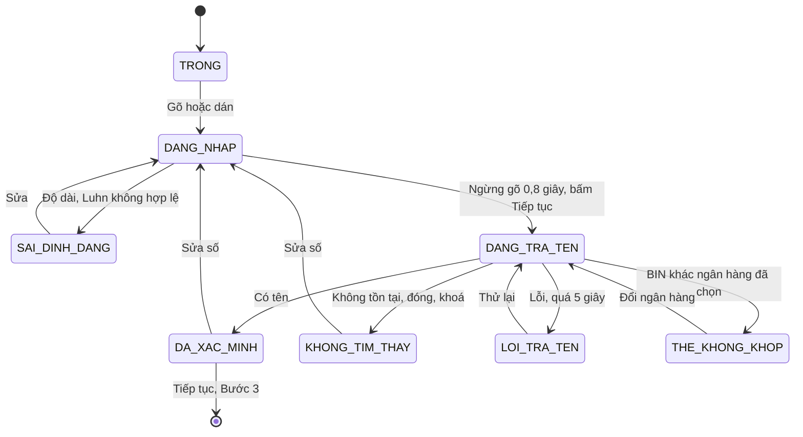

#### Hiển thị

| **Trạng thái** | **Hiển thị** |
| --- | --- |
| `SAI_DINH_DANG` | MSG-06 dưới ô |
| `DANG_TRA_TEN` | Vòng chờ nhỏ ở vị trí tên |
| `DA_XAC_MINH` | Tên chữ lớn, dấu tích; MSG-10 nếu có cờ; "Đã lưu: …" nếu có |
| `KHONG_TIM_THAY` | MSG-07, nút "Đổi ngân hàng" |
| `LOI_TRA_TEN` | MSG-08, "Thử lại" |
| `THE_KHONG_KHOP` | MSG-09 |

### 4.3 Bước 3 · Chọn số tiền

#### Trạng thái nút Tiếp tục trên SCR-04

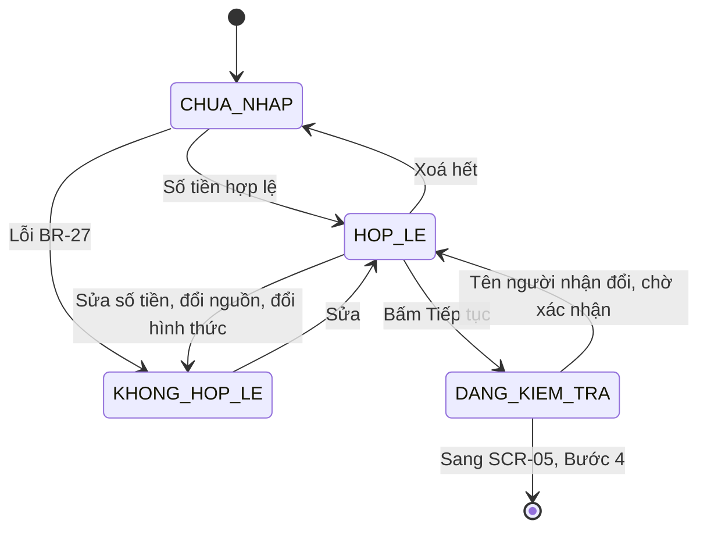

#### Hiển thị lựa chọn hình thức

| **Tình huống** | **Hiển thị** |
| --- | --- |
| Trong ngân hàng | Dòng "Ngay lập tức · Miễn phí", không có lựa chọn |
| Liên ngân hàng, < 500 triệu | Hai thẻ chọn: Chuyển nhanh (chọn sẵn), Chuyển thường; mỗi thẻ có phí, thời gian tới |
| Liên ngân hàng, ≥ 500 triệu hoặc bảo trì | Chỉ thẻ Chuyển thường, MSG-16 |

### 4.4 Bước 4 · Xác thực & xác nhận chuyển khoản

#### Giao dịch trong phạm vi Bước 4

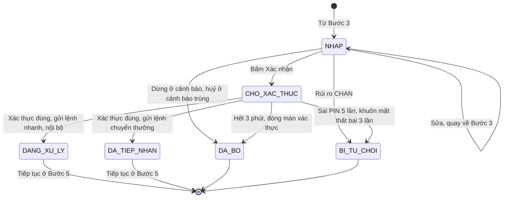

`DA_BO`, `BI_TU_CHOI` không xuất hiện trong lịch sử giao dịch; `BI_TU_CHOI` được ghi log an ninh.

#### Hiển thị nút trên SCR-05

| **Tình huống** | **Hiển thị** |
| --- | --- |
| Bình thường | "Xác nhận" (chính), "Sửa" (phụ) |
| Cần khuôn mặt, đã đăng ký | "Xác nhận" + dòng "Giao dịch này cần xác thực khuôn mặt" |
| Cần khuôn mặt, chưa đăng ký | "Đăng ký ngay" thay "Xác nhận", MSG-25 |
| Rủi ro lỗi, cảnh báo nhẹ | Banner vàng trên đầu màn |

### 4.5 Bước 5 · Hoàn thành chuyển khoản

#### Giao dịch trong phạm vi Bước 5

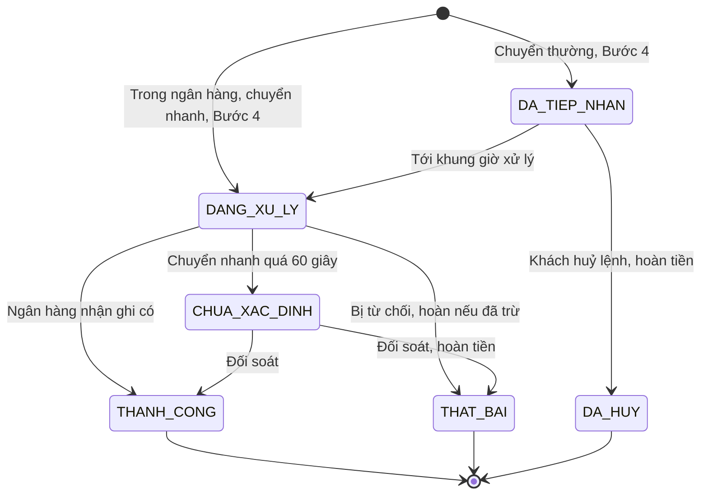

#### Hiển thị trên SCR-07

| **Trạng thái** | **Hiển thị** | **Nút** |
| --- | --- | --- |
| `DANG_XU_LY` | Vòng chờ, "Đang chuyển tiền…" | "Về trang chủ" sau 10 giây |
| `THANH_CONG` | Tích xanh lớn, MSG-31, biên lai | Chia sẻ, Lưu danh bạ, Giao dịch mới, Về trang chủ |
| `DA_TIEP_NHAN` | Đồng hồ xanh, MSG-38, thời gian dự kiến, biên lai "Đã tiếp nhận" | Huỷ lệnh, Chia sẻ, Lưu danh bạ, Về trang chủ |
| `THAT_BAI` | Biểu tượng đỏ, MSG-32 | Thử lại, Về trang chủ |
| `CHUA_XAC_DINH` | Đồng hồ vàng, MSG-33 | Xem chi tiết, Về trang chủ |

## 5. Use Case

### Bước 1 · Chọn ngân hàng

#### UC-01 Bắt đầu chuyển tiền

| **Mục** | **Nội dung** |
| --- | --- |
| Tiền điều kiện | Khách đã đăng nhập |
| Hậu điều kiện thành công | Mở **SCR-02** (người nhận mới) hoặc **SCR-04** (đi tắt) |
| Hậu điều kiện thất bại | Ở lại **SCR-01** |

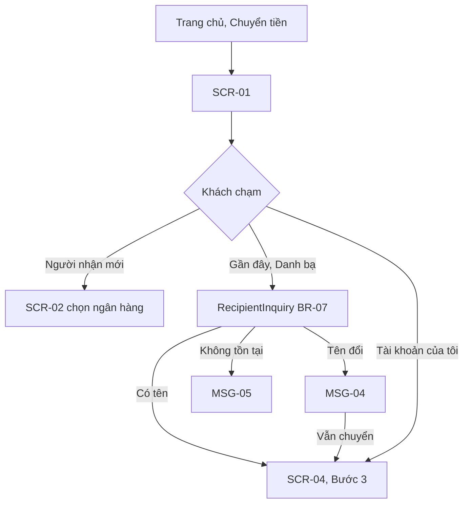

**Luồng chính**

| **Bước** | **Actor** | **Mô tả** |
| --- | --- | --- |
| 1 | Khách hàng | Chạm "Chuyển tiền" ở trang chủ |
| 2 | App | Gọi \[PayeeList\], \[RecentPayees\]; hiện **SCR-01** |
| 3 | Khách hàng | Chạm "Người nhận mới" |
| 4 | App | Mở **SCR-02** |

**Luồng thay thế**

| **Mã** | **Điều kiện** | **Xử lý** |
| --- | --- | --- |
| A1 | Chạm người nhận ở Gần đây, Danh bạ | BR-07 |
| A2 | Chạm Tài khoản của tôi | BR-08 |
| A3 | Tìm ở **SCR-01** | Lọc Gần đây, Danh bạ theo tên, 4 số cuối |
| A4 | Người nhận có nhãn cảnh báo | Vẫn đi tiếp; cảnh báo toàn trang ở Bước 4 |

**Luồng lỗi**

| **Mã** | **Điều kiện** | **Xử lý** |
| --- | --- | --- |
| E1 | Tên người nhận đã đổi | MSG-04 |
| E2 | Tài khoản nhận không còn | MSG-05 |
| E3 | Không tải được danh bạ | Dùng bản lưu trên máy; MSG-01 |

#### UC-02 Chọn ngân hàng

| **Mục** | **Nội dung** |
| --- | --- |
| Tiền điều kiện | Khách ở **SCR-02** |
| Hậu điều kiện thành công | Có ngân hàng nhận; mở **SCR-03** (Bước 2) |
| Hậu điều kiện thất bại | Ở lại **SCR-02** |

**Luồng chính**

| **Bước** | **Actor** | **Mô tả** |
| --- | --- | --- |
| 1 | App | Gọi \[BankList\]; hiện ngân hàng của app, nhóm Hay dùng, danh sách A–Z |
| 2 | Khách hàng | Gõ "tcb" |
| 3 | App | Lọc còn Techcombank |
| 4 | Khách hàng | Chạm ngân hàng |
| 5 | App | Mở **SCR-03** với ngân hàng đã chọn |

**Luồng thay thế**

| **Mã** | **Điều kiện** | **Xử lý** |
| --- | --- | --- |
| A1 | Chọn trong Hay dùng | Bỏ bước 2–3 |
| A2 | Ngân hàng `BAO_TRI_NHANH` | Chọn được; **SCR-03** mang theo cờ bảo trì |

**Luồng lỗi**

| **Mã** | **Điều kiện** | **Xử lý** |
| --- | --- | --- |
| E1 | Tìm 0 kết quả | MSG-02 |
| E2 | Chạm ngân hàng `TAM_DUNG` | MSG-03 |
| E3 | Không tải được danh sách | Dùng bản cache; không có cache → MSG-01 |

### Bước 2 · Nhập số tài khoản

#### UC-03 Nhập số tài khoản và tra tên

| **Mục** | **Nội dung** |
| --- | --- |
| Tiền điều kiện | Đã chọn ngân hàng (Bước 1) |
| Hậu điều kiện thành công | Người nhận `DA_XAC_MINH` có inquiry_id; mở **SCR-04** (Bước 3) |
| Hậu điều kiện thất bại | Ở lại **SCR-03** |

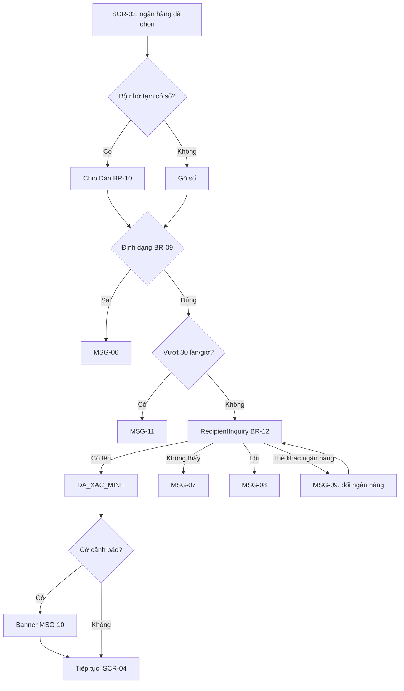

**Luồng chính**

| **Bước** | **Actor** | **Mô tả** |
| --- | --- | --- |
| 1 | App | Mở **SCR-03**: ngân hàng đã chọn ở đầu, ô số tài khoản focus sẵn; bộ nhớ tạm có số → chip Dán |
| 2 | Khách hàng | Chạm chip Dán |
| 3 | App | Làm sạch, hiện "1903 6688 2024"; gọi \[RecipientInquiry\] |
| 4 | Máy chủ | Tra qua Napas; trả "NGUYEN THI LAN", không có cờ |
| 5 | App | Hiện tên chữ lớn, dấu tích |
| 6 | Khách hàng | Kiểm tra tên, bấm "Tiếp tục" |
| 7 | App | Mở **SCR-04** (Bước 3) |

**Luồng thay thế**

| **Mã** | **Điều kiện** | **Xử lý** |
| --- | --- | --- |
| A1 | Gõ tay | Tra tự động sau 0,8 giây ngừng gõ (BR-12) |
| A2 | Số thẻ | Biểu tượng thẻ; kiểm tra BIN (BR-14) |
| A3 | Đổi ngân hàng | Nút "Đổi" cạnh tên ngân hàng → **SCR-02**, giữ số |
| A4 | Số trùng danh bạ | "Đã lưu: {tên gợi nhớ}" (BR-11) |
| A5 | Số của chính mình | MSG-12 (BR-17) |

**Luồng lỗi**

| **Mã** | **Điều kiện** | **Xử lý** |
| --- | --- | --- |
| E1 | Sai định dạng | MSG-06 |
| E2 | Không tìm thấy | MSG-07 |
| E3 | Lỗi tra tên | MSG-08; thử lại tối đa 3 lần rồi gợi ý thử lại sau |
| E4 | Thẻ không khớp ngân hàng | MSG-09 |
| E5 | Vượt giới hạn tra tên | MSG-11 |

### Bước 3 · Chọn số tiền

#### UC-04 Chọn số tiền

| **Mục** | **Nội dung** |
| --- | --- |
| Tiền điều kiện | Có người nhận đã xác minh (Bước 2) hoặc tài khoản của tôi (Bước 1) |
| Hậu điều kiện thành công | Lệnh nháp hợp lệ: số tiền, nội dung, nguồn, hình thức, phí; mở **SCR-05** (Bước 4) |
| Hậu điều kiện thất bại | Ở lại **SCR-04** với lỗi |

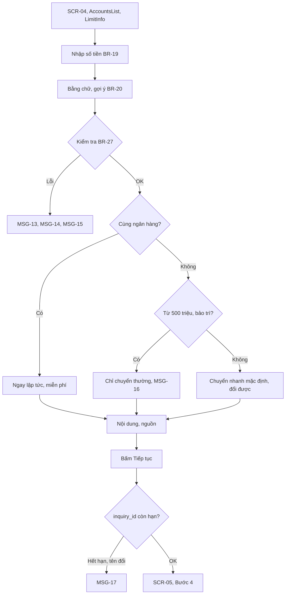

**Luồng chính**

| **Bước** | **Actor** | **Mô tả** |
| --- | --- | --- |
| 1 | App | Mở **SCR-04**: người nhận, tài khoản nguồn mặc định; gọi \[AccountsList\], \[LimitInfo\], \[TransferOptions\] |
| 2 | Khách hàng | Gõ 12.500.000 |
| 3 | App | Hiện "Mười hai triệu năm trăm nghìn đồng"; hợp lệ; liên ngân hàng → Chuyển nhanh chọn sẵn, "Ngay lập tức · Miễn phí" |
| 4 | Khách hàng | Sửa nội dung "Tien nha T11 P302" |
| 5 | Khách hàng | Bấm "Tiếp tục" |
| 6 | App | inquiry_id còn hạn → mở **SCR-05** (Bước 4) |

**Luồng thay thế**

| **Mã** | **Điều kiện** | **Xử lý** |
| --- | --- | --- |
| A1 | Số tiền ≥ 500 triệu | Chỉ Chuyển thường, phí, thời gian tới (BR-24, BR-25, BR-26) |
| A2 | Khách chọn Chuyển thường dù < 500 triệu | Phí, thời gian tới cập nhật |
| A3 | Đổi tài khoản nguồn | Bottom sheet tài khoản, số dư; kiểm tra lại BR-27 |
| A4 | Tài khoản của tôi | Không có hình thức; không tính hạn mức ngày (BR-23) |
| A5 | Sửa người nhận | BR-18 |

**Luồng lỗi**

| **Mã** | **Điều kiện** | **Xử lý** |
| --- | --- | --- |
| E1 | Dưới tối thiểu | MSG-13 |
| E2 | Không đủ số dư | MSG-14 |
| E3 | Vượt hạn mức | MSG-15 |
| E4 | Tên người nhận đổi khi tra lại | MSG-17 |
| E5 | Không tải được số dư, phí | MSG-18; máy chủ kiểm tra lại ở Bước 4 |

### Bước 4 · Xác thực & xác nhận chuyển khoản

#### UC-05 Xem lại và xác nhận

| **Mục** | **Nội dung** |
| --- | --- |
| Tiền điều kiện | Lệnh nháp hợp lệ từ Bước 3 |
| Hậu điều kiện thành công | Giao dịch `CHO_XAC_THUC`, mở xác thực |
| Hậu điều kiện thất bại | `DA_BO`, `BI_TU_CHOI`, hoặc quay về **SCR-04** |

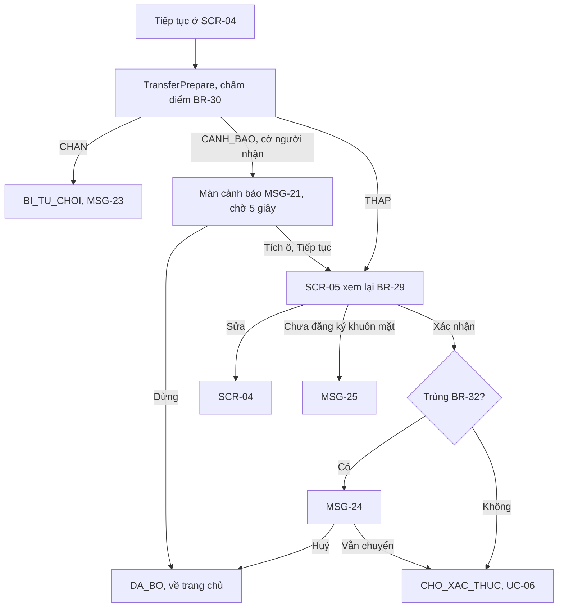

**Luồng chính**

| **Bước** | **Actor** | **Mô tả** |
| --- | --- | --- |
| 1 | App | Gọi \[TransferPrepare\]; nhận transaction_id, mức xác thực, kết quả rủi ro `THAP` |
| 2 | App | Hiện **SCR-05** theo BR-29 |
| 3 | Khách hàng | Kiểm tra, bấm "Xác nhận" |
| 4 | App | Không trùng; giao dịch `CHO_XAC_THUC`; sang UC-06 |

**Luồng thay thế**

| **Mã** | **Điều kiện** | **Xử lý** |
| --- | --- | --- |
| A1 | Rủi ro `CANH_BAO` | Màn cảnh báo trước **SCR-05** (BR-31) |
| A2 | Bấm Sửa | Về **SCR-04** (Bước 3), giữ dữ liệu |
| A3 | Có giao dịch trùng | MSG-24 (BR-32) |

**Luồng lỗi**

| **Mã** | **Điều kiện** | **Xử lý** |
| --- | --- | --- |
| E1 | Rủi ro `CHAN` | MSG-23 |
| E2 | Cần khuôn mặt, chưa đăng ký | MSG-25 |
| E3 | \[TransferPrepare\] lỗi mạng | MSG-30, ở lại **SCR-04** |

#### UC-06 Xác thực và gửi lệnh

| **Mục** | **Nội dung** |
| --- | --- |
| Tiền điều kiện | Giao dịch `CHO_XAC_THUC` |
| Hậu điều kiện thành công | Lệnh được gửi; giao dịch `DANG_XU_LY` hoặc `DA_TIEP_NHAN`; mở **SCR-07** (Bước 5) |
| Hậu điều kiện thất bại | `DA_BO` hoặc `BI_TU_CHOI`; tiền không bị trừ |

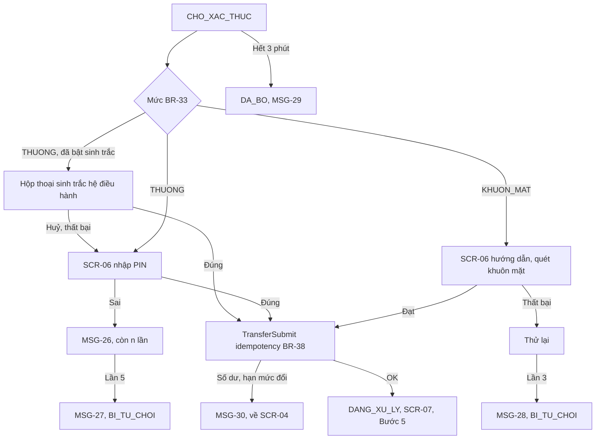

**Luồng chính**

| **Bước** | **Actor** | **Mô tả** |
| --- | --- | --- |
| 1 | App | Mức `THUONG`, đã bật Face ID → hiện hộp thoại Face ID |
| 2 | Khách hàng | Xác thực thành công |
| 3 | App | Ký lệnh, gọi \[TransferSubmit\] |
| 4 | Máy chủ | Kiểm tra lại số dư, hạn mức; nhận lệnh |
| 5 | App | Mở **SCR-07** trạng thái "Đang chuyển tiền…" (Bước 5) |

**Luồng thay thế**

| **Mã** | **Điều kiện** | **Xử lý** |
| --- | --- | --- |
| A1 | Chưa bật sinh trắc | Nhập PIN trên **SCR-06** |
| A2 | Mức `KHUON_MAT` | Hướng dẫn → camera trước → \[FaceVerify\] |
| A3 | Quên PIN | Link "Quên PIN" mở luồng đặt lại Smart OTP; giao dịch `DA_BO` |

**Luồng lỗi**

| **Mã** | **Điều kiện** | **Xử lý** |
| --- | --- | --- |
| E1 | Sai PIN | MSG-26; lần 5 → MSG-27 |
| E2 | Khuôn mặt thất bại 3 lần | MSG-28 |
| E3 | Hết 3 phút | MSG-29 |
| E4 | Máy chủ báo số dư, hạn mức không còn đủ | MSG-30 |
| E5 | Mất mạng khi gửi | Gửi lại cùng idempotency key; không chắc lệnh đã tới → vẫn mở **SCR-07**, Bước 5 xử lý `CHUA_XAC_DINH` |

### Bước 5 · Hoàn thành chuyển khoản

#### UC-07 Nhận kết quả

| **Mục** | **Nội dung** |
| --- | --- |
| Tiền điều kiện | Lệnh đã gửi (Bước 4) |
| Hậu điều kiện thành công | **SCR-07** hiện đúng trạng thái; khách nhận push khi có kết quả cuối |
| Hậu điều kiện thất bại | – |

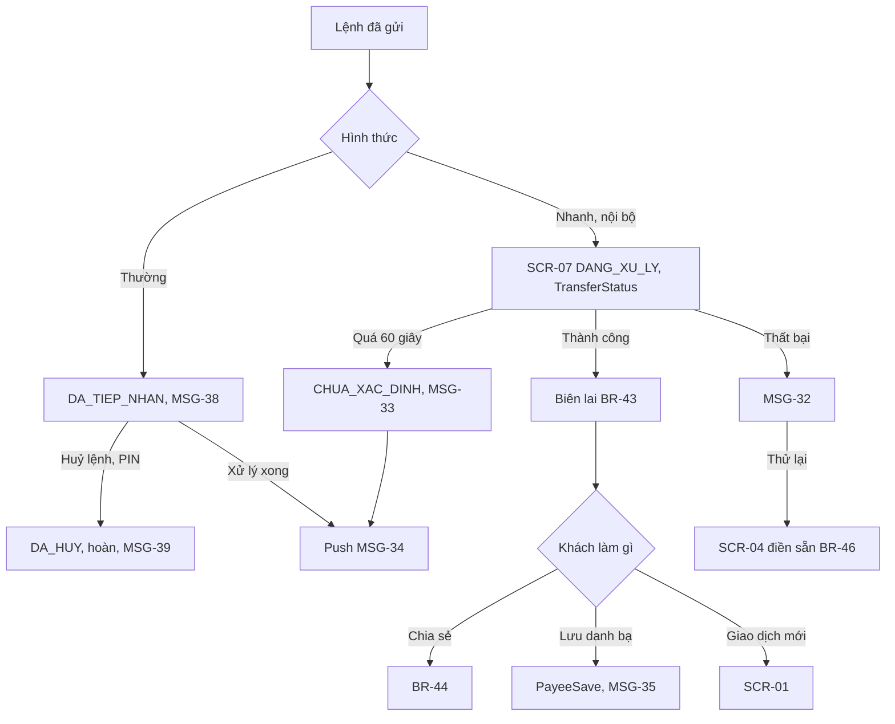

**Luồng chính**

| **Bước** | **Actor** | **Mô tả** |
| --- | --- | --- |
| 1 | App | **SCR-07** "Đang chuyển tiền…"; gọi \[TransferStatus\] |
| 2 | Máy chủ | Nhận ghi có thành công từ ngân hàng nhận |
| 3 | App | **SCR-07** `THANH_CONG`, biên lai; gợi ý lưu danh bạ (người nhận mới) |
| 4 | Khách hàng | Đặt tên "Chủ trọ", lưu; bấm Chia sẻ, gửi biên lai cho chủ nhà |

**Luồng thay thế**

| **Mã** | **Điều kiện** | **Xử lý** |
| --- | --- | --- |
| A1 | Chuyển thường | `DA_TIEP_NHAN`, MSG-38 (BR-47) |
| A2 | Huỷ lệnh chuyển thường | PIN → \[TransferCancel\] → MSG-39 |
| A3 | Về trang chủ khi đang xử lý | Kết quả qua push MSG-34 |
| A4 | Thất bại, Thử lại | BR-46 |

**Luồng lỗi**

| **Mã** | **Điều kiện** | **Xử lý** |
| --- | --- | --- |
| E1 | Ngân hàng nhận từ chối | MSG-32 |
| E2 | Quá 60 giây | MSG-33 |
| E3 | Danh bạ đầy | MSG-36 |
| E4 | Huỷ khi lệnh đã vào xử lý | Toast "Lệnh đang được xử lý, không thể huỷ" |
| E5 | Mất mạng trên app | Banner MSG-37; khi có mạng gọi lại \[TransferStatus\] |

#### UC-08 Xem chi tiết giao dịch

**Luồng chính**

| **Bước** | **Actor** | **Mô tả** |
| --- | --- | --- |
| 1 | Khách hàng | Chạm push MSG-34 hoặc mở giao dịch từ lịch sử của app |
| 2 | App | Gọi \[TxDetail\]; hiện **SCR-08** |
| 3 | Khách hàng | Bấm "Chuyển lại" |
| 4 | App | Mở **SCR-04** điền sẵn (BR-46) |

**Luồng thay thế**

| **Mã** | **Điều kiện** | **Xử lý** |
| --- | --- | --- |
| A1 | `DA_TIEP_NHAN` | Hiện thời gian dự kiến và "Huỷ lệnh" (BR-47) |
| A2 | `CHUA_XAC_DINH` | MSG-33 và hạn có kết quả; không có Chuyển lại |
| A3 | Cần hỗ trợ | "Liên hệ hỗ trợ" mở kênh hỗ trợ sẵn có, kèm mã giao dịch |

## 6. Điểm vào

| **Điểm vào** | **Dẫn tới** | **Ghi chú** |
| --- | --- | --- |
| Nút "Chuyển tiền" ở trang chủ | **SCR-01** | |
| "Đổi ngân hàng" ở **SCR-03** (Bước 2) | **SCR-02** | Giữ số tài khoản đã nhập |
| "Chuyển tiếp" ở **SCR-07** (Bước 5) | **SCR-01** | |
| Chọn ngân hàng ở **SCR-02** (Bước 1) | **SCR-03** | |
| "Sửa" người nhận ở **SCR-04** (Bước 3) | **SCR-03** | Giữ ngân hàng, số |
| "Tiếp tục" ở **SCR-03** (Bước 2) | **SCR-04** | |
| Đi tắt từ **SCR-01** (Bước 1) | **SCR-04** | |
| "Sửa" ở **SCR-05** (Bước 4) | **SCR-04** | Giữ dữ liệu |
| "Chuyển lại", "Thử lại" (Bước 5) | **SCR-04** điền sẵn | Tra tên lại |
| "Tiếp tục" ở **SCR-04** (Bước 3) | UC-05 | |
| Quay lại từ màn đăng ký khuôn mặt thành công | **SCR-05** | Giữ giao dịch nếu chưa quá 10 phút |
| Gửi lệnh ở Bước 4 | **SCR-07** | |
| Push kết quả | **SCR-08** | |
| Lịch sử giao dịch sẵn có của app | **SCR-08** | |

## 7. Mô tả màn hình

<!-- Bước 1 · Chọn ngân hàng -->
### SCR-01 Chuyển tiền

| **#** | **Thành phần** | **Loại** | **Hành vi** |
| --- | --- | --- | --- |
| 1 | Ô tìm | Search | A3 UC-01 |
| 2 | "Người nhận mới" | Button nổi bật | Mở **SCR-02** |
| 3 | Gần đây | Avatar cuộn ngang | BR-01, BR-02 |
| 4 | Tài khoản của tôi | List | BR-08 |
| 5 | Danh bạ | List A–Z | BR-02; chỉ mục chữ cái bên phải |

### SCR-02 Chọn ngân hàng

| **#** | **Thành phần** | **Loại** | **Hành vi** |
| --- | --- | --- | --- |
| 1 | Ô tìm | Search | BR-05; bàn phím mở sẵn |
| 2 | Ngân hàng của app | List item ghim | BR-04 |
| 3 | Hay dùng | Lưới logo 5 ô | BR-04 |
| 4 | Tất cả ngân hàng | List | Logo, tên viết tắt, tên đầy đủ, nhãn trạng thái (mục 4.1) |
| 5 | Trạng thái rỗng | Empty state | MSG-02 |

<!-- Bước 2 · Nhập số tài khoản -->
### SCR-03 Nhập số tài khoản

| **#** | **Thành phần** | **Loại** | **Bắt buộc** | **Validate / hành vi** |
| --- | --- | --- | --- | --- |
| 1 | Ngân hàng | Card | Có | Logo, tên viết tắt, tên đầy đủ, nhãn bảo trì; nút "Đổi" |
| 2 | Số tài khoản / số thẻ | Number | Có | BR-09; nhóm 4 số; nút xoá |
| 3 | Chip Dán | Chip | – | BR-10 |
| 4 | Tên chủ tài khoản | Text lớn | – | Mục 4.2 |
| 5 | Đã lưu | Text phụ | – | BR-11 |
| 6 | Banner cảnh báo | Banner đỏ | – | MSG-10 |
| 7 | Lỗi | Text đỏ | – | MSG-06, MSG-07, MSG-08, MSG-09 |
| 8 | "Tiếp tục" | Button | – | Bật ở `DA_XAC_MINH`; ở trạng thái nhập xong chưa tra thì kích hoạt tra |

<!-- Bước 3 · Chọn số tiền -->
### SCR-04 Chọn số tiền

| **#** | **Thành phần** | **Loại** | **Bắt buộc** | **Validate / hành vi** |
| --- | --- | --- | --- | --- |
| 1 | Người nhận | Card | – | BR-18 |
| 2 | Số tiền | Amount display | Có | BR-19 |
| 3 | Bằng chữ | Text | – | |
| 4 | Lỗi | Text đỏ | – | MSG-13, MSG-14, MSG-15 |
| 5 | Gợi ý nhanh | Chips | – | BR-20 |
| 6 | Nội dung | Textarea | Có | BR-21; đếm 160 |
| 7 | Tài khoản nguồn | Dòng chọn | Có | BR-22 |
| 8 | Hình thức chuyển | Radio card | Có (liên ngân hàng) | Mục 4.2; mỗi thẻ có phí, thời gian tới |
| 9 | Tổng trừ | Text | – | Số tiền + phí |
| 10 | Bàn phím số | Keypad | – | Ẩn khi đang sửa nội dung |
| 11 | "Tiếp tục" | Button | – | Mục 4.1 |

<!-- Bước 4 · Xác thực & xác nhận chuyển khoản -->
### SCR-05 Xác nhận giao dịch (gồm màn cảnh báo)

| **#** | **Thành phần** | **Loại** | **Hành vi** |
| --- | --- | --- | --- |
| 1 | Số tiền | Text lớn | Kèm bằng chữ |
| 2 | Người nhận | List | Tên chủ tài khoản, ngân hàng, số tài khoản đầy đủ |
| 3 | Nội dung | Text | Bản sẽ gửi |
| 4 | Hình thức, thời gian tới | Text | "Chuyển nhanh · Ngay lập tức" hoặc "Chuyển thường · {thời gian}" |
| 5 | Tài khoản nguồn | Text | Số tài khoản che giữa |
| 6 | Phí, tổng trừ | Text | |
| 7 | Cách xác thực | Info | BR-33; MSG-25 khi chưa đăng ký |
| 8 | Banner cảnh báo nhẹ | Banner | BR-30 khi chấm điểm lỗi |
| 9 | "Sửa", "Xác nhận" | Button | Mục 4.2; "Xác nhận" dính đáy |
| 10 | Màn cảnh báo | Full screen | Biểu tượng cảnh báo, MSG-21, MSG-22; nút chính "Dừng giao dịch"; ô tích; "Tiếp tục" bật sau 5 giây; số tổng đài khẩn |

### SCR-06 Xác thực giao dịch

| **#** | **Thành phần** | **Loại** | **Hành vi** |
| --- | --- | --- | --- |
| 1 | Tóm tắt | Card | Người nhận, số tiền |
| 2 | PIN Smart OTP | 6 ô số | Bàn phím xáo vị trí; ẩn ký tự |
| 3 | Dùng sinh trắc | Link | Khi đã bật sinh trắc thiết bị |
| 4 | Khuôn mặt | Camera tròn | Hướng dẫn, kiểm tra người thật, tiến trình |
| 5 | Đếm ngược | Timer | 3 phút (BR-37) |
| 6 | Quên PIN | Link | A3 UC-06 |

<!-- Bước 5 · Hoàn thành chuyển khoản -->
### SCR-07 Kết quả & biên lai

| **#** | **Thành phần** | **Loại** | **Hành vi** |
| --- | --- | --- | --- |
| 1 | Trạng thái | Icon + tiêu đề | Mục 4.2 |
| 2 | Số tiền | Text lớn | Kèm bằng chữ |
| 3 | Thời gian dự kiến | Text | Chỉ `DA_TIEP_NHAN` |
| 4 | Biên lai | List | BR-43 |
| 5 | Chia sẻ (ảnh, PDF) | Button | BR-44 |
| 6 | Lưu danh bạ | Checkbox + Text | BR-45 |
| 7 | Huỷ lệnh | Button phụ | Chỉ `DA_TIEP_NHAN` |
| 8 | Giao dịch mới, Về trang chủ, Thử lại | Button | Theo trạng thái |

### SCR-08 Chi tiết giao dịch

| **#** | **Thành phần** | **Loại** | **Hành vi** |
| --- | --- | --- | --- |
| 1 | Trạng thái, số tiền | Header | Màu theo trạng thái |
| 2 | Biên lai | List | BR-43; mã giao dịch sao chép được |
| 3 | Mốc thời gian | Timeline | Gửi lệnh, tiếp nhận, xử lý, kết quả, hoàn tiền |
| 4 | Chia sẻ, Chuyển lại, Huỷ lệnh | Button | Theo trạng thái |
| 5 | Liên hệ hỗ trợ | Link | A3 UC-08 |

## 8. API

### 8.1 Bước 1 · Chọn ngân hàng

| **API** | **Request chính** | **Response chính** | **Timeout / retry** |
| --- | --- | --- | --- |
| \[PayeeList\] | – | Danh bạ, cờ cảnh báo | 5s / 1 lần; cache trên máy |
| \[RecentPayees\] | – | 10 người nhận gần đây | 3s / 1 lần |
| \[BankList\] | – | Ngân hàng, viết tắt, từ khoá, logo, trạng thái, hay dùng | 5s / 1 lần; cache 1 ngày, trạng thái làm mới 5 phút |
| \[RecipientInquiry\] | bank_code, account | Tên, risk_flag, inquiry_id | 5s / người dùng thử lại |

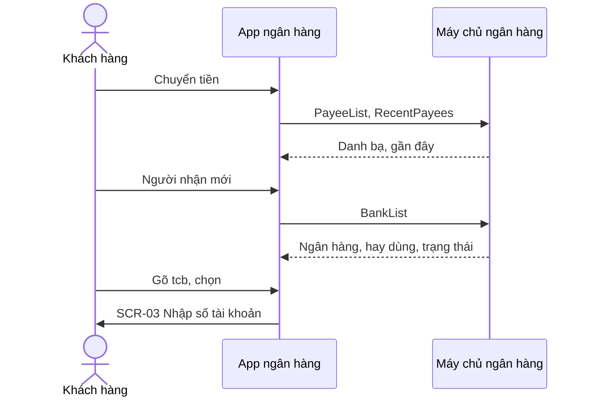

**Map lỗi → thông báo**

| **Nhóm lỗi** | **Message** |
| --- | --- |
| Mất mạng, lỗi máy chủ | MSG-01 |
| Tìm 0 kết quả | MSG-02 |
| Ngân hàng tạm dừng | MSG-03 |
| Tên người nhận đã đổi | MSG-04 |
| Tài khoản người nhận không còn | MSG-05 |

### 8.2 Bước 2 · Nhập số tài khoản

| **API** | **Request chính** | **Response chính** | **Timeout / retry** |
| --- | --- | --- | --- |
| \[RecipientInquiry\] | bank_code, account_or_card | name, risk_flag, inquiry_id, is_own_account, card_bank_code | 5s / người dùng thử lại |
| \[InquiryQuota\] | – | Số lần còn lại trong giờ | Trả kèm \[RecipientInquiry\] |

Kiểm tra định dạng, Luhn, BIN chạy trên máy với danh sách BIN từ \[BankList\] (Bước 1).

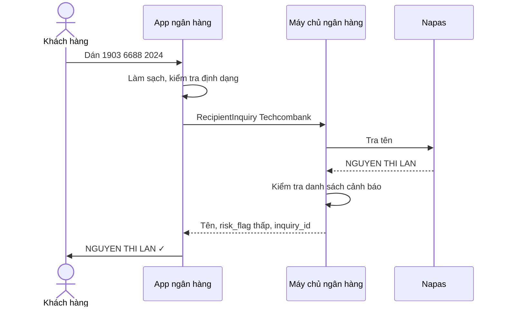

**Map lỗi → thông báo**

| **Nhóm lỗi** | **Message** |
| --- | --- |
| Sai định dạng | MSG-06 |
| Không tìm thấy tài khoản | MSG-07 |
| Lỗi tra tên | MSG-08 |
| Thẻ không khớp ngân hàng | MSG-09 |
| Tài khoản bị báo cáo | MSG-10 |
| Vượt giới hạn tra tên | MSG-11 |
| Tài khoản của chính mình | MSG-12 |

### 8.3 Bước 3 · Chọn số tiền

| **API** | **Request chính** | **Response chính** | **Timeout / retry** |
| --- | --- | --- | --- |
| \[AccountsList\] | – | Tài khoản nguồn, số dư khả dụng | 5s / 1 lần |
| \[LimitInfo\] | source_account | Hạn mức giao dịch, ngày, đã dùng hôm nay | 3s / 1 lần |
| \[TransferOptions\] | inquiry_id, amount, source_account | Hình thức khả dụng, phí, eta, lý do giới hạn | 3s / 1 lần; gọi lại khi số tiền qua ngưỡng 500 triệu |
| \[RecipientInquiry\] | Như Bước 2 | Tên, inquiry_id mới | 5s / người dùng thử lại |

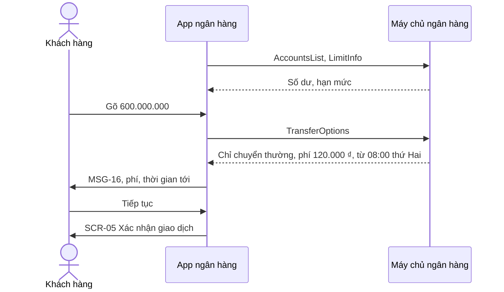

**Map lỗi → thông báo**

| **Nhóm lỗi** | **Message** |
| --- | --- |
| Dưới tối thiểu | MSG-13 |
| Không đủ số dư | MSG-14 |
| Vượt hạn mức | MSG-15 |
| Chỉ chuyển thường | MSG-16 |
| Tên người nhận đổi | MSG-17 |
| Không tải được số dư, phí | MSG-18 |
| Mất mạng | MSG-19 |
| Không có tài khoản nguồn | MSG-20 |

### 8.4 Bước 4 · Xác thực & xác nhận chuyển khoản

| **API** | **Request chính** | **Response chính** | **Timeout / retry** |
| --- | --- | --- | --- |
| \[TransferPrepare\] | inquiry_id, amount, note, source_account | transaction_id, auth_level, risk_result, risk_reasons, duplicate_hint, idempotency_key | 5s / 1 lần |
| \[FaceVerify\] | transaction_id, dữ liệu khuôn mặt mã hoá | verified, liveness | 15s / không retry tự động |
| \[TransferSubmit\] | transaction_id, chữ ký Smart OTP, idempotency_key | status `DANG_XU_LY` hoặc lỗi | 30s / gửi lại cùng key |

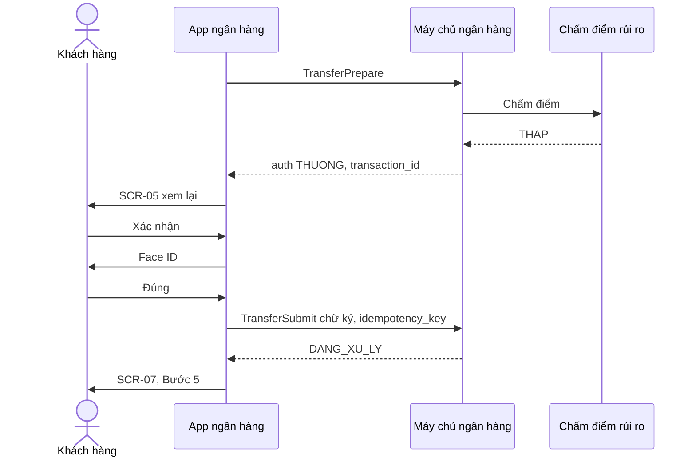

**Map lỗi → thông báo**

| **Nhóm lỗi** | **Message** |
| --- | --- |
| Người nhận đáng ngờ, giao dịch bất thường | MSG-21 |
| Đang có cuộc gọi | MSG-22 |
| Bị chặn vì rủi ro | MSG-23 |
| Giao dịch trùng | MSG-24 |
| Chưa đăng ký khuôn mặt | MSG-25 |
| Sai PIN | MSG-26 |
| Khoá Smart OTP | MSG-27 |
| Khuôn mặt thất bại | MSG-28 |
| Hết thời gian xác thực | MSG-29 |
| Số dư, hạn mức thay đổi; mất mạng | MSG-30 |

### 8.5 Bước 5 · Hoàn thành chuyển khoản

| **API** | **Request chính** | **Response chính** | **Timeout / retry** |
| --- | --- | --- | --- |
| \[TransferStatus\] | transaction_id | status, reason_code, refunded, eta | 3s / mỗi 2 giây tới 60 giây |
| \[TransferCancel\] | transaction_id, chữ ký PIN | status `DA_HUY`, refund | 5s / 1 lần |
| \[TxDetail\] | transaction_id | Chi tiết, mốc thời gian, allowed_actions | 5s / 1 lần |
| \[ReceiptExport\] | transaction_id, format | Ảnh hoặc PDF | 10s / 1 lần |
| \[PayeeSave\] | bank, account, nickname | payee_id | 5s / 1 lần |

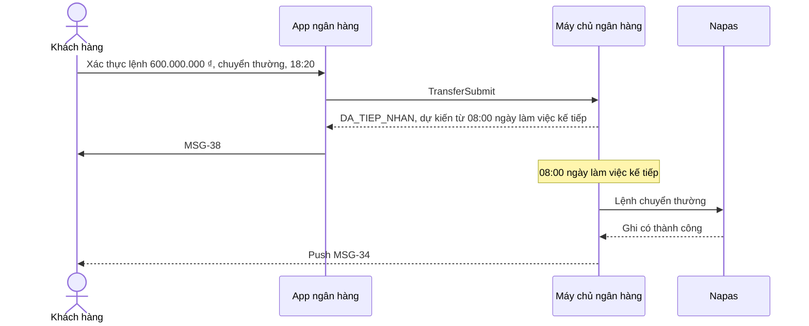

**Map lỗi → thông báo**

| **Nhóm** | **Message** |
| --- | --- |
| Thành công | MSG-31 |
| Thất bại | MSG-32 |
| Chưa xác định | MSG-33 |
| Có kết quả cuối (push) | MSG-34 |
| Đã lưu danh bạ | MSG-35 |
| Danh bạ đầy | MSG-36 |
| Mất mạng | MSG-37 |
| Đã tiếp nhận chuyển thường | MSG-38 |
| Đã huỷ lệnh | MSG-39 |

## 9. Danh sách thông báo

| **ID** | **Nơi hiện** | **Nội dung (VI)** |
| --- | --- | --- |
| MSG-01 | Toast | Kết nối không ổn định, vui lòng thử lại |
| MSG-02 | Empty state | Không tìm thấy ngân hàng “{từ khoá}”. Thử tên viết tắt, ví dụ VCB, BIDV |
| MSG-03 | Toast | {Ngân hàng} tạm dừng nhận chuyển khoản. Vui lòng thử lại sau |
| MSG-04 | Popup | Tên chủ tài khoản đã thay đổi: trước đây "{tên cũ}", hiện tại "{tên mới}". Bạn có chắc vẫn muốn chuyển? \[Vẫn chuyển\] \[Huỷ\] |
| MSG-05 | Popup | Tài khoản nhận không còn tồn tại hoặc đã bị khoá. Bạn có muốn xoá người nhận này khỏi danh bạ? \[Xoá\] \[Để sau\] |
| MSG-06 | Inline | Số tài khoản gồm 6–19 chữ số; số thẻ gồm 16 hoặc 19 chữ số |
| MSG-07 | Inline | Không tìm thấy tài khoản tại {ngân hàng}. Kiểm tra lại số tài khoản và ngân hàng. \[Đổi ngân hàng\] |
| MSG-08 | Inline | Chưa kiểm tra được tên người nhận. \[Thử lại\] |
| MSG-09 | Inline | Số thẻ này thuộc {ngân hàng đúng}, không phải {ngân hàng đã chọn}. \[Đổi sang {ngân hàng đúng}\] |
| MSG-10 | Banner | Tài khoản này đã bị báo cáo có dấu hiệu lừa đảo. Hãy kiểm tra kỹ trước khi chuyển |
| MSG-11 | Popup | Bạn đã tra cứu quá nhiều tài khoản mới. Vui lòng thử lại sau {m} phút hoặc chọn người nhận trong danh bạ |
| MSG-12 | Info | Đây là tài khoản của bạn. Giao dịch sẽ được chuyển giữa các tài khoản của bạn |
| MSG-13 | Inline | Số tiền tối thiểu là 1.000 ₫ |
| MSG-14 | Inline | Số dư khả dụng không đủ (cần {tổng trừ} ₫ gồm phí). Số dư hiện tại: {số dư} ₫ |
| MSG-15 | Inline | Vượt hạn mức chuyển tiền. Hôm nay bạn còn chuyển được {số tiền} ₫. \[Đổi hạn mức\] |
| MSG-16 | Info | {Giao dịch từ 500 triệu đồng / {Ngân hàng} đang bảo trì chuyển nhanh} nên sẽ đi bằng chuyển thường. Tiền tới {thời gian} |
| MSG-17 | Popup | Tên người nhận vừa cập nhật thành "{tên mới}". Bạn có chắc vẫn chuyển cho người này? \[Tiếp tục\] \[Sửa người nhận\] |
| MSG-18 | Toast | Chưa cập nhật được số dư hoặc phí. Bạn vẫn có thể tiếp tục |
| MSG-19 | Toast | Kết nối không ổn định, vui lòng thử lại |
| MSG-20 | Popup | Bạn chưa có tài khoản thanh toán có thể chuyển tiền. Vui lòng liên hệ tổng đài {số} |
| MSG-21 | Màn cảnh báo | {Tài khoản này đã bị báo cáo có dấu hiệu lừa đảo / Giao dịch này khác thói quen của bạn}. Ngân hàng, công an, cơ quan nhà nước **không bao giờ** yêu cầu bạn chuyển tiền qua điện thoại. ☐ Tôi hiểu rủi ro và tự chịu trách nhiệm \[Dừng giao dịch\] \[Tiếp tục\] |
| MSG-22 | Màn cảnh báo | Bạn có đang được ai đó hướng dẫn chuyển tiền qua điện thoại không? Nếu có, hãy dừng lại và gọi tổng đài {số} |
| MSG-23 | Popup | Giao dịch tạm thời không thể thực hiện để bảo vệ tài khoản của bạn. Gọi {số} để được hỗ trợ |
| MSG-24 | Popup | Bạn vừa chuyển {số tiền} ₫ cho {tên} lúc {giờ}. Bạn có muốn chuyển thêm lần nữa? \[Vẫn chuyển\] \[Huỷ\] |
| MSG-25 | Info **SCR-05** | Giao dịch trên 10 triệu đồng hoặc tổng trong ngày trên 20 triệu đồng cần xác thực khuôn mặt. Bạn chưa đăng ký. \[Đăng ký ngay\] |
| MSG-26 | Inline **SCR-06** | Mã PIN chưa đúng. Bạn còn {n} lần thử |
| MSG-27 | Popup | Smart OTP đã bị khoá do nhập sai 5 lần. \[Mở khoá Smart OTP\] |
| MSG-28 | Popup | Xác thực khuôn mặt chưa thành công. Vui lòng thử lại sau 15 phút, ở nơi đủ sáng |
| MSG-29 | Toast | Phiên xác thực đã hết hạn. Bấm Xác nhận để thử lại |
| MSG-30 | Popup | {Số dư hoặc hạn mức vừa thay đổi, vui lòng kiểm tra lại số tiền / Kết nối không ổn định, vui lòng thử lại} |
| MSG-31 | **SCR-07** | Chuyển tiền thành công |
| MSG-32 | **SCR-07** | Giao dịch không thành công: {Tài khoản nhận không nhận được tiền lúc này / Ngân hàng nhận đang bảo trì / Giao dịch bị từ chối}. Tiền {chưa bị trừ / đã được hoàn về tài khoản của bạn} |
| MSG-33 | **SCR-07**, **SCR-08** | Giao dịch đang được ngân hàng xác nhận. **Vui lòng không chuyển lại.** Chúng tôi sẽ báo kết quả cho bạn, chậm nhất trong 1 ngày làm việc |
| MSG-34 | Push | Giao dịch {số tiền} ₫ tới {tên} ({mã}): {Thành công / Không thành công, tiền đã được hoàn về tài khoản} |
| MSG-35 | Toast | Đã lưu {tên gợi nhớ} vào danh bạ |
| MSG-36 | Toast | Danh bạ đã đủ 200 người nhận. Xoá bớt để lưu người mới |
| MSG-37 | Banner | Mất kết nối. Kết quả giao dịch sẽ được cập nhật khi có mạng |
| MSG-38 | **SCR-07** | Lệnh đã được tiếp nhận. Tiền đã được trừ và sẽ tới người nhận {thời gian dự kiến}. Chúng tôi sẽ báo khi người nhận nhận được |
| MSG-39 | Toast | Đã huỷ lệnh. {Số tiền + phí} ₫ đã được hoàn về tài khoản của bạn |

## 10. Yêu cầu phi chức năng

| **Mục** | **Yêu cầu** |
| --- | --- |
| Hiệu năng | **SCR-01**, **SCR-02** hiện ≤ 500 ms (dữ liệu cache, làm mới nền); lọc tìm kiếm ≤ 100 ms; \[RecipientInquiry\] ≤ 2 giây (p95); kiểm tra định dạng ≤ 50 ms; **SCR-04** hiện ≤ 500 ms; bằng chữ, kiểm tra cập nhật ≤ 100 ms; \[TransferOptions\] ≤ 500 ms; \[TransferPrepare\] gồm chấm điểm ≤ 1 giây (p95); \[TransferSubmit\] phản hồi nhận lệnh ≤ 2 giây (p95); 95% chuyển nhanh có kết quả ≤ 10 giây; push kết quả cuối ≤ 1 phút sau khi có kết quả |
| Riêng tư | Danh bạ mã hoá khi lưu trên máy; số tài khoản chỉ hiện 4 số cuối trong danh sách |
| Log / audit | Ngân hàng được chọn, cách chọn (hay dùng, tìm, cuộn); Mỗi lần tra tên: ngân hàng, kết quả, risk_flag (không log số đầy đủ); Số tiền, nguồn, hình thức, phí khi bấm Tiếp tục; Kết quả rủi ro, cảnh báo đã hiện và lựa chọn của khách, mức xác thực, kết quả từng lần xác thực; Thời điểm từng trạng thái, mã lý do, lệnh hoàn tiền, huỷ lệnh |
| Tracking | Nguồn bắt đầu (mới, gần đây, danh bạ, của tôi), thời gian chọn ngân hàng, từ khoá tìm 0 kết quả, chọn ngân hàng bảo trì; Dán hay gõ, số lần tra, kết quả, đổi ngân hàng, gặp cảnh báo, thời gian tới có tên; Thời gian ở **SCR-04**, gợi ý nhanh, đổi hình thức, đổi nguồn, lỗi gặp phải, bỏ giữa chừng; Thời gian ở **SCR-05**, bấm Sửa, gặp cảnh báo (loại, lựa chọn), loại xác thực, thất bại, bỏ dở; Phân bố kết quả, thời gian tới kết quả, thoát khi đang xử lý, chia sẻ, lưu danh bạ, huỷ lệnh, thử lại, chuyển lại |
| Accessibility | Logo kèm tên dạng chữ; danh sách A–Z có chỉ mục; nhãn trạng thái đọc được bằng giọng đọc; Tên người nhận được đọc ngay khi có; số tài khoản đọc theo nhóm; lỗi được đọc khi xuất hiện; Số tiền đọc kèm bằng chữ; thẻ hình thức đọc rõ phí và thời gian tới; **SCR-05** đọc tuần tự theo thứ tự quan trọng; nút "Dừng giao dịch" là trọng tâm mặc định ở màn cảnh báo; hướng dẫn khuôn mặt có lời đọc; Kết quả thông báo bằng giọng đọc; trạng thái phân biệt bằng biểu tượng và chữ, không chỉ màu |
| Bảo mật, riêng tư | Bộ nhớ tạm chỉ đọc khi được phép; chống dò theo BR-16 |
| Bảo mật | Số dư ẩn mặc định; Smart OTP gắn thiết bị; chặn chụp màn hình ở **SCR-06**; dữ liệu khuôn mặt mã hoá, không lưu trên máy; idempotency bắt buộc; Biên lai không chứa số dư; số tài khoản che giữa |
| Tuân thủ | Ngưỡng xác thực theo Quyết định 2345/QĐ-NHNN, là cấu hình; lưu bằng chứng xác thực từng giao dịch |
| Tính đúng | Hoàn tiền tự động khi thất bại đã trừ; huỷ lệnh chuyển thường chỉ thành công khi lệnh chưa vào xử lý (khoá trên máy chủ) |
