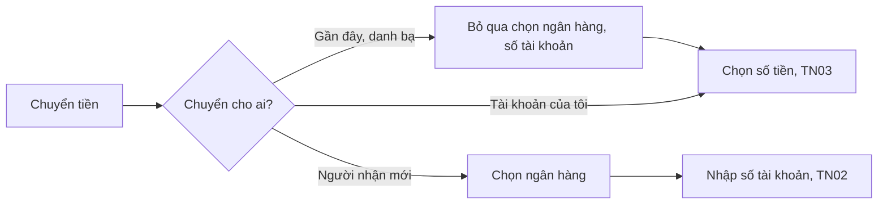

> **Mã:** DE07-TN01-PRD · **Trạng thái:** đã chốt · **Người viết:** Design · **SRS:** [SRS.md](SRS.md)

# PRD Chọn ngân hàng (App ngân hàng, chuyển khoản)

## 1. Bối cảnh và vấn đề

### 1.1 Bối cảnh

Chọn ngân hàng nhận là bước đầu tiên khi chuyển khoản bằng số tài khoản (xem [README](../../README.md)). Việt Nam có khoảng 50 ngân hàng thành viên Napas, nhiều ngân hàng có tên gần giống nhau, và người dùng thường chỉ nhớ tên viết tắt ("VCB", "TCB", "MB"). Phần lớn lần chuyển là cho **người nhận quen**, nên màn bắt đầu chuyển tiền cũng phải cho đi tắt tới người đã chuyển gần đây.

### 1.2 Vấn đề

| **Vấn đề** | **Hệ quả** |
| --- | --- |
| Danh sách 50 ngân hàng xếp theo bảng chữ cái, cuộn mãi | Chọn chậm, chọn nhầm |
| Chỉ nhớ tên viết tắt, ô tìm chỉ tìm tên đầy đủ | Không tìm thấy ngân hàng |
| Ngân hàng nhận đang bảo trì nhưng chỉ biết sau khi chuyển | Giao dịch lỗi, khách bực |
| Chuyển cho người quen mà vẫn phải chọn lại ngân hàng, gõ lại số tài khoản | Mất thời gian, dễ sai |
| Chuyển giữa các tài khoản của chính mình cũng phải đi đủ các bước | Bất tiện |

### 1.3 Mục tiêu

- Thời gian chọn ngân hàng ≤ 5 giây (trung vị).
- ≥ 70% lần chọn ngân hàng nằm trong 5 ngân hàng hay dùng hoặc tìm kiếm (không cuộn danh sách).
- ≥ 50% lệnh chuyển bắt đầu bằng đi tắt từ Gần đây hoặc Danh bạ.

## 2. Người dùng

| **Nhóm** | **Nhu cầu với tính năng này** |
| --- | --- |
| Người chuyển định kỳ (tiền nhà, học phí) | Chạm người nhận quen là xong bước này |
| Người chuyển cho người mới | Tìm ngân hàng bằng tên viết tắt |
| Người có nhiều tài khoản | Chuyển giữa tài khoản của mình nhanh |
| Người lớn tuổi | Logo ngân hàng to, dễ nhận ra |

## 3. Phạm vi

### 3.1 Trong phạm vi (MVP)

- Màn bắt đầu chuyển tiền: Người nhận mới (chọn ngân hàng), Gần đây, Danh bạ, Tài khoản của tôi.
- Danh sách ngân hàng: logo, tên viết tắt, tên đầy đủ; 5 ngân hàng hay dùng ở đầu; ngân hàng của mình được ghim.
- Tìm ngân hàng theo tên viết tắt, tên đầy đủ, không dấu.
- Trạng thái ngân hàng: đang bảo trì chuyển nhanh.

### 3.2 Ngoài phạm vi

- Chuyển tới ví điện tử, số điện thoại, ngân hàng nước ngoài.
- Quản lý danh bạ (sửa, xoá) – tính năng sẵn có của app.
- Đoán ngân hàng từ số tài khoản → phase sau.

## 4. Nguyên tắc sản phẩm

### 4.1 Người quen đi tắt

Màn bắt đầu cho thấy Gần đây và Danh bạ trước; chạm là bỏ qua bước chọn ngân hàng và nhập số tài khoản.

### 4.2 Tìm theo cách người dùng gọi

"VCB", "vietcom", "ngoai thuong" đều ra cùng một ngân hàng.

### 4.3 Báo trước khi có sự cố

Ngân hàng đang bảo trì được ghi nhãn ngay trong danh sách.

## 5. Quy tắc nghiệp vụ

| **Quy tắc** | **Giá trị** |
| --- | --- |
| Danh sách ngân hàng | Mọi ngân hàng thành viên Napas nhận chuyển khoản |
| Hay dùng | 5 ngân hàng khách chuyển thành công nhiều nhất trong 90 ngày |
| Gần đây | 10 người nhận gần nhất, không trùng |
| Danh bạ | Tối đa 200 người nhận đã lưu |
| Tìm kiếm | Tên viết tắt, tên đầy đủ, từ khoá phổ biến; không dấu |

## 6. Luồng trải nghiệm

| **Bước** | **Giai đoạn** | **Trải nghiệm** | **Đầu ra** |
| --- | --- | --- | --- |
| 1 | Mở chuyển tiền | Gần đây, Danh bạ, Tài khoản của tôi, Người nhận mới | Hướng đi |
| 2 | Chọn ngân hàng | Hay dùng ở đầu, ô tìm, danh sách logo | Ngân hàng nhận |
| 3 | Tiếp | Sang nhập số tài khoản | – |

## 7. Use Cases, User Stories và Acceptance Criteria

### UC1. Bắt đầu chuyển tiền

#### US1.1 Chuyển cho người quen

User Story: Là người trả tiền nhà hằng tháng, tôi muốn chạm vào "Chủ trọ" để chuyển ngay.

AC01: Màn bắt đầu: nút "Người nhận mới", Gần đây (cuộn ngang), Danh bạ (A–Z), Tài khoản của tôi (khi có ≥ 2 tài khoản).

AC02: Chạm người nhận quen → tra lại tên rồi sang chọn số tiền.

AC03: Ô tìm lọc danh bạ, gần đây theo tên, số tài khoản.

### UC2. Chọn ngân hàng

#### US2.1 Chọn nhanh

User Story: Là người chuyển cho người mới, tôi muốn gõ "tcb" là thấy ngân hàng.

AC01: 5 ngân hàng hay dùng ở đầu; ngân hàng của mình ghim trên cùng.

AC02: Ô tìm nhận tên viết tắt, tên đầy đủ, không dấu; kết quả hiện ngay khi gõ.

AC03: Mỗi ngân hàng có logo, tên viết tắt, tên đầy đủ.

#### US2.2 Biết ngân hàng đang bảo trì

AC01: Ngân hàng đang bảo trì chuyển nhanh có nhãn "Đang bảo trì"; vẫn chọn được, sẽ chuyển thường (TN03).

AC02: Ngân hàng tạm dừng nhận mọi chuyển khoản → không chọn được, ghi lý do.

## 8. Chỉ số theo dõi

| **Chỉ số** | **Định nghĩa** | **Mục tiêu MVP** |
| --- | --- | --- |
| Thời gian chọn ngân hàng | Mở **SCR-02** → chọn xong (trung vị) | ≤ 5 giây |
| Chọn không cuộn | Chọn từ Hay dùng hoặc tìm kiếm / tổng lần chọn | ≥ 70% |
| Đi tắt | Lệnh bắt đầu từ Gần đây, Danh bạ / tổng lệnh | ≥ 50% |
| Tìm không ra | Lượt tìm 0 kết quả / lượt tìm | ≤ 2% |
| Chọn sai ngân hàng | Lần tra tên không thấy ở TN02 rồi đổi ngân hàng / lần tra | Theo dõi |

## 9. Phụ thuộc và rủi ro

| **Mục** | **Mô tả** | **Hướng xử lý** |
| --- | --- | --- |
| Danh sách Napas thay đổi | Ngân hàng sáp nhập, đổi tên | Cấu hình từ máy chủ, cache 1 ngày |
| Trạng thái bảo trì | Thông báo từ Napas trễ | Cập nhật mỗi 5 phút |
| Từ khoá tìm | Thiếu tên gọi phổ biến | Vận hành bổ sung theo báo cáo tìm 0 kết quả |

## 10. Câu hỏi mở

> Mọi câu hỏi dưới đây đã được PO chốt ngày 20/11/2026; quyết định ghi sau mỗi câu và đã cập nhật vào SRS.

- Có cho nhập số tài khoản trước rồi chọn ngân hàng sau? → **Đã chốt:** Không; luồng chuẩn là chọn ngân hàng trước (SRS BR-03).
- Người nhận từ danh bạ có cần tra tên lại? → **Đã chốt:** Có, mỗi lần chuyển (SRS BR-07).
- Ngân hàng của mình xếp ở đâu? → **Đã chốt:** Ghim trên cùng, trên 5 ngân hàng hay dùng (SRS BR-04).
- Chuyển cho tài khoản của mình có tính hạn mức? → **Đã chốt:** Không tính vào hạn mức ngày (SRS BR-08).
