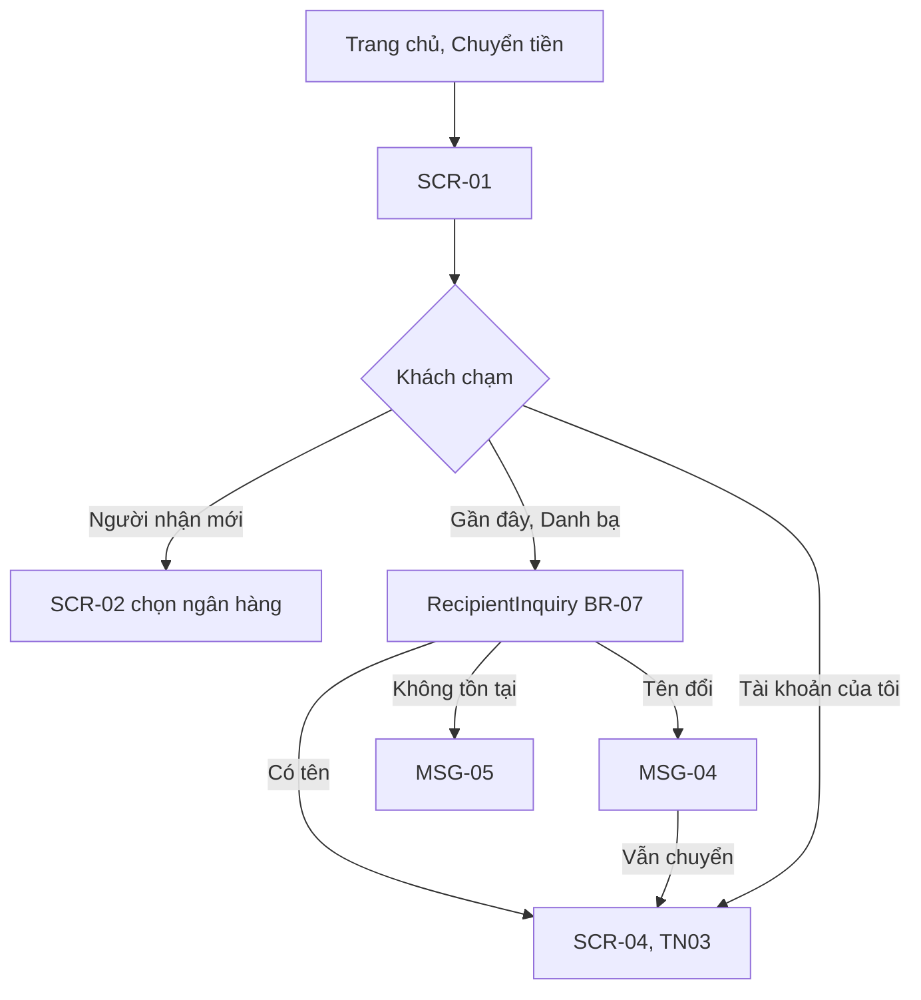
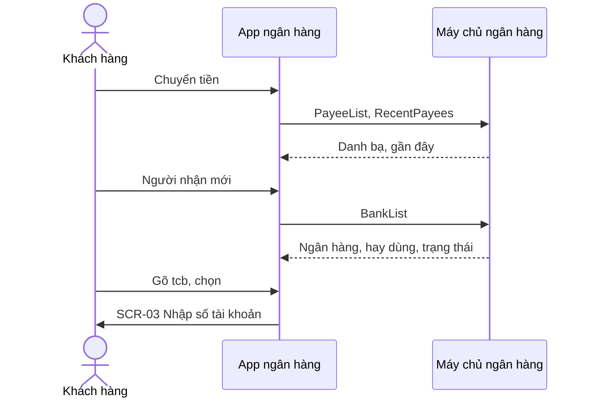

> **Mã:** DE07-TN01-SRS · **Trạng thái:** đã chốt · **Người viết:** Design · **PRD:** [PRD.md](PRD.md)

# UC-DE07-01 - Chọn ngân hàng

> SRS này mô tả màn bắt đầu chuyển tiền và bước chọn ngân hàng nhận; nhập số tài khoản xem [SRS TN02](../TN02-nhap-so-tai-khoan/SRS.md). Người nhận quen đi tắt thẳng tới [SRS TN03](../TN03-chon-so-tien/SRS.md).

## 1. Tổng quan

| **Mục** | **Nội dung** |
| --- | --- |
| Mục tiêu | Khách chọn đúng ngân hàng nhận thật nhanh, hoặc đi tắt tới người nhận quen |
| Actor | Khách hàng · App ngân hàng · Máy chủ ngân hàng · Napas (trạng thái ngân hàng) |
| Phạm vi | Màn bắt đầu chuyển tiền, Gần đây, Danh bạ, Tài khoản của tôi, danh sách ngân hàng, tìm ngân hàng, ngân hàng hay dùng, trạng thái bảo trì |
| Ngoài phạm vi | Ví, số điện thoại, ngân hàng nước ngoài, quản lý danh bạ, đoán ngân hàng |
| Nền tảng | App ngân hàng iOS / Android |

## 2. User Story

| **ID** | **As a** | **I want** | **So that** |
| --- | --- | --- | --- |
| US-01 | Khách hàng | Chạm người nhận quen để chuyển ngay | Không phải chọn lại ngân hàng, số tài khoản |
| US-02 | Khách hàng | Thấy ngân hàng hay dùng ở đầu | Chọn trong một chạm |
| US-03 | Khách hàng | Tìm ngân hàng bằng tên viết tắt | Không phải cuộn danh sách dài |
| US-04 | Khách hàng | Biết ngân hàng nào đang bảo trì | Không bất ngờ khi chuyển |
| US-05 | Khách hàng | Chuyển giữa tài khoản của mình | Không phải nhập số |

## 3. Business Rules

| **Mã** | **Quy tắc** |
| --- | --- |
| BR-01 | **Màn bắt đầu** (**SCR-01**): ô tìm; nút "Người nhận mới"; Gần đây (10 người nhận gần nhất từ giao dịch thành công, không trùng); Tài khoản của tôi (khi có ≥ 2 tài khoản thanh toán VND); Danh bạ (A–Z theo tên gợi nhớ, tối đa 200) |
| BR-02 | **Dòng người nhận** (Gần đây, Danh bạ): ảnh đại diện chữ cái đầu, tên gợi nhớ (hoặc tên chủ tài khoản), logo và tên viết tắt ngân hàng, 4 số cuối tài khoản; nhãn cảnh báo nếu tài khoản bị báo cáo lừa đảo |
| BR-03 | **Thứ tự bước** với người nhận mới: chọn ngân hàng (**SCR-02**) → nhập số tài khoản (TN02). Không có luồng nhập số trước |
| BR-04 | **Danh sách ngân hàng** (**SCR-02**): mọi thành viên Napas nhận chuyển khoản; mỗi mục có logo, tên viết tắt, tên đầy đủ. Thứ tự: ngân hàng của chính app (ghim trên cùng) → 5 ngân hàng hay dùng (chuyển thành công nhiều nhất 90 ngày, nhóm "Hay dùng") → còn lại theo tên viết tắt A–Z |
| BR-05 | **Tìm ngân hàng**: không phân biệt dấu, hoa thường; khớp tên viết tắt, tên đầy đủ, từ khoá phổ biến do vận hành cấu hình (ví dụ "ngoai thuong"); lọc ngay khi gõ, từ 1 ký tự; 0 kết quả → MSG-02 |
| BR-06 | **Trạng thái ngân hàng**: `BINH_THUONG`; `BAO_TRI_NHANH` (nhãn "Đang bảo trì", chọn được, TN03 chỉ cho chuyển thường); `TAM_DUNG` (mờ, không chọn được, MSG-03). Cập nhật mỗi 5 phút |
| BR-07 | **Đi tắt từ Gần đây, Danh bạ**: chạm → tra tên lại (\[RecipientInquiry\], như TN02 BR-12); có tên → mở **SCR-04** (TN03); tên khác tên đã lưu → MSG-04; tài khoản không tồn tại → MSG-05 |
| BR-08 | **Tài khoản của tôi**: tài khoản thanh toán VND khác cùng chủ, đang hoạt động; không tra tên, không cảnh báo; mở thẳng **SCR-04**; không tính vào hạn mức ngày (TN03 BR-23) |

## 4. Trạng thái

### 4.1 Hiển thị ngân hàng trên SCR-02

| **Trạng thái** | **Hiển thị** | **Chọn được** |
| --- | --- | --- |
| `BINH_THUONG` | Logo, tên viết tắt, tên đầy đủ | Có |
| `BAO_TRI_NHANH` | Như trên + nhãn vàng "Đang bảo trì" | Có, chỉ chuyển thường |
| `TAM_DUNG` | Mờ, nhãn "Tạm dừng" | Không |

## 5. Use Case

### UC-01 Bắt đầu chuyển tiền

| **Mục** | **Nội dung** |
| --- | --- |
| Tiền điều kiện | Khách đã đăng nhập |
| Hậu điều kiện thành công | Mở **SCR-02** (người nhận mới) hoặc **SCR-04** (đi tắt) |
| Hậu điều kiện thất bại | Ở lại **SCR-01** |

**Luồng chính**

| **Bước** | **Actor** | **Mô tả** |
| --- | --- | --- |
| 1 | Khách hàng | Chạm "Chuyển tiền" ở trang chủ |
| 2 | App | Gọi \[PayeeList\], \[RecentPayees\]; hiện **SCR-01** |
| 3 | Khách hàng | Chạm "Người nhận mới" |
| 4 | App | Mở **SCR-02** |

**Luồng thay thế**

| **Mã** | **Điều kiện** | **Xử lý** |
| --- | --- | --- |
| A1 | Chạm người nhận ở Gần đây, Danh bạ | BR-07 |
| A2 | Chạm Tài khoản của tôi | BR-08 |
| A3 | Tìm ở **SCR-01** | Lọc Gần đây, Danh bạ theo tên, 4 số cuối |
| A4 | Người nhận có nhãn cảnh báo | Vẫn đi tiếp; cảnh báo toàn trang ở TN04 |

**Luồng lỗi**

| **Mã** | **Điều kiện** | **Xử lý** |
| --- | --- | --- |
| E1 | Tên người nhận đã đổi | MSG-04 |
| E2 | Tài khoản nhận không còn | MSG-05 |
| E3 | Không tải được danh bạ | Dùng bản lưu trên máy; MSG-01 |

### UC-02 Chọn ngân hàng

| **Mục** | **Nội dung** |
| --- | --- |
| Tiền điều kiện | Khách ở **SCR-02** |
| Hậu điều kiện thành công | Có ngân hàng nhận; mở **SCR-03** (TN02) |
| Hậu điều kiện thất bại | Ở lại **SCR-02** |

**Luồng chính**

| **Bước** | **Actor** | **Mô tả** |
| --- | --- | --- |
| 1 | App | Gọi \[BankList\]; hiện ngân hàng của app, nhóm Hay dùng, danh sách A–Z |
| 2 | Khách hàng | Gõ "tcb" |
| 3 | App | Lọc còn Techcombank |
| 4 | Khách hàng | Chạm ngân hàng |
| 5 | App | Mở **SCR-03** với ngân hàng đã chọn |

**Luồng thay thế**

| **Mã** | **Điều kiện** | **Xử lý** |
| --- | --- | --- |
| A1 | Chọn trong Hay dùng | Bỏ bước 2–3 |
| A2 | Ngân hàng `BAO_TRI_NHANH` | Chọn được; **SCR-03** mang theo cờ bảo trì |

**Luồng lỗi**

| **Mã** | **Điều kiện** | **Xử lý** |
| --- | --- | --- |
| E1 | Tìm 0 kết quả | MSG-02 |
| E2 | Chạm ngân hàng `TAM_DUNG` | MSG-03 |
| E3 | Không tải được danh sách | Dùng bản cache; không có cache → MSG-01 |

## 6. Điểm vào

| **Điểm vào** | **Dẫn tới** | **Ghi chú** |
| --- | --- | --- |
| Nút "Chuyển tiền" ở trang chủ | **SCR-01** | |
| "Đổi ngân hàng" ở **SCR-03** (TN02) | **SCR-02** | Giữ số tài khoản đã nhập |
| "Chuyển tiếp" ở **SCR-07** (TN05) | **SCR-01** | |

## 7. Mô tả màn hình

### SCR-01 Chuyển tiền

| **#** | **Thành phần** | **Loại** | **Hành vi** |
| --- | --- | --- | --- |
| 1 | Ô tìm | Search | A3 UC-01 |
| 2 | "Người nhận mới" | Button nổi bật | Mở **SCR-02** |
| 3 | Gần đây | Avatar cuộn ngang | BR-01, BR-02 |
| 4 | Tài khoản của tôi | List | BR-08 |
| 5 | Danh bạ | List A–Z | BR-02; chỉ mục chữ cái bên phải |

### SCR-02 Chọn ngân hàng

| **#** | **Thành phần** | **Loại** | **Hành vi** |
| --- | --- | --- | --- |
| 1 | Ô tìm | Search | BR-05; bàn phím mở sẵn |
| 2 | Ngân hàng của app | List item ghim | BR-04 |
| 3 | Hay dùng | Lưới logo 5 ô | BR-04 |
| 4 | Tất cả ngân hàng | List | Logo, tên viết tắt, tên đầy đủ, nhãn trạng thái (mục 4.1) |
| 5 | Trạng thái rỗng | Empty state | MSG-02 |

## 8. API

| **API** | **Request chính** | **Response chính** | **Timeout / retry** |
| --- | --- | --- | --- |
| \[PayeeList\] | – | Danh bạ, cờ cảnh báo | 5s / 1 lần; cache trên máy |
| \[RecentPayees\] | – | 10 người nhận gần đây | 3s / 1 lần |
| \[BankList\] | – | Ngân hàng, viết tắt, từ khoá, logo, trạng thái, hay dùng | 5s / 1 lần; cache 1 ngày, trạng thái làm mới 5 phút |
| \[RecipientInquiry\] | bank_code, account | Tên, risk_flag, inquiry_id | 5s / người dùng thử lại |

**Map lỗi → thông báo**

| **Nhóm lỗi** | **Message** |
| --- | --- |
| Mất mạng, lỗi máy chủ | MSG-01 |
| Tìm 0 kết quả | MSG-02 |
| Ngân hàng tạm dừng | MSG-03 |
| Tên người nhận đã đổi | MSG-04 |
| Tài khoản người nhận không còn | MSG-05 |

## 9. Danh sách thông báo

| **ID** | **Nơi hiện** | **Nội dung (VI)** |
| --- | --- | --- |
| MSG-01 | Toast | Kết nối không ổn định, vui lòng thử lại |
| MSG-02 | Empty state | Không tìm thấy ngân hàng “{từ khoá}”. Thử tên viết tắt, ví dụ VCB, BIDV |
| MSG-03 | Toast | {Ngân hàng} tạm dừng nhận chuyển khoản. Vui lòng thử lại sau |
| MSG-04 | Popup | Tên chủ tài khoản đã thay đổi: trước đây "{tên cũ}", hiện tại "{tên mới}". Bạn có chắc vẫn muốn chuyển? \[Vẫn chuyển\] \[Huỷ\] |
| MSG-05 | Popup | Tài khoản nhận không còn tồn tại hoặc đã bị khoá. Bạn có muốn xoá người nhận này khỏi danh bạ? \[Xoá\] \[Để sau\] |

## 10. Yêu cầu phi chức năng

| **Mục** | **Yêu cầu** |
| --- | --- |
| Hiệu năng | **SCR-01**, **SCR-02** hiện ≤ 500 ms (dữ liệu cache, làm mới nền); lọc tìm kiếm ≤ 100 ms |
| Riêng tư | Danh bạ mã hoá khi lưu trên máy; số tài khoản chỉ hiện 4 số cuối trong danh sách |
| Log / audit | Ngân hàng được chọn, cách chọn (hay dùng, tìm, cuộn) |
| Tracking | Nguồn bắt đầu (mới, gần đây, danh bạ, của tôi), thời gian chọn ngân hàng, từ khoá tìm 0 kết quả, chọn ngân hàng bảo trì |
| Accessibility | Logo kèm tên dạng chữ; danh sách A–Z có chỉ mục; nhãn trạng thái đọc được bằng giọng đọc |
