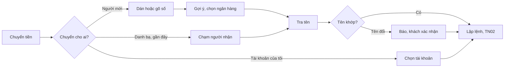

> **Mã:** DE07-TN01-PRD · **Trạng thái:** đã chốt · **Người viết:** Design · **SRS:** [SRS.md](SRS.md)

# PRD Người thụ hưởng và danh bạ (App ngân hàng, chuyển khoản)

## 1. Bối cảnh và vấn đề

### 1.1 Bối cảnh

Mọi lần chuyển khoản bắt đầu bằng câu hỏi "chuyển cho ai" (xem [README](../../README.md)). Người dùng chuyển tiền nhà cho chủ trọ, học phí cho trường, tiền hàng cho nhà cung cấp, tiền cho bố mẹ. Phần lớn là **người nhận quen**, lặp lại hằng tháng; một phần là người nhận mới, số tài khoản được gửi qua tin nhắn.

### 1.2 Vấn đề

| **Vấn đề** | **Hệ quả** |
| --- | --- |
| Phải nhớ ngân hàng của người nhận, chọn trong danh sách 50 ngân hàng | Chọn nhầm, tra tên lỗi |
| Gõ số tài khoản dài, nhầm một số | Tra ra tên người khác, có thể chuyển nhầm |
| Người nhận quen nhưng phải nhập lại mỗi lần | Mất thời gian, dễ sai |
| Danh bạ chỉ có tên in hoa không dấu từ ngân hàng | Không phân biệt "NGUYEN VAN AN" nào |
| Chuyển giữa các tài khoản của chính mình cũng phải nhập số | Bất tiện |

### 1.3 Mục tiêu

- ≥ 60% lệnh chuyển chọn người nhận từ danh bạ hoặc gần đây.
- Thời gian chọn người nhận mới (dán số tài khoản → có tên) ≤ 15 giây (trung vị).
- Tỉ lệ tra tên thất bại do chọn sai ngân hàng giảm 50%.

## 2. Người dùng

| **Nhóm** | **Nhu cầu với tính năng này** |
| --- | --- |
| Người chuyển định kỳ (tiền nhà, học phí) | Chọn người nhận quen trong 1 chạm |
| Chủ hộ kinh doanh | Danh bạ nhà cung cấp có tên gợi nhớ |
| Người nhận số tài khoản qua tin nhắn | Dán số, app tự đoán ngân hàng |
| Người có nhiều tài khoản | Chuyển giữa tài khoản của mình nhanh |

## 3. Phạm vi

### 3.1 Trong phạm vi (MVP)

- Chọn người nhận: Danh bạ, Gần đây, Tài khoản của tôi, Người nhận mới.
- Người nhận mới bằng số tài khoản hoặc số thẻ; gợi ý ngân hàng; tra tên chủ tài khoản.
- Dán số tài khoản từ bộ nhớ tạm; nhận diện cả ngân hàng nếu văn bản có tên ngân hàng.
- Danh bạ thụ hưởng: lưu, tên gợi nhớ, ảnh đại diện màu chữ cái, sửa, xoá, tìm.

### 3.2 Ngoài phạm vi

- Chuyển bằng QR (xem Đề 4).
- Chuyển tới số điện thoại, ví điện tử, tài khoản nước ngoài.
- Chia sẻ danh bạ giữa nhiều người dùng.
- Nhóm người nhận để chuyển hàng loạt.

## 4. Nguyên tắc sản phẩm

### 4.1 Người nhận quen ở trên cùng

Màn chuyển tiền mở ra là thấy danh bạ và gần đây; người nhận mới là lựa chọn thứ hai.

### 4.2 Tên chủ tài khoản luôn được xác minh

Mỗi lần chuyển, kể cả từ danh bạ, đều tra lại tên tại ngân hàng nhận. Tên thay đổi thì báo.

### 4.3 Bớt chọn, bớt gõ

Dán số tài khoản và để app đoán ngân hàng; ngân hàng hay dùng lên đầu danh sách.

## 5. Quy tắc nghiệp vụ

| **Quy tắc** | **Giá trị** |
| --- | --- |
| Số tài khoản | 6–19 chữ số tuỳ ngân hàng |
| Số thẻ | 16 hoặc 19 chữ số, thẻ nội địa thành viên Napas |
| Danh bạ | Tối đa 200 người nhận |
| Tên gợi nhớ | 1–30 ký tự, có dấu |
| Gần đây | 10 người nhận gần nhất, không trùng |
| Tra tên | Bắt buộc trước mỗi lần chuyển |

## 6. Luồng trải nghiệm

| **Bước** | **Giai đoạn** | **Trải nghiệm** | **Đầu ra** |
| --- | --- | --- | --- |
| 1 | Mở chuyển tiền | Danh bạ, gần đây, tài khoản của tôi | Người nhận quen |
| 2 | Người nhận mới | Dán số, app đoán ngân hàng | Số + ngân hàng |
| 3 | Xác minh | Tên chủ tài khoản từ ngân hàng nhận | Người nhận đã xác minh |
| 4 | Lưu | Lưu danh bạ với tên gợi nhớ (sau khi chuyển) | Danh bạ |

## 7. Use Cases, User Stories và Acceptance Criteria

### UC1. Chọn người nhận quen

#### US1.1 Chuyển cho người trong danh bạ

User Story: Là người trả tiền nhà hằng tháng, tôi muốn chạm vào "Chủ trọ" để chuyển ngay.

AC01: Màn chuyển tiền hiện ô tìm, Gần đây (cuộn ngang), Danh bạ (A–Z).

AC02: Mỗi người nhận: tên gợi nhớ, tên chủ tài khoản, ngân hàng, 4 số cuối.

AC03: Chạm → tra tên lại; tên khớp → sang lập lệnh.

AC04: Tên tại ngân hàng khác tên đã lưu → báo, khách xác nhận trước khi tiếp tục.

#### US1.2 Chuyển giữa tài khoản của mình

AC01: Mục "Tài khoản của tôi" liệt kê tài khoản khác cùng chủ, không cần tra tên.

### UC2. Người nhận mới

#### US2.1 Nhập nhanh

User Story: Là người nhận số tài khoản qua tin nhắn, tôi muốn dán vào là app tự đoán ngân hàng.

AC01: Có số tài khoản trong bộ nhớ tạm → gợi ý "Dán {số}"; văn bản có tên ngân hàng → chọn sẵn ngân hàng.

AC02: Chưa rõ ngân hàng → gợi ý ngân hàng có khả năng nhất và ngân hàng hay dùng; tìm ngân hàng không dấu, theo tên viết tắt.

AC03: Nhập số thẻ → tự nhận diện ngân hàng phát hành.

AC04: Tra tên không thấy → báo kiểm tra lại số và ngân hàng.

### UC3. Danh bạ

AC01: Sau khi chuyển thành công, gợi ý lưu với tên gợi nhớ.

AC02: Sửa tên gợi nhớ, xoá người nhận; tìm theo tên, số tài khoản.

AC03: Đủ 200 người nhận → báo xoá bớt.

## 8. Chỉ số theo dõi

| **Chỉ số** | **Định nghĩa** | **Mục tiêu MVP** |
| --- | --- | --- |
| Tỉ lệ chọn người quen | Lệnh từ danh bạ, gần đây / tổng lệnh | ≥ 60% |
| Thời gian người nhận mới | Mở người nhận mới → có tên (trung vị) | ≤ 15 giây |
| Tỉ lệ dùng gợi ý ngân hàng | Lệnh mới chọn đúng ngân hàng từ gợi ý / lệnh mới | ≥ 70% |
| Tra tên thất bại | Lần tra không tìm thấy / lần tra | Giảm 50% |
| Tỉ lệ lưu danh bạ | Người nhận mới được lưu / người nhận mới chuyển thành công | Theo dõi |

## 9. Phụ thuộc và rủi ro

| **Mục** | **Mô tả** | **Hướng xử lý** |
| --- | --- | --- |
| Dịch vụ tra tên Napas | Chậm, lỗi | Timeout 5 giây, thử lại; không có tên thì không cho chuyển |
| Đoán ngân hàng sai | Định dạng số tài khoản các ngân hàng trùng nhau | Chỉ gợi ý, khách luôn xác nhận; tra tên là bước kiểm chứng |
| Tài khoản đã đổi chủ, đã đóng | Danh bạ cũ | Tra lại mỗi lần; báo khi tên đổi |
| Dán từ bộ nhớ tạm | Lộ dữ liệu khác | Chỉ đọc khi khách chạm "Dán" (theo quy định hệ điều hành) |

## 10. Câu hỏi mở

> Mọi câu hỏi dưới đây đã được PO chốt ngày 20/11/2026; quyết định ghi sau mỗi câu và đã cập nhật vào SRS.

- Có tự động lưu người nhận sau khi chuyển? → **Đã chốt:** Không. Gợi ý lưu, khách chọn (SRS BR-08).
- Đoán ngân hàng dựa trên gì? → **Đã chốt:** Tên ngân hàng trong văn bản dán; với số thẻ dùng mã BIN; với số tài khoản dùng lịch sử chuyển của khách và quy tắc độ dài; không gọi tra tên thử nhiều ngân hàng (SRS BR-04).
- Người nhận bị cảnh báo lừa đảo có lưu danh bạ được? → **Đã chốt:** Không (SRS BR-09).
- Có đồng bộ danh bạ với chuyển khoản QR? → **Đã chốt:** Có, dùng chung một danh bạ (SRS BR-07).
