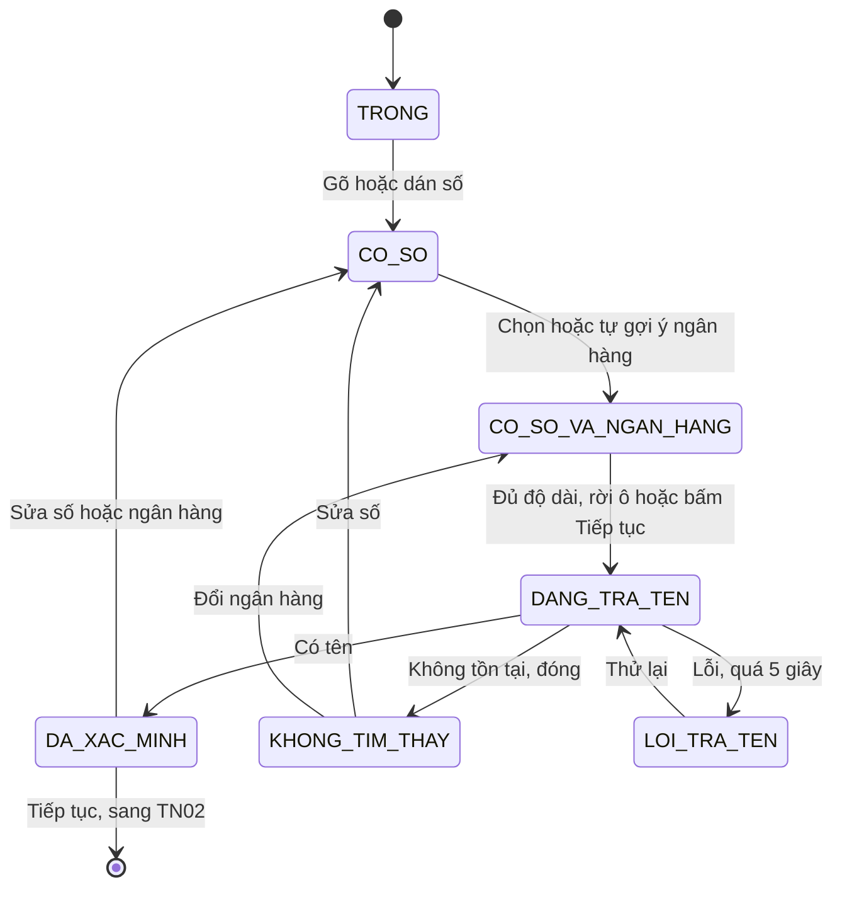
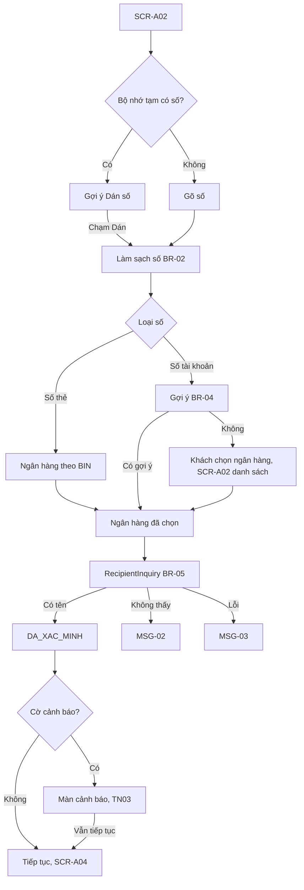
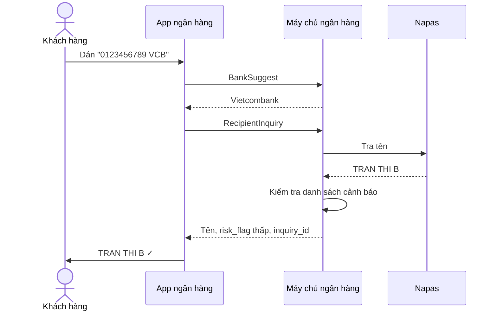

> **Mã:** DE07-TN01-SRS · **Trạng thái:** đã chốt · **Người viết:** Design · **PRD:** [PRD.md](PRD.md)

# UC-DE07-01 - Người thụ hưởng và danh bạ

> SRS này mô tả việc chọn và xác minh người nhận; lập lệnh và xác thực xem [SRS TN02](../TN02-lap-lenh-xac-thuc/SRS.md).

## 1. Tổng quan

| **Mục** | **Nội dung** |
| --- | --- |
| Mục tiêu | Khách chọn người nhận nhanh, đúng, đã được ngân hàng nhận xác minh tên |
| Actor | Khách hàng · App ngân hàng · Máy chủ ngân hàng · Napas |
| Phạm vi | Màn chọn người nhận, gần đây, danh bạ, tài khoản của tôi, người nhận mới, gợi ý ngân hàng, tra tên, lưu, sửa, xoá danh bạ |
| Ngoài phạm vi | QR, số điện thoại, ví, quốc tế, chuyển hàng loạt |
| Nền tảng | App ngân hàng iOS / Android |

## 2. User Story

| **ID** | **As a** | **I want** | **So that** |
| --- | --- | --- | --- |
| US-01 | Khách hàng | Chọn người nhận quen trong 1 chạm | Chuyển nhanh khoản hằng tháng |
| US-02 | Khách hàng | Dán số tài khoản và được gợi ý ngân hàng | Không phải tìm trong danh sách dài |
| US-03 | Khách hàng | Thấy tên chủ tài khoản thật trước khi chuyển | Không chuyển nhầm |
| US-04 | Khách hàng | Đặt tên gợi nhớ cho người nhận | Phân biệt người trùng tên |
| US-05 | Khách hàng | Chuyển giữa tài khoản của mình | Không phải nhập số |

## 3. Business Rules

| **Mã** | **Quy tắc** |
| --- | --- |
| BR-01 | **Màn chọn người nhận** (**SCR-A01**) gồm: ô tìm, Gần đây (10 người nhận gần nhất từ giao dịch thành công, không trùng, không gồm tài khoản của tôi), Tài khoản của tôi (khi có ≥ 2 tài khoản thanh toán), Danh bạ (A–Z theo tên gợi nhớ), nút "Người nhận mới" |
| BR-02 | **Số tài khoản**: chỉ chữ số, 6–19 ký tự; tự bỏ khoảng trắng, dấu chấm, gạch ngang khi dán. **Số thẻ**: 16 hoặc 19 chữ số, kiểm tra Luhn; hiển thị nhóm 4 số |
| BR-03 | **Danh sách ngân hàng**: mọi thành viên Napas; mỗi ngân hàng có tên đầy đủ, tên viết tắt, logo; tìm không dấu theo tên hoặc viết tắt. 5 ngân hàng khách hay chuyển nhất xếp đầu |
| BR-04 | **Gợi ý ngân hàng**: (1) văn bản dán có tên hoặc viết tắt ngân hàng → chọn sẵn; (2) số thẻ → theo mã BIN; (3) số tài khoản từng chuyển thành công → ngân hàng lần trước; (4) không có → hiện 5 ngân hàng hay chuyển, không chọn sẵn. Không tra tên thử nhiều ngân hàng |
| BR-05 | **Tra tên** (\[RecipientInquiry\]) mỗi lần chọn người nhận, kể cả từ danh bạ, gần đây. Cùng ngân hàng → nội bộ; khác → Napas. Kết quả hợp lệ 10 phút (inquiry_id). Không có tên → không cho sang TN02 |
| BR-06 | **Tên thay đổi**: tên tra được khác tên chủ tài khoản đã lưu trong danh bạ → MSG-04 hiện cả hai tên; khách chọn "Vẫn chuyển" (cập nhật tên đã lưu) hoặc "Huỷ" |
| BR-07 | **Danh bạ thụ hưởng** dùng chung cho chuyển khoản số tài khoản và QR; tối đa 200; mỗi mục: tên gợi nhớ (1–30 ký tự, có dấu), tên chủ tài khoản (từ ngân hàng), ngân hàng, số tài khoản hoặc thẻ; ảnh đại diện là chữ cái đầu tên gợi nhớ trên nền màu sinh từ tên |
| BR-08 | **Lưu người nhận**: gợi ý trên màn kết quả thành công (TN02) khi người nhận chưa có trong danh bạ; tên gợi nhớ mặc định = tên chủ tài khoản viết hoa chữ cái đầu. Thêm từ **SCR-A03** cũng phải tra tên thành công |
| BR-09 | **Không lưu** người nhận có cờ cảnh báo lừa đảo (TN03); người nhận đã lưu bị gắn cờ sau này → mục danh bạ hiện nhãn cảnh báo, chạm vẫn đi qua màn cảnh báo TN03 |
| BR-10 | **Tài khoản của tôi**: tài khoản thanh toán VND khác cùng chủ, đang hoạt động; không tra tên, không cảnh báo, không tính vào hạn mức ngày (TN02 BR-16) |

## 4. Trạng thái

### 4.1 Trạng thái nhập người nhận mới (SCR-A02)

### 4.2 Hiển thị

| **Trạng thái** | **Hiển thị** |
| --- | --- |
| `DANG_TRA_TEN` | Spinner trong ô tên chủ tài khoản |
| `DA_XAC_MINH` | Tên chủ tài khoản in đậm, dấu tích; nút "Tiếp tục" bật |
| `KHONG_TIM_THAY` | MSG-02 dưới ô số |
| `LOI_TRA_TEN` | MSG-03 + "Thử lại" |

## 5. Use Case

### UC-01 Chọn người nhận quen

| **Mục** | **Nội dung** |
| --- | --- |
| Tiền điều kiện | Đã đăng nhập |
| Hậu điều kiện thành công | Có người nhận đã xác minh (inquiry_id); mở **SCR-A04** (TN02) |
| Hậu điều kiện thất bại | Ở lại **SCR-A01** |

**Luồng chính**

| **Bước** | **Actor** | **Mô tả** |
| --- | --- | --- |
| 1 | Khách hàng | Chạm "Chuyển tiền" ở trang chủ |
| 2 | App | Gọi \[PayeeList\], \[RecentPayees\]; hiện **SCR-A01** |
| 3 | Khách hàng | Chạm "Chủ trọ" trong danh bạ |
| 4 | App | Gọi \[RecipientInquiry\] |
| 5 | Máy chủ | Trả tên, khớp tên đã lưu, không có cờ |
| 6 | App | Mở **SCR-A04** với người nhận |

**Luồng thay thế**

| **Mã** | **Điều kiện** | **Xử lý** |
| --- | --- | --- |
| A1 | Chọn Tài khoản của tôi | Không tra tên (BR-10); mở **SCR-A04** |
| A2 | Tìm trong ô tìm | Lọc danh bạ và gần đây theo tên gợi nhớ, tên chủ tài khoản, 4 số cuối; không dấu |
| A3 | Tên thay đổi | MSG-04 (BR-06) |
| A4 | Người nhận có cờ cảnh báo | Màn cảnh báo TN03 trước khi mở **SCR-A04** |

**Luồng lỗi**

| **Mã** | **Điều kiện** | **Xử lý** |
| --- | --- | --- |
| E1 | Tài khoản nhận đã đóng | MSG-02; gợi ý xoá khỏi danh bạ |
| E2 | Tra tên lỗi | MSG-03 |

### UC-02 Nhập người nhận mới

| **Mục** | **Nội dung** |
| --- | --- |
| Tiền điều kiện | Đã đăng nhập |
| Hậu điều kiện thành công | Người nhận `DA_XAC_MINH`; mở **SCR-A04** |
| Hậu điều kiện thất bại | Ở lại **SCR-A02** |

**Luồng chính**

| **Bước** | **Actor** | **Mô tả** |
| --- | --- | --- |
| 1 | Khách hàng | Ở **SCR-A01** chạm "Người nhận mới" |
| 2 | App | Mở **SCR-A02**; bộ nhớ tạm có chuỗi số → hiện chip "Dán {số che giữa}" |
| 3 | Khách hàng | Chạm chip Dán |
| 4 | App | Làm sạch số; văn bản dán có "VCB" → chọn sẵn ngân hàng tương ứng (BR-04) |
| 5 | App | Gọi \[RecipientInquiry\]; hiện tên chủ tài khoản |
| 6 | Khách hàng | Kiểm tra tên, bấm "Tiếp tục" |
| 7 | App | Mở **SCR-A04** |

**Luồng thay thế**

| **Mã** | **Điều kiện** | **Xử lý** |
| --- | --- | --- |
| A1 | Không đoán được ngân hàng | Danh sách ngân hàng, 5 ngân hàng hay dùng ở đầu, ô tìm |
| A2 | Nhập số thẻ | Ngân hàng theo BIN, khoá lựa chọn ngân hàng |
| A3 | Người nhận đã có trong danh bạ | Hiện "Đã lưu với tên {tên gợi nhớ}" |

**Luồng lỗi**

| **Mã** | **Điều kiện** | **Xử lý** |
| --- | --- | --- |
| E1 | Số sai định dạng (độ dài, Luhn) | MSG-01 |
| E2 | Không tìm thấy tài khoản | MSG-02 |
| E3 | Tra tên lỗi | MSG-03; thử lại tối đa 3 lần |

### UC-03 Quản lý danh bạ

**Luồng chính**

| **Bước** | **Actor** | **Mô tả** |
| --- | --- | --- |
| 1 | Khách hàng | Mở **SCR-A03** từ **SCR-A01** ("Quản lý") hoặc Cài đặt |
| 2 | Khách hàng | Chạm một người nhận → Sửa tên gợi nhớ |
| 3 | App | Gọi \[PayeeUpdate\]; MSG-06 |

**Luồng thay thế**

| **Mã** | **Điều kiện** | **Xử lý** |
| --- | --- | --- |
| A1 | Thêm mới | Như UC-02 tới bước 5 → nhập tên gợi nhớ → \[PayeeSave\] |
| A2 | Xoá | Vuốt trái hoặc menu → MSG-07 xác nhận → \[PayeeDelete\] |
| A3 | Lưu từ màn kết quả (TN02) | BR-08 |

**Luồng lỗi**

| **Mã** | **Điều kiện** | **Xử lý** |
| --- | --- | --- |
| E1 | Đủ 200 | MSG-05 |
| E2 | Người nhận có cờ cảnh báo | MSG-08 (BR-09) |

## 6. Điểm vào

| **Điểm vào** | **Dẫn tới** | **Ghi chú** |
| --- | --- | --- |
| "Chuyển tiền" ở trang chủ | **SCR-A01** | |
| Dán số tài khoản khi đang ở trang chủ (gợi ý nổi) | **SCR-A02** đã điền số | Theo BR-04 |
| Cài đặt → Danh bạ thụ hưởng | **SCR-A03** | |
| "Chuyển lại" ở chi tiết giao dịch (TN05) | UC-01 bước 4 | |
| Lệnh hẹn lịch (TN04) | **SCR-A01** chế độ chọn người nhận | |

## 7. Mô tả màn hình

### SCR-A01 Chọn người nhận

| **#** | **Thành phần** | **Loại** | **Hành vi** |
| --- | --- | --- | --- |
| 1 | Ô tìm | Search | A2 UC-01 |
| 2 | Người nhận mới | Button nổi bật | Mở **SCR-A02** |
| 3 | Gần đây | Avatar cuộn ngang | 10 người (BR-01) |
| 4 | Tài khoản của tôi | List | BR-10 |
| 5 | Danh bạ | List A–Z | Tên gợi nhớ, tên chủ tài khoản, logo ngân hàng, 4 số cuối; nhãn cảnh báo (BR-09) |
| 6 | Quản lý | Link | Mở **SCR-A03** |

### SCR-A02 Người nhận mới

| **#** | **Thành phần** | **Loại** | **Bắt buộc** | **Validate / hành vi** |
| --- | --- | --- | --- | --- |
| 1 | Số tài khoản / số thẻ | Number | Có | BR-02; chip "Dán" khi có |
| 2 | Ngân hàng | Dòng chọn | Có | Gợi ý BR-04; mở danh sách ngân hàng có tìm (BR-03) |
| 3 | Tên chủ tài khoản | Read-only | – | Mục 4.2 |
| 4 | Đã lưu | Info | – | A3 UC-02 |
| 5 | "Tiếp tục" | Button | – | Bật ở `DA_XAC_MINH` |

### SCR-A03 Danh bạ thụ hưởng

| **#** | **Thành phần** | **Loại** | **Hành vi** |
| --- | --- | --- | --- |
| 1 | Ô tìm | Search | Tên, số tài khoản |
| 2 | Danh sách | List A–Z | Vuốt để sửa, xoá |
| 3 | "Thêm người nhận" | Button | A1 UC-03 |
| 4 | Số lượng | Text | "{n}/200" |
| 5 | Sửa tên gợi nhớ | Bottom sheet | 1–30 ký tự |

## 8. API

| **API** | **Request chính** | **Response chính** | **Timeout / retry** |
| --- | --- | --- | --- |
| \[PayeeList\] | – | Danh bạ (BR-07), cờ cảnh báo | 5s / 1 lần |
| \[RecentPayees\] | – | 10 người nhận gần đây | 3s / 1 lần |
| \[BankList\] | – | Ngân hàng Napas, viết tắt, logo, BIN | 5s / cache 1 ngày |
| \[BankSuggest\] | account_no, pasted_text | Ngân hàng gợi ý hoặc null | 2s / không retry |
| \[RecipientInquiry\] | bank_code, account_or_card | name, risk_flag, inquiry_id, name_changed_from | 5s / người dùng thử lại |
| \[PayeeSave\], \[PayeeUpdate\], \[PayeeDelete\] | payee | payee_id | 5s / 1 lần |

**Map lỗi → thông báo**

| **Nhóm lỗi** | **Message** |
| --- | --- |
| Số sai định dạng | MSG-01 |
| Không tìm thấy tài khoản | MSG-02 |
| Tra tên lỗi | MSG-03 |
| Tên đã thay đổi | MSG-04 |
| Danh bạ đầy | MSG-05 |
| Lưu, sửa thành công | MSG-06 |
| Xác nhận xoá | MSG-07 |
| Không lưu người nhận bị cảnh báo | MSG-08 |

## 9. Danh sách thông báo

| **ID** | **Nơi hiện** | **Nội dung (VI)** |
| --- | --- | --- |
| MSG-01 | Inline | Số tài khoản gồm 6–19 chữ số; số thẻ gồm 16 hoặc 19 chữ số |
| MSG-02 | Inline | Không tìm thấy tài khoản tại {ngân hàng}. Kiểm tra lại số tài khoản và ngân hàng |
| MSG-03 | Inline | Chưa kiểm tra được tên người nhận. \[Thử lại\] |
| MSG-04 | Popup | Tên chủ tài khoản đã thay đổi: trước đây "{tên cũ}", hiện tại "{tên mới}". Bạn có chắc vẫn muốn chuyển? \[Vẫn chuyển\] \[Huỷ\] |
| MSG-05 | Toast | Danh bạ đã đủ 200 người nhận. Xoá bớt để lưu người mới |
| MSG-06 | Toast | Đã lưu |
| MSG-07 | Popup | Xoá {tên gợi nhớ} khỏi danh bạ? \[Xoá\] \[Huỷ\] |
| MSG-08 | Toast | Không thể lưu người nhận này vì tài khoản đang bị cảnh báo |

## 10. Yêu cầu phi chức năng

| **Mục** | **Yêu cầu** |
| --- | --- |
| Hiệu năng | **SCR-A01** hiện ≤ 1 giây (danh bạ cache trên máy, làm mới nền); \[RecipientInquiry\] ≤ 2 giây (p95) |
| Bảo mật, riêng tư | Bộ nhớ tạm chỉ đọc khi khách chạm Dán hoặc theo quyền hệ điều hành; danh bạ mã hoá khi lưu trên máy; số tài khoản che giữa trong danh sách |
| Chống dò tài khoản | Giới hạn 30 lần tra tên người nhận mới mỗi giờ mỗi khách; vượt → tạm khoá tra tên 1 giờ |
| Log / audit | Mỗi lần tra tên: ngân hàng, kết quả, risk_flag; thay đổi danh bạ |
| Tracking | Nguồn chọn người nhận (danh bạ, gần đây, của tôi, mới), dùng Dán, gợi ý ngân hàng đúng hay bị đổi, tra tên thất bại, lưu danh bạ |
| Accessibility | Tên chủ tài khoản đọc được bằng giọng đọc sau khi tra; danh sách A–Z có chỉ mục nhảy chữ cái |
