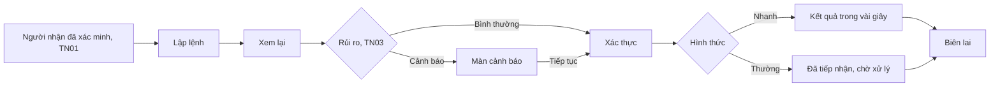

> **Mã:** DE07-TN02-PRD · **Trạng thái:** đã chốt · **Người viết:** Design · **SRS:** [SRS.md](SRS.md)

# PRD Lập lệnh và xác thực chuyển khoản (App ngân hàng, chuyển khoản)

## 1. Bối cảnh và vấn đề

### 1.1 Bối cảnh

Sau khi chọn người nhận (TN01), khách nhập số tiền, nội dung, xem lại và xác thực (xem [README](../../README.md)). Khác với trả tiền QR ở quầy, chuyển khoản bằng số tài khoản thường là **khoản lớn hơn và quan trọng hơn**: tiền nhà, học phí, tiền hàng, tiền đặt cọc. Khách cần chắc chắn từng chi tiết và cần biết khi nào tiền tới.

### 1.2 Vấn đề

| **Vấn đề** | **Hệ quả** |
| --- | --- |
| Không biết chuyển khoản sẽ tới ngay hay ngày mai | Người nhận hỏi liên tục, trễ hạn thanh toán |
| Khoản lớn (≥ 500 triệu) không đi được chuyển nhanh, app không giải thích | Khách tưởng lỗi, gọi tổng đài |
| Nội dung chuyển khoản bị cắt, mất dấu | Người nhận không đối chiếu được |
| Không có bước xem lại trước khi xác thực | Sai một số 0 mới phát hiện |
| Yêu cầu quét khuôn mặt bất ngờ | Khách bỏ dở |

### 1.3 Mục tiêu

- Tỉ lệ hoàn tất từ lập lệnh tới thành công ≥ 85%.
- Khiếu nại "chuyển sai số tiền" giảm 40%.
- 100% lệnh hiện thời gian tiền tới dự kiến trước khi xác thực.

## 2. Người dùng

| **Nhóm** | **Nhu cầu với tính năng này** |
| --- | --- |
| Người trả tiền nhà, học phí | Nội dung đúng mẫu người nhận yêu cầu, có biên lai |
| Chủ hộ kinh doanh | Chuyển khoản lớn, biết tiền tới khi nào |
| Người lớn tuổi | Xem lại rõ ràng trước khi xác thực |

## 3. Phạm vi

### 3.1 Trong phạm vi (MVP)

- Lập lệnh: tài khoản nguồn, số tiền (bằng chữ), nội dung, hình thức chuyển (nhanh hoặc thường), phí.
- Xem lại toàn bộ lệnh trước khi xác thực.
- Hạn mức giao dịch, hạn mức ngày.
- Xác thực theo mức: PIN Smart OTP, sinh trắc thiết bị, sinh trắc khuôn mặt.
- Xử lý và kết quả: thành công, thất bại, chưa xác định, chờ xử lý (chuyển thường).
- Biên lai, chia sẻ, lưu người nhận, chuyển lại.

### 3.2 Ngoài phạm vi

- Chuyển ngoại tệ, chuyển quốc tế.
- Chuyển khoản theo lô (nhiều người nhận một lần).
- Hẹn lịch, định kỳ (xem TN04).
- Cảnh báo rủi ro, tạm giữ (xem TN03; tính năng này chỉ gọi tới).

## 4. Nguyên tắc sản phẩm

### 4.1 Xem lại là một bước, không phải một popup

Màn xác nhận riêng, đọc từ trên xuống: người nhận → số tiền → thời gian tới → phí.

### 4.2 Nói rõ khi nào tiền tới

Mỗi hình thức chuyển hiện thời gian tới dự kiến; chuyển thường ngoài giờ ghi rõ "xử lý ngày làm việc tiếp theo".

### 4.3 Xác thực tương xứng với rủi ro

Khoản nhỏ thì nhanh; khoản lớn hoặc thiết bị mới thì chặt hơn và được báo trước.

## 5. Quy tắc nghiệp vụ

| **Quy tắc** | **Giá trị** |
| --- | --- |
| Chuyển nhanh 24/7 | Trong ngân hàng hoặc liên ngân hàng qua Napas; mỗi giao dịch < 500.000.000 ₫; tiền tới trong vài giây |
| Chuyển thường | Liên ngân hàng, mọi số tiền; xử lý trong giờ làm việc ngày làm việc; bắt buộc khi ≥ 500.000.000 ₫ |
| Phí | Theo biểu phí cấu hình; hiện chuyển nhanh miễn phí |
| Nội dung | Tối đa 160 ký tự; liên ngân hàng tự bỏ dấu |
| Hạn mức mặc định | 500.000.000 ₫/giao dịch, 1.000.000.000 ₫/ngày; khách tự chỉnh trong khung ngân hàng (TN03) |
| Xác thực khuôn mặt | Giao dịch > 10.000.000 ₫, hoặc tổng trong ngày > 20.000.000 ₫, hoặc giao dịch đầu tiên trên thiết bị mới |
| Chờ kết quả chuyển nhanh | 60 giây; quá thì "Chưa xác định" |

- Ngưỡng, hạn mức, phí là **cấu hình** theo quy định Ngân hàng Nhà nước (hiện hành: Quyết định 2345/QĐ-NHNN).

## 6. Luồng trải nghiệm

| **Bước** | **Giai đoạn** | **Trải nghiệm** | **Đầu ra** |
| --- | --- | --- | --- |
| 1 | Lập lệnh | Số tiền và bằng chữ, nội dung, tài khoản nguồn, hình thức | Lệnh nháp |
| 2 | Xem lại | Toàn bộ thông tin, thời gian tới, phí, cách xác thực | Khách đồng ý |
| 3 | Xác thực | PIN, sinh trắc, khuôn mặt | Lệnh được ký |
| 4 | Kết quả | Thành công / đã tiếp nhận / thất bại / chưa xác định | Biên lai |

## 7. Use Cases, User Stories và Acceptance Criteria

### UC1. Lập lệnh

#### US1.1 Nhập số tiền, nội dung

AC01: Số tiền tự định dạng, hiện bằng chữ; gợi ý nhanh nhân 1.000, 10.000, 100.000.

AC02: Nội dung mặc định "{TÊN} chuyen tien"; đếm ký tự; có dấu thì ghi chú sẽ bỏ dấu khi liên ngân hàng.

AC03: Chọn tài khoản nguồn; hiện số dư khả dụng.

#### US1.2 Chọn hình thức chuyển

User Story: Là chủ hộ kinh doanh, tôi muốn biết khoản 600 triệu sẽ tới khi nào.

AC01: Số tiền < 500 triệu → mặc định Chuyển nhanh; khách đổi được sang Chuyển thường.

AC02: Số tiền ≥ 500 triệu → chỉ Chuyển thường, ghi lý do.

AC03: Mỗi hình thức hiện thời gian tới và phí.

### UC2. Xem lại và xác thực

#### US2.1 Xem lại

AC01: Màn xác nhận: người nhận (tên, ngân hàng, số tài khoản), số tiền và bằng chữ, nội dung, hình thức, thời gian tới, phí, tổng trừ, tài khoản nguồn.

AC02: Ghi rõ cách xác thực sẽ dùng.

AC03: Nút sửa quay lại lập lệnh, giữ dữ liệu.

#### US2.2 Xác thực

AC01: PIN Smart OTP hoặc sinh trắc thiết bị cho mức thường; khuôn mặt cho mức cao.

AC02: Chưa đăng ký khuôn mặt mà cần → dẫn đăng ký, không cho chuyển.

### UC3. Kết quả

AC01: Chuyển nhanh thành công → biên lai ngay.

AC02: Chuyển thường → "Đã tiếp nhận", thời gian xử lý dự kiến; báo khi xong.

AC03: Chưa xác định → không chuyển lại, báo khi có kết quả.

AC04: Thất bại → lý do, tiền chưa trừ hoặc đã hoàn.

AC05: Chia sẻ biên lai, lưu người nhận, chuyển lại.

## 8. Chỉ số theo dõi

| **Chỉ số** | **Định nghĩa** | **Mục tiêu MVP** |
| --- | --- | --- |
| Tỉ lệ hoàn tất | Giao dịch thành công hoặc đã tiếp nhận / lệnh mở | ≥ 85% |
| Bỏ ở màn xác nhận | Phiên dừng tại **SCR-A05** / phiên tới **SCR-A05** | Theo dõi |
| Bỏ ở xác thực khuôn mặt | Phiên dừng ở khuôn mặt / phiên cần khuôn mặt | ≤ 10% |
| Chưa xác định | Giao dịch quá 60 giây / giao dịch nhanh | ≤ 1% |
| Khiếu nại sai số tiền | Số khiếu nại / 10.000 giao dịch | Giảm 40% |

## 9. Phụ thuộc và rủi ro

| **Mục** | **Mô tả** | **Hướng xử lý** |
| --- | --- | --- |
| Napas, ngân hàng nhận | Chậm, bảo trì | Chưa xác định + đối soát; báo trước nếu ngân hàng nhận đang bảo trì |
| Lịch ngày làm việc | Lễ, Tết | Lịch nghỉ cấu hình; thời gian xử lý chuyển thường tính theo lịch |
| Quy định xác thực | Thay đổi | Ngưỡng cấu hình |

## 10. Câu hỏi mở

> Mọi câu hỏi dưới đây đã được PO chốt ngày 20/11/2026; quyết định ghi sau mỗi câu và đã cập nhật vào SRS.

- Lệnh chuyển thường đặt ngoài giờ có huỷ được? → **Đã chốt:** Có, khi còn "Đã tiếp nhận" và chưa được xử lý (SRS BR-22).
- Phí trừ vào số tiền chuyển hay trừ thêm? → **Đã chốt:** Trừ thêm từ tài khoản nguồn; người nhận nhận đủ số tiền (SRS BR-14).
- Giữ dữ liệu khi khách thoát giữa chừng? → **Đã chốt:** Không lưu nháp; thoát là bỏ (SRS BR-24).
- Hạn mức ngày tính chung QR và chuyển khoản? → **Đã chốt:** Có, mọi giao dịch chuyển tiền ra ngoài tài khoản của chính khách (SRS BR-16).
