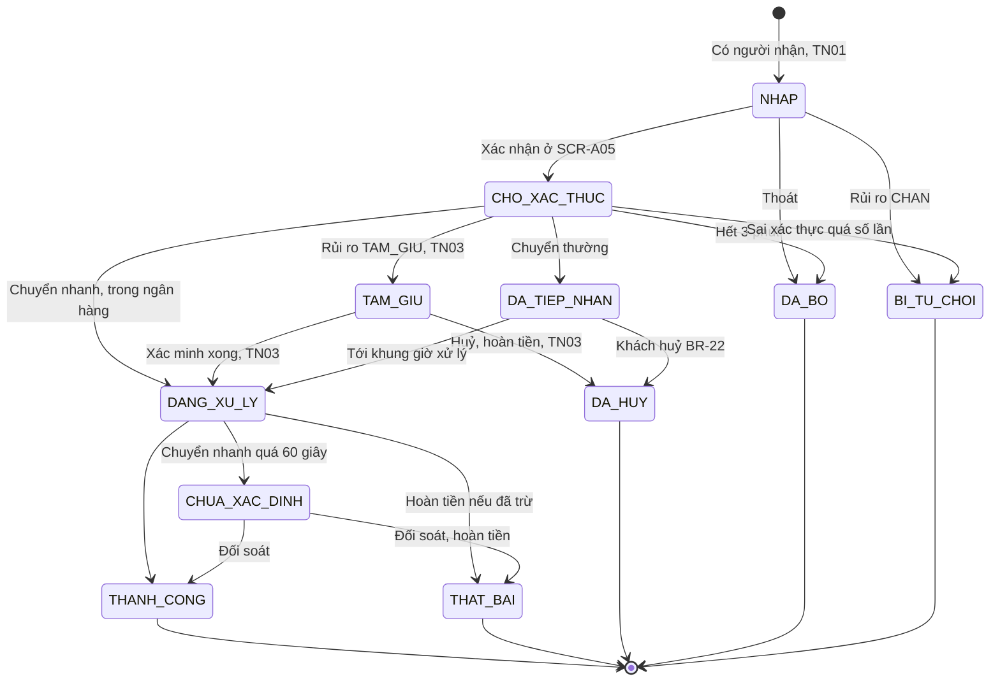
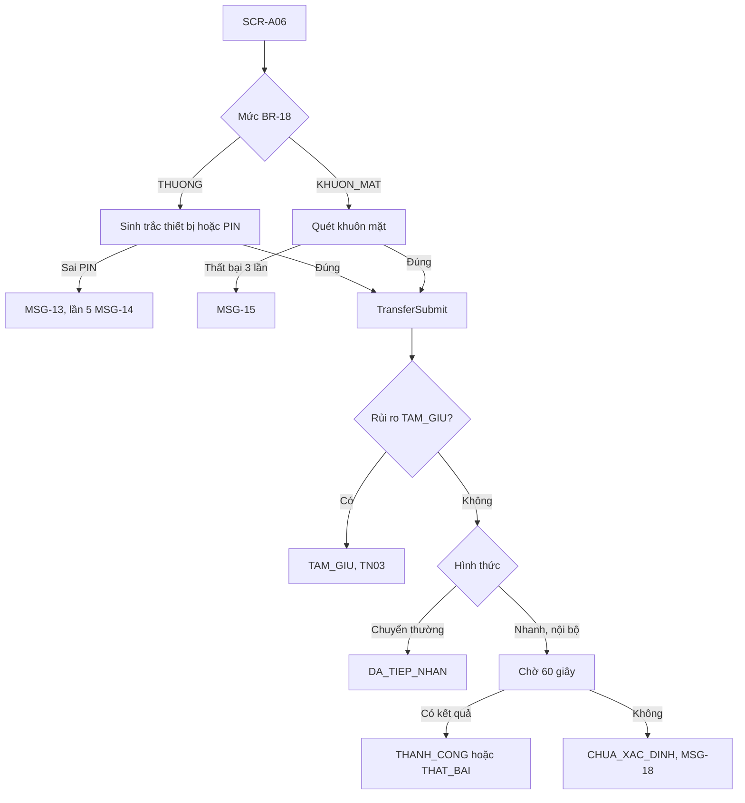
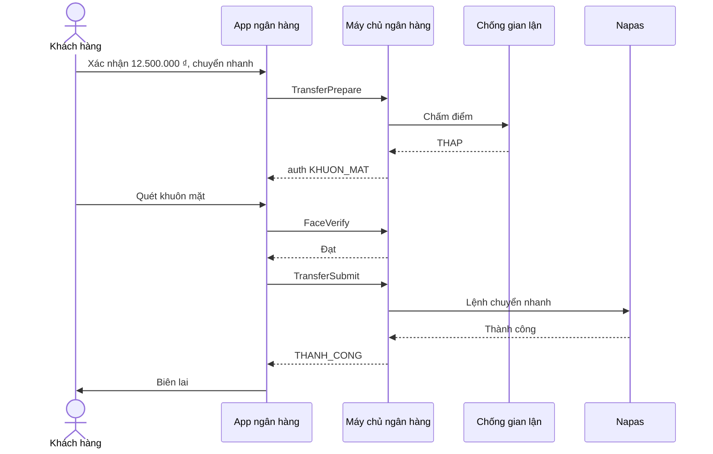

> **Mã:** DE07-TN02-SRS · **Trạng thái:** đã chốt · **Người viết:** Design · **PRD:** [PRD.md](PRD.md)

# UC-DE07-02 - Lập lệnh và xác thực chuyển khoản

> SRS này mô tả giao dịch từ `NHAP` tới kết quả; chấm điểm rủi ro và tạm giữ xem [SRS TN03](../TN03-canh-bao-gian-lan/SRS.md); tra soát xem [SRS TN05](../TN05-tra-soat-khieu-nai/SRS.md).

## 1. Tổng quan

| **Mục** | **Nội dung** |
| --- | --- |
| Mục tiêu | Khách lập lệnh đúng, xem lại, xác thực đúng mức, nhận kết quả và biên lai |
| Actor | Khách hàng · App ngân hàng · Máy chủ ngân hàng · Hệ thống chống gian lận · Napas · Ngân hàng nhận |
| Phạm vi | Lập lệnh, hình thức chuyển, phí, hạn mức, xem lại, xác thực, xử lý, kết quả, biên lai, huỷ lệnh chuyển thường |
| Ngoài phạm vi | Ngoại tệ, quốc tế, theo lô, hẹn lịch (TN04) |
| Nền tảng | App ngân hàng iOS / Android |

## 2. User Story

| **ID** | **As a** | **I want** | **So that** |
| --- | --- | --- | --- |
| US-06 | Khách hàng | Thấy số tiền bằng chữ | Không gõ nhầm số 0 |
| US-07 | Khách hàng | Biết khi nào tiền tới | Báo đúng cho người nhận |
| US-08 | Khách hàng | Xem lại toàn bộ trước khi xác thực | Sửa kịp nếu sai |
| US-09 | Khách hàng | Biết trước cách xác thực | Không bất ngờ |
| US-10 | Khách hàng | Có biên lai rõ ràng | Làm bằng chứng thanh toán |

## 3. Business Rules

| **Mã** | **Quy tắc** |
| --- | --- |
| BR-11 | **Số tiền**: số nguyên VND ≥ 1.000; tự chèn dấu chấm, hiện bằng chữ; gợi ý nhanh (× 1.000, × 10.000, × 100.000; tối đa 3, chỉ gợi ý hợp lệ) |
| BR-12 | **Nội dung**: mặc định "{TÊN KHÁCH} chuyen tien"; 1–160 ký tự; trong ngân hàng giữ dấu; liên ngân hàng bỏ dấu khi gửi, ghi chú "Nội dung sẽ được gửi không dấu"; chỉ chữ, số, khoảng trắng và `. , - / ( ) :` |
| BR-13 | **Hình thức**: Trong ngân hàng → tức thì 24/7. Liên ngân hàng: Chuyển nhanh (Napas 24/7, số tiền < 500.000.000 ₫, mặc định) hoặc Chuyển thường (mọi số tiền, bắt buộc khi ≥ 500.000.000 ₫; xử lý 08:00–16:00 ngày làm việc; lệnh ngoài khung giờ xử lý từ 08:00 ngày làm việc kế tiếp). Ngân hàng nhận đang bảo trì chuyển nhanh → chỉ Chuyển thường, MSG-11 |
| BR-14 | **Phí** theo biểu phí cấu hình (hiện: trong ngân hàng 0 ₫; chuyển nhanh 0 ₫; chuyển thường 0,02% số tiền, tối thiểu 10.000 ₫, tối đa 500.000 ₫). Phí trừ thêm từ tài khoản nguồn; người nhận nhận đủ số tiền. Tổng trừ = số tiền + phí |
| BR-15 | **Tài khoản nguồn**: tài khoản thanh toán VND đứng tên khách, hoạt động, không bị phong toả chiều ghi nợ; mặc định tài khoản chính. Tổng trừ > số dư khả dụng → MSG-09 |
| BR-16 | **Hạn mức**: theo giao dịch và theo ngày (00:00–24:00 giờ Việt Nam), áp dụng chung cho mọi giao dịch chuyển tiền ra ngoài tài khoản của chính khách (chuyển khoản, QR, lệnh hẹn lịch). Mặc định 500.000.000 ₫/giao dịch, 1.000.000.000 ₫/ngày; khách tự chỉnh (TN03 BR-33). Vượt → MSG-10 |
| BR-17 | **Thời gian tới dự kiến**: trong ngân hàng, chuyển nhanh → "Ngay lập tức"; chuyển thường trong khung giờ → "Trong ngày làm việc hôm nay"; ngoài khung → "Từ 08:00 {ngày làm việc kế tiếp}" |
| BR-18 | **Mức xác thực**: `THUONG` = PIN Smart OTP 6 số hoặc sinh trắc thiết bị (nếu đã bật). `KHUON_MAT` = sinh trắc khuôn mặt có kiểm tra người thật, đối chiếu dữ liệu đã đăng ký; áp dụng khi số tiền > 10.000.000 ₫, hoặc tổng trong ngày (kể cả lệnh này) > 20.000.000 ₫, hoặc giao dịch chuyển tiền đầu tiên trên thiết bị mới. Chuyển giữa tài khoản của chính khách → `THUONG` mọi số tiền. Chưa đăng ký khuôn mặt mà cần → MSG-12 |
| BR-19 | **Kiểm tra rủi ro**: khi khách bấm "Tiếp tục" ở **SCR-A05**, gọi chấm điểm (TN03 BR-25). Kết quả: `THAP` → xác thực; `CANH_BAO` → màn cảnh báo (TN03) rồi xác thực; `TAM_GIU` → sau xác thực, giao dịch vào `TAM_GIU` (TN03); `CHAN` → `BI_TU_CHOI`, MSG-17 |
| BR-20 | **Hiệu lực**: inquiry_id 10 phút (quá hạn → tra lại tự động trước khi xác thực); màn xác thực 3 phút; sai PIN 5 lần liên tiếp → khoá Smart OTP (MSG-14); khuôn mặt thất bại 3 lần → tạm khoá 15 phút (MSG-15) |
| BR-21 | **Xử lý**: lệnh ký gửi kèm idempotency key. Trong ngân hàng, chuyển nhanh: chờ ≤ 60 giây → `THANH_CONG`, `THAT_BAI` hoặc `CHUA_XAC_DINH` (đối soát tự động mỗi 5 phút, có kết quả ≤ 1 ngày làm việc; thất bại thì hoàn). Chuyển thường: trừ tiền ngay, `DA_TIEP_NHAN` → `DANG_XU_LY` → `THANH_CONG` hoặc `THAT_BAI` (hoàn tiền) |
| BR-22 | **Huỷ lệnh chuyển thường**: khi còn `DA_TIEP_NHAN` (chưa vào xử lý) → khách huỷ ở chi tiết giao dịch, xác thực PIN; hoàn tổng trừ ngay; trạng thái `DA_HUY` |
| BR-23 | **Biên lai**: mã giao dịch, thời gian, hình thức, người nhận (tên, ngân hàng, số tài khoản che giữa), số tiền và bằng chữ, nội dung (bản đã gửi), phí, tài khoản nguồn che giữa, trạng thái. Chia sẻ dạng ảnh hoặc PDF; không chứa số dư |
| BR-24 | **Không lưu nháp**: thoát giữa chừng → bỏ lệnh (`DA_BO`); không xuất hiện trong lịch sử |

## 4. Trạng thái

### 4.1 Vòng đời giao dịch (phạm vi TN02)

### 4.2 Hiển thị kết quả trên SCR-A07

| **Trạng thái** | **Hiển thị** |
| --- | --- |
| `DANG_XU_LY` | "Đang chuyển tiền…" |
| `THANH_CONG` | Tích xanh, "Chuyển tiền thành công", biên lai, Chia sẻ, Lưu người nhận |
| `DA_TIEP_NHAN` | Biểu tượng đồng hồ xanh, "Lệnh đã được tiếp nhận", thời gian xử lý dự kiến (BR-17); "Tiền đã được trừ, chúng tôi sẽ báo khi người nhận nhận được" |
| `TAM_GIU` | Biểu tượng khiên, MSG-27 (TN03) |
| `THAT_BAI` | Đỏ, lý do MSG-16, tiền chưa trừ hoặc đã hoàn; Thử lại |
| `CHUA_XAC_DINH` | Vàng, MSG-18; không có Thử lại |

## 5. Use Case

### UC-04 Lập lệnh và xem lại

| **Mục** | **Nội dung** |
| --- | --- |
| Tiền điều kiện | Có người nhận đã xác minh (TN01) |
| Hậu điều kiện thành công | Khách bấm "Xác nhận" ở **SCR-A05**; giao dịch qua kiểm tra rủi ro |
| Hậu điều kiện thất bại | Ở lại **SCR-A04** với lỗi; hoặc `DA_BO` |

**Luồng chính**

| **Bước** | **Actor** | **Mô tả** |
| --- | --- | --- |
| 1 | App | Mở **SCR-A04**: người nhận, tài khoản nguồn mặc định, số dư |
| 2 | Khách hàng | Nhập số tiền 12.500.000; sửa nội dung "Tien nha T11 P302" |
| 3 | App | Kiểm tra số dư, hạn mức; chọn Chuyển nhanh; hiện phí, thời gian tới |
| 4 | Khách hàng | Bấm "Tiếp tục" |
| 5 | App | Gọi \[TransferPrepare\]; mở **SCR-A05** với toàn bộ lệnh và ghi chú "Giao dịch này cần xác thực khuôn mặt" |
| 6 | Khách hàng | Kiểm tra, bấm "Xác nhận" |
| 7 | App | Theo BR-19: rủi ro `THAP` → mở **SCR-A06** |

**Luồng thay thế**

| **Mã** | **Điều kiện** | **Xử lý** |
| --- | --- | --- |
| A1 | Số tiền ≥ 500.000.000 ₫ | Chỉ Chuyển thường, ghi lý do (BR-13) |
| A2 | Khách đổi sang Chuyển thường | Phí, thời gian tới cập nhật |
| A3 | Sửa ở **SCR-A05** | Quay lại **SCR-A04**, giữ dữ liệu |
| A4 | Rủi ro `CANH_BAO` | Màn cảnh báo (TN03) trước **SCR-A06** |
| A5 | Ngân hàng nhận bảo trì chuyển nhanh | MSG-11 |

**Luồng lỗi**

| **Mã** | **Điều kiện** | **Xử lý** |
| --- | --- | --- |
| E1 | Không đủ số dư | MSG-09 |
| E2 | Vượt hạn mức | MSG-10 |
| E3 | Cần khuôn mặt, chưa đăng ký | MSG-12 |
| E4 | Rủi ro `CHAN` | MSG-17 |
| E5 | Lỗi mạng | MSG-19 |

### UC-05 Xác thực và kết quả

| **Mục** | **Nội dung** |
| --- | --- |
| Tiền điều kiện | Giao dịch `CHO_XAC_THUC` |
| Hậu điều kiện thành công | Giao dịch ở `THANH_CONG`, `DA_TIEP_NHAN`, `TAM_GIU` hoặc `CHUA_XAC_DINH`; **SCR-A07** hiện đúng |
| Hậu điều kiện thất bại | `DA_BO`, `BI_TU_CHOI` hoặc `THAT_BAI` |

**Luồng chính**

| **Bước** | **Actor** | **Mô tả** |
| --- | --- | --- |
| 1 | App | **SCR-A06** mức `KHUON_MAT`: hướng dẫn, mở camera trước |
| 2 | Khách hàng | Quét khuôn mặt |
| 3 | Máy chủ | \[FaceVerify\] đạt |
| 4 | App | Ký Smart OTP, gọi \[TransferSubmit\]; **SCR-A07** `DANG_XU_LY` |
| 5 | Máy chủ | Trừ tiền, gửi Napas; nhận ghi có thành công |
| 6 | App | **SCR-A07** `THANH_CONG`, biên lai; gợi ý lưu người nhận (TN01 BR-08) |

**Luồng thay thế**

| **Mã** | **Điều kiện** | **Xử lý** |
| --- | --- | --- |
| A1 | Chuyển thường | **SCR-A07** `DA_TIEP_NHAN`; push MSG-20 khi xong |
| A2 | `TAM_GIU` | **SCR-A07** theo TN03 |
| A3 | `CHUA_XAC_DINH` | MSG-18; push MSG-20 khi có kết quả |
| A4 | Huỷ lệnh chuyển thường | Từ chi tiết giao dịch (TN05) khi `DA_TIEP_NHAN` → PIN → \[TransferCancel\] (BR-22) |

**Luồng lỗi**

| **Mã** | **Điều kiện** | **Xử lý** |
| --- | --- | --- |
| E1 | Sai PIN | MSG-13; lần 5 → MSG-14, `BI_TU_CHOI` |
| E2 | Khuôn mặt thất bại 3 lần | MSG-15, `BI_TU_CHOI` |
| E3 | Hết 3 phút | `DA_BO`, MSG-19 |
| E4 | Ngân hàng nhận từ chối | `THAT_BAI`, MSG-16 |
| E5 | Mất mạng sau khi gửi | Gửi lại cùng key; không chắc → `CHUA_XAC_DINH` |

## 6. Điểm vào

| **Điểm vào** | **Dẫn tới** | **Ghi chú** |
| --- | --- | --- |
| Chọn người nhận xong (TN01) | **SCR-A04** | |
| "Chuyển lại" ở chi tiết giao dịch (TN05) | **SCR-A04** điền sẵn số tiền, nội dung | Tra tên lại |
| "Thử lại" ở **SCR-A07** | **SCR-A04** điền sẵn | |
| Push kết quả | Chi tiết giao dịch (TN05) | |

## 7. Mô tả màn hình

### SCR-A04 Lập lệnh chuyển tiền

| **#** | **Thành phần** | **Loại** | **Bắt buộc** | **Validate / hành vi** |
| --- | --- | --- | --- | --- |
| 1 | Người nhận | Card | – | Tên gợi nhớ hoặc tên chủ tài khoản, ngân hàng, số tài khoản che giữa; chạm đổi người nhận |
| 2 | Tài khoản nguồn | Dòng chọn | Có | BR-15; số dư ẩn hiện |
| 3 | Số tiền | Amount | Có | BR-11; bằng chữ; gợi ý nhanh |
| 4 | Nội dung | Textarea | Có | BR-12; đếm 160 |
| 5 | Hình thức | Radio card | Có | Nhanh / Thường; mỗi lựa chọn có phí và thời gian tới (BR-13, BR-14, BR-17) |
| 6 | "Tiếp tục" | Button | – | Disabled khi lỗi |

### SCR-A05 Xác nhận giao dịch

| **#** | **Thành phần** | **Loại** | **Hành vi** |
| --- | --- | --- | --- |
| 1 | Số tiền | Text lớn | Kèm bằng chữ |
| 2 | Người nhận | List | Tên chủ tài khoản, tên gợi nhớ, ngân hàng, số tài khoản đầy đủ |
| 3 | Nội dung | Text | Bản sẽ gửi (đã bỏ dấu nếu liên ngân hàng) |
| 4 | Hình thức, thời gian tới | Text | BR-17 |
| 5 | Phí, tổng trừ | Text | BR-14 |
| 6 | Tài khoản nguồn | Text | |
| 7 | Cách xác thực | Info | "Xác thực bằng {PIN / sinh trắc / khuôn mặt}" |
| 8 | "Sửa", "Xác nhận" | Button | |

### SCR-A06 Xác thực giao dịch

| **#** | **Thành phần** | **Loại** | **Hành vi** |
| --- | --- | --- | --- |
| 1 | Tóm tắt | Card | Người nhận, số tiền |
| 2 | PIN Smart OTP | 6 ô | Bàn phím ngẫu nhiên vị trí |
| 3 | Dùng sinh trắc | Link | Khi đã bật |
| 4 | Khuôn mặt | Camera tròn | Hướng dẫn, kiểm tra người thật |
| 5 | Đếm ngược | Timer | 3 phút |

### SCR-A07 Kết quả & biên lai

| **#** | **Thành phần** | **Loại** | **Hành vi** |
| --- | --- | --- | --- |
| 1 | Trạng thái | Icon + tiêu đề | Mục 4.2 |
| 2 | Biên lai | List | BR-23 |
| 3 | Chia sẻ (ảnh, PDF) | Button | |
| 4 | Lưu người nhận | Checkbox + tên | TN01 BR-08 |
| 5 | Thử lại / Về trang chủ / Giao dịch mới | Button | Theo trạng thái |

## 8. API

| **API** | **Request chính** | **Response chính** | **Timeout / retry** |
| --- | --- | --- | --- |
| \[AccountsList\] | – | Tài khoản nguồn, số dư khả dụng | 5s / 1 lần |
| \[TransferOptions\] | inquiry_id, amount, source | Hình thức khả dụng, phí, eta, hạn mức còn lại, mức xác thực | 3s / 1 lần |
| \[TransferPrepare\] | inquiry_id, amount, note, source, method | transaction_id, risk_result, auth_level, challenge | 5s / 1 lần |
| \[FaceVerify\] | transaction_id, dữ liệu khuôn mặt mã hoá | verified | 15s / không retry tự động |
| \[TransferSubmit\] | transaction_id, chữ ký, idempotency_key | status | 30s / gửi lại cùng key |
| \[TransferStatus\] | transaction_id | status, reason_code, eta | 3s / mỗi 2 giây tới 60 giây |
| \[TransferCancel\] | transaction_id, chữ ký PIN | status | 5s / 1 lần |
| \[ReceiptExport\] | transaction_id, format | Ảnh hoặc PDF | 10s / 1 lần |

**Map lỗi → thông báo**

| **Nhóm lỗi** | **Message** |
| --- | --- |
| Không đủ số dư | MSG-09 |
| Vượt hạn mức | MSG-10 |
| Ngân hàng nhận bảo trì chuyển nhanh | MSG-11 |
| Chưa đăng ký khuôn mặt | MSG-12 |
| Sai PIN | MSG-13 |
| Khoá Smart OTP | MSG-14 |
| Khuôn mặt thất bại | MSG-15 |
| Ngân hàng nhận từ chối | MSG-16 |
| Bị chặn vì rủi ro | MSG-17 |
| Chưa xác định | MSG-18 |
| Mất mạng, hết phiên | MSG-19 |
| Kết quả cuối (push) | MSG-20 |

## 9. Danh sách thông báo

| **ID** | **Nơi hiện** | **Nội dung (VI)** |
| --- | --- | --- |
| MSG-09 | Inline | Số dư khả dụng không đủ (cần {tổng trừ} ₫ gồm phí). Số dư hiện tại: {số dư} ₫ |
| MSG-10 | Inline | Vượt hạn mức. Hôm nay bạn còn chuyển được {số tiền} ₫. \[Đổi hạn mức\] |
| MSG-11 | Info | {Ngân hàng} đang bảo trì chuyển nhanh. Lệnh sẽ đi bằng chuyển thường, tiền tới {thời gian} |
| MSG-12 | Popup | Giao dịch này cần xác thực khuôn mặt nhưng bạn chưa đăng ký. \[Đăng ký ngay\] \[Để sau\] |
| MSG-13 | Inline | Mã PIN chưa đúng. Bạn còn {n} lần thử |
| MSG-14 | Popup | Smart OTP đã bị khoá do nhập sai 5 lần. \[Mở khoá\] |
| MSG-15 | Popup | Xác thực khuôn mặt chưa thành công. Vui lòng thử lại sau 15 phút, ở nơi đủ sáng |
| MSG-16 | **SCR-A07** | Giao dịch không thành công: {lý do}. Tiền {chưa bị trừ / đã được hoàn} |
| MSG-17 | Popup | Giao dịch tạm thời không thể thực hiện để bảo vệ tài khoản của bạn. Gọi {số} để được hỗ trợ |
| MSG-18 | **SCR-A07** | Giao dịch đang được xác nhận. **Vui lòng không chuyển lại.** Chúng tôi sẽ báo kết quả chậm nhất trong 1 ngày làm việc |
| MSG-19 | Toast | Kết nối không ổn định hoặc phiên xác thực đã hết hạn, vui lòng thử lại |
| MSG-20 | Push | Giao dịch {số tiền} ₫ tới {tên} ({mã}): {Thành công / Không thành công, tiền đã hoàn về tài khoản} |

## 10. Yêu cầu phi chức năng

| **Mục** | **Yêu cầu** |
| --- | --- |
| Hiệu năng | \[TransferOptions\] ≤ 500 ms; \[TransferPrepare\] gồm chấm điểm ≤ 1,5 giây (p95); 95% chuyển nhanh có kết quả ≤ 10 giây |
| Bảo mật | Smart OTP gắn thiết bị; chặn chụp màn hình ở **SCR-A06**; dữ liệu khuôn mặt mã hoá, không lưu trên máy; idempotency bắt buộc |
| Tuân thủ | Ngưỡng xác thực cấu hình theo quy định NHNN; lưu bằng chứng xác thực từng giao dịch |
| Log / audit | Mọi trạng thái, mức xác thực, kết quả từng lần xác thực, điểm rủi ro, phí áp dụng |
| Tracking | Hình thức chọn, đổi hình thức, thời gian ở **SCR-A05**, sửa từ **SCR-A05**, loại xác thực, kết quả, bỏ dở ở bước nào |
| Accessibility | Số tiền và bằng chữ đọc được; **SCR-A05** đọc tuần tự theo thứ tự quan trọng; trạng thái kết quả thông báo bằng giọng đọc |
