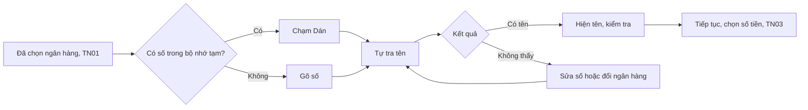

> **Mã:** DE07-TN02-PRD · **Trạng thái:** đã chốt · **Người viết:** Design · **SRS:** [SRS.md](SRS.md)

# PRD Nhập số tài khoản (App ngân hàng, chuyển khoản)

## 1. Bối cảnh và vấn đề

### 1.1 Bối cảnh

Sau khi chọn ngân hàng (TN01), khách nhập số tài khoản hoặc số thẻ người nhận, và app tra **tên chủ tài khoản** tại ngân hàng nhận (xem [README](../../README.md)). Số tài khoản thường được gửi qua tin nhắn; khách dán vào hoặc gõ tay một dãy 10–16 chữ số. Tên chủ tài khoản là cách duy nhất để khách biết mình không gõ nhầm.

### 1.2 Vấn đề

| **Vấn đề** | **Hệ quả** |
| --- | --- |
| Gõ dãy số dài, nhầm một số | Tra ra tên người khác, có thể chuyển nhầm |
| Dán số kèm khoảng trắng, dấu chấm | Báo lỗi định dạng khó hiểu |
| Nhập số thẻ nhưng đã chọn sai ngân hàng | Tra tên thất bại, không biết vì sao |
| Tên chủ tài khoản hiện nhỏ, dễ bỏ qua | Không phát hiện nhầm người |
| Người nhận bị báo cáo lừa đảo nhưng app không nói gì | Mất tiền |

### 1.3 Mục tiêu

- Thời gian từ khi vào màn tới khi có tên người nhận ≤ 12 giây (trung vị).
- Tỉ lệ tra tên thất bại do sai định dạng ≤ 3%.
- 100% người nhận mới được tra tên trước khi sang bước chọn số tiền.

## 2. Người dùng

| **Nhóm** | **Nhu cầu với tính năng này** |
| --- | --- |
| Người nhận số qua tin nhắn | Dán vào là xong |
| Người gõ tay | Thấy số theo nhóm dễ đối chiếu |
| Người lớn tuổi | Tên người nhận to, rõ |
| Người có thể bị lừa | Biết ngay nếu tài khoản bị báo cáo |

## 3. Phạm vi

### 3.1 Trong phạm vi (MVP)

- Nhập số tài khoản hoặc số thẻ; tự nhận ra số thẻ.
- Dán từ bộ nhớ tạm, tự làm sạch.
- Tra tên chủ tài khoản tại ngân hàng nhận; hiện tên to, rõ.
- Báo không tìm thấy, lỗi tra tên, số thẻ không khớp ngân hàng.
- Gợi ý người nhận đã lưu khi số trùng danh bạ.
- Cảnh báo tài khoản bị báo cáo lừa đảo.

### 3.2 Ngoài phạm vi

- Quét ảnh, chụp số tài khoản (OCR) → phase sau.
- Chuyển tới số điện thoại, ví.
- Lưu danh bạ ở bước này (lưu sau khi chuyển thành công, TN05).

## 4. Nguyên tắc sản phẩm

### 4.1 Tên người nhận là bằng chứng

Không có tên tra được thì không đi tiếp. Tên hiện to nhất màn, ngay dưới số tài khoản.

### 4.2 Ít gõ, ít lỗi

Dán một chạm, tự bỏ khoảng trắng, tự nhận số thẻ, tự tra khi gõ xong.

### 4.3 Cảnh báo sớm

Tài khoản bị báo cáo được cảnh báo ngay khi có tên, trước khi khách nhập tiền.

## 5. Quy tắc nghiệp vụ

| **Quy tắc** | **Giá trị** |
| --- | --- |
| Số tài khoản | 6–19 chữ số |
| Số thẻ | 16 hoặc 19 chữ số, thẻ nội địa thành viên Napas |
| Tra tên | Tự động sau khi ngừng gõ 0,8 giây với độ dài hợp lệ; kết quả hiệu lực 10 phút |
| Giới hạn tra tên | 30 lần người nhận mới mỗi giờ |
| Tên hiển thị | Tên chủ tài khoản do ngân hàng nhận trả về, in hoa không dấu |

## 6. Luồng trải nghiệm

| **Bước** | **Giai đoạn** | **Trải nghiệm** | **Đầu ra** |
| --- | --- | --- | --- |
| 1 | Nhập | Dán hoặc gõ; số chia nhóm 4 | Số tài khoản |
| 2 | Tra tên | Tự động, có vòng chờ nhỏ | Tên chủ tài khoản |
| 3 | Kiểm tra | Tên to, cảnh báo nếu có | Người nhận đã xác minh |
| 4 | Tiếp tục | Sang chọn số tiền | – |

## 7. Use Cases, User Stories và Acceptance Criteria

### UC1. Nhập và tra tên

#### US1.1 Dán số tài khoản

User Story: Là người nhận số qua tin nhắn, tôi muốn dán vào và thấy ngay tên người nhận.

AC01: Bộ nhớ tạm có dãy số hợp lệ → chip "Dán {số che giữa}".

AC02: Dán xong tự bỏ khoảng trắng, dấu chấm, gạch ngang; tự tra tên.

#### US1.2 Gõ tay

AC01: Bàn phím số; số hiện theo nhóm 4 chữ số.

AC02: Ngừng gõ 0,8 giây với độ dài hợp lệ → tự tra tên; hoặc bấm "Tiếp tục".

AC03: Nhập 16 hoặc 19 số hợp lệ của thẻ → nhận là số thẻ; thẻ không thuộc ngân hàng đã chọn → báo và gợi ý ngân hàng đúng.

#### US1.3 Thấy tên người nhận

AC01: Có tên → tên in đậm cỡ lớn, dấu tích; nút Tiếp tục bật.

AC02: Không tìm thấy → báo kiểm tra lại số và ngân hàng, nút "Đổi ngân hàng".

AC03: Lỗi tra tên → nút Thử lại.

AC04: Số trùng người trong danh bạ → hiện "Đã lưu: {tên gợi nhớ}".

### UC2. Cảnh báo

AC01: Tài khoản bị báo cáo lừa đảo → banner đỏ dưới tên; vẫn tiếp tục được, cảnh báo toàn trang ở bước xác nhận (TN04).

AC02: Nhập số tài khoản của chính mình → báo và chuyển sang chuyển giữa tài khoản của tôi.

## 8. Chỉ số theo dõi

| **Chỉ số** | **Định nghĩa** | **Mục tiêu MVP** |
| --- | --- | --- |
| Thời gian tới có tên | Mở **SCR-03** → có tên (trung vị) | ≤ 12 giây |
| Dùng Dán | Lượt dán / lượt nhập | Theo dõi |
| Tra tên thất bại | Lượt không tìm thấy / lượt tra | Theo dõi |
| Sai định dạng | Lượt báo sai định dạng / lượt nhập | ≤ 3% |
| Dừng sau cảnh báo | Bỏ giao dịch sau banner cảnh báo / lượt có banner | Theo dõi |

## 9. Phụ thuộc và rủi ro

| **Mục** | **Mô tả** | **Hướng xử lý** |
| --- | --- | --- |
| Dịch vụ tra tên Napas | Chậm, lỗi | Timeout 5 giây, thử lại; không có tên thì không cho đi tiếp |
| Dò tài khoản | Kẻ xấu tra hàng loạt để lấy tên | Giới hạn 30 lần mỗi giờ |
| Bộ nhớ tạm | Lộ dữ liệu khác | Chỉ đọc khi khách chạm Dán hoặc theo quy định hệ điều hành |

## 10. Câu hỏi mở

> Mọi câu hỏi dưới đây đã được PO chốt ngày 20/11/2026; quyết định ghi sau mỗi câu và đã cập nhật vào SRS.

- Tra tên tự động hay bấm nút? → **Đã chốt:** Tự động sau 0,8 giây ngừng gõ; nút Tiếp tục cũng kích hoạt tra (SRS BR-12).
- Có cho đi tiếp khi người nhận bị cảnh báo? → **Đã chốt:** Có, nhưng phải qua màn cảnh báo toàn trang ở TN04 (SRS BR-15).
- Có cần tab riêng cho số thẻ? → **Đã chốt:** Không; tự nhận ra số thẻ (SRS BR-09).
- Đổi ngân hàng có xoá số đã nhập? → **Đã chốt:** Không; giữ số và tra lại (SRS BR-14).
