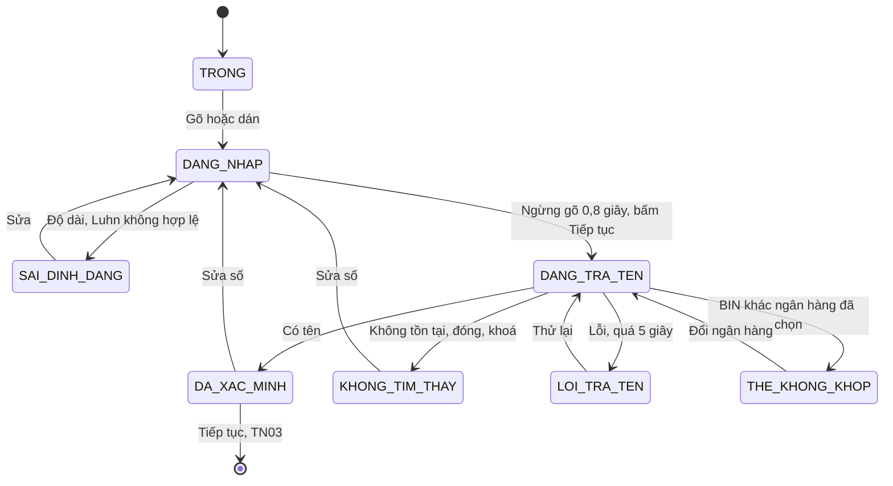
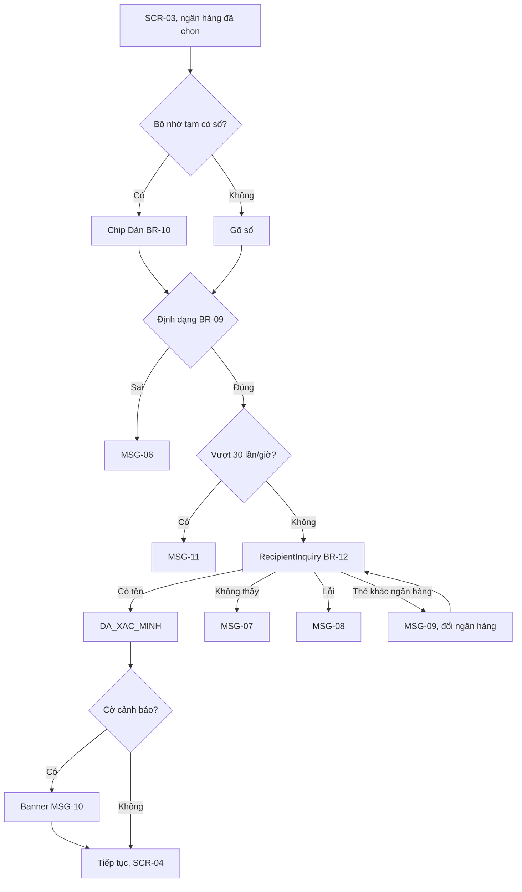
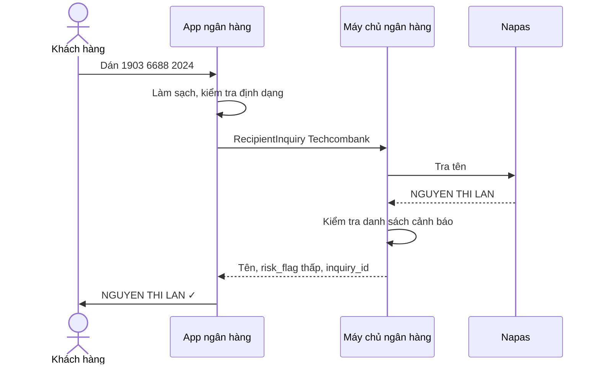

> **Mã:** DE07-TN02-SRS · **Trạng thái:** đã chốt · **Người viết:** Design · **PRD:** [PRD.md](PRD.md)

# UC-DE07-02 - Nhập số tài khoản

> SRS này mô tả việc nhập số tài khoản hoặc số thẻ và tra tên người nhận, sau khi chọn ngân hàng ([SRS TN01](../TN01-chon-ngan-hang/SRS.md)); chọn số tiền xem [SRS TN03](../TN03-chon-so-tien/SRS.md).

## 1. Tổng quan

| **Mục** | **Nội dung** |
| --- | --- |
| Mục tiêu | Khách nhập đúng số tài khoản, thấy tên chủ tài khoản thật trước khi chuyển |
| Actor | Khách hàng · App ngân hàng · Máy chủ ngân hàng · Napas |
| Phạm vi | Nhập số tài khoản, số thẻ, dán, làm sạch, tra tên, kết quả tra tên, gợi ý từ danh bạ, cảnh báo tài khoản, chống dò |
| Ngoài phạm vi | OCR, số điện thoại, ví, lưu danh bạ (TN05) |
| Nền tảng | App ngân hàng iOS / Android |

## 2. User Story

| **ID** | **As a** | **I want** | **So that** |
| --- | --- | --- | --- |
| US-06 | Khách hàng | Dán số tài khoản từ tin nhắn | Không phải gõ |
| US-07 | Khách hàng | Thấy tên chủ tài khoản thật | Không chuyển nhầm người |
| US-08 | Khách hàng | Biết vì sao không tìm thấy tài khoản | Sửa đúng chỗ |
| US-09 | Khách hàng | Được cảnh báo tài khoản bị báo cáo | Tránh bị lừa |

## 3. Business Rules

| **Mã** | **Quy tắc** |
| --- | --- |
| BR-09 | **Định dạng**: chỉ chữ số. Số tài khoản 6–19 chữ số. Số thẻ: 16 hoặc 19 chữ số, đúng thuật toán Luhn và mã BIN của một ngân hàng nội địa → tự nhận là số thẻ, hiện biểu tượng thẻ. Hiển thị theo nhóm 4 chữ số |
| BR-10 | **Dán**: bộ nhớ tạm có dãy 6–19 chữ số (sau khi bỏ khoảng trắng, dấu chấm, gạch ngang) → chip "Dán {số che giữa}". Dán → làm sạch và tra tên ngay |
| BR-11 | **Gợi ý từ danh bạ**: số đã nhập trùng một người trong danh bạ hoặc gần đây cùng ngân hàng → dòng "Đã lưu: {tên gợi nhớ}" |
| BR-12 | **Tra tên** (\[RecipientInquiry\]): tự chạy sau 0,8 giây ngừng gõ khi độ dài hợp lệ, hoặc khi bấm "Tiếp tục". Cùng ngân hàng → tra nội bộ; khác → qua Napas. Timeout 5 giây. Kết quả có hiệu lực 10 phút (inquiry_id); sửa số hoặc ngân hàng → huỷ kết quả cũ |
| BR-13 | **Kết quả tra tên**: có tên → tên in hoa không dấu, chữ lớn, dấu tích; nút "Tiếp tục" bật. Không tồn tại, đã đóng, bị khoá → MSG-07. Lỗi, quá thời gian → MSG-08 kèm "Thử lại" |
| BR-14 | **Thẻ không khớp ngân hàng**: số thẻ có BIN của ngân hàng khác ngân hàng đã chọn → MSG-09 với nút "Đổi sang {ngân hàng đúng}". Đổi ngân hàng (nút ở **SCR-03** hoặc từ MSG-09) giữ số đã nhập và tra lại |
| BR-15 | **Cảnh báo**: kết quả có risk_flag (tài khoản trong danh sách bị báo cáo lừa đảo) → banner đỏ MSG-10 dưới tên; vẫn bật "Tiếp tục"; cờ đi theo giao dịch để TN04 hiện màn cảnh báo toàn trang |
| BR-16 | **Chống dò**: tối đa 30 lần tra tên người nhận mới mỗi giờ mỗi khách (không tính người trong danh bạ, gần đây); vượt → tạm khoá tra tên người nhận mới 1 giờ, MSG-11 |
| BR-17 | **Tài khoản của chính mình**: số trùng tài khoản của khách tại ngân hàng của app → MSG-12; "Tiếp tục" đi như Tài khoản của tôi (TN01 BR-08) |

## 4. Trạng thái

### 4.1 Trạng thái ô số tài khoản

### 4.2 Hiển thị

| **Trạng thái** | **Hiển thị** |
| --- | --- |
| `SAI_DINH_DANG` | MSG-06 dưới ô |
| `DANG_TRA_TEN` | Vòng chờ nhỏ ở vị trí tên |
| `DA_XAC_MINH` | Tên chữ lớn, dấu tích; MSG-10 nếu có cờ; "Đã lưu: …" nếu có |
| `KHONG_TIM_THAY` | MSG-07, nút "Đổi ngân hàng" |
| `LOI_TRA_TEN` | MSG-08, "Thử lại" |
| `THE_KHONG_KHOP` | MSG-09 |

## 5. Use Case

### UC-03 Nhập số tài khoản và tra tên

| **Mục** | **Nội dung** |
| --- | --- |
| Tiền điều kiện | Đã chọn ngân hàng (TN01) |
| Hậu điều kiện thành công | Người nhận `DA_XAC_MINH` có inquiry_id; mở **SCR-04** (TN03) |
| Hậu điều kiện thất bại | Ở lại **SCR-03** |

**Luồng chính**

| **Bước** | **Actor** | **Mô tả** |
| --- | --- | --- |
| 1 | App | Mở **SCR-03**: ngân hàng đã chọn ở đầu, ô số tài khoản focus sẵn; bộ nhớ tạm có số → chip Dán |
| 2 | Khách hàng | Chạm chip Dán |
| 3 | App | Làm sạch, hiện "1903 6688 2024"; gọi \[RecipientInquiry\] |
| 4 | Máy chủ | Tra qua Napas; trả "NGUYEN THI LAN", không có cờ |
| 5 | App | Hiện tên chữ lớn, dấu tích |
| 6 | Khách hàng | Kiểm tra tên, bấm "Tiếp tục" |
| 7 | App | Mở **SCR-04** (TN03) |

**Luồng thay thế**

| **Mã** | **Điều kiện** | **Xử lý** |
| --- | --- | --- |
| A1 | Gõ tay | Tra tự động sau 0,8 giây ngừng gõ (BR-12) |
| A2 | Số thẻ | Biểu tượng thẻ; kiểm tra BIN (BR-14) |
| A3 | Đổi ngân hàng | Nút "Đổi" cạnh tên ngân hàng → **SCR-02**, giữ số |
| A4 | Số trùng danh bạ | "Đã lưu: {tên gợi nhớ}" (BR-11) |
| A5 | Số của chính mình | MSG-12 (BR-17) |

**Luồng lỗi**

| **Mã** | **Điều kiện** | **Xử lý** |
| --- | --- | --- |
| E1 | Sai định dạng | MSG-06 |
| E2 | Không tìm thấy | MSG-07 |
| E3 | Lỗi tra tên | MSG-08; thử lại tối đa 3 lần rồi gợi ý thử lại sau |
| E4 | Thẻ không khớp ngân hàng | MSG-09 |
| E5 | Vượt giới hạn tra tên | MSG-11 |

## 6. Điểm vào

| **Điểm vào** | **Dẫn tới** | **Ghi chú** |
| --- | --- | --- |
| Chọn ngân hàng ở **SCR-02** (TN01) | **SCR-03** | |
| "Sửa" người nhận ở **SCR-04** (TN03) | **SCR-03** | Giữ ngân hàng, số |

## 7. Mô tả màn hình

### SCR-03 Nhập số tài khoản

| **#** | **Thành phần** | **Loại** | **Bắt buộc** | **Validate / hành vi** |
| --- | --- | --- | --- | --- |
| 1 | Ngân hàng | Card | Có | Logo, tên viết tắt, tên đầy đủ, nhãn bảo trì; nút "Đổi" |
| 2 | Số tài khoản / số thẻ | Number | Có | BR-09; nhóm 4 số; nút xoá |
| 3 | Chip Dán | Chip | – | BR-10 |
| 4 | Tên chủ tài khoản | Text lớn | – | Mục 4.2 |
| 5 | Đã lưu | Text phụ | – | BR-11 |
| 6 | Banner cảnh báo | Banner đỏ | – | MSG-10 |
| 7 | Lỗi | Text đỏ | – | MSG-06, MSG-07, MSG-08, MSG-09 |
| 8 | "Tiếp tục" | Button | – | Bật ở `DA_XAC_MINH`; ở trạng thái nhập xong chưa tra thì kích hoạt tra |

## 8. API

| **API** | **Request chính** | **Response chính** | **Timeout / retry** |
| --- | --- | --- | --- |
| \[RecipientInquiry\] | bank_code, account_or_card | name, risk_flag, inquiry_id, is_own_account, card_bank_code | 5s / người dùng thử lại |
| \[InquiryQuota\] | – | Số lần còn lại trong giờ | Trả kèm \[RecipientInquiry\] |

Kiểm tra định dạng, Luhn, BIN chạy trên máy với danh sách BIN từ \[BankList\] (TN01).

**Map lỗi → thông báo**

| **Nhóm lỗi** | **Message** |
| --- | --- |
| Sai định dạng | MSG-06 |
| Không tìm thấy tài khoản | MSG-07 |
| Lỗi tra tên | MSG-08 |
| Thẻ không khớp ngân hàng | MSG-09 |
| Tài khoản bị báo cáo | MSG-10 |
| Vượt giới hạn tra tên | MSG-11 |
| Tài khoản của chính mình | MSG-12 |

## 9. Danh sách thông báo

| **ID** | **Nơi hiện** | **Nội dung (VI)** |
| --- | --- | --- |
| MSG-06 | Inline | Số tài khoản gồm 6–19 chữ số; số thẻ gồm 16 hoặc 19 chữ số |
| MSG-07 | Inline | Không tìm thấy tài khoản tại {ngân hàng}. Kiểm tra lại số tài khoản và ngân hàng. \[Đổi ngân hàng\] |
| MSG-08 | Inline | Chưa kiểm tra được tên người nhận. \[Thử lại\] |
| MSG-09 | Inline | Số thẻ này thuộc {ngân hàng đúng}, không phải {ngân hàng đã chọn}. \[Đổi sang {ngân hàng đúng}\] |
| MSG-10 | Banner | Tài khoản này đã bị báo cáo có dấu hiệu lừa đảo. Hãy kiểm tra kỹ trước khi chuyển |
| MSG-11 | Popup | Bạn đã tra cứu quá nhiều tài khoản mới. Vui lòng thử lại sau {m} phút hoặc chọn người nhận trong danh bạ |
| MSG-12 | Info | Đây là tài khoản của bạn. Giao dịch sẽ được chuyển giữa các tài khoản của bạn |

## 10. Yêu cầu phi chức năng

| **Mục** | **Yêu cầu** |
| --- | --- |
| Hiệu năng | \[RecipientInquiry\] ≤ 2 giây (p95); kiểm tra định dạng ≤ 50 ms |
| Bảo mật, riêng tư | Bộ nhớ tạm chỉ đọc khi được phép; chống dò theo BR-16 |
| Log / audit | Mỗi lần tra tên: ngân hàng, kết quả, risk_flag (không log số đầy đủ) |
| Tracking | Dán hay gõ, số lần tra, kết quả, đổi ngân hàng, gặp cảnh báo, thời gian tới có tên |
| Accessibility | Tên người nhận được đọc ngay khi có; số tài khoản đọc theo nhóm; lỗi được đọc khi xuất hiện |
