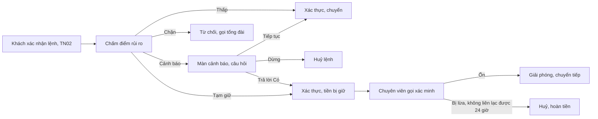

> **Mã:** DE07-TN03-PRD · **Trạng thái:** đã chốt · **Người viết:** Design · **SRS:** [SRS.md](SRS.md)

# PRD Cảnh báo và phòng chống gian lận (App ngân hàng, chuyển khoản)

## 1. Bối cảnh và vấn đề

### 1.1 Bối cảnh

Lừa đảo chuyển khoản là rủi ro lớn nhất của chuyển tiền online (xem [README](../../README.md)). Kịch bản điển hình: kẻ gian giả danh công an, nhân viên ngân hàng, người thân, hoặc hứa hẹn việc nhẹ lương cao, rồi **hướng dẫn nạn nhân tự chuyển tiền**. Nạn nhân tự xác thực, nên mọi lớp bảo mật kỹ thuật đều "đúng". Ngân hàng cần những điểm dừng giúp người dùng tỉnh lại, và một quy trình giữ tiền kịp thời khi dấu hiệu rõ ràng.

### 1.2 Vấn đề

| **Vấn đề** | **Hệ quả** |
| --- | --- |
| Cảnh báo là một dòng chữ nhỏ, bấm qua theo thói quen | Không ngăn được ai |
| Tiền đi ngay trong vài giây | Không có thời gian can thiệp |
| Người dùng phát hiện bị lộ thông tin nhưng không biết khoá thế nào | Mất thêm tiền trong lúc gọi tổng đài |
| Kẻ gian chiếm thiết bị, nâng hạn mức rồi chuyển hết | Mất toàn bộ số dư |
| Cuộc gọi xác minh của ngân hàng bị nghi là lừa đảo | Khách không nghe máy, giao dịch thật bị chậm |

### 1.3 Mục tiêu

- Giảm 50% số tiền bị lừa đảo qua chuyển khoản trên app so với cùng kỳ.
- ≥ 30% giao dịch gặp cảnh báo mức cao được khách tự dừng.
- ≥ 90% giao dịch tạm giữ được xử lý trong 30 phút (giờ hoạt động).

## 2. Người dùng

| **Nhóm** | **Nhu cầu với tính năng này** |
| --- | --- |
| Người lớn tuổi, ít rành công nghệ | Cảnh báo dễ hiểu, đủ mạnh để dừng lại |
| Người đang bị dẫn dắt qua điện thoại | Một khoảng dừng, một câu hỏi đúng lúc |
| Người vừa lộ OTP, mật khẩu | Khoá ngay trong một chạm |
| Chuyên viên phòng chống gian lận | Danh sách giao dịch tạm giữ theo mức gấp, đủ thông tin để gọi xác minh và quyết định |

## 3. Phạm vi

### 3.1 Trong phạm vi (MVP)

- Chấm điểm rủi ro mỗi lệnh chuyển; 4 mức: thấp, cảnh báo, tạm giữ, chặn.
- Màn cảnh báo có thời gian chờ và câu hỏi tự kiểm tra.
- Tạm giữ giao dịch tối đa 24 giờ; chuyên viên gọi xác minh; giải phóng hoặc huỷ và hoàn tiền.
- Màn web nội bộ: hàng đợi tạm giữ, xử lý.
- Khoá nhanh dịch vụ ngân hàng điện tử; mở khoá.
- Hạn mức tự đặt; tăng hạn mức có độ trễ an toàn.
- Thông báo đăng nhập thiết bị mới; hạn mức giảm trên thiết bị mới.

### 3.2 Ngoài phạm vi

- Mô hình chấm điểm chi tiết, huấn luyện mô hình (đề chỉ mô tả đầu vào, đầu ra).
- Thu hồi tiền từ ngân hàng nhận sau khi đã chuyển (xem TN05).
- Quản lý danh sách cảnh báo dùng chung liên ngân hàng.
- Giám sát giao dịch thẻ.

## 4. Nguyên tắc sản phẩm

### 4.1 Ma sát tỉ lệ với rủi ro

Giao dịch bình thường không bị làm phiền; giao dịch đáng ngờ phải dừng lại thật sự.

### 4.2 Nói bằng kịch bản lừa đảo, không bằng thuật ngữ

"Công an không bao giờ yêu cầu bạn chuyển tiền để xác minh" hiệu quả hơn "Giao dịch có rủi ro cao".

### 4.3 Khoá trước, hỏi sau

Khoá nhanh không cần mật khẩu, không cần lý do. Mở lại mới cần xác thực chặt.

### 4.4 Cuộc gọi của ngân hàng phải nhận ra được

App báo trước "Ngân hàng đang gọi bạn" và luôn nhắc: nhân viên không bao giờ hỏi OTP, mật khẩu.

## 5. Quy tắc nghiệp vụ

| **Quy tắc** | **Giá trị** |
| --- | --- |
| Mức rủi ro | Thấp < 40; Cảnh báo 40–69; Tạm giữ 70–89; Chặn ≥ 90 (điểm 0–100) |
| Màn cảnh báo | Chờ 5 giây, tích ô xác nhận; 3 câu hỏi tự kiểm tra |
| Tạm giữ | Gọi xác minh trong 30 phút (07:00–22:00); tối đa 24 giờ rồi tự huỷ, hoàn tiền |
| Thiết bị mới | 24 giờ đầu: hạn mức ngày tối đa 20.000.000 ₫ |
| Tăng hạn mức | Cần xác thực khuôn mặt; hiệu lực sau 30 phút |
| Khoá nhanh | Một chạm; mở khoá bằng khuôn mặt trên app hoặc tại quầy |

- Ngưỡng điểm, thời gian, hạn mức là **cấu hình**.

## 6. Luồng trải nghiệm

| **Bước** | **Giai đoạn** | **Khách thấy** | **Chuyên viên thấy** |
| --- | --- | --- | --- |
| 1 | Chấm điểm | Không thấy gì nếu thấp | – |
| 2 | Cảnh báo | Màn toàn trang, câu hỏi | – |
| 3 | Tạm giữ | "Giao dịch đang được xác minh", số tổng đài sẽ gọi | Giao dịch vào hàng đợi, lý do |
| 4 | Xác minh | Cuộc gọi, app báo "Ngân hàng đang gọi" | Thông tin để hỏi, nút ghi kết quả |
| 5 | Quyết định | Giao dịch tiếp tục hoặc tiền được hoàn | Lý do, ghi chú lưu vết |

## 7. Use Cases, User Stories và Acceptance Criteria

### UC1. Cảnh báo trước khi chuyển

#### US1.1 Dừng lại đúng lúc

User Story: Là người đang bị hướng dẫn chuyển tiền qua điện thoại, tôi muốn app khiến tôi dừng lại suy nghĩ.

AC01: Màn cảnh báo toàn trang, nêu lý do bằng kịch bản cụ thể; nút chính "Dừng giao dịch".

AC02: "Tiếp tục" chỉ bật sau 5 giây và tích ô "Tôi hiểu rủi ro".

AC03: 3 câu hỏi tự kiểm tra; trả lời "Có" bất kỳ câu → khuyên dừng; nếu vẫn tiếp tục thì giao dịch bị tạm giữ.

### UC2. Tạm giữ và xác minh

#### US2.1 Khách biết giao dịch đang được xác minh

AC01: Màn kết quả: "Giao dịch đang được xác minh để bảo vệ bạn", tiền đã trừ và đang được giữ, số điện thoại ngân hàng sẽ gọi.

AC02: Khách tự huỷ giao dịch tạm giữ trong app → hoàn tiền ngay.

AC03: Khi chuyên viên gọi, app hiện "Ngân hàng đang gọi bạn từ số {số}".

#### US2.2 Chuyên viên xử lý

User Story: Là chuyên viên, tôi muốn thấy giao dịch gấp nhất trước và đủ thông tin để hỏi đúng câu.

AC01: Hàng đợi sắp xếp theo hạn xử lý; đếm ngược; giao dịch quá hạn nổi bật.

AC02: Chi tiết: khách, giao dịch, lý do điểm, câu trả lời tự kiểm tra, lịch sử 90 ngày, thiết bị.

AC03: Ghi kết quả cuộc gọi; quyết định Giải phóng, Huỷ và hoàn, Hẹn gọi lại; bắt buộc ghi chú.

AC04: Một giao dịch chỉ một chuyên viên xử lý tại một thời điểm.

### UC3. Khoá nhanh

#### US3.1 Khoá trong một chạm

User Story: Là người vừa lỡ đọc OTP cho người lạ, tôi muốn khoá mọi giao dịch ngay lập tức.

AC01: Nút "Khoá nhanh" ở màn đăng nhập và Bảo mật; không cần mật khẩu, chỉ cần xác nhận một lần.

AC02: Khoá → chặn mọi giao dịch online, đăng xuất mọi thiết bị, huỷ lệnh hẹn lịch đang chờ hôm nay.

AC03: Mở khoá bằng khuôn mặt trên app hoặc tại quầy.

### UC4. Hạn mức và thiết bị mới

AC01: Khách tự giảm hạn mức có hiệu lực ngay; tăng cần khuôn mặt, hiệu lực sau 30 phút, có thông báo và huỷ được trong 30 phút.

AC02: Đăng nhập thiết bị mới → báo tới thiết bị cũ và SMS; 24 giờ đầu hạn mức ngày tối đa 20 triệu.

## 8. Chỉ số theo dõi

| **Chỉ số** | **Định nghĩa** | **Mục tiêu MVP** |
| --- | --- | --- |
| Tiền bị lừa đảo | Tổng tiền khách báo bị lừa qua chuyển khoản app | Giảm 50% |
| Tỉ lệ dừng ở cảnh báo cao | Giao dịch dừng / giao dịch gặp cảnh báo từ 60 điểm | ≥ 30% |
| Xử lý tạm giữ đúng hạn | Giao dịch quyết định ≤ 30 phút / giao dịch tạm giữ trong giờ hoạt động | ≥ 90% |
| Tỉ lệ cảnh báo nhầm | Giao dịch cảnh báo, tạm giữ sau xác minh là hợp lệ / tổng cảnh báo, tạm giữ | Theo dõi; ≤ 70% |
| Ma sát với khách bình thường | Giao dịch bị cảnh báo / tổng giao dịch | ≤ 3% |
| Thời gian từ khoá nhanh tới hiệu lực | p95 | ≤ 5 giây |

## 9. Phụ thuộc và rủi ro

| **Mục** | **Mô tả** | **Hướng xử lý** |
| --- | --- | --- |
| Mô hình chấm điểm | Nhầm nhiều làm phiền khách | Ngưỡng cấu hình; theo dõi tỉ lệ cảnh báo nhầm |
| Nhân sự trực xác minh | Không đủ người giờ cao điểm | Hàng đợi ưu tiên; tự huỷ an toàn sau 24 giờ |
| Kẻ gian dặn nạn nhân "bỏ qua cảnh báo" | Cảnh báo bị vô hiệu | Câu hỏi tự kiểm tra; trả lời "Có" thì tạm giữ dù khách tiếp tục |
| Quyền đọc trạng thái cuộc gọi | Không có trên mọi thiết bị | Chỉ là một tín hiệu; thiếu thì bỏ qua |

## 10. Câu hỏi mở

> Mọi câu hỏi dưới đây đã được PO chốt ngày 20/11/2026; quyết định ghi sau mỗi câu và đã cập nhật vào SRS.

- Khi tạm giữ, tiền có bị trừ khỏi tài khoản khách? → **Đã chốt:** Có, chuyển sang tài khoản giữ tạm của ngân hàng; huỷ thì hoàn ngay (SRS BR-28).
- Ngoài giờ 07:00–22:00 thì sao? → **Đã chốt:** Giao dịch vẫn tạm giữ, gọi từ 07:30; khách được báo trước (SRS BR-28).
- Khách có tự giải phóng giao dịch tạm giữ được không? → **Đã chốt:** Không; chỉ tự huỷ được (SRS BR-28).
- Khoá nhanh có huỷ lệnh hẹn lịch? → **Đã chốt:** Có, tạm dừng mọi lệnh hẹn lịch, định kỳ cho tới khi mở khoá; lần chạy bị lỡ không chạy bù (SRS BR-29, TN04).
