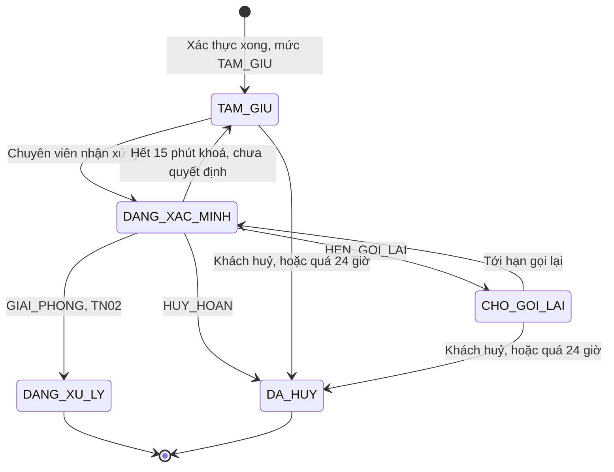
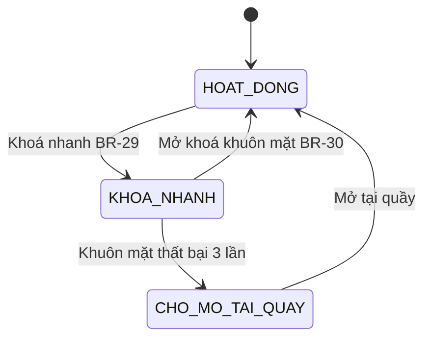
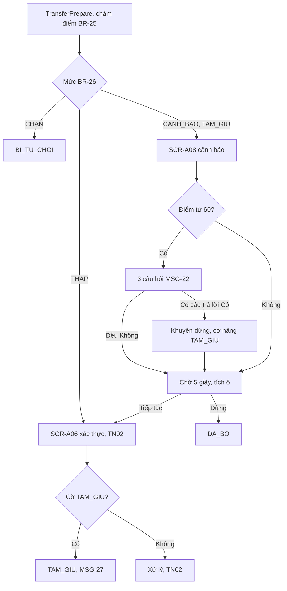
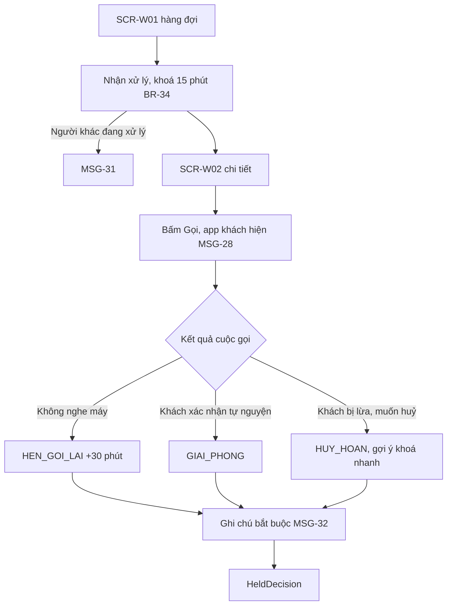
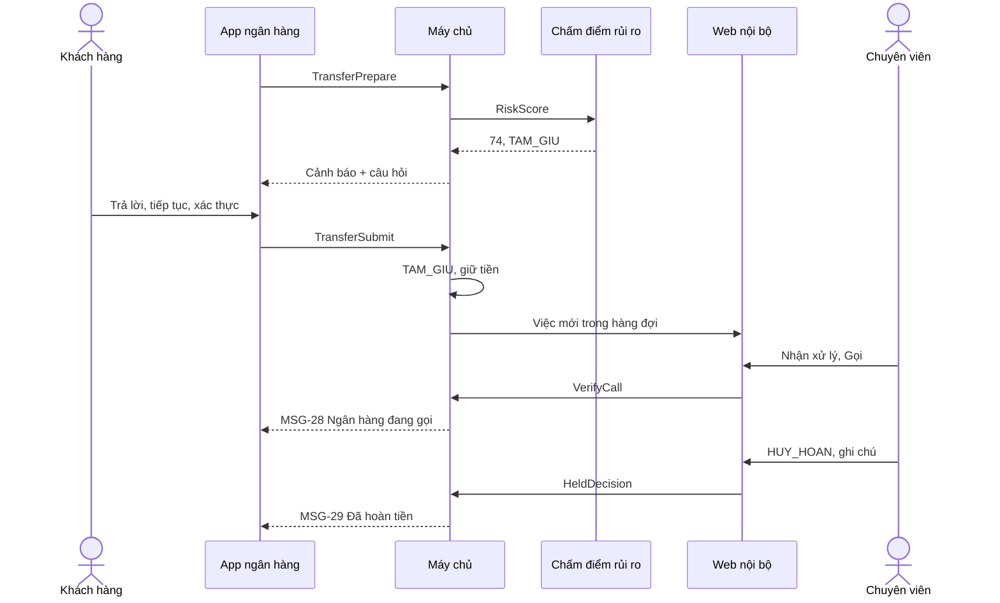

> **Mã:** DE07-TN03-SRS · **Trạng thái:** đã chốt · **Người viết:** Design · **PRD:** [PRD.md](PRD.md)

# UC-DE07-03 - Cảnh báo và phòng chống gian lận

> SRS này mô tả chấm điểm rủi ro, màn cảnh báo, tạm giữ và xác minh giao dịch (gọi từ [SRS TN02](../TN02-lap-lenh-xac-thuc/SRS.md)), khoá nhanh, hạn mức tự đặt và thiết bị mới.

## 1. Tổng quan

| **Mục** | **Nội dung** |
| --- | --- |
| Mục tiêu | Giảm tiền bị lừa đảo bằng cảnh báo đúng lúc, tạm giữ có xác minh, khoá nhanh và hạn mức an toàn |
| Actor | Khách hàng · Chuyên viên phòng chống gian lận · App ngân hàng · Web nội bộ · Máy chủ · Hệ thống chấm điểm rủi ro · Tổng đài |
| Phạm vi | Chấm điểm, màn cảnh báo, câu hỏi tự kiểm tra, tạm giữ, hàng đợi và xử lý tạm giữ, cuộc gọi xác minh, khoá nhanh, mở khoá, hạn mức tự đặt, thông báo thiết bị mới |
| Ngoài phạm vi | Mô hình chấm điểm chi tiết, thu hồi tiền sau chuyển (TN05), danh sách cảnh báo liên ngân hàng, giao dịch thẻ |
| Nền tảng | App ngân hàng iOS / Android; Web nội bộ (desktop) |

## 2. User Story

| **ID** | **As a** | **I want** | **So that** |
| --- | --- | --- | --- |
| US-11 | Khách hàng | Được cảnh báo rõ bằng kịch bản lừa đảo cụ thể | Nhận ra mình đang bị lừa |
| US-12 | Khách hàng | Biết giao dịch đang được xác minh và ai sẽ gọi | Không hoảng, nghe đúng cuộc gọi |
| US-13 | Khách hàng | Khoá mọi giao dịch trong một chạm | Ngăn mất thêm tiền |
| US-14 | Khách hàng | Đặt hạn mức thấp cho mình | Giới hạn thiệt hại |
| US-15 | Chuyên viên | Xử lý giao dịch gấp nhất trước, đủ thông tin | Quyết định nhanh, đúng |

## 3. Business Rules

| **Mã** | **Quy tắc** |
| --- | --- |
| BR-25 | **Chấm điểm** mỗi lệnh chuyển ra ngoài tài khoản của chính khách (gồm QR và lần chạy lệnh hẹn lịch). Đầu vào: người nhận trong danh sách cảnh báo; người nhận mới (chưa từng chuyển thành công); số tiền so với trung vị 90 ngày; số tiền ≥ 90% số dư và ≥ 5.000.000 ₫; thiết bị mới hoặc đăng nhập lại trong 24 giờ; đang có cuộc gọi thoại (nếu đọc được, BR-35); giờ 23:00–05:00; ≥ 3 người nhận mới trong 1 giờ. Đầu ra điểm 0–100 và danh sách lý do (mã + câu hiển thị) |
| BR-26 | **Mức**: `THAP` < 40 → không làm gì; `CANH_BAO` 40–69 → màn cảnh báo **SCR-A08**; `TAM_GIU` 70–89 → màn cảnh báo, sau xác thực giao dịch vào `TAM_GIU`; `CHAN` ≥ 90 → `BI_TU_CHOI`, TN02 MSG-17. Ngưỡng cấu hình |
| BR-27 | **Màn cảnh báo** (**SCR-A08**): tiêu đề và nội dung theo lý do điểm cao nhất (MSG-21, MSG-23); nút chính "Dừng giao dịch"; nút "Tiếp tục" bật sau 5 giây và khi đã tích "Tôi hiểu rủi ro và tự chịu trách nhiệm". Điểm ≥ 60 → thêm 3 câu hỏi tự kiểm tra (MSG-22), mỗi câu Có / Không, bắt buộc trả lời; trả lời "Có" bất kỳ → hiện khuyên dừng, nếu vẫn tiếp tục thì nâng lên `TAM_GIU` |
| BR-28 | **Tạm giữ**: sau xác thực, tổng trừ chuyển sang tài khoản giữ tạm; giao dịch `TAM_GIU`; **SCR-A07** hiện MSG-27. Hạn gọi xác minh: 30 phút nếu trong 07:00–22:00, nếu không thì 07:30 hôm sau. Tối đa 24 giờ từ lúc tạm giữ → tự `DA_HUY`, hoàn tiền, MSG-29. Khách tự huỷ trong app bất cứ lúc nào → hoàn ngay. Khách không tự giải phóng được |
| BR-29 | **Khoá nhanh**: nút ở màn đăng nhập (không cần đăng nhập, chỉ trên thiết bị đã đăng ký) và ở **SCR-A09**; một lần xác nhận. Hiệu lực ≤ 5 giây: chặn mọi giao dịch tài chính online, đăng xuất mọi thiết bị, tạm dừng lệnh hẹn lịch và định kỳ (TN04), huỷ giao dịch đang `CHO_XAC_THUC`. Giao dịch `TAM_GIU` giữ nguyên chờ xác minh. Gửi SMS MSG-25. Cũng khoá được qua tổng đài |
| BR-30 | **Mở khoá**: trên app bằng mật khẩu + xác thực khuôn mặt; thất bại 3 lần → chỉ mở tại quầy. Sau mở khoá, thiết bị được coi là thiết bị mới trong 24 giờ (BR-31) |
| BR-31 | **Thiết bị mới**: lần đăng nhập đầu trên thiết bị → push tới thiết bị cũ và SMS MSG-24 kèm link khoá nhanh; 24 giờ đầu hạn mức ngày tối đa 20.000.000 ₫ (hoặc hạn mức khách đặt nếu thấp hơn); giao dịch đầu tiên cần khuôn mặt (TN02 BR-18) |
| BR-32 | **Cuộc gọi xác minh**: chuyên viên gọi từ số tổng đài chính thức; khi bấm "Gọi" trên **SCR-W02**, app khách (nếu đang mở hoặc qua push) hiện MSG-28. Chuyên viên không hỏi OTP, mật khẩu, mã PIN |
| BR-33 | **Hạn mức tự đặt** (**SCR-A09**): hạn mức giao dịch và hạn mức ngày, từ 0 tới trần ngân hàng; giảm → hiệu lực ngay, xác thực PIN; tăng → xác thực khuôn mặt, hiệu lực sau 30 phút, push MSG-30 ngay và khi có hiệu lực; trong 30 phút huỷ được việc tăng. Đặt 0 = khoá chuyển tiền ra ngoài, vẫn chuyển giữa tài khoản của mình |
| BR-34 | **Hàng đợi tạm giữ** (**SCR-W01**): sắp xếp theo hạn gọi tăng dần; cột: thời gian tạm giữ, khách (tên, tuổi, hạng), số tiền, người nhận, điểm, lý do chính, hạn (đếm ngược), người đang xử lý. Quá hạn tô đỏ. Chuyên viên "Nhận xử lý" → khoá giao dịch cho mình 15 phút; người khác mở thấy MSG-31 |
| BR-35 | **Tín hiệu cuộc gọi**: app chỉ đọc có hay không có cuộc gọi thoại đang diễn ra (khi hệ điều hành cho phép và khách đã cấp quyền); không đọc số, không ghi âm. Thiếu quyền thì bỏ qua tín hiệu |
| BR-36 | **Quyết định xác minh** (**SCR-W02**): `GIAI_PHONG` (khách xác nhận tự nguyện, không bị hướng dẫn) → giao dịch `DANG_XU_LY` (TN02); `HUY_HOAN` (khách xác nhận bị lừa hoặc yêu cầu huỷ) → `DA_HUY`, hoàn tiền, gợi ý khoá nhanh cho khách, đánh dấu người nhận để xem xét đưa vào danh sách cảnh báo; `HEN_GOI_LAI` (không liên lạc được) → hạn gọi mới +30 phút, tối đa trong 24 giờ. Bắt buộc ghi kết quả cuộc gọi và ghi chú ≥ 20 ký tự (MSG-32) |
| BR-37 | **Phản hồi chất lượng**: khách đã bỏ qua cảnh báo và sau đó tạo tra soát "Nghi bị lừa đảo" (TN05) → liên kết hai sự kiện để đánh giá ngưỡng |

## 4. Trạng thái

### 4.1 Giao dịch tạm giữ

### 4.2 Trạng thái dịch vụ của khách

## 5. Use Case

### UC-06 Cảnh báo và tạm giữ khi chuyển

| **Mục** | **Nội dung** |
| --- | --- |
| Tiền điều kiện | Khách bấm "Xác nhận" ở **SCR-A05** (TN02) |
| Hậu điều kiện thành công | Giao dịch đi tiếp, bị dừng, hoặc vào `TAM_GIU` đúng mức |
| Hậu điều kiện thất bại | – |

**Luồng chính**

| **Bước** | **Actor** | **Mô tả** |
| --- | --- | --- |
| 1 | Máy chủ | Chấm điểm 74, lý do chính "Người nhận mới, số tiền gấp 8 lần thường lệ, đang có cuộc gọi" |
| 2 | App | Mở **SCR-A08**: MSG-23 theo lý do, 3 câu hỏi |
| 3 | Khách hàng | Trả lời "Có" ở câu "Có ai đang gọi điện hướng dẫn bạn chuyển khoản?" |
| 4 | App | Hiện khuyên dừng; khách vẫn tích ô, bấm "Tiếp tục" sau 5 giây |
| 5 | App | Mở **SCR-A06**; khách xác thực |
| 6 | Máy chủ | Giao dịch `TAM_GIU`; trừ tiền sang tài khoản giữ tạm; tạo việc trong hàng đợi |
| 7 | App | **SCR-A07** hiện MSG-27; nút "Huỷ giao dịch" |

**Luồng thay thế**

| **Mã** | **Điều kiện** | **Xử lý** |
| --- | --- | --- |
| A1 | Khách bấm Dừng | `DA_BO`; ghi nhận "dừng ở cảnh báo" |
| A2 | Khách huỷ khi `TAM_GIU` | Xác nhận → \[HeldCancel\] → hoàn, MSG-29 |
| A3 | Ngoài 07:00–22:00 | MSG-27 ghi "Chúng tôi sẽ gọi bạn từ 07:30" |

### UC-07 Chuyên viên xác minh giao dịch tạm giữ

| **Mục** | **Nội dung** |
| --- | --- |
| Tiền điều kiện | Chuyên viên đăng nhập Web nội bộ với quyền phòng chống gian lận |
| Hậu điều kiện thành công | Giao dịch được giải phóng, huỷ hoàn, hoặc hẹn gọi lại với ghi chú |
| Hậu điều kiện thất bại | Giao dịch quay lại hàng đợi |

**Luồng chính**

| **Bước** | **Actor** | **Mô tả** |
| --- | --- | --- |
| 1 | Chuyên viên | Mở **SCR-W01**; giao dịch hạn gần nhất ở đầu |
| 2 | Chuyên viên | Bấm "Nhận xử lý" |
| 3 | Web nội bộ | Mở **SCR-W02**: khách, giao dịch, lý do điểm, câu trả lời tự kiểm tra, lịch sử 90 ngày, thiết bị, kịch bản câu hỏi gợi ý |
| 4 | Chuyên viên | Bấm "Gọi" (qua tổng đài) → app khách hiện MSG-28 |
| 5 | Chuyên viên | Hỏi theo kịch bản; khách cho biết có người tự xưng công an yêu cầu chuyển |
| 6 | Chuyên viên | Chọn kết quả "Khách xác nhận bị lừa", quyết định `HUY_HOAN`, ghi chú |
| 7 | Máy chủ | Huỷ, hoàn tiền, push MSG-29; gợi ý khách khoá nhanh; đánh dấu người nhận |

**Luồng thay thế**

| **Mã** | **Điều kiện** | **Xử lý** |
| --- | --- | --- |
| A1 | Khách xác nhận tự nguyện | `GIAI_PHONG` → giao dịch đi tiếp (TN02), push kết quả như thường |
| A2 | Không liên lạc được | `HEN_GOI_LAI`; sau 24 giờ tự huỷ (BR-28) |
| A3 | Khách đã tự huỷ trong lúc chuyên viên đang xem | **SCR-W02** hiện "Khách đã huỷ giao dịch", khoá thao tác |

**Luồng lỗi**

| **Mã** | **Điều kiện** | **Xử lý** |
| --- | --- | --- |
| E1 | Người khác đang xử lý | MSG-31 |
| E2 | Thiếu ghi chú | MSG-32 |
| E3 | Hết 15 phút khoá | Giao dịch về hàng đợi; dữ liệu đang nhập được giữ trên trình duyệt để nhận lại |

### UC-08 Khoá nhanh và hạn mức

**Luồng chính**

| **Bước** | **Actor** | **Mô tả** |
| --- | --- | --- |
| 1 | Khách hàng | Ở màn đăng nhập bấm "Khoá nhanh" |
| 2 | App | Popup xác nhận "Khoá mọi giao dịch ngay?" |
| 3 | Khách hàng | Xác nhận |
| 4 | Máy chủ | Thực hiện BR-29 trong ≤ 5 giây; gửi SMS MSG-25 |
| 5 | App | Hiện "Đã khoá" và hướng dẫn mở khoá |

**Luồng thay thế**

| **Mã** | **Điều kiện** | **Xử lý** |
| --- | --- | --- |
| A1 | Mở khoá | **SCR-A09** → mật khẩu + khuôn mặt (BR-30); MSG-26 nếu thất bại 3 lần |
| A2 | Giảm hạn mức | **SCR-A09** → nhập số mới → PIN → hiệu lực ngay |
| A3 | Tăng hạn mức | Khuôn mặt → hiệu lực sau 30 phút, MSG-30; nút "Huỷ thay đổi" trong 30 phút |
| A4 | Đăng nhập thiết bị mới | BR-31, MSG-24 |

## 6. Điểm vào

| **Điểm vào** | **Dẫn tới** | **Ghi chú** |
| --- | --- | --- |
| Kiểm tra rủi ro ở TN02 | **SCR-A08** | |
| Màn đăng nhập → Khoá nhanh | UC-08 | |
| Cài đặt → Bảo mật & hạn mức | **SCR-A09** | |
| Link trong SMS thiết bị mới | Khoá nhanh | Mở app hoặc trang web khoá nhanh |
| Web nội bộ → Giao dịch tạm giữ | **SCR-W01** | |

## 7. Mô tả màn hình

### SCR-A08 Cảnh báo giao dịch

| **#** | **Thành phần** | **Loại** | **Hành vi** |
| --- | --- | --- | --- |
| 1 | Biểu tượng cảnh báo | Icon lớn | |
| 2 | Tiêu đề, nội dung | Text | MSG-21 hoặc MSG-23 theo lý do |
| 3 | Thông tin giao dịch | Card | Người nhận, số tiền |
| 4 | Câu hỏi tự kiểm tra | 3 câu Có / Không | MSG-22; khi điểm ≥ 60 |
| 5 | Khuyên dừng | Banner đỏ | Khi có câu "Có" |
| 6 | "Dừng giao dịch" | Button chính | Trọng tâm mặc định |
| 7 | Ô xác nhận rủi ro | Checkbox | |
| 8 | "Tiếp tục" | Button phụ | Bật sau 5 giây + tích ô + trả lời đủ |
| 9 | Gọi tổng đài khẩn | Link | |

### SCR-A09 Bảo mật & hạn mức

| **#** | **Thành phần** | **Loại** | **Bắt buộc** | **Validate / hành vi** |
| --- | --- | --- | --- | --- |
| 1 | Khoá nhanh | Button đỏ | – | BR-29 |
| 2 | Hạn mức mỗi giao dịch | Amount + thanh trượt | Có | 0 → trần ngân hàng |
| 3 | Hạn mức mỗi ngày | Amount + thanh trượt | Có | ≥ hạn mức giao dịch |
| 4 | Thay đổi đang chờ | Banner | – | "Hạn mức mới có hiệu lực lúc {giờ}" + "Huỷ thay đổi" |
| 5 | Thiết bị đăng nhập | List | – | Tên máy, lần dùng cuối, "Đăng xuất" |
| 6 | Quyền tín hiệu cuộc gọi | Switch | – | BR-35; giải thích lý do |

### SCR-W01 Hàng đợi giao dịch tạm giữ (Web nội bộ)

| **#** | **Thành phần** | **Loại** | **Hành vi** |
| --- | --- | --- | --- |
| 1 | Bộ lọc | Chips | Tất cả, Quá hạn, Của tôi, Chờ gọi lại |
| 2 | Bảng | Table | Cột theo BR-34; sắp xếp mặc định theo hạn |
| 3 | Đếm ngược | Cell | Đỏ khi quá hạn |
| 4 | "Nhận xử lý" | Button dòng | Khoá 15 phút |
| 5 | Tự làm mới | – | Mỗi 15 giây hoặc theo sự kiện |

### SCR-W02 Xử lý giao dịch tạm giữ (Web nội bộ)

| **#** | **Thành phần** | **Loại** | **Bắt buộc** | **Validate / hành vi** |
| --- | --- | --- | --- | --- |
| 1 | Khách | Panel | – | Tên, tuổi, số điện thoại đã đăng ký, hạng, thời gian là khách |
| 2 | Giao dịch | Panel | – | Số tiền, người nhận, ngân hàng, nội dung, thời điểm, thiết bị |
| 3 | Lý do điểm | List | – | Mã + câu, đóng góp điểm |
| 4 | Trả lời tự kiểm tra | List | – | 3 câu và câu trả lời |
| 5 | Lịch sử 90 ngày | Table | – | Giao dịch ra, người nhận mới, cảnh báo đã bỏ qua |
| 6 | Kịch bản gợi ý | Text | – | Câu hỏi theo lý do; nhắc không hỏi OTP |
| 7 | "Gọi" | Button | – | BR-32 |
| 8 | Kết quả cuộc gọi | Radio | Có | Không nghe máy, Tự nguyện, Bị lừa, Khách yêu cầu huỷ |
| 9 | Quyết định | Radio | Có | Giải phóng, Huỷ và hoàn, Hẹn gọi lại (BR-36) |
| 10 | Ghi chú | Textarea | Có | ≥ 20 ký tự |
| 11 | "Lưu quyết định" | Button | – | Xác nhận lại với Giải phóng |

## 8. API

| **API** | **Request chính** | **Response chính** | **Timeout / retry** |
| --- | --- | --- | --- |
| \[RiskScore\] | transaction context (BR-25) | score, level, reasons | 800 ms / không retry; lỗi → coi như `CANH_BAO` |
| \[SelfCheckSubmit\] | transaction_id, answers | level sau điều chỉnh | 3s / 1 lần |
| \[HeldCancel\] | transaction_id | status, refund | 5s / 1 lần |
| \[QuickLock\] | device_id hoặc session | locked_at | 5s / 3 lần |
| \[Unlock\] | password, face_data | status | 15s / 1 lần |
| \[LimitUpdate\] | per_tx, per_day, auth | effective_at | 5s / 1 lần |
| \[LimitChangeCancel\] | change_id | status | 5s / 1 lần |
| \[HeldQueue\] (nội bộ) | filter | Danh sách BR-34 | 5s / 1 lần |
| \[HeldClaim\] (nội bộ) | transaction_id | lock_until hoặc lỗi | 3s / 1 lần |
| \[VerifyCall\] (nội bộ) | transaction_id | call_id; gửi tín hiệu tới app khách | 5s / 1 lần |
| \[HeldDecision\] (nội bộ) | transaction_id, call_result, decision, note | status | 5s / 1 lần |

**Map lỗi → thông báo**

| **Nhóm** | **Message** |
| --- | --- |
| Người nhận bị báo cáo | MSG-21 |
| Câu hỏi tự kiểm tra | MSG-22 |
| Giao dịch bất thường | MSG-23 |
| Thiết bị mới | MSG-24 |
| Đã khoá nhanh | MSG-25 |
| Mở khoá thất bại | MSG-26 |
| Giao dịch tạm giữ | MSG-27 |
| Ngân hàng đang gọi | MSG-28 |
| Kết quả tạm giữ | MSG-29 |
| Đổi hạn mức | MSG-30 |
| Người khác đang xử lý (nội bộ) | MSG-31 |
| Thiếu ghi chú (nội bộ) | MSG-32 |

## 9. Danh sách thông báo

| **ID** | **Nơi hiện** | **Nội dung (VI)** |
| --- | --- | --- |
| MSG-21 | **SCR-A08** | Tài khoản nhận đã bị báo cáo có dấu hiệu lừa đảo. Công an, ngân hàng, cơ quan nhà nước **không bao giờ** yêu cầu bạn chuyển tiền để "xác minh" hay "phục vụ điều tra" |
| MSG-22 | **SCR-A08** | Trả lời thật lòng để tự bảo vệ: (1) Có ai đang gọi điện, nhắn tin hướng dẫn bạn chuyển khoản này? (2) Bạn có được hứa hẹn lợi nhuận, hoa hồng, quà tặng khi chuyển? (3) Bạn chưa từng gặp trực tiếp người nhận? |
| MSG-23 | **SCR-A08** | Giao dịch này khác thói quen của bạn: {lý do, ví dụ: người nhận mới, số tiền lớn hơn nhiều lần thường lệ}. Hãy dừng lại và kiểm tra với người thân nếu bạn không chắc chắn |
| MSG-24 | Push thiết bị cũ, SMS | Tài khoản của bạn vừa đăng nhập trên thiết bị {tên máy} lúc {giờ}. Nếu không phải bạn, khoá ngay: {link} hoặc gọi {số} |
| MSG-25 | SMS | Dịch vụ ngân hàng điện tử của bạn đã được khoá lúc {giờ}. Mở khoá trên app bằng xác thực khuôn mặt hoặc tại quầy |
| MSG-26 | Popup | Không mở khoá được trên ứng dụng. Vui lòng mang CCCD tới quầy giao dịch gần nhất |
| MSG-27 | **SCR-A07** | Giao dịch đang được xác minh để bảo vệ bạn. Tiền đã được trừ và đang được ngân hàng giữ an toàn. Chúng tôi sẽ gọi bạn từ số {số} {trong 30 phút / từ 07:30}. Nhân viên **không bao giờ** hỏi mã OTP hay mật khẩu. \[Huỷ giao dịch\] |
| MSG-28 | Overlay, push | Ngân hàng đang gọi bạn từ số {số} để xác minh giao dịch {số tiền} ₫. Nhân viên sẽ không hỏi OTP, mật khẩu |
| MSG-29 | Push | Giao dịch {số tiền} ₫ tới {tên} {đã được thực hiện / đã huỷ, tiền đã hoàn về tài khoản của bạn} |
| MSG-30 | Push | Hạn mức chuyển tiền sẽ đổi thành {x} ₫/giao dịch, {y} ₫/ngày lúc {giờ}. Nếu không phải bạn thay đổi, \[Huỷ thay đổi\] hoặc khoá nhanh |
| MSG-31 | Toast nội bộ | Giao dịch đang được {tên chuyên viên} xử lý tới {giờ} |
| MSG-32 | Inline nội bộ | Vui lòng chọn kết quả cuộc gọi và ghi chú ít nhất 20 ký tự |

## 10. Yêu cầu phi chức năng

| **Mục** | **Yêu cầu** |
| --- | --- |
| Hiệu năng | \[RiskScore\] ≤ 300 ms (p95); khoá nhanh hiệu lực ≤ 5 giây; việc tạm giữ xuất hiện trong hàng đợi ≤ 5 giây |
| Độ tin cậy | Chấm điểm lỗi → mặc định `CANH_BAO` (không chặn, không bỏ qua); tự huỷ sau 24 giờ chạy kể cả khi hàng đợi gặp sự cố |
| Bảo mật | Web nội bộ chỉ truy cập từ mạng ngân hàng, đăng nhập 2 lớp; phân quyền xem dữ liệu khách theo vai trò; che bớt số tài khoản trừ khi bấm xem (có ghi log) |
| Riêng tư | Tín hiệu cuộc gọi chỉ là có hoặc không (BR-35); khách tắt được |
| Log / audit | Mọi điểm, lý do, câu trả lời, lựa chọn của khách ở cảnh báo; mọi thao tác chuyên viên (xem, gọi, quyết định, ghi chú); mọi khoá, mở khoá, đổi hạn mức |
| Tracking | Phân bố mức rủi ro, tỉ lệ dừng ở cảnh báo theo lý do, tỉ lệ trả lời "Có", thời gian xử lý tạm giữ, kết quả quyết định, dùng khoá nhanh |
| Accessibility | **SCR-A08** đọc được đầy đủ bằng giọng đọc, nút Dừng có trọng tâm mặc định; Web nội bộ dùng được bằng bàn phím, phím tắt nhận việc kế tiếp |
