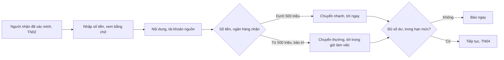

> **Mã:** DE07-TN03-PRD · **Trạng thái:** đã chốt · **Người viết:** Design · **SRS:** [SRS.md](SRS.md)

# PRD Chọn số tiền (App ngân hàng, chuyển khoản)

## 1. Bối cảnh và vấn đề

### 1.1 Bối cảnh

Khi đã có người nhận được xác minh (TN02, hoặc đi tắt từ TN01), khách chọn số tiền, nội dung và tài khoản nguồn (xem [README](../../README.md)). Chuyển khoản bằng số tài khoản thường là khoản lớn: tiền nhà, học phí, tiền hàng, tiền cọc. Khách cần nhập đúng, biết phí và **biết khi nào tiền tới**: khoản từ 500 triệu đồng không đi được chuyển nhanh 24/7 mà phải đi chuyển thường, chỉ xử lý trong giờ làm việc.

### 1.2 Vấn đề

| **Vấn đề** | **Hệ quả** |
| --- | --- |
| Gõ thừa, thiếu số 0 | Chuyển sai số tiền |
| Không biết tiền tới ngay hay ngày mai | Người nhận hỏi liên tục, trễ hạn thanh toán |
| Khoản lớn bị từ chối chuyển nhanh, không giải thích | Khách tưởng app lỗi |
| Nội dung bị cắt, mất dấu | Người nhận không đối chiếu được |
| Biết thiếu tiền, vượt hạn mức ở bước cuối | Phải quay lại từ đầu |

### 1.3 Mục tiêu

- Khiếu nại chuyển sai số tiền giảm 40%.
- 100% lệnh hiện thời gian tiền tới dự kiến trước khi xác nhận.
- Thời gian ở bước chọn số tiền ≤ 20 giây (trung vị).

## 2. Người dùng

| **Nhóm** | **Nhu cầu với tính năng này** |
| --- | --- |
| Người trả tiền nhà, học phí | Nội dung đúng mẫu người nhận yêu cầu |
| Chủ hộ kinh doanh | Chuyển khoản lớn, biết tiền tới khi nào, biết phí |
| Người lớn tuổi | Số tiền bằng chữ, rõ ràng |
| Người có nhiều tài khoản | Chọn tài khoản nguồn, thấy số dư |

## 3. Phạm vi

### 3.1 Trong phạm vi (MVP)

- Nhập số tiền; bằng chữ; gợi ý nhanh.
- Nội dung chuyển khoản.
- Tài khoản nguồn, số dư khả dụng.
- Hình thức: trong ngân hàng, chuyển nhanh 24/7, chuyển thường; phí; thời gian tới dự kiến.
- Kiểm tra số dư, hạn mức ngay khi nhập.

### 3.2 Ngoài phạm vi

- Ngoại tệ, chuyển quốc tế.
- Hẹn lịch, định kỳ, chuyển theo lô.
- Đổi hạn mức (dẫn link tới cài đặt sẵn có).
- Xác nhận, xác thực (TN04).

## 4. Nguyên tắc sản phẩm

### 4.1 Số tiền phải đọc được hai lần

Số lớn và bằng chữ luôn đi cùng nhau.

### 4.2 Nói rõ khi nào tiền tới

Mỗi hình thức chuyển hiện thời gian tới; khoản lớn, ngân hàng bảo trì, ngoài giờ đều được giải thích.

### 4.3 Báo lỗi trước khi bấm

Thiếu tiền, vượt hạn mức báo ngay khi nhập.

## 5. Quy tắc nghiệp vụ

| **Quy tắc** | **Giá trị** |
| --- | --- |
| Số tiền tối thiểu | 1.000 ₫ |
| Chuyển nhanh 24/7 | Liên ngân hàng qua Napas, mỗi giao dịch < 500.000.000 ₫, tới trong vài giây |
| Chuyển thường | Liên ngân hàng, mọi số tiền; xử lý 08:00–16:00 ngày làm việc; bắt buộc khi ≥ 500.000.000 ₫ hoặc ngân hàng nhận bảo trì chuyển nhanh |
| Trong ngân hàng | Tức thì 24/7 |
| Hạn mức mặc định | 500.000.000 ₫/giao dịch, 1.000.000.000 ₫/ngày |
| Phí | Trong ngân hàng, chuyển nhanh: 0 ₫; chuyển thường: 0,02%, tối thiểu 10.000 ₫, tối đa 500.000 ₫ |
| Nội dung | 1–160 ký tự; liên ngân hàng tự bỏ dấu |

- Hạn mức, phí là **cấu hình**.

## 6. Luồng trải nghiệm

| **Bước** | **Giai đoạn** | **Trải nghiệm** | **Đầu ra** |
| --- | --- | --- | --- |
| 1 | Số tiền | Bàn phím số, bằng chữ, gợi ý | Số tiền |
| 2 | Nội dung, nguồn | Nội dung mặc định, tài khoản, số dư | Lệnh nháp |
| 3 | Hình thức | Nhanh hoặc thường, phí, thời gian tới | Khách biết khi nào tiền tới |
| 4 | Tiếp tục | Kiểm tra số dư, hạn mức | Sang xác nhận |

## 7. Use Cases, User Stories và Acceptance Criteria

### UC1. Chọn số tiền

#### US1.1 Nhập không nhầm

AC01: Số tiền tự định dạng, hiện bằng chữ; gợi ý nhanh nhân 1.000, 10.000, 100.000.

AC02: Dưới 1.000 ₫, thiếu số dư, vượt hạn mức → báo ngay, nút Tiếp tục tắt.

#### US1.2 Nội dung, nguồn

AC01: Nội dung mặc định "{TÊN} chuyen tien"; đếm ký tự; ghi chú sẽ bỏ dấu khi liên ngân hàng.

AC02: Chọn tài khoản nguồn; hiện số dư khả dụng.

#### US1.3 Biết khi nào tiền tới

User Story: Là chủ hộ kinh doanh, tôi muốn biết khoản 600 triệu sẽ tới khi nào.

AC01: Dưới 500 triệu, liên ngân hàng → mặc định Chuyển nhanh; đổi sang Chuyển thường được.

AC02: Từ 500 triệu → chỉ Chuyển thường, ghi lý do.

AC03: Ngân hàng nhận bảo trì chuyển nhanh → chỉ Chuyển thường, ghi lý do.

AC04: Mỗi hình thức hiện phí và thời gian tới ("Ngay lập tức", "Trong ngày làm việc hôm nay", "Từ 08:00 thứ Hai 23/11").

AC05: Chuyển trong ngân hàng → không có lựa chọn hình thức, ghi "Ngay lập tức · Miễn phí".

## 8. Chỉ số theo dõi

| **Chỉ số** | **Định nghĩa** | **Mục tiêu MVP** |
| --- | --- | --- |
| Thời gian chọn số tiền | Mở **SCR-04** → Tiếp tục (trung vị) | ≤ 20 giây |
| Gặp lỗi số dư, hạn mức | Lượt hiện lỗi / lượt vào **SCR-04** | Theo dõi |
| Quay lại sửa từ TN04 | Lượt sửa / lượt tới TN04 | Theo dõi |
| Chuyển thường | Lệnh chuyển thường / lệnh liên ngân hàng | Theo dõi |
| Khiếu nại sai số tiền | Số khiếu nại / 10.000 giao dịch | Giảm 40% |

## 9. Phụ thuộc và rủi ro

| **Mục** | **Mô tả** | **Hướng xử lý** |
| --- | --- | --- |
| Lịch ngày làm việc | Lễ, Tết | Lịch nghỉ cấu hình |
| Trạng thái bảo trì | Napas báo trễ | Kiểm tra lại khi gửi lệnh (TN04) |
| Số dư thay đổi | Giao dịch khác cùng lúc | Kiểm tra lại ở TN04 |

## 10. Câu hỏi mở

> Mọi câu hỏi dưới đây đã được PO chốt ngày 20/11/2026; quyết định ghi sau mỗi câu và đã cập nhật vào SRS.

- Phí trừ vào số tiền chuyển hay trừ thêm? → **Đã chốt:** Trừ thêm; người nhận nhận đủ (SRS BR-25).
- Hạn mức ngày tính chung QR và chuyển khoản? → **Đã chốt:** Có (SRS BR-23).
- Có lưu nháp khi thoát? → **Đã chốt:** Không (SRS BR-28).
- Chuyển thường đặt ngoài giờ có huỷ được? → **Đã chốt:** Có, khi chưa được xử lý; xem TN05.
