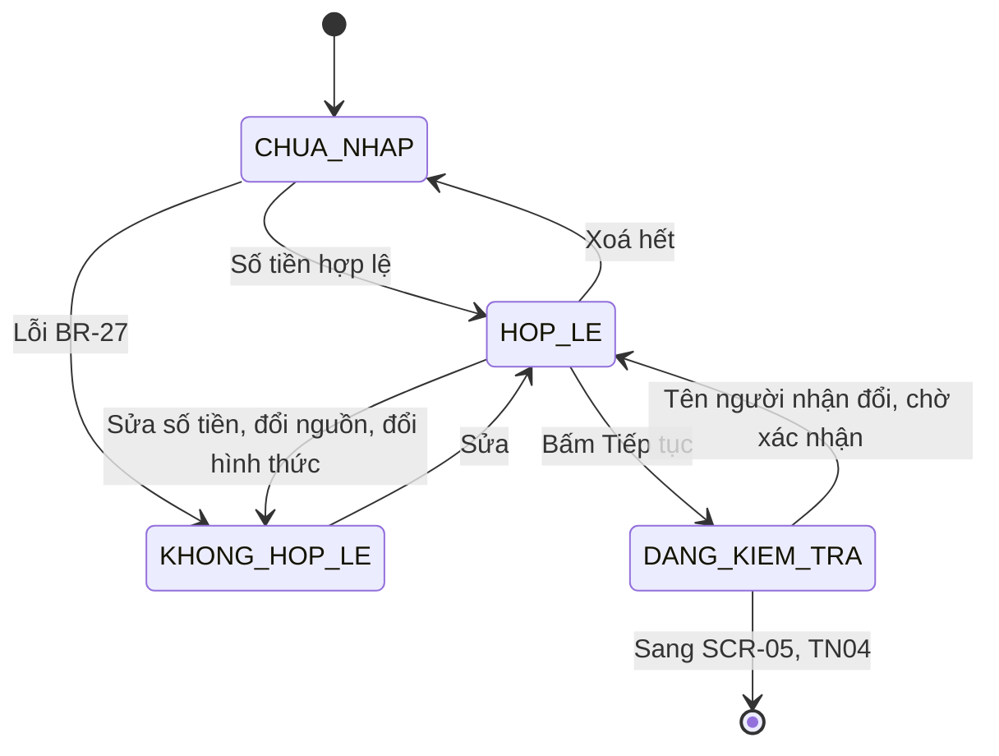
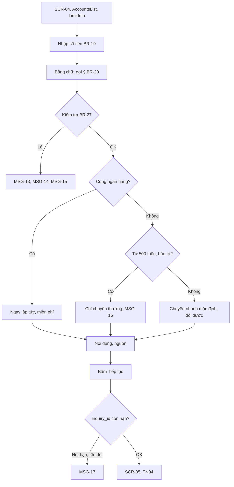
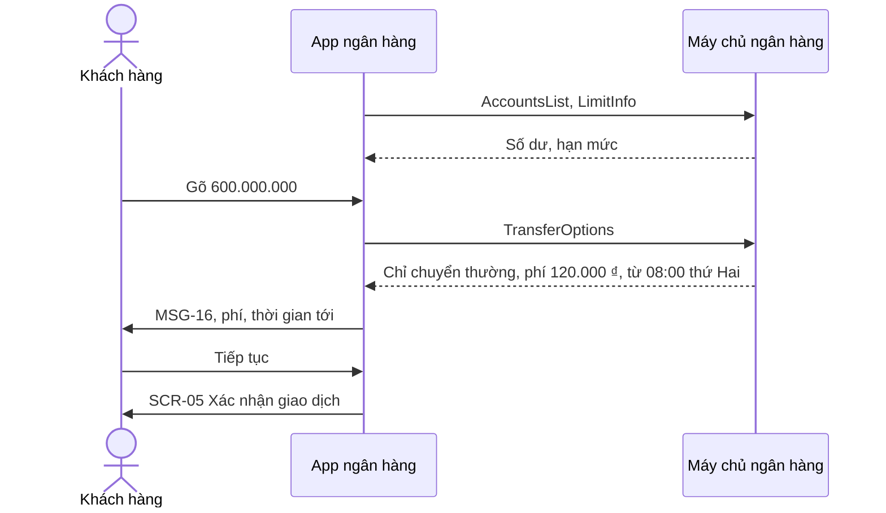

> **Mã:** DE07-TN03-SRS · **Trạng thái:** đã chốt · **Người viết:** Design · **PRD:** [PRD.md](PRD.md)

# UC-DE07-03 - Chọn số tiền

> SRS này mô tả giao dịch ở trạng thái `NHAP`: từ khi có người nhận đã xác minh ([SRS TN02](../TN02-nhap-so-tai-khoan/SRS.md), hoặc đi tắt từ [SRS TN01](../TN01-chon-ngan-hang/SRS.md)) tới khi bấm Tiếp tục sang [SRS TN04](../TN04-xac-thuc-xac-nhan/SRS.md).

## 1. Tổng quan

| **Mục** | **Nội dung** |
| --- | --- |
| Mục tiêu | Khách nhập đúng số tiền, nội dung, tài khoản nguồn; biết hình thức chuyển, phí và thời gian tiền tới |
| Actor | Khách hàng · App ngân hàng · Máy chủ ngân hàng |
| Phạm vi | Số tiền, bằng chữ, gợi ý nhanh, nội dung, tài khoản nguồn, số dư, hạn mức, hình thức chuyển, phí, thời gian tới |
| Ngoài phạm vi | Ngoại tệ, quốc tế, hẹn lịch, theo lô, đổi hạn mức, xác thực (TN04) |
| Nền tảng | App ngân hàng iOS / Android |

## 2. User Story

| **ID** | **As a** | **I want** | **So that** |
| --- | --- | --- | --- |
| US-10 | Khách hàng | Thấy số tiền bằng chữ | Không gõ nhầm số 0 |
| US-11 | Khách hàng | Biết khi nào tiền tới | Báo đúng cho người nhận |
| US-12 | Khách hàng | Biết phí trước khi chuyển | Không bất ngờ |
| US-13 | Khách hàng | Biết ngay khi thiếu tiền, vượt hạn mức | Không mất công ở bước sau |

## 3. Business Rules

| **Mã** | **Quy tắc** |
| --- | --- |
| BR-18 | **Người nhận** ở đầu **SCR-04**: tên chủ tài khoản (hoặc tên gợi nhớ), ngân hàng, số tài khoản che giữa; banner cảnh báo nếu có cờ (TN02 BR-15); nút "Sửa" về **SCR-03** (người nhận mới) hoặc **SCR-01** (đi tắt) |
| BR-19 | **Số tiền**: số nguyên VND ≥ 1.000; bàn phím số riêng của app (0–9, 000, xoá); tự chèn dấu chấm; tối đa 12 chữ số; dòng bằng chữ cập nhật khi gõ |
| BR-20 | **Gợi ý nhanh**: từ số đã gõ x (1–3 chữ số), gợi ý x × 1.000, x × 10.000, x × 100.000, chỉ gợi ý hợp lệ theo BR-27; tối đa 3 |
| BR-21 | **Nội dung**: mặc định "{TÊN KHÁCH} chuyen tien"; 1–160 ký tự; chỉ chữ, số, khoảng trắng và `. , - / ( ) :`; liên ngân hàng bỏ dấu khi gửi, ghi chú "Nội dung sẽ được gửi không dấu" |
| BR-22 | **Tài khoản nguồn**: tài khoản thanh toán VND đứng tên khách, hoạt động, không phong toả chiều ghi nợ; mặc định tài khoản chính; số dư khả dụng ẩn mặc định, chạm con mắt để hiện |
| BR-23 | **Hạn mức** theo giao dịch và theo ngày (00:00–24:00 giờ Việt Nam), áp dụng chung cho mọi giao dịch chuyển tiền ra ngoài tài khoản của chính khách (chuyển khoản, QR); mặc định 500.000.000 ₫/giao dịch, 1.000.000.000 ₫/ngày. Chuyển giữa tài khoản của chính khách không tính hạn mức ngày |
| BR-24 | **Hình thức chuyển**: cùng ngân hàng → "Trong ngân hàng", không có lựa chọn. Liên ngân hàng: **Chuyển nhanh 24/7** (Napas, số tiền < 500.000.000 ₫, mặc định) hoặc **Chuyển thường** (mọi số tiền; xử lý 08:00–16:00 ngày làm việc; lệnh ngoài khung xử lý từ 08:00 ngày làm việc kế tiếp). Số tiền ≥ 500.000.000 ₫ hoặc ngân hàng nhận `BAO_TRI_NHANH` (TN01 BR-06) → chỉ Chuyển thường, hiện MSG-16 với lý do |
| BR-25 | **Phí** theo biểu phí cấu hình: trong ngân hàng 0 ₫; chuyển nhanh 0 ₫; chuyển thường 0,02% số tiền, tối thiểu 10.000 ₫, tối đa 500.000 ₫. Phí trừ thêm từ tài khoản nguồn; người nhận nhận đủ. Tổng trừ = số tiền + phí |
| BR-26 | **Thời gian tới dự kiến**: trong ngân hàng, chuyển nhanh → "Ngay lập tức"; chuyển thường trong khung giờ → "Trong ngày làm việc hôm nay"; ngoài khung → "Từ 08:00 {thứ, ngày làm việc kế tiếp}" |
| BR-27 | **Kiểm tra tức thì** (chờ 300 ms sau lần gõ cuối): số tiền < 1.000 → MSG-13; tổng trừ > số dư khả dụng → MSG-14; vượt hạn mức giao dịch hoặc hạn mức còn lại trong ngày → MSG-15. Có lỗi → nút "Tiếp tục" tắt |
| BR-28 | **Rời màn**: quay lại → giữ người nhận, bỏ số tiền đã nhập; thoát chuyển tiền → bỏ lệnh nháp, không lưu. inquiry_id (TN02 BR-12) hết hạn khi bấm Tiếp tục → tra tên lại tự động; tên khác → MSG-17 |

## 4. Trạng thái

### 4.1 Trạng thái nút Tiếp tục trên SCR-04

### 4.2 Hiển thị lựa chọn hình thức

| **Tình huống** | **Hiển thị** |
| --- | --- |
| Trong ngân hàng | Dòng "Ngay lập tức · Miễn phí", không có lựa chọn |
| Liên ngân hàng, < 500 triệu | Hai thẻ chọn: Chuyển nhanh (chọn sẵn), Chuyển thường; mỗi thẻ có phí, thời gian tới |
| Liên ngân hàng, ≥ 500 triệu hoặc bảo trì | Chỉ thẻ Chuyển thường, MSG-16 |

## 5. Use Case

### UC-04 Chọn số tiền

| **Mục** | **Nội dung** |
| --- | --- |
| Tiền điều kiện | Có người nhận đã xác minh (TN02) hoặc tài khoản của tôi (TN01) |
| Hậu điều kiện thành công | Lệnh nháp hợp lệ: số tiền, nội dung, nguồn, hình thức, phí; mở **SCR-05** (TN04) |
| Hậu điều kiện thất bại | Ở lại **SCR-04** với lỗi |

**Luồng chính**

| **Bước** | **Actor** | **Mô tả** |
| --- | --- | --- |
| 1 | App | Mở **SCR-04**: người nhận, tài khoản nguồn mặc định; gọi \[AccountsList\], \[LimitInfo\], \[TransferOptions\] |
| 2 | Khách hàng | Gõ 12.500.000 |
| 3 | App | Hiện "Mười hai triệu năm trăm nghìn đồng"; hợp lệ; liên ngân hàng → Chuyển nhanh chọn sẵn, "Ngay lập tức · Miễn phí" |
| 4 | Khách hàng | Sửa nội dung "Tien nha T11 P302" |
| 5 | Khách hàng | Bấm "Tiếp tục" |
| 6 | App | inquiry_id còn hạn → mở **SCR-05** (TN04) |

**Luồng thay thế**

| **Mã** | **Điều kiện** | **Xử lý** |
| --- | --- | --- |
| A1 | Số tiền ≥ 500 triệu | Chỉ Chuyển thường, phí, thời gian tới (BR-24, BR-25, BR-26) |
| A2 | Khách chọn Chuyển thường dù < 500 triệu | Phí, thời gian tới cập nhật |
| A3 | Đổi tài khoản nguồn | Bottom sheet tài khoản, số dư; kiểm tra lại BR-27 |
| A4 | Tài khoản của tôi | Không có hình thức; không tính hạn mức ngày (BR-23) |
| A5 | Sửa người nhận | BR-18 |

**Luồng lỗi**

| **Mã** | **Điều kiện** | **Xử lý** |
| --- | --- | --- |
| E1 | Dưới tối thiểu | MSG-13 |
| E2 | Không đủ số dư | MSG-14 |
| E3 | Vượt hạn mức | MSG-15 |
| E4 | Tên người nhận đổi khi tra lại | MSG-17 |
| E5 | Không tải được số dư, phí | MSG-18; máy chủ kiểm tra lại ở TN04 |

## 6. Điểm vào

| **Điểm vào** | **Dẫn tới** | **Ghi chú** |
| --- | --- | --- |
| "Tiếp tục" ở **SCR-03** (TN02) | **SCR-04** | |
| Đi tắt từ **SCR-01** (TN01) | **SCR-04** | |
| "Sửa" ở **SCR-05** (TN04) | **SCR-04** | Giữ dữ liệu |
| "Chuyển lại", "Thử lại" (TN05) | **SCR-04** điền sẵn | Tra tên lại |

## 7. Mô tả màn hình

### SCR-04 Chọn số tiền

| **#** | **Thành phần** | **Loại** | **Bắt buộc** | **Validate / hành vi** |
| --- | --- | --- | --- | --- |
| 1 | Người nhận | Card | – | BR-18 |
| 2 | Số tiền | Amount display | Có | BR-19 |
| 3 | Bằng chữ | Text | – | |
| 4 | Lỗi | Text đỏ | – | MSG-13, MSG-14, MSG-15 |
| 5 | Gợi ý nhanh | Chips | – | BR-20 |
| 6 | Nội dung | Textarea | Có | BR-21; đếm 160 |
| 7 | Tài khoản nguồn | Dòng chọn | Có | BR-22 |
| 8 | Hình thức chuyển | Radio card | Có (liên ngân hàng) | Mục 4.2; mỗi thẻ có phí, thời gian tới |
| 9 | Tổng trừ | Text | – | Số tiền + phí |
| 10 | Bàn phím số | Keypad | – | Ẩn khi đang sửa nội dung |
| 11 | "Tiếp tục" | Button | – | Mục 4.1 |

## 8. API

| **API** | **Request chính** | **Response chính** | **Timeout / retry** |
| --- | --- | --- | --- |
| \[AccountsList\] | – | Tài khoản nguồn, số dư khả dụng | 5s / 1 lần |
| \[LimitInfo\] | source_account | Hạn mức giao dịch, ngày, đã dùng hôm nay | 3s / 1 lần |
| \[TransferOptions\] | inquiry_id, amount, source_account | Hình thức khả dụng, phí, eta, lý do giới hạn | 3s / 1 lần; gọi lại khi số tiền qua ngưỡng 500 triệu |
| \[RecipientInquiry\] | Như TN02 | Tên, inquiry_id mới | 5s / người dùng thử lại |

**Map lỗi → thông báo**

| **Nhóm lỗi** | **Message** |
| --- | --- |
| Dưới tối thiểu | MSG-13 |
| Không đủ số dư | MSG-14 |
| Vượt hạn mức | MSG-15 |
| Chỉ chuyển thường | MSG-16 |
| Tên người nhận đổi | MSG-17 |
| Không tải được số dư, phí | MSG-18 |
| Mất mạng | MSG-19 |
| Không có tài khoản nguồn | MSG-20 |

## 9. Danh sách thông báo

| **ID** | **Nơi hiện** | **Nội dung (VI)** |
| --- | --- | --- |
| MSG-13 | Inline | Số tiền tối thiểu là 1.000 ₫ |
| MSG-14 | Inline | Số dư khả dụng không đủ (cần {tổng trừ} ₫ gồm phí). Số dư hiện tại: {số dư} ₫ |
| MSG-15 | Inline | Vượt hạn mức chuyển tiền. Hôm nay bạn còn chuyển được {số tiền} ₫. \[Đổi hạn mức\] |
| MSG-16 | Info | {Giao dịch từ 500 triệu đồng / {Ngân hàng} đang bảo trì chuyển nhanh} nên sẽ đi bằng chuyển thường. Tiền tới {thời gian} |
| MSG-17 | Popup | Tên người nhận vừa cập nhật thành "{tên mới}". Bạn có chắc vẫn chuyển cho người này? \[Tiếp tục\] \[Sửa người nhận\] |
| MSG-18 | Toast | Chưa cập nhật được số dư hoặc phí. Bạn vẫn có thể tiếp tục |
| MSG-19 | Toast | Kết nối không ổn định, vui lòng thử lại |
| MSG-20 | Popup | Bạn chưa có tài khoản thanh toán có thể chuyển tiền. Vui lòng liên hệ tổng đài {số} |

## 10. Yêu cầu phi chức năng

| **Mục** | **Yêu cầu** |
| --- | --- |
| Hiệu năng | **SCR-04** hiện ≤ 500 ms; bằng chữ, kiểm tra cập nhật ≤ 100 ms; \[TransferOptions\] ≤ 500 ms |
| Bảo mật | Số dư ẩn mặc định |
| Log / audit | Số tiền, nguồn, hình thức, phí khi bấm Tiếp tục |
| Tracking | Thời gian ở **SCR-04**, gợi ý nhanh, đổi hình thức, đổi nguồn, lỗi gặp phải, bỏ giữa chừng |
| Accessibility | Số tiền đọc kèm bằng chữ; thẻ hình thức đọc rõ phí và thời gian tới |
