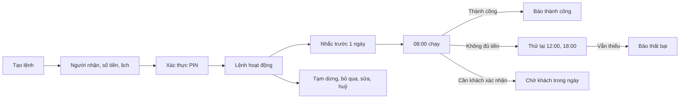

> **Mã:** DE07-TN04-PRD · **Trạng thái:** đã chốt · **Người viết:** Design · **SRS:** [SRS.md](SRS.md)

# PRD Chuyển khoản hẹn lịch và định kỳ (App ngân hàng, chuyển khoản)

## 1. Bối cảnh và vấn đề

### 1.1 Bối cảnh

Nhiều khoản chuyển lặp lại theo lịch: tiền nhà ngày 5 hằng tháng, tiền gửi bố mẹ đầu tháng, tiền học thêm hằng tuần, tiết kiệm đều đặn cho tài khoản của con (xem [README](../../README.md)). Khách muốn cài một lần rồi yên tâm, nhưng vẫn kiểm soát được: biết trước khi tiền đi, đổi hoặc dừng khi cần.

### 1.2 Vấn đề

| **Vấn đề** | **Hệ quả** |
| --- | --- |
| Quên ngày chuyển tiền nhà | Trễ hạn, bị nhắc, mất uy tín |
| Lệnh tự chạy khi tài khoản không đủ tiền | Thất bại mà không biết, không ai báo |
| Muốn tạm dừng một tháng nhưng phải huỷ và tạo lại | Phiền, dễ quên tạo lại |
| Ngày 31 không có trong tháng 2 | Không rõ lệnh chạy ngày nào |
| Kẻ gian chiếm tài khoản cài lệnh định kỳ rút dần | Mất tiền âm thầm |

### 1.3 Mục tiêu

- ≥ 95% lần chạy thành công trong ngày đến hạn.
- 100% lần chạy thất bại được thông báo cho khách trong ngày.
- ≥ 10% khách có ít nhất một khoản chuyển lặp lại hằng tháng dùng lệnh định kỳ sau 6 tháng.

## 2. Người dùng

| **Nhóm** | **Nhu cầu với tính năng này** |
| --- | --- |
| Người thuê nhà | Chuyển tiền nhà đúng ngày, nội dung đúng mẫu |
| Người gửi tiền cho gia đình | Đều đặn, không phải nhớ |
| Phụ huynh | Học phí hằng tuần, hằng tháng; tạm dừng dịp nghỉ hè |
| Người tiết kiệm | Chuyển định kỳ sang tài khoản khác của mình |

## 3. Phạm vi

### 3.1 Trong phạm vi (MVP)

- Lệnh một lần vào ngày định trước.
- Lệnh định kỳ hằng tuần hoặc hằng tháng, có hoặc không có ngày kết thúc.
- Nhắc trước 1 ngày; báo kết quả mỗi lần chạy.
- Thử lại khi không đủ số dư; tự tạm dừng sau 3 kỳ thất bại liên tiếp.
- Sửa, tạm dừng, tiếp tục, bỏ qua một kỳ, huỷ.
- Lịch sử từng lần chạy.

### 3.2 Ngoài phạm vi

- Thanh toán hoá đơn định kỳ (điện, nước) qua nhà cung cấp.
- Số tiền thay đổi theo kỳ, chuyển phần trăm số dư.
- Lệnh định kỳ hằng ngày, hằng quý.
- Lệnh định kỳ chuyển thường (≥ 500 triệu).

## 4. Nguyên tắc sản phẩm

### 4.1 Không có bất ngờ

Khách được nhắc trước khi tiền đi và được báo ngay sau khi tiền đi hoặc không đi được.

### 4.2 Tạm dừng dễ hơn huỷ

Tạm dừng, bỏ qua một kỳ đều một chạm; dữ liệu lệnh giữ nguyên.

### 4.3 Tự động nhưng vẫn an toàn

Mỗi lần chạy vẫn qua kiểm tra rủi ro và hạn mức; khi cần xác thực mà khách không có mặt, lệnh chờ khách thay vì tự chạy.

## 5. Quy tắc nghiệp vụ

| **Quy tắc** | **Giá trị** |
| --- | --- |
| Tần suất | Một lần; hằng tuần (chọn thứ); hằng tháng (chọn ngày 1–31) |
| Ngày không tồn tại | Chạy vào ngày cuối tháng |
| Giờ chạy | 08:00 ngày đến hạn; thử lại 12:00 và 18:00 nếu không đủ số dư |
| Số tiền mỗi lần | Tối đa 10.000.000 ₫ |
| Số lệnh hoạt động | Tối đa 20 |
| Thất bại liên tiếp | 3 kỳ → tự tạm dừng |
| Nhắc trước | 1 ngày, lúc 20:00; mặc định bật |

## 6. Luồng trải nghiệm

| **Bước** | **Giai đoạn** | **Trải nghiệm** | **Đầu ra** |
| --- | --- | --- | --- |
| 1 | Tạo | Chọn người nhận, số tiền, nội dung, lịch, ngày kết thúc | Lệnh nháp |
| 2 | Xác nhận | Xem lại lịch các kỳ sắp tới, xác thực | Lệnh hoạt động |
| 3 | Chạy | Nhắc trước, chạy, báo kết quả | Giao dịch |
| 4 | Quản lý | Danh sách lệnh, lịch sử từng kỳ, thao tác | Lệnh được điều chỉnh |

## 7. Use Cases, User Stories và Acceptance Criteria

### UC1. Tạo lệnh

#### US1.1 Cài tiền nhà hằng tháng

User Story: Là người thuê nhà, tôi muốn cài chuyển 5 triệu cho chủ trọ ngày 5 hằng tháng.

AC01: Chọn người nhận (danh bạ hoặc mới), số tiền, nội dung.

AC02: Chọn Hằng tháng, ngày 5; kết thúc: không kết thúc, đến ngày, hoặc sau n lần.

AC03: Xem trước 3 kỳ sắp tới với ngày cụ thể.

AC04: Chọn ngày 29–31 → ghi chú "Tháng không có ngày này sẽ chuyển vào ngày cuối tháng".

AC05: Xác thực PIN; lệnh vào danh sách.

### UC2. Chạy lệnh

#### US2.1 Biết trước và biết kết quả

AC01: 20:00 ngày trước kỳ chạy → push nhắc, kèm cảnh báo nếu số dư hiện tại không đủ.

AC02: Thành công → push như giao dịch thường.

AC03: Không đủ số dư → thử lại 12:00, 18:00; vẫn thiếu → push thất bại.

AC04: Lần chạy cần xác thực khuôn mặt (vượt ngưỡng ngày) hoặc bị cảnh báo rủi ro → push mời khách vào app xác nhận trước 22:00; không xác nhận → bỏ kỳ đó.

### UC3. Quản lý lệnh

AC01: Danh sách lệnh: người nhận, số tiền, lịch, kỳ tới, trạng thái.

AC02: Tạm dừng, tiếp tục, bỏ qua kỳ tới, huỷ một chạm (có xác nhận).

AC03: Sửa số tiền, nội dung, lịch (xác thực lại); đổi người nhận phải tạo lệnh mới.

AC04: Lịch sử từng kỳ: ngày, kết quả, lý do.

AC05: 3 kỳ thất bại liên tiếp → lệnh tự tạm dừng, báo khách.

## 8. Chỉ số theo dõi

| **Chỉ số** | **Định nghĩa** | **Mục tiêu MVP** |
| --- | --- | --- |
| Tỉ lệ chạy thành công | Lần chạy thành công trong ngày đến hạn / lần đến hạn | ≥ 95% |
| Báo thất bại | Lần thất bại có push trong ngày / lần thất bại | 100% |
| Nhờ thử lại | Lần thành công ở lần thử 12:00, 18:00 / lần thiếu số dư lúc 08:00 | Theo dõi |
| Tỉ lệ dùng tạm dừng thay vì huỷ | Tạm dừng / (tạm dừng + huỷ) | Theo dõi |
| Mức sử dụng | Khách có lệnh định kỳ / khách có khoản chuyển lặp hằng tháng | ≥ 10% sau 6 tháng |

## 9. Phụ thuộc và rủi ro

| **Mục** | **Mô tả** | **Hướng xử lý** |
| --- | --- | --- |
| Quy định xác thực | Lần chạy không có khách để xác thực | Giới hạn số tiền mỗi lần; vượt ngưỡng ngày thì chờ khách |
| Chiếm tài khoản | Cài lệnh rút dần | Thông báo khi tạo lệnh; chấm rủi ro mỗi lần chạy; khoá nhanh tạm dừng mọi lệnh |
| Tải hệ thống 08:00 | Nhiều lệnh chạy cùng lúc | Rải đều trong 08:00–08:30 |
| Người nhận đóng tài khoản | Lần chạy thất bại mãi | Tra tên trước mỗi lần chạy; tài khoản không tồn tại → tạm dừng ngay |

## 10. Câu hỏi mở

> Mọi câu hỏi dưới đây đã được PO chốt ngày 20/11/2026; quyết định ghi sau mỗi câu và đã cập nhật vào SRS.

- Kỳ bị lỡ khi tạm dừng có chạy bù? → **Đã chốt:** Không (SRS BR-45).
- Mỗi lần chạy có tra tên người nhận lại? → **Đã chốt:** Có; tên đổi thì không chạy, tạm dừng lệnh và báo khách (SRS BR-42).
- Lần chạy có tính vào hạn mức ngày? → **Đã chốt:** Có, như mọi giao dịch (SRS BR-40).
- Mở khoá nhanh xong lệnh có tự tiếp tục? → **Đã chốt:** Không; khách tự tiếp tục từng lệnh (SRS BR-48).
