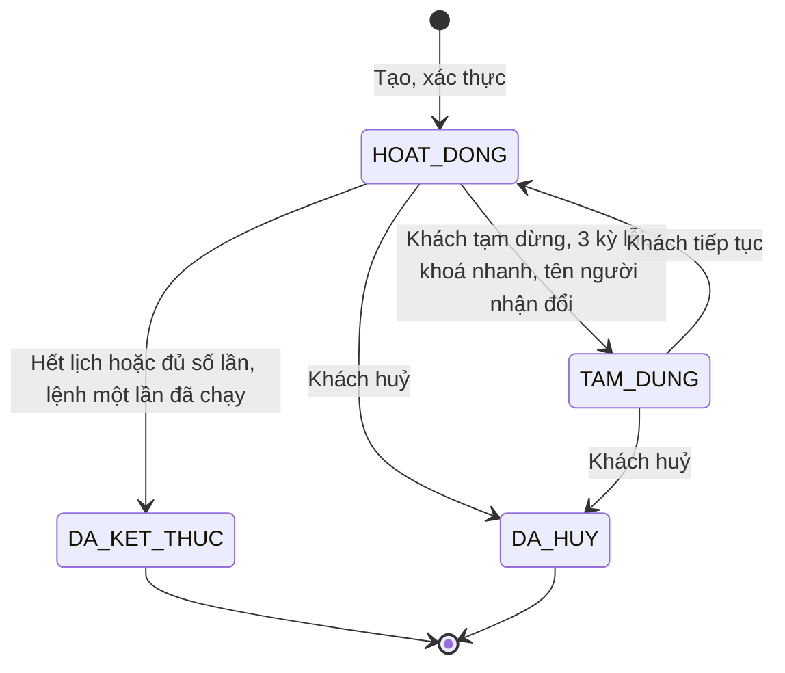
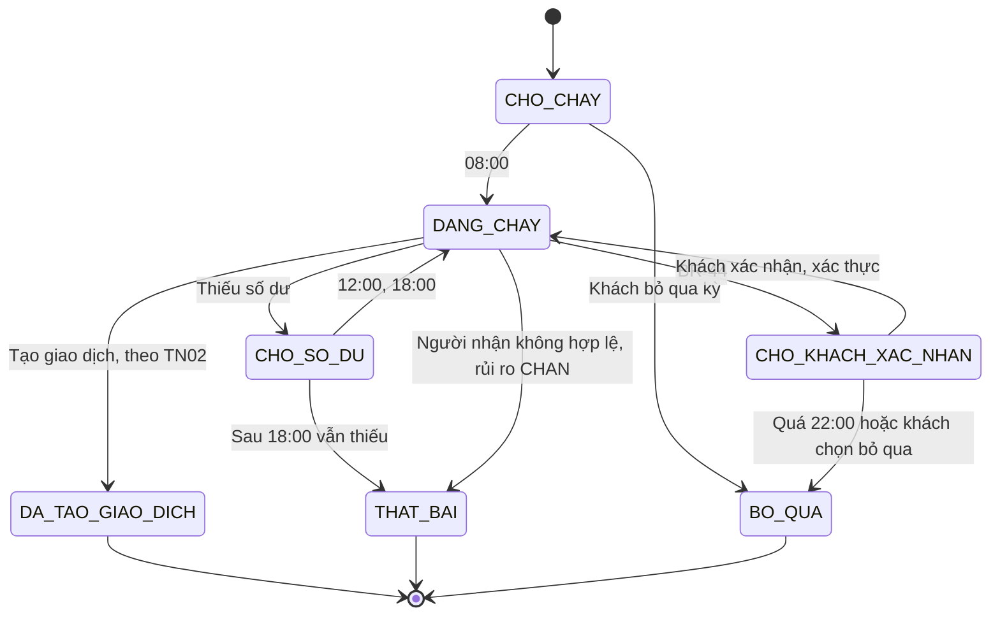
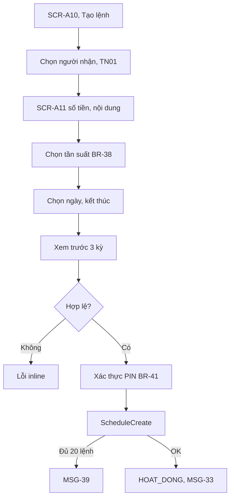
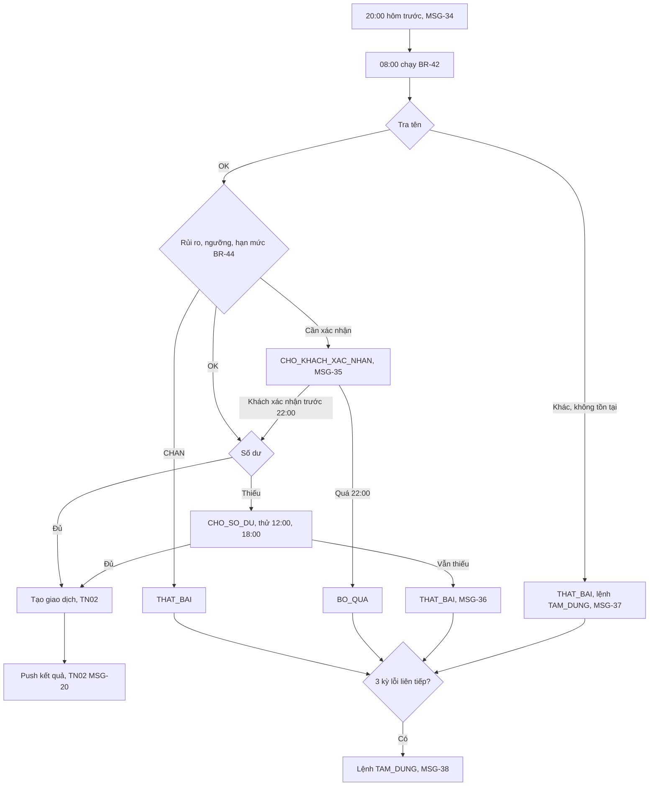
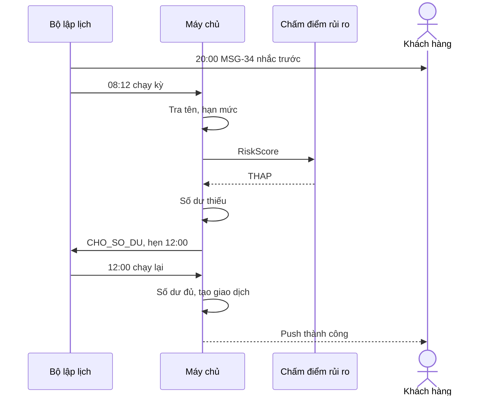

> **Mã:** DE07-TN04-SRS · **Trạng thái:** đã chốt · **Người viết:** Design · **PRD:** [PRD.md](PRD.md)

# UC-DE07-04 - Chuyển khoản hẹn lịch và định kỳ

> SRS này mô tả lệnh hẹn lịch (một lần, định kỳ) và các lần chạy. Mỗi lần chạy tạo một giao dịch đi theo vòng đời ở [SRS TN02](../TN02-lap-lenh-xac-thuc/SRS.md) và qua kiểm tra ở [SRS TN03](../TN03-canh-bao-gian-lan/SRS.md).

## 1. Tổng quan

| **Mục** | **Nội dung** |
| --- | --- |
| Mục tiêu | Khách cài khoản chuyển theo lịch, được nhắc và báo kết quả, quản lý lệnh dễ dàng |
| Actor | Khách hàng · App ngân hàng · Bộ lập lịch · Máy chủ ngân hàng · Hệ thống chấm điểm rủi ro |
| Phạm vi | Tạo, xem trước kỳ, xác thực, chạy, nhắc trước, thử lại, chờ khách xác nhận, sửa, tạm dừng, tiếp tục, bỏ qua, huỷ, lịch sử kỳ |
| Ngoài phạm vi | Hoá đơn định kỳ, số tiền biến đổi, hằng ngày, hằng quý, chuyển thường |
| Nền tảng | App ngân hàng iOS / Android |

## 2. User Story

| **ID** | **As a** | **I want** | **So that** |
| --- | --- | --- | --- |
| US-16 | Khách hàng | Cài chuyển tiền nhà ngày 5 hằng tháng | Không quên, không trễ |
| US-17 | Khách hàng | Được nhắc trước khi tiền đi | Nạp đủ tiền kịp |
| US-18 | Khách hàng | Được báo khi một kỳ không chạy được | Xử lý trong ngày |
| US-19 | Khách hàng | Tạm dừng hoặc bỏ qua một kỳ | Không phải tạo lại lệnh |
| US-20 | Khách hàng | Lệnh vẫn an toàn khi tôi không có mặt | Không bị rút tiền âm thầm |

## 3. Business Rules

| **Mã** | **Quy tắc** |
| --- | --- |
| BR-38 | **Lịch**: Một lần (ngày từ mai tới 365 ngày); Hằng tuần (chọn 1 thứ); Hằng tháng (ngày 1–31; tháng không có ngày đó → ngày cuối tháng). Bắt đầu từ kỳ đầu tiên ≥ ngày mai. Kết thúc (định kỳ): Không kết thúc · Đến ngày (≥ kỳ đầu) · Sau n lần (2–120) |
| BR-39 | **Người nhận**: chọn theo TN01 (danh bạ, mới, tài khoản của tôi); không cho người nhận có cờ cảnh báo. **Nội dung** theo TN02 BR-12 |
| BR-40 | **Số tiền** mỗi lần 1.000–10.000.000 ₫ (ngưỡng không cần xác thực khuôn mặt cho từng lần). Lần chạy tính vào hạn mức ngày (TN02 BR-16) và tổng ngày dùng cho ngưỡng khuôn mặt. Chuyển tới tài khoản của chính khách không giới hạn 10.000.000 ₫ (tối đa theo hạn mức giao dịch) |
| BR-41 | **Xác thực khi tạo, sửa** (số tiền, lịch, nội dung): mức `THUONG` (PIN Smart OTP hoặc sinh trắc thiết bị). Tạo lệnh gửi push và SMS MSG-33 tới khách |
| BR-42 | **Chạy**: 08:00–08:30 ngày đến hạn (rải đều). Mỗi lần chạy: (1) tra tên người nhận; tên khác tên đã lưu hoặc tài khoản không tồn tại → không chạy, lệnh `TAM_DUNG`, MSG-37; (2) kiểm tra hạn mức; (3) chấm điểm rủi ro (TN03 BR-25); (4) kiểm tra ngưỡng khuôn mặt theo tổng ngày; (5) kiểm tra số dư; (6) tạo giao dịch chuyển nhanh hoặc nội bộ |
| BR-43 | **Thiếu số dư** lúc chạy → kỳ `CHO_SO_DU`, thử lại 12:00 và 18:00; vẫn thiếu → kỳ `THAT_BAI`, MSG-36. Lệnh định kỳ giữ nguyên cho kỳ sau |
| BR-44 | **Cần khách xác nhận**: rủi ro mức `CANH_BAO` trở lên, hoặc tổng ngày (kể cả lần này) > 20.000.000 ₫, hoặc vượt hạn mức ngày đang có hiệu lực (khi khách vừa giảm) → kỳ `CHO_KHACH_XAC_NHAN`, push MSG-35; khách vào app xác nhận (qua cảnh báo TN03 và xác thực đúng mức TN02) trước 22:00; quá 22:00 → kỳ `BO_QUA`. Vượt hạn mức → khách chỉ có thể bỏ qua kỳ hoặc đổi hạn mức trước |
| BR-45 | **Thao tác lệnh**: Tạm dừng (không chạy các kỳ tới, kỳ lỡ không chạy bù) · Tiếp tục (từ kỳ kế tiếp ≥ ngày mai) · Bỏ qua kỳ tới (chỉ kỳ gần nhất, trước 08:00 ngày chạy) · Huỷ (kết thúc vĩnh viễn) · Sửa (số tiền, nội dung, lịch; không đổi người nhận, tài khoản nguồn đổi được). Tạm dừng, tiếp tục, bỏ qua, huỷ cần xác nhận popup, không cần PIN |
| BR-46 | **Nhắc trước**: 20:00 ngày trước kỳ chạy (mặc định bật, tắt theo lệnh): MSG-34; số dư khả dụng lúc 20:00 < số tiền → thêm câu nhắc nạp tiền |
| BR-47 | **Giới hạn**: tối đa 20 lệnh ở `HOAT_DONG` hoặc `TAM_DUNG` mỗi khách; tối đa 3 lệnh khác nhau chạy cùng một ngày tới cùng một người nhận |
| BR-48 | **Tự tạm dừng**: 3 kỳ liên tiếp `THAT_BAI` hoặc `BO_QUA` → lệnh `TAM_DUNG`, MSG-38. Khoá nhanh (TN03 BR-29) → mọi lệnh `TAM_DUNG` lý do "Khoá nhanh"; mở khoá không tự tiếp tục |

## 4. Trạng thái

### 4.1 Trạng thái lệnh

### 4.2 Trạng thái một kỳ chạy

Kết quả cuối của kỳ `DA_TAO_GIAO_DICH` theo trạng thái giao dịch ở TN02 (thành công, thất bại, chưa xác định, tạm giữ).

## 5. Use Case

### UC-09 Tạo lệnh hẹn lịch

| **Mục** | **Nội dung** |
| --- | --- |
| Tiền điều kiện | Đã đăng nhập; dịch vụ không bị khoá; < 20 lệnh |
| Hậu điều kiện thành công | Lệnh `HOAT_DONG` với kỳ đầu `CHO_CHAY` |
| Hậu điều kiện thất bại | Không tạo lệnh |

**Luồng chính**

| **Bước** | **Actor** | **Mô tả** |
| --- | --- | --- |
| 1 | Khách hàng | Mở **SCR-A10**, bấm "Tạo lệnh" |
| 2 | App | Mở **SCR-A01** (TN01) chế độ chọn người nhận; khách chọn "Chủ trọ" |
| 3 | App | Mở **SCR-A11** |
| 4 | Khách hàng | Nhập 5.000.000 ₫, nội dung "Tien nha P302"; chọn Hằng tháng, ngày 5, Không kết thúc |
| 5 | App | Hiện 3 kỳ tới: 05/12/2026, 05/01/2027, 05/02/2027 |
| 6 | Khách hàng | Bấm "Tạo lệnh", xác thực Face ID |
| 7 | App | Gọi \[ScheduleCreate\]; về **SCR-A10**; MSG-33 |

**Luồng thay thế**

| **Mã** | **Điều kiện** | **Xử lý** |
| --- | --- | --- |
| A1 | Chọn ngày 29–31 | Ghi chú tháng thiếu ngày (BR-38) |
| A2 | Tạo từ chi tiết giao dịch (TN05) "Đặt lịch chuyển định kỳ" | Điền sẵn người nhận, số tiền, nội dung |
| A3 | Người nhận là tài khoản của tôi | Không giới hạn 10 triệu (BR-40) |

**Luồng lỗi**

| **Mã** | **Điều kiện** | **Xử lý** |
| --- | --- | --- |
| E1 | Số tiền > 10.000.000 ₫ | MSG-40 |
| E2 | Đủ 20 lệnh | MSG-39 |
| E3 | Ngày kết thúc trước kỳ đầu | Lỗi inline |
| E4 | Lỗi mạng | MSG-19 (TN02) |

### UC-10 Chạy một kỳ

| **Mục** | **Nội dung** |
| --- | --- |
| Tiền điều kiện | Kỳ `CHO_CHAY`, lệnh `HOAT_DONG`, tới 08:00 ngày đến hạn |
| Hậu điều kiện thành công | Giao dịch được tạo (TN02); khách nhận kết quả |
| Hậu điều kiện thất bại | Kỳ `THAT_BAI` hoặc `BO_QUA`; khách được báo |

**Luồng chính**

| **Bước** | **Actor** | **Mô tả** |
| --- | --- | --- |
| 1 | Bộ lập lịch | 20:00 ngày 04/12 gửi MSG-34 |
| 2 | Bộ lập lịch | 08:12 ngày 05/12 chạy kỳ |
| 3 | Máy chủ | Tra tên OK; hạn mức OK; điểm rủi ro thấp; tổng ngày 5.000.000 ₫; số dư đủ |
| 4 | Máy chủ | Tạo giao dịch chuyển nhanh; thành công |
| 5 | Máy chủ | Push kết quả; kỳ tiếp theo 05/01 `CHO_CHAY` |

**Luồng thay thế**

| **Mã** | **Điều kiện** | **Xử lý** |
| --- | --- | --- |
| A1 | Thiếu số dư lúc 08:00, đủ lúc 12:00 | Chạy lúc 12:00 |
| A2 | Cần khách xác nhận | Khách chạm push → **SCR-A11** chế độ xác nhận kỳ → cảnh báo (nếu có) → xác thực → chạy |
| A3 | Kỳ tạo giao dịch bị `TAM_GIU` | Theo TN03; kỳ ghi "Đang xác minh" |

**Luồng lỗi**

| **Mã** | **Điều kiện** | **Xử lý** |
| --- | --- | --- |
| E1 | Tên người nhận đổi | MSG-37 |
| E2 | Không đủ số dư cả ngày | MSG-36 |
| E3 | Hệ thống lỗi lúc 08:00 | Thử lại mỗi 15 phút tới 20:00; vẫn lỗi → `THAT_BAI` lý do hệ thống, không tính vào 3 kỳ lỗi |

### UC-11 Quản lý lệnh

**Luồng chính**

| **Bước** | **Actor** | **Mô tả** |
| --- | --- | --- |
| 1 | Khách hàng | Mở **SCR-A10**, chạm lệnh "Tiền nhà" |
| 2 | App | Chi tiết: thông tin, kỳ tới, lịch sử kỳ, thao tác |
| 3 | Khách hàng | Bấm "Bỏ qua kỳ tới" |
| 4 | App | Popup "Bỏ qua kỳ 05/12? Kỳ tiếp theo: 05/01" → xác nhận → \[ScheduleSkip\] |

**Luồng thay thế**

| **Mã** | **Điều kiện** | **Xử lý** |
| --- | --- | --- |
| A1 | Tạm dừng / Tiếp tục | \[ScheduleStatus\]; tiếp tục hiện kỳ kế tiếp |
| A2 | Sửa | **SCR-A11** chế độ sửa; xác thực (BR-41); kỳ `CHO_CHAY` tính lại theo lịch mới |
| A3 | Huỷ | Popup xác nhận → `DA_HUY` |

**Luồng lỗi**

| **Mã** | **Điều kiện** | **Xử lý** |
| --- | --- | --- |
| E1 | Bỏ qua kỳ đang chạy (sau 08:00 ngày chạy) | Không cho; ghi "Kỳ hôm nay đang được thực hiện" |
| E2 | Tiếp tục khi dịch vụ đang khoá | MSG-25 (TN03) hướng dẫn mở khoá |

## 6. Điểm vào

| **Điểm vào** | **Dẫn tới** | **Ghi chú** |
| --- | --- | --- |
| Chuyển tiền → Lệnh hẹn lịch | **SCR-A10** | |
| "Đặt lịch định kỳ" ở chi tiết giao dịch thành công (TN05) | **SCR-A11** điền sẵn | A2 UC-09 |
| Push nhắc trước, kết quả, cần xác nhận | Chi tiết lệnh hoặc chế độ xác nhận kỳ | |

## 7. Mô tả màn hình

### SCR-A10 Lệnh hẹn lịch

| **#** | **Thành phần** | **Loại** | **Hành vi** |
| --- | --- | --- | --- |
| 1 | Tab | Tabs | Đang hoạt động, Tạm dừng, Đã kết thúc |
| 2 | Thẻ lệnh | Card | Người nhận, số tiền, lịch ("Ngày 5 hằng tháng"), kỳ tới, nhãn trạng thái, cảnh báo kỳ gần nhất thất bại |
| 3 | "Tạo lệnh" | Button | UC-09 |
| 4 | Chi tiết lệnh | Màn chi tiết | Thông tin, kỳ tới, lịch sử kỳ (ngày, trạng thái mục 4.2, lý do), Tạm dừng, Tiếp tục, Bỏ qua kỳ tới, Sửa, Huỷ, công tắc Nhắc trước |
| 5 | Số lệnh | Text | "{n}/20" |

### SCR-A11 Tạo / sửa lệnh

| **#** | **Thành phần** | **Loại** | **Bắt buộc** | **Validate / hành vi** |
| --- | --- | --- | --- | --- |
| 1 | Người nhận | Card | Có | Chọn theo TN01; khoá khi sửa |
| 2 | Tài khoản nguồn | Dòng chọn | Có | |
| 3 | Số tiền | Amount | Có | BR-40 |
| 4 | Nội dung | Text | Có | TN02 BR-12 |
| 5 | Tần suất | Segmented | Có | Một lần, Hằng tuần, Hằng tháng |
| 6 | Ngày | Date / thứ / ngày trong tháng | Có | BR-38 |
| 7 | Kết thúc | Radio | Có (định kỳ) | Không kết thúc, Đến ngày, Sau n lần |
| 8 | Xem trước | List | – | 3 kỳ tới |
| 9 | Nhắc trước 1 ngày | Switch | – | Mặc định bật |
| 10 | "Tạo lệnh" / "Lưu" | Button | – | Xác thực BR-41 |
| 11 | Chế độ xác nhận kỳ | Banner + Button | – | Khi mở từ MSG-35: "Xác nhận chuyển {số tiền} hôm nay", "Bỏ qua kỳ này" |

## 8. API

| **API** | **Request chính** | **Response chính** | **Timeout / retry** |
| --- | --- | --- | --- |
| \[ScheduleList\] | tab | Danh sách lệnh | 5s / 1 lần |
| \[ScheduleDetail\] | schedule_id | Lệnh, kỳ tới, lịch sử kỳ | 5s / 1 lần |
| \[SchedulePreview\] | frequency, day, start, end | 3 ngày chạy tới | 2s / 1 lần |
| \[ScheduleCreate\], \[ScheduleUpdate\] | payee, source, amount, note, rule, end, remind, chữ ký | schedule_id | 10s / 1 lần |
| \[ScheduleStatus\] | schedule_id, action (pause, resume, cancel) | status | 5s / 1 lần |
| \[ScheduleSkip\] | schedule_id, run_date | next_run | 5s / 1 lần |
| \[RunConfirm\] | run_id | transaction_id (đi tiếp theo TN02, TN03) | 5s / 1 lần |
| \[RunSkip\] | run_id | status | 5s / 1 lần |

**Map lỗi → thông báo**

| **Nhóm** | **Message** |
| --- | --- |
| Đã tạo lệnh | MSG-33 |
| Nhắc trước | MSG-34 |
| Cần khách xác nhận | MSG-35 |
| Thiếu số dư cả ngày | MSG-36 |
| Người nhận không hợp lệ | MSG-37 |
| Tự tạm dừng | MSG-38 |
| Đủ 20 lệnh | MSG-39 |
| Vượt số tiền mỗi lần | MSG-40 |

## 9. Danh sách thông báo

| **ID** | **Nơi hiện** | **Nội dung (VI)** |
| --- | --- | --- |
| MSG-33 | Push, SMS | Bạn vừa tạo lệnh chuyển {số tiền} ₫ tới {tên} {lịch}. Nếu không phải bạn, khoá ngay: {link} |
| MSG-34 | Push | Ngày mai {ngày} sẽ chuyển {số tiền} ₫ tới {tên}. {Nếu thiếu: Số dư hiện tại {số dư} ₫, vui lòng nạp thêm} \[Bỏ qua kỳ này\] |
| MSG-35 | Push | Lệnh chuyển {số tiền} ₫ tới {tên} hôm nay cần bạn xác nhận trước 22:00. \[Xác nhận\] |
| MSG-36 | Push | Chưa chuyển được {số tiền} ₫ tới {tên} hôm nay do số dư không đủ. Kỳ tiếp theo: {ngày} |
| MSG-37 | Push | Lệnh chuyển tới {tên} đã tạm dừng vì thông tin tài khoản nhận đã thay đổi. Kiểm tra và tạo lệnh mới nếu cần |
| MSG-38 | Push | Lệnh "{tên lệnh}" đã tạm dừng sau 3 kỳ không thực hiện được. \[Xem lệnh\] |
| MSG-39 | Popup | Bạn đã có 20 lệnh hẹn lịch. Huỷ bớt lệnh không dùng để tạo lệnh mới |
| MSG-40 | Inline | Mỗi lần chuyển theo lịch tối đa 10.000.000 ₫ |

## 10. Yêu cầu phi chức năng

| **Mục** | **Yêu cầu** |
| --- | --- |
| Độ tin cậy | Mỗi kỳ chạy đúng một lần (khoá theo run_id, idempotency); lỗi hệ thống thử lại theo E3 UC-10; không bao giờ chạy kỳ của lệnh `TAM_DUNG` |
| Hiệu năng | Mọi kỳ 08:00 bắt đầu xử lý trước 08:30; push kết quả ≤ 1 phút sau khi có kết quả giao dịch |
| Múi giờ | Mọi lịch theo giờ Việt Nam (UTC+7) |
| Bảo mật | Tạo, sửa lệnh luôn có thông báo (MSG-33); khoá nhanh tạm dừng mọi lệnh ≤ 5 giây |
| Log / audit | Tạo, sửa, mọi thao tác lệnh; mọi kỳ: thời điểm từng bước, kết quả kiểm tra, lý do |
| Tracking | Tạo lệnh (tần suất, số tiền), tỉ lệ thành công kỳ, dùng thử lại, cần xác nhận và tỉ lệ khách xác nhận, tạm dừng, bỏ qua, huỷ |
| Accessibility | Lịch đọc được bằng câu ("Ngày 5 hằng tháng, không kết thúc"); trạng thái kỳ không chỉ bằng màu |
