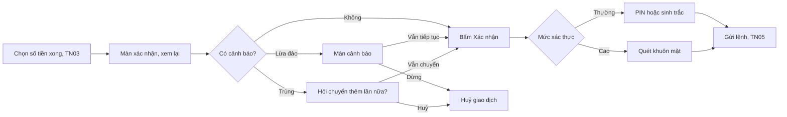

> **Mã:** DE07-TN04-PRD · **Trạng thái:** đã chốt · **Người viết:** Design · **SRS:** [SRS.md](SRS.md)

# PRD Xác thực và xác nhận chuyển khoản (App ngân hàng, chuyển khoản)

## 1. Bối cảnh và vấn đề

### 1.1 Bối cảnh

Sau khi chọn số tiền (TN03), khách xem lại toàn bộ giao dịch, bấm xác nhận và xác thực để chuyển (xem [README](../../README.md)). Đây là khoảnh khắc **tiền rời khỏi tài khoản**, thường là khoản lớn (tiền nhà, học phí, tiền hàng). Bước này phải đủ rõ để không chuyển nhầm, đủ mạnh để chặn lừa đảo, nhưng không làm phiền giao dịch bình thường. Theo Quyết định 2345/QĐ-NHNN, giao dịch giá trị lớn phải xác thực bằng sinh trắc học khuôn mặt.

### 1.2 Vấn đề

| **Vấn đề** | **Hệ quả** |
| --- | --- |
| Không có bước xem lại, sai một số mới phát hiện | Chuyển nhầm, khó đòi lại |
| Không rõ khi nào phải quét khuôn mặt | Người dùng bất ngờ, tưởng app lỗi, bỏ dở |
| Bị kẻ gian gọi điện hướng dẫn chuyển tiền | Mất tiền |
| Vừa chuyển xong lại chuyển thêm lần nữa vì tưởng chưa đi | Chuyển trùng |
| Nhập sai PIN nhiều lần không biết còn bao nhiêu lần | Bị khoá Smart OTP bất ngờ |

### 1.3 Mục tiêu

- Thời gian từ màn xác nhận tới gửi lệnh ≤ 7 giây (trung vị) với giao dịch dưới ngưỡng khuôn mặt.
- ≥ 30% giao dịch gặp cảnh báo lừa đảo được khách tự dừng.
- Tỉ lệ bỏ dở ở bước xác thực khuôn mặt ≤ 10%.

## 2. Người dùng

| **Nhóm** | **Nhu cầu với tính năng này** |
| --- | --- |
| Người chuyển tiền nhà, học phí | Xem lại kỹ, xác nhận, sinh trắc vân tay hoặc Face ID |
| Người chuyển số tiền lớn | Biết trước phải quét khuôn mặt, được hướng dẫn |
| Người lớn tuổi | Xem lại rõ ràng, chữ to |
| Người có thể bị lừa | Được cảnh báo đủ mạnh để dừng lại |

## 3. Phạm vi

### 3.1 Trong phạm vi (MVP)

- Màn xác nhận: người nhận, số tiền và bằng chữ, nội dung, tài khoản nguồn, hình thức chuyển, thời gian tới, phí, tổng trừ, cách xác thực sẽ dùng.
- Cảnh báo người nhận đáng ngờ, giao dịch bất thường; cảnh báo chuyển trùng.
- Xác thực theo mức: PIN Smart OTP hoặc sinh trắc thiết bị; sinh trắc khuôn mặt khi vượt ngưỡng hoặc thiết bị mới.
- Giới hạn số lần sai, thời gian chờ xác thực.
- Gửi lệnh chuyển tiền an toàn (không gửi trùng).

### 3.2 Ngoài phạm vi

- Đăng ký, cài Smart OTP, đăng ký sinh trắc khuôn mặt (chỉ dẫn link).
- Tạm giữ giao dịch để nhân viên gọi xác minh.
- Màn kết quả (TN05).

## 4. Nguyên tắc sản phẩm

### 4.1 Xem lại rồi mới xác thực

Màn xác nhận là một bước riêng, đọc từ trên xuống: số tiền → người nhận → nội dung → hình thức và thời gian tới → nguồn → phí. Bấm "Xác nhận" xong mới xác thực.

### 4.2 Nói trước khi đòi

Nếu cần quét khuôn mặt, màn xác nhận báo trước, kèm lý do.

### 4.3 Cảnh báo phải làm người dùng dừng lại

Cảnh báo lừa đảo là màn riêng, có thời gian chờ ngắn; nút chính là "Dừng giao dịch".

## 5. Quy tắc nghiệp vụ

| **Quy tắc** | **Giá trị** |
| --- | --- |
| Xác thực thường | Mã PIN Smart OTP 6 số, hoặc sinh trắc thiết bị nếu đã bật |
| Xác thực khuôn mặt | Giao dịch > 10.000.000 ₫, hoặc tổng trong ngày > 20.000.000 ₫, hoặc giao dịch đầu tiên trên thiết bị mới |
| Thời gian xác thực | 3 phút |
| Sai PIN | 5 lần liên tiếp → khoá Smart OTP |
| Khuôn mặt thất bại | 3 lần liên tiếp → tạm khoá 15 phút |
| Cảnh báo trùng | Cùng người nhận, cùng số tiền trong 5 phút |
| Màn cảnh báo | Chờ 5 giây và tích ô xác nhận mới tiếp tục được |

- Ngưỡng là **cấu hình** theo quy định Ngân hàng Nhà nước.

## 6. Luồng trải nghiệm

| **Bước** | **Giai đoạn** | **Trải nghiệm** | **Đầu ra** |
| --- | --- | --- | --- |
| 1 | Xem lại | Toàn bộ thông tin, cách xác thực | Người dùng chắc chắn |
| 2 | Cảnh báo (nếu có) | Màn cảnh báo, thời gian chờ | Dừng hoặc tiếp tục có ý thức |
| 3 | Xác nhận | Bấm "Xác nhận" | Lệnh chờ xác thực |
| 4 | Xác thực | PIN, sinh trắc, khuôn mặt | Lệnh được ký, gửi đi |

## 7. Use Cases, User Stories và Acceptance Criteria

### UC1. Xem lại và xác nhận

#### US1.1 Xem lại trước khi chuyển

User Story: Là khách, tôi muốn xem lại người nhận và số tiền trước khi xác thực để sửa kịp nếu sai.

AC01: Màn xác nhận hiện: số tiền lớn và bằng chữ, tên người nhận, ngân hàng, số tài khoản, nội dung, hình thức chuyển và thời gian tới, tài khoản nguồn, phí, tổng trừ.

AC02: Có dòng "Xác thực bằng {PIN / sinh trắc / khuôn mặt}".

AC03: Nút "Sửa" quay lại chọn số tiền, giữ dữ liệu.

#### US1.2 Được cảnh báo

AC01: Người nhận bị báo cáo lừa đảo hoặc giao dịch bất thường → màn cảnh báo toàn trang, nút chính "Dừng giao dịch"; "Tiếp tục" bật sau 5 giây và khi đã tích ô.

AC02: Vừa chuyển cùng người, cùng số tiền trong 5 phút → hỏi lại.

### UC2. Xác thực

#### US2.1 Xác thực nhanh

AC01: Đã bật sinh trắc thiết bị → hỏi vân tay hoặc Face ID ngay khi bấm Xác nhận.

AC02: Sinh trắc thất bại hoặc huỷ → nhập PIN 6 số.

AC03: Sai PIN → báo số lần còn lại; sai 5 lần → khoá Smart OTP, hướng dẫn mở khoá.

#### US2.2 Xác thực khuôn mặt

AC01: Hướng dẫn trước khi mở camera (nhìn thẳng, đủ sáng, bỏ khẩu trang).

AC02: Thất bại → cho thử lại; 3 lần → tạm khoá 15 phút.

AC03: Chưa đăng ký khuôn mặt → báo ngay ở màn xác nhận, dẫn tới đăng ký, không cho chuyển.

#### US2.3 Không gửi trùng

AC01: Mạng chập chờn, bấm lại nhiều lần → chỉ một lệnh được gửi.

## 8. Chỉ số theo dõi

| **Chỉ số** | **Định nghĩa** | **Mục tiêu MVP** |
| --- | --- | --- |
| Thời gian xác nhận | Mở **SCR-05** → gửi lệnh (dưới ngưỡng, trung vị) | ≤ 7 giây |
| Quay lại sửa | Lượt bấm Sửa / lượt mở **SCR-05** | Theo dõi |
| Dừng ở cảnh báo | Giao dịch dừng / giao dịch gặp cảnh báo lừa đảo | ≥ 30% |
| Bỏ ở khuôn mặt | Phiên bỏ / phiên cần khuôn mặt | ≤ 10% |
| Khoá Smart OTP | Số lần khoá / 10.000 giao dịch | Theo dõi |

## 9. Phụ thuộc và rủi ro

| **Mục** | **Mô tả** | **Hướng xử lý** |
| --- | --- | --- |
| Hệ thống chấm điểm rủi ro | Chậm, lỗi | Quá 800 ms coi như mức cảnh báo nhẹ, không chặn |
| Xác thực khuôn mặt | Máy cũ, thiếu sáng | Hướng dẫn rõ; cho thử lại |
| Quy định thay đổi | Ngưỡng xác thực | Cấu hình |

## 10. Câu hỏi mở

> Mọi câu hỏi dưới đây đã được PO chốt ngày 20/11/2026; quyết định ghi sau mỗi câu và đã cập nhật vào SRS.

- Xác nhận trước hay xác thực trước? → **Đã chốt:** Xem lại và bấm Xác nhận trước, rồi mới xác thực (SRS BR-29).
- Có cảnh báo trùng với giao dịch chưa xác định? → **Đã chốt:** Có (SRS BR-32).
- Rủi ro rất cao thì sao? → **Đã chốt:** Chặn giao dịch, hướng dẫn gọi tổng đài; không có tạm giữ ở MVP (SRS BR-31).
- Đổi tài khoản nguồn ở màn xác nhận được không? → **Đã chốt:** Không; bấm Sửa để quay lại TN03 (SRS BR-29).
