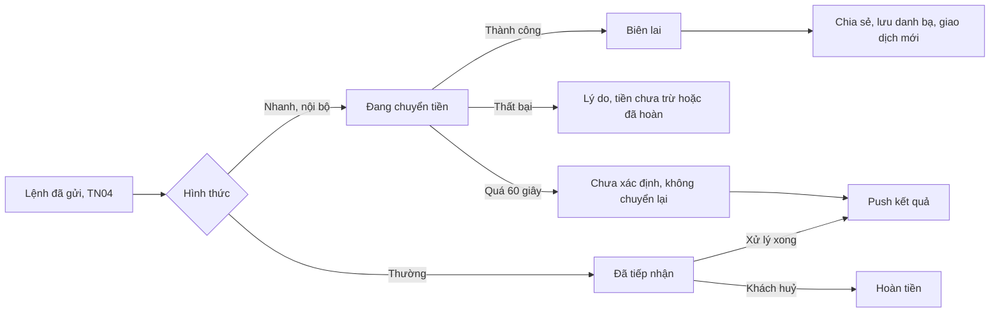

> **Mã:** DE07-TN05-PRD · **Trạng thái:** đã chốt · **Người viết:** Design · **SRS:** [SRS.md](SRS.md)

# PRD Hoàn thành chuyển khoản (App ngân hàng, chuyển khoản)

## 1. Bối cảnh và vấn đề

### 1.1 Bối cảnh

Sau khi xác thực (TN04), lệnh được gửi đi và khách chờ kết quả (xem [README](../../README.md)). Chuyển trong ngân hàng và chuyển nhanh 24/7 thường có kết quả trong vài giây; chuyển thường chỉ được **tiếp nhận** và xử lý trong giờ làm việc. Khách cần biết chắc tiền đã đi, đang chờ, hay chưa đi, và có biên lai để gửi người nhận.

### 1.2 Vấn đề

| **Vấn đề** | **Hệ quả** |
| --- | --- |
| Màn "Đang xử lý" quay mãi | Khách chuyển lại, bị trừ tiền hai lần |
| Chuyển thường chỉ báo "Thành công" khi tiền chưa tới | Người nhận nói chưa nhận được, khách hoang mang |
| Thất bại nhưng không biết tiền đã bị trừ chưa | Gọi tổng đài |
| Muốn gửi bằng chứng phải chụp màn hình | Lộ số dư |
| Người nhận mới phải nhập lại lần sau | Mất thời gian |

### 1.3 Mục tiêu

- ≥ 99% giao dịch chuyển nhanh, trong ngân hàng có kết quả cuối trong 60 giây.
- Giao dịch chuyển trùng do "Đang xử lý" lâu giảm 70%.
- ≥ 40% người nhận mới được lưu danh bạ sau khi chuyển thành công.

## 2. Người dùng

| **Nhóm** | **Nhu cầu với tính năng này** |
| --- | --- |
| Người chuyển tiền nhà, học phí | Biên lai rõ ràng gửi chủ nhà, nhà trường |
| Chủ hộ kinh doanh chuyển khoản lớn | Biết lệnh chuyển thường đã tiếp nhận, bao giờ tới; huỷ được nếu cần |
| Người gặp lỗi | Biết tiền ở đâu, phải làm gì |
| Người chuyển định kỳ cho cùng người | Lưu danh bạ, chuyển lại nhanh |

## 3. Phạm vi

### 3.1 Trong phạm vi (MVP)

- Màn đang xử lý; kết quả: thành công, đã tiếp nhận (chuyển thường), thất bại, chưa xác định.
- Đối soát tự động; thông báo khi có kết quả cuối.
- Huỷ lệnh chuyển thường chưa xử lý.
- Biên lai; chia sẻ dạng ảnh hoặc PDF.
- Lưu người nhận vào danh bạ; chuyển lại; giao dịch mới.
- Chi tiết giao dịch.

### 3.2 Ngoài phạm vi

- Lịch sử giao dịch đầy đủ, tìm kiếm (tính năng sẵn có của app).
- Tra soát, khiếu nại (dẫn tới kênh hỗ trợ sẵn có).
- Hẹn lịch, định kỳ.

## 4. Nguyên tắc sản phẩm

### 4.1 Mỗi kết quả nói rõ tiền đang ở đâu

Thành công, đã tiếp nhận, thất bại, chưa xác định: mỗi trạng thái kèm một câu về tiền và việc khách nên làm.

### 4.2 "Đã tiếp nhận" không phải "Thành công"

Chuyển thường hiện trạng thái riêng với thời gian tiền tới dự kiến; chỉ báo thành công khi ngân hàng nhận đã ghi có.

### 4.3 Chưa rõ thì đừng chuyển lại

Khi chưa xác định, app nói thẳng "Vui lòng không chuyển lại".

## 5. Quy tắc nghiệp vụ

| **Quy tắc** | **Giá trị** |
| --- | --- |
| Chờ kết quả | 60 giây với trong ngân hàng, chuyển nhanh; quá thì "Chưa xác định" |
| Chuyển thường | "Đã tiếp nhận" → xử lý 08:00–16:00 ngày làm việc → thành công hoặc thất bại |
| Huỷ lệnh chuyển thường | Khi chưa vào xử lý; hoàn số tiền và phí ngay |
| Đối soát | Có kết quả trong tối đa 1 ngày làm việc |
| Thất bại đã trừ tiền | Hoàn tự động về tài khoản nguồn |
| Danh bạ | Tối đa 200 người nhận |

## 6. Luồng trải nghiệm

| **Bước** | **Giai đoạn** | **Trải nghiệm** | **Đầu ra** |
| --- | --- | --- | --- |
| 1 | Chờ | "Đang chuyển tiền…" hoặc "Đã tiếp nhận" | – |
| 2 | Kết quả | Biểu tượng lớn, số tiền, người nhận, giờ, mã | Khách yên tâm |
| 3 | Sau đó | Chia sẻ biên lai, lưu danh bạ | Bằng chứng, lần sau nhanh hơn |
| 4 | Ngoại lệ | Push khi có kết quả cuối; huỷ lệnh chuyển thường | Biết chắc tiền đi hay hoàn |

## 7. Use Cases, User Stories và Acceptance Criteria

### UC1. Nhận kết quả

#### US1.1 Thành công

AC01: Dấu tích lớn, "Chuyển tiền thành công", số tiền, tên người nhận, ngân hàng, thời gian tới giây, mã giao dịch; không có số dư.

#### US1.2 Đã tiếp nhận (chuyển thường)

User Story: Là chủ hộ kinh doanh, tôi muốn biết lệnh 600 triệu đã được ngân hàng nhận và bao giờ tiền tới.

AC01: "Lệnh đã được tiếp nhận", thời gian xử lý dự kiến, "Tiền đã được trừ, chúng tôi sẽ báo khi người nhận nhận được".

AC02: Khi xử lý xong → push kết quả.

AC03: Chưa vào xử lý → nút "Huỷ lệnh"; huỷ cần PIN, hoàn ngay.

#### US1.3 Thất bại, chưa xác định

AC01: Thất bại → lý do, "Tiền chưa bị trừ" hoặc "Tiền đã được hoàn"; nút "Thử lại".

AC02: Chưa xác định → khuyên không chuyển lại; push khi có kết quả cuối.

### UC2. Sau khi thành công

AC01: Chia sẻ biên lai dạng ảnh hoặc PDF.

AC02: Người nhận mới → gợi ý lưu danh bạ với tên gợi nhớ.

AC03: "Giao dịch mới" mở màn chuyển tiền; "Về trang chủ".

AC04: Chi tiết giao dịch có "Chuyển lại" (người nhận, số tiền, nội dung cũ).

## 8. Chỉ số theo dõi

| **Chỉ số** | **Định nghĩa** | **Mục tiêu MVP** |
| --- | --- | --- |
| Có kết quả trong 60 giây | Giao dịch nhanh, nội bộ có kết quả ≤ 60 giây / tổng | ≥ 99% |
| Chuyển trùng | Cùng người nhận, cùng tiền trong 5 phút sau "Chưa xác định" | Giảm 70% |
| Lưu danh bạ | Người nhận mới được lưu / giao dịch thành công với người nhận mới | ≥ 40% |
| Chia sẻ biên lai | Giao dịch chia sẻ / giao dịch thành công | Theo dõi |
| Huỷ lệnh chuyển thường | Lệnh huỷ / lệnh chuyển thường | Theo dõi |

## 9. Phụ thuộc và rủi ro

| **Mục** | **Mô tả** | **Hướng xử lý** |
| --- | --- | --- |
| Napas, ngân hàng nhận | Không phản hồi | Chưa xác định, đối soát tự động |
| Lịch xử lý chuyển thường | Lễ, Tết | Thời gian dự kiến theo lịch ngày làm việc |
| Push | Bị tắt | Chi tiết giao dịch luôn cập nhật; banner khi mở app |

## 10. Câu hỏi mở

> Mọi câu hỏi dưới đây đã được PO chốt ngày 20/11/2026; quyết định ghi sau mỗi câu và đã cập nhật vào SRS.

- Màn đang xử lý có cho thoát? → **Đã chốt:** Sau 10 giây; giao dịch vẫn xử lý, kết quả qua push (SRS BR-39).
- Huỷ lệnh chuyển thường cần xác thực? → **Đã chốt:** Có, PIN Smart OTP (SRS BR-47).
- Thất bại có hoàn phí? → **Đã chốt:** Có (SRS BR-41).
- "Thử lại" bắt đầu từ bước nào? → **Đã chốt:** Bước chọn số tiền, điền sẵn; tra tên lại tự động (SRS BR-46).
