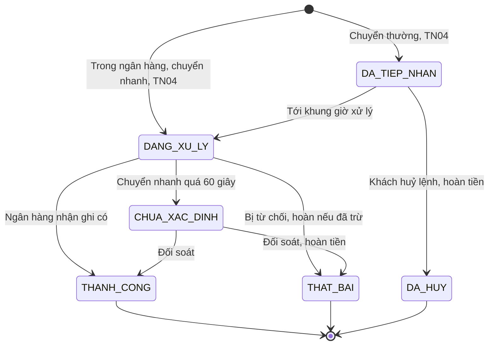
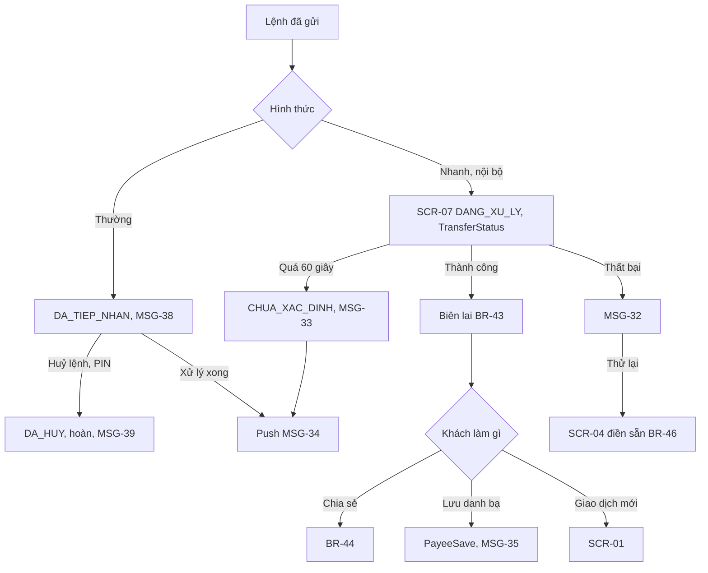
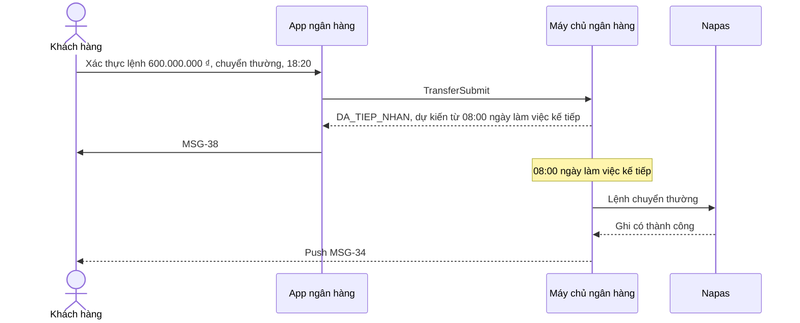

> **Mã:** DE07-TN05-SRS · **Trạng thái:** đã chốt · **Người viết:** Design · **PRD:** [PRD.md](PRD.md)

# UC-DE07-05 - Hoàn thành chuyển khoản

> SRS này mô tả giao dịch từ khi lệnh được gửi ([SRS TN04](../TN04-xac-thuc-xac-nhan/SRS.md)) ở `DANG_XU_LY` hoặc `DA_TIEP_NHAN` tới `THANH_CONG`, `THAT_BAI` hoặc `DA_HUY`, gồm `CHUA_XAC_DINH`, biên lai và chi tiết giao dịch.

## 1. Tổng quan

| **Mục** | **Nội dung** |
| --- | --- |
| Mục tiêu | Khách nhận kết quả rõ ràng, có biên lai, biết tiền đang ở đâu và nên làm gì |
| Actor | Khách hàng · App ngân hàng · Máy chủ ngân hàng · Napas · Ngân hàng nhận |
| Phạm vi | Đang xử lý, đã tiếp nhận, thành công, thất bại, chưa xác định, đối soát, hoàn tiền tự động, huỷ lệnh chuyển thường, push, biên lai, chia sẻ, lưu danh bạ, chi tiết giao dịch, chuyển lại |
| Ngoài phạm vi | Lịch sử đầy đủ, tra soát, hẹn lịch |
| Nền tảng | App ngân hàng iOS / Android |

## 2. User Story

| **ID** | **As a** | **I want** | **So that** |
| --- | --- | --- | --- |
| US-19 | Khách hàng | Thấy kết quả rõ ràng | Biết tiền đã đi |
| US-20 | Khách hàng | Biết lệnh chuyển thường bao giờ xử lý | Báo đúng cho người nhận |
| US-21 | Khách hàng | Huỷ lệnh chuyển thường chưa xử lý | Sửa sai kịp thời |
| US-22 | Khách hàng | Biết không nên chuyển lại khi chưa rõ kết quả | Không bị trừ hai lần |
| US-23 | Khách hàng | Chia sẻ biên lai, lưu người nhận | Có bằng chứng, lần sau nhanh hơn |

## 3. Business Rules

| **Mã** | **Quy tắc** |
| --- | --- |
| BR-39 | **Đang xử lý** (**SCR-07**, trong ngân hàng và chuyển nhanh): vòng chờ, "Đang chuyển tiền…", tóm tắt người nhận, số tiền. 10 giây đầu không có nút thoát; sau đó hiện "Về trang chủ" (giao dịch vẫn xử lý, kết quả qua push). App gọi \[TransferStatus\] mỗi 2 giây |
| BR-40 | **Kết quả trong 60 giây**: `THANH_CONG` (ngân hàng nhận ghi có) hoặc `THAT_BAI` (bị từ chối). Quá 60 giây → `CHUA_XAC_DINH` |
| BR-41 | **Thất bại**: lý do theo mã (MSG-32); tiền chưa trừ → "Tiền chưa bị trừ"; đã trừ → hoàn số tiền và phí về tài khoản nguồn ngay, "Tiền đã được hoàn" |
| BR-42 | **Chưa xác định**: MSG-33; không có nút Thử lại. Máy chủ tra cứu mỗi 5 phút; có kết quả cuối trong tối đa 1 ngày làm việc; thất bại mà đã trừ → hoàn tự động. Có kết quả → push MSG-34 |
| BR-43 | **Biên lai**: trạng thái, số tiền và bằng chữ, người nhận (tên, ngân hàng, số tài khoản che giữa), nội dung đã gửi, hình thức chuyển, phí, tài khoản nguồn che giữa, thời gian (giờ:phút:giây, ngày), mã giao dịch. Không có số dư |
| BR-44 | **Chia sẻ biên lai**: ảnh PNG hoặc PDF theo BR-43, có logo ngân hàng; mở bảng chia sẻ của hệ điều hành; cho `THANH_CONG` và `DA_TIEP_NHAN` (biên lai ghi "Đã tiếp nhận") |
| BR-45 | **Lưu danh bạ**: trên **SCR-07** khi `THANH_CONG` hoặc `DA_TIEP_NHAN` và người nhận chưa có trong danh bạ; tên gợi nhớ 1–30 ký tự (mặc định tên chủ tài khoản); tối đa 200; không lưu người nhận có cờ cảnh báo |
| BR-46 | **Thử lại / Chuyển lại**: "Thử lại" (`THAT_BAI`) và "Chuyển lại" (chi tiết giao dịch `THANH_CONG`) mở **SCR-04** (TN03) điền sẵn người nhận, số tiền, nội dung; tra tên lại tự động |
| BR-47 | **Chuyển thường**: giao dịch `DA_TIEP_NHAN` (tiền đã trừ) → `DANG_XU_LY` khi tới khung 08:00–16:00 ngày làm việc → `THANH_CONG` hoặc `THAT_BAI` (hoàn tiền). **SCR-07** hiện MSG-38 và thời gian dự kiến (TN03 BR-26). Khi còn `DA_TIEP_NHAN`, khách bấm "Huỷ lệnh" (ở **SCR-07** hoặc **SCR-08**) → nhập PIN Smart OTP → `DA_HUY`, hoàn số tiền và phí ngay, MSG-39 |
| BR-48 | **Giao dịch mới**: "Giao dịch mới" mở **SCR-01** (TN01); "Về trang chủ" về trang chủ app |

## 4. Trạng thái

### 4.1 Giao dịch trong phạm vi TN05

### 4.2 Hiển thị trên SCR-07

| **Trạng thái** | **Hiển thị** | **Nút** |
| --- | --- | --- |
| `DANG_XU_LY` | Vòng chờ, "Đang chuyển tiền…" | "Về trang chủ" sau 10 giây |
| `THANH_CONG` | Tích xanh lớn, MSG-31, biên lai | Chia sẻ, Lưu danh bạ, Giao dịch mới, Về trang chủ |
| `DA_TIEP_NHAN` | Đồng hồ xanh, MSG-38, thời gian dự kiến, biên lai "Đã tiếp nhận" | Huỷ lệnh, Chia sẻ, Lưu danh bạ, Về trang chủ |
| `THAT_BAI` | Biểu tượng đỏ, MSG-32 | Thử lại, Về trang chủ |
| `CHUA_XAC_DINH` | Đồng hồ vàng, MSG-33 | Xem chi tiết, Về trang chủ |

## 5. Use Case

### UC-07 Nhận kết quả

| **Mục** | **Nội dung** |
| --- | --- |
| Tiền điều kiện | Lệnh đã gửi (TN04) |
| Hậu điều kiện thành công | **SCR-07** hiện đúng trạng thái; khách nhận push khi có kết quả cuối |
| Hậu điều kiện thất bại | – |

**Luồng chính**

| **Bước** | **Actor** | **Mô tả** |
| --- | --- | --- |
| 1 | App | **SCR-07** "Đang chuyển tiền…"; gọi \[TransferStatus\] |
| 2 | Máy chủ | Nhận ghi có thành công từ ngân hàng nhận |
| 3 | App | **SCR-07** `THANH_CONG`, biên lai; gợi ý lưu danh bạ (người nhận mới) |
| 4 | Khách hàng | Đặt tên "Chủ trọ", lưu; bấm Chia sẻ, gửi biên lai cho chủ nhà |

**Luồng thay thế**

| **Mã** | **Điều kiện** | **Xử lý** |
| --- | --- | --- |
| A1 | Chuyển thường | `DA_TIEP_NHAN`, MSG-38 (BR-47) |
| A2 | Huỷ lệnh chuyển thường | PIN → \[TransferCancel\] → MSG-39 |
| A3 | Về trang chủ khi đang xử lý | Kết quả qua push MSG-34 |
| A4 | Thất bại, Thử lại | BR-46 |

**Luồng lỗi**

| **Mã** | **Điều kiện** | **Xử lý** |
| --- | --- | --- |
| E1 | Ngân hàng nhận từ chối | MSG-32 |
| E2 | Quá 60 giây | MSG-33 |
| E3 | Danh bạ đầy | MSG-36 |
| E4 | Huỷ khi lệnh đã vào xử lý | Toast "Lệnh đang được xử lý, không thể huỷ" |
| E5 | Mất mạng trên app | Banner MSG-37; khi có mạng gọi lại \[TransferStatus\] |

### UC-08 Xem chi tiết giao dịch

**Luồng chính**

| **Bước** | **Actor** | **Mô tả** |
| --- | --- | --- |
| 1 | Khách hàng | Chạm push MSG-34 hoặc mở giao dịch từ lịch sử của app |
| 2 | App | Gọi \[TxDetail\]; hiện **SCR-08** |
| 3 | Khách hàng | Bấm "Chuyển lại" |
| 4 | App | Mở **SCR-04** điền sẵn (BR-46) |

**Luồng thay thế**

| **Mã** | **Điều kiện** | **Xử lý** |
| --- | --- | --- |
| A1 | `DA_TIEP_NHAN` | Hiện thời gian dự kiến và "Huỷ lệnh" (BR-47) |
| A2 | `CHUA_XAC_DINH` | MSG-33 và hạn có kết quả; không có Chuyển lại |
| A3 | Cần hỗ trợ | "Liên hệ hỗ trợ" mở kênh hỗ trợ sẵn có, kèm mã giao dịch |

## 6. Điểm vào

| **Điểm vào** | **Dẫn tới** | **Ghi chú** |
| --- | --- | --- |
| Gửi lệnh ở TN04 | **SCR-07** | |
| Push kết quả | **SCR-08** | |
| Lịch sử giao dịch sẵn có của app | **SCR-08** | |

## 7. Mô tả màn hình

### SCR-07 Kết quả & biên lai

| **#** | **Thành phần** | **Loại** | **Hành vi** |
| --- | --- | --- | --- |
| 1 | Trạng thái | Icon + tiêu đề | Mục 4.2 |
| 2 | Số tiền | Text lớn | Kèm bằng chữ |
| 3 | Thời gian dự kiến | Text | Chỉ `DA_TIEP_NHAN` |
| 4 | Biên lai | List | BR-43 |
| 5 | Chia sẻ (ảnh, PDF) | Button | BR-44 |
| 6 | Lưu danh bạ | Checkbox + Text | BR-45 |
| 7 | Huỷ lệnh | Button phụ | Chỉ `DA_TIEP_NHAN` |
| 8 | Giao dịch mới, Về trang chủ, Thử lại | Button | Theo trạng thái |

### SCR-08 Chi tiết giao dịch

| **#** | **Thành phần** | **Loại** | **Hành vi** |
| --- | --- | --- | --- |
| 1 | Trạng thái, số tiền | Header | Màu theo trạng thái |
| 2 | Biên lai | List | BR-43; mã giao dịch sao chép được |
| 3 | Mốc thời gian | Timeline | Gửi lệnh, tiếp nhận, xử lý, kết quả, hoàn tiền |
| 4 | Chia sẻ, Chuyển lại, Huỷ lệnh | Button | Theo trạng thái |
| 5 | Liên hệ hỗ trợ | Link | A3 UC-08 |

## 8. API

| **API** | **Request chính** | **Response chính** | **Timeout / retry** |
| --- | --- | --- | --- |
| \[TransferStatus\] | transaction_id | status, reason_code, refunded, eta | 3s / mỗi 2 giây tới 60 giây |
| \[TransferCancel\] | transaction_id, chữ ký PIN | status `DA_HUY`, refund | 5s / 1 lần |
| \[TxDetail\] | transaction_id | Chi tiết, mốc thời gian, allowed_actions | 5s / 1 lần |
| \[ReceiptExport\] | transaction_id, format | Ảnh hoặc PDF | 10s / 1 lần |
| \[PayeeSave\] | bank, account, nickname | payee_id | 5s / 1 lần |

**Map lỗi → thông báo**

| **Nhóm** | **Message** |
| --- | --- |
| Thành công | MSG-31 |
| Thất bại | MSG-32 |
| Chưa xác định | MSG-33 |
| Có kết quả cuối (push) | MSG-34 |
| Đã lưu danh bạ | MSG-35 |
| Danh bạ đầy | MSG-36 |
| Mất mạng | MSG-37 |
| Đã tiếp nhận chuyển thường | MSG-38 |
| Đã huỷ lệnh | MSG-39 |

## 9. Danh sách thông báo

| **ID** | **Nơi hiện** | **Nội dung (VI)** |
| --- | --- | --- |
| MSG-31 | **SCR-07** | Chuyển tiền thành công |
| MSG-32 | **SCR-07** | Giao dịch không thành công: {Tài khoản nhận không nhận được tiền lúc này / Ngân hàng nhận đang bảo trì / Giao dịch bị từ chối}. Tiền {chưa bị trừ / đã được hoàn về tài khoản của bạn} |
| MSG-33 | **SCR-07**, **SCR-08** | Giao dịch đang được ngân hàng xác nhận. **Vui lòng không chuyển lại.** Chúng tôi sẽ báo kết quả cho bạn, chậm nhất trong 1 ngày làm việc |
| MSG-34 | Push | Giao dịch {số tiền} ₫ tới {tên} ({mã}): {Thành công / Không thành công, tiền đã được hoàn về tài khoản} |
| MSG-35 | Toast | Đã lưu {tên gợi nhớ} vào danh bạ |
| MSG-36 | Toast | Danh bạ đã đủ 200 người nhận. Xoá bớt để lưu người mới |
| MSG-37 | Banner | Mất kết nối. Kết quả giao dịch sẽ được cập nhật khi có mạng |
| MSG-38 | **SCR-07** | Lệnh đã được tiếp nhận. Tiền đã được trừ và sẽ tới người nhận {thời gian dự kiến}. Chúng tôi sẽ báo khi người nhận nhận được |
| MSG-39 | Toast | Đã huỷ lệnh. {Số tiền + phí} ₫ đã được hoàn về tài khoản của bạn |

## 10. Yêu cầu phi chức năng

| **Mục** | **Yêu cầu** |
| --- | --- |
| Hiệu năng | 95% chuyển nhanh có kết quả ≤ 10 giây; push kết quả cuối ≤ 1 phút sau khi có kết quả |
| Tính đúng | Hoàn tiền tự động khi thất bại đã trừ; huỷ lệnh chuyển thường chỉ thành công khi lệnh chưa vào xử lý (khoá trên máy chủ) |
| Bảo mật | Biên lai không chứa số dư; số tài khoản che giữa |
| Log / audit | Thời điểm từng trạng thái, mã lý do, lệnh hoàn tiền, huỷ lệnh |
| Tracking | Phân bố kết quả, thời gian tới kết quả, thoát khi đang xử lý, chia sẻ, lưu danh bạ, huỷ lệnh, thử lại, chuyển lại |
| Accessibility | Kết quả thông báo bằng giọng đọc; trạng thái phân biệt bằng biểu tượng và chữ, không chỉ màu |
