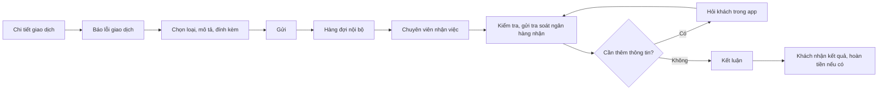

> **Mã:** DE07-TN05-PRD · **Trạng thái:** đã chốt · **Người viết:** Design · **SRS:** [SRS.md](SRS.md)

# PRD Lịch sử giao dịch, tra soát và khiếu nại (App ngân hàng, chuyển khoản)

## 1. Bối cảnh và vấn đề

### 1.1 Bối cảnh

Khi chuyển khoản có vấn đề, khách cần ngân hàng điều tra và xử lý: người nhận nói chưa nhận được, tiền bị trừ mà giao dịch lỗi, chuyển nhầm người, hoặc bị lừa (xem [README](../../README.md)). Phía sau là **chuyên viên tra soát** làm việc với Napas và ngân hàng nhận. Tính năng này thiết kế cả hai phía: khách tạo và theo dõi yêu cầu trong app; chuyên viên xử lý trên web nội bộ.

### 1.2 Vấn đề

| **Vấn đề** | **Hệ quả** |
| --- | --- |
| Khách phải gọi tổng đài, đọc mã giao dịch | Tốn thời gian, nhầm thông tin |
| Không biết yêu cầu tới đâu, bao giờ xong | Gọi lại nhiều lần |
| Chuyên viên nhận yêu cầu qua email, bảng tính | Sót việc, trễ hạn |
| Nghi lừa đảo nhưng xử lý như yêu cầu thường | Tiền bị rút khỏi tài khoản nhận trước khi kịp phong toả |
| Chuyên viên phải hỏi lại khách qua điện thoại | Kéo dài, khách bực |

### 1.3 Mục tiêu

- ≥ 75% yêu cầu tra soát chuyển khoản tạo trong app.
- ≥ 90% yêu cầu giải quyết trong thời hạn.
- Yêu cầu "Nghi lừa đảo" được gửi đề nghị phong toả tới ngân hàng nhận trong ≤ 15 phút.

## 2. Người dùng

| **Nhóm** | **Nhu cầu với tính năng này** |
| --- | --- |
| Khách chuyển nhầm | Biết quy trình, khả năng lấy lại tiền, thời gian |
| Khách bị lừa | Báo ngay, được ưu tiên, biết làm gì tiếp |
| Khách có giao dịch lỗi | Được hoàn tiền nhanh |
| Chuyên viên tra soát | Hàng đợi rõ ràng theo hạn, đủ dữ liệu, trao đổi với khách trong hệ thống |

## 3. Phạm vi

### 3.1 Trong phạm vi (MVP)

- Lịch sử giao dịch, tìm kiếm, chi tiết, biên lai, các hành động nhanh.
- Khách tạo yêu cầu tra soát theo loại; đính kèm; theo dõi; bổ sung; huỷ.
- Web nội bộ: hàng đợi tra soát theo hạn và mức ưu tiên; nhận việc; xem dữ liệu giao dịch; ghi bước xử lý; yêu cầu khách bổ sung; kết luận; hoàn tiền.
- Luồng ưu tiên cho nghi lừa đảo: đề nghị phong toả ngay.

### 3.2 Ngoài phạm vi

- Kết nối kỹ thuật với Napas, ngân hàng nhận (đề chỉ mô tả bước "gửi yêu cầu" và "ghi kết quả").
- Khiếu nại về phí, lãi, dịch vụ thẻ.
- Tổng đài và chat trực tuyến.
- Báo cáo quản trị cho trưởng phòng.

## 4. Nguyên tắc sản phẩm

### 4.1 Báo lỗi từ chính giao dịch

Nút "Báo lỗi giao dịch" ở chi tiết; thông tin giao dịch điền sẵn, khách chỉ mô tả vấn đề.

### 4.2 Nói thật về kết quả có thể

Chuyển nhầm cần người nhận đồng ý; lừa đảo phụ thuộc tốc độ phong toả. Nói trước khi khách gửi.

### 4.3 Một nơi cho mọi trao đổi

Câu hỏi của chuyên viên và trả lời của khách đều nằm trong yêu cầu, có lưu vết.

### 4.4 Gấp thì đi trước

Nghi lừa đảo luôn ở đầu hàng đợi với thời hạn tính bằng phút.

## 5. Quy tắc nghiệp vụ

| **Quy tắc** | **Giá trị** |
| --- | --- |
| Tạo yêu cầu | Giao dịch chuyển đi trong 90 ngày; 1 yêu cầu mở mỗi giao dịch |
| Thời hạn | Trừ tiền nhưng lỗi 1 ngày làm việc; Người nhận chưa nhận 2; Khác 5; Chuyển nhầm 7; Nghi lừa đảo: đề nghị phong toả ≤ 15 phút, kết luận 1 ngày làm việc |
| Bổ sung | Khách trả lời trong 3 ngày làm việc; thời hạn tạm dừng khi chờ khách |
| Đính kèm | ≤ 5 tệp ảnh hoặc PDF, mỗi tệp ≤ 5 MB |
| Phí tra soát | Miễn phí |

## 6. Luồng trải nghiệm

| **Bước** | **Giai đoạn** | **Khách thấy** | **Chuyên viên thấy** |
| --- | --- | --- | --- |
| 1 | Gửi | Mã yêu cầu, hạn dự kiến | Việc mới trong hàng đợi |
| 2 | Xử lý | "Đang xử lý" | Dữ liệu giao dịch, bước đã làm |
| 3 | Bổ sung | Câu hỏi, hạn trả lời | "Chờ khách", hạn tạm dừng |
| 4 | Kết luận | Kết quả bằng lời dễ hiểu, số tiền hoàn | Mẫu kết luận, ghi chú |

## 7. Use Cases, User Stories và Acceptance Criteria

### UC1. Lịch sử và chi tiết

AC01: Lịch sử nhóm theo ngày; lọc thời gian (≤ 3 tháng mỗi lần), loại (vào, ra), tìm theo tên, nội dung, số tiền.

AC02: Chi tiết: biên lai, trạng thái; hành động: Chia sẻ, Chuyển lại, Đặt lịch định kỳ, Lưu người nhận, Huỷ lệnh (chuyển thường chưa xử lý), Báo lỗi giao dịch.

### UC2. Khách tạo và theo dõi yêu cầu

#### US2.1 Báo chuyển nhầm

User Story: Là khách chuyển nhầm người, tôi muốn đề nghị lấy lại tiền và hiểu khả năng thành công.

AC01: Trước khi gửi hiện: cần người nhận đồng ý; không chắc chắn lấy lại được; thời hạn 7 ngày làm việc.

AC02: Nhập số tiền đề nghị hoàn (mặc định toàn bộ), mô tả bắt buộc.

#### US2.2 Báo bị lừa đảo

AC01: Lựa chọn "Tôi bị lừa đảo" nổi bật; gửi xong hiện ngay số tổng đài khẩn, nút khoá nhanh, hướng dẫn trình báo công an.

AC02: Yêu cầu vào hàng ưu tiên; khách được báo khi đề nghị phong toả đã gửi.

#### US2.3 Theo dõi, bổ sung

AC01: Trạng thái, hạn dự kiến, dòng thời gian trao đổi.

AC02: Khi chuyên viên hỏi → push; khách trả lời bằng chữ, đính kèm.

AC03: Huỷ yêu cầu khi còn chưa xử lý hoặc đang chờ khách.

### UC3. Chuyên viên xử lý

#### US3.1 Hàng đợi

User Story: Là chuyên viên, tôi muốn thấy việc gấp nhất trước và biết việc nào sắp trễ hạn.

AC01: Hàng đợi sắp theo mức ưu tiên rồi theo hạn; cảnh báo vàng khi dùng 80% thời hạn, đỏ khi quá hạn.

AC02: Lọc theo loại, trạng thái, của tôi.

#### US3.2 Xử lý yêu cầu

AC01: Thấy giao dịch đầy đủ (gồm mã tham chiếu liên ngân hàng), yêu cầu, đính kèm, lịch sử trao đổi.

AC02: Ghi từng bước: đã kiểm tra nội bộ, đã gửi tra soát ngân hàng nhận, đã nhận phản hồi.

AC03: Hỏi khách bổ sung bằng câu hỏi cụ thể.

AC04: Kết luận bằng mẫu theo loại, ghi chú bắt buộc; nếu có hoàn tiền thì nhập số tiền, hệ thống hoàn.

## 8. Chỉ số theo dõi

| **Chỉ số** | **Định nghĩa** | **Mục tiêu MVP** |
| --- | --- | --- |
| Tỉ lệ tạo trong app | Yêu cầu tạo trong app / tổng yêu cầu chuyển khoản | ≥ 75% |
| Đúng hạn | Yêu cầu kết luận trong hạn / tổng yêu cầu | ≥ 90% |
| Phong toả kịp | Yêu cầu lừa đảo có đề nghị phong toả ≤ 15 phút / tổng yêu cầu lừa đảo | ≥ 95% |
| Thời gian xử lý | Gửi → kết luận theo loại (trung vị) | Theo dõi |
| Tỉ lệ cần bổ sung | Yêu cầu có hỏi khách / tổng | Theo dõi; cao là dấu hiệu form thiếu |
| Hài lòng | Khách chấm kết quả từ 4 sao (1–5) | ≥ 70% |

## 9. Phụ thuộc và rủi ro

| **Mục** | **Mô tả** | **Hướng xử lý** |
| --- | --- | --- |
| Ngân hàng nhận | Phản hồi chậm | Thời hạn theo loại; nhắc tự động; ghi "chờ ngân hàng nhận" |
| Nhân sự | Ít người ngoài giờ | Ca trực cho loại lừa đảo; hàng đợi ưu tiên |
| Kỳ vọng khách | Nghĩ ngân hàng luôn lấy lại được tiền | Thông báo trước khi gửi (nguyên tắc 4.2) |
| Dữ liệu cá nhân | Thông tin người nhận | Khách chỉ thấy tên, ngân hàng; chi tiết chỉ chuyên viên thấy |

## 10. Câu hỏi mở

> Mọi câu hỏi dưới đây đã được PO chốt ngày 20/11/2026; quyết định ghi sau mỗi câu và đã cập nhật vào SRS.

- Yêu cầu nghi lừa đảo có tự động gửi đề nghị phong toả? → **Đã chốt:** Không tự động; chuyên viên ca trực gửi sau khi kiểm tra nhanh, thời hạn 15 phút (SRS BR-51).
- Chuyên viên có nhắn trực tiếp với khách? → **Đã chốt:** Có, trong yêu cầu, không qua kênh khác; mỗi tin có lưu vết (SRS BR-56).
- Khách có đánh giá kết quả? → **Đã chốt:** Có, 1–5 sao sau khi kết luận, tuỳ chọn (SRS BR-58).
- Thời hạn có tính ngày nghỉ? → **Đã chốt:** Tính theo ngày làm việc; riêng phong toả lừa đảo tính theo phút cả ngày nghỉ (SRS BR-51).
