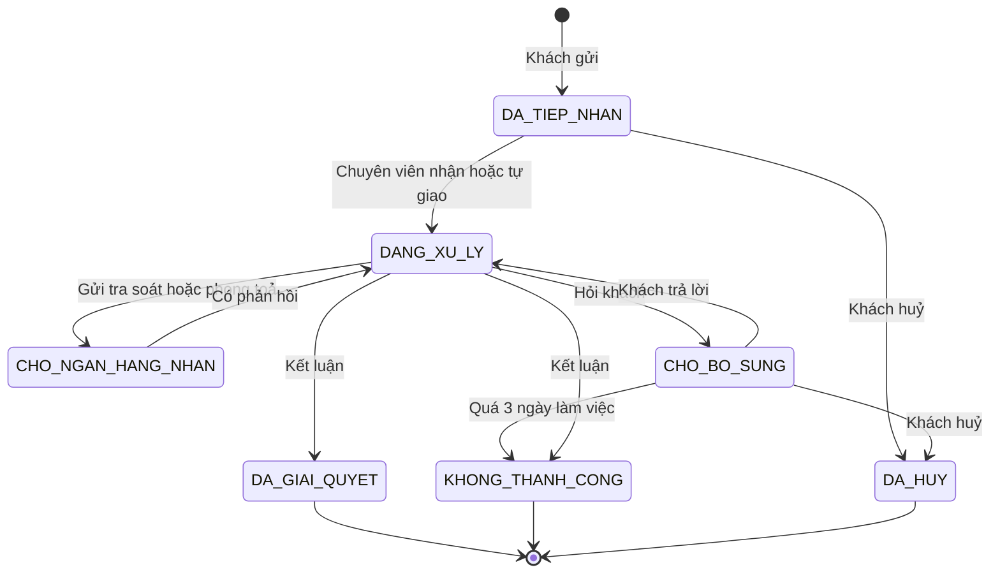
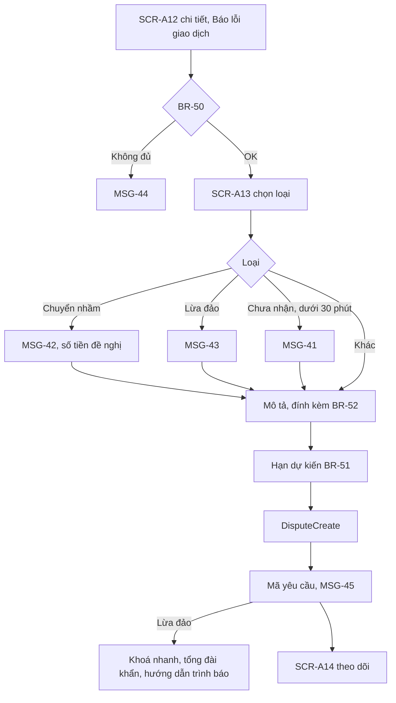
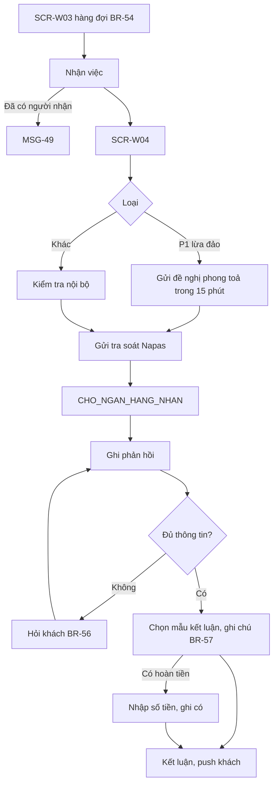
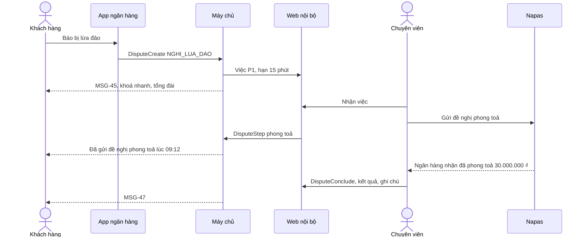

> **Mã:** DE07-TN05-SRS · **Trạng thái:** đã chốt · **Người viết:** Design · **PRD:** [PRD.md](PRD.md)

# UC-DE07-05 - Lịch sử giao dịch, tra soát và khiếu nại

> SRS này mô tả lịch sử, chi tiết giao dịch và vòng đời yêu cầu tra soát ở cả App (khách) và Web nội bộ (chuyên viên tra soát). Trạng thái giao dịch tham chiếu [SRS TN02](../TN02-lap-lenh-xac-thuc/SRS.md).

## 1. Tổng quan

| **Mục** | **Nội dung** |
| --- | --- |
| Mục tiêu | Khách tìm lại giao dịch, tự tạo và theo dõi tra soát; chuyên viên xử lý đúng hạn, có lưu vết |
| Actor | Khách hàng · Chuyên viên tra soát · Trưởng nhóm tra soát · App ngân hàng · Web nội bộ · Máy chủ · Napas · Ngân hàng nhận |
| Phạm vi | Lịch sử, chi tiết, hành động nhanh; tạo, theo dõi, bổ sung, huỷ yêu cầu; hàng đợi, nhận việc, bước xử lý, hỏi khách, kết luận, hoàn tiền; luồng ưu tiên lừa đảo; đánh giá kết quả |
| Ngoài phạm vi | Kết nối kỹ thuật Napas, khiếu nại phí và thẻ, tổng đài, báo cáo quản trị |
| Nền tảng | App ngân hàng iOS / Android; Web nội bộ (desktop) |

## 2. User Story

| **ID** | **As a** | **I want** | **So that** |
| --- | --- | --- | --- |
| US-21 | Khách hàng | Báo lỗi ngay tại giao dịch | Không phải đọc mã qua điện thoại |
| US-22 | Khách hàng | Biết yêu cầu đang ở đâu, bao giờ xong | Không phải gọi hỏi |
| US-23 | Khách bị lừa | Được ưu tiên xử lý ngay | Tăng khả năng giữ được tiền |
| US-24 | Chuyên viên | Hàng đợi theo mức gấp và hạn | Không trễ hạn |
| US-25 | Chuyên viên | Hỏi khách ngay trong yêu cầu | Không phải gọi điện |

## 3. Business Rules

| **Mã** | **Quy tắc** |
| --- | --- |
| BR-49 | **Lịch sử** (**SCR-A12**): 12 tháng; mỗi lần lọc ≤ 3 tháng; mặc định 30 ngày; tìm theo tên, nội dung, số tiền (không dấu). Chi tiết có hành động theo trạng thái: Chia sẻ biên lai, Chuyển lại (TN02), Đặt lịch định kỳ (TN04), Lưu người nhận (TN01), Huỷ lệnh (chuyển thường `DA_TIEP_NHAN`, TN02 BR-22), Báo lỗi giao dịch (BR-50) |
| BR-50 | **Điều kiện tạo yêu cầu**: giao dịch chuyển đi của khách, trong 90 ngày, không có yêu cầu đang mở. Không tạo cho giao dịch `CHUA_XAC_DINH` (đang đối soát) và `TAM_GIU` (đang xác minh, TN03) – hiện thời hạn tương ứng thay cho nút |
| BR-51 | **Loại, mức ưu tiên, thời hạn**: `NGHI_LUA_DAO` – P1 – gửi đề nghị phong toả tới ngân hàng nhận ≤ 15 phút (tính cả ngày nghỉ), kết luận ≤ 1 ngày làm việc; `TRU_TIEN_LOI` (giao dịch `THAT_BAI` mà chưa hoàn sau 1 ngày làm việc) – P2 – 1 ngày làm việc; `CHUA_NHAN` (giao dịch `THANH_CONG`) – P3 – 2 ngày làm việc; `CHUYEN_NHAM` (`THANH_CONG`) – P3 – 7 ngày làm việc; `KHAC` – P4 – 5 ngày làm việc |
| BR-52 | **Thông tin khách nhập**: loại; mô tả 10–1.000 ký tự (bắt buộc với `CHUYEN_NHAM`, `NGHI_LUA_DAO`, `KHAC`); số điện thoại liên hệ (điền sẵn); đính kèm 0–5 tệp JPG, PNG, PDF ≤ 5 MB. `CHUYEN_NHAM`: số tiền đề nghị hoàn (1.000 → số tiền giao dịch, mặc định toàn bộ) |
| BR-53 | **Thông báo trước khi gửi**: `CHUYEN_NHAM` → MSG-42; `NGHI_LUA_DAO` → MSG-43 (sau khi gửi hiện thêm nút Khoá nhanh, số tổng đài khẩn); `CHUA_NHAN` và giao dịch < 30 phút → MSG-41 gợi ý chờ, vẫn cho gửi |
| BR-54 | **Hàng đợi** (**SCR-W03**): sắp theo mức ưu tiên (P1 trước), rồi theo hạn còn lại. Cảnh báo vàng khi đã dùng ≥ 80% thời hạn, đỏ khi quá hạn; quá hạn → thông báo trưởng nhóm. Yêu cầu chưa ai nhận trong 10 phút (P1) hoặc 2 giờ làm việc (khác) → tự giao cho chuyên viên ít việc nhất trong ca |
| BR-55 | **Bước xử lý** (chuyên viên ghi trên **SCR-W04**, mỗi bước có thời điểm, người làm): Kiểm tra nội bộ · Gửi tra soát qua Napas (kèm mã tham chiếu) · Gửi đề nghị phong toả (P1) · Nhận phản hồi ngân hàng nhận · Hỏi khách · Hoàn tiền · Kết luận |
| BR-56 | **Hỏi khách**: chuyên viên gửi câu hỏi cụ thể (≥ 20 ký tự); yêu cầu `CHO_BO_SUNG`; thời hạn tạm dừng; khách trả lời trong 3 ngày làm việc (chữ + đính kèm) → `DANG_XU_LY`, thời hạn chạy tiếp; quá hạn → kết luận `KHONG_THANH_CONG` lý do thiếu thông tin. Mọi tin nhắn giữa hai bên nằm trong dòng thời gian của yêu cầu |
| BR-57 | **Kết luận**: `DA_GIAI_QUYET` hoặc `KHONG_THANH_CONG`, chọn mẫu theo loại (ví dụ: "Người nhận đã được ghi có lúc {giờ}", "Đã hoàn {x} ₫ vào tài khoản của bạn", "Ngân hàng nhận đã hoàn {x} ₫ theo đồng ý của người nhận", "Người nhận không đồng ý hoàn trả", "Tài khoản nhận đã rút tiền trước khi phong toả") + ghi chú nội bộ ≥ 20 ký tự. Có hoàn tiền → nhập số tiền ≤ số tiền giao dịch, hệ thống ghi có tài khoản nguồn của khách ngay. P1 kết luận → liên kết sự kiện cảnh báo bị bỏ qua (TN03 BR-37) |
| BR-58 | **Khách thấy**: trạng thái theo mục 4.2, hạn dự kiến (ngày cụ thể), dòng thời gian (tin của chuyên viên, câu hỏi, trả lời, kết luận); không thấy ghi chú nội bộ; về người nhận chỉ thấy tên chủ tài khoản và ngân hàng. Sau kết luận: đánh giá 1–5 sao tuỳ chọn |
| BR-59 | **Huỷ yêu cầu** (khách): khi `DA_TIEP_NHAN` hoặc `CHO_BO_SUNG`; không huỷ được P1 sau khi đã gửi đề nghị phong toả |
| BR-60 | **Thông báo**: mỗi lần đổi trạng thái và mỗi câu hỏi mới → push cho khách (MSG-45, MSG-46, MSG-47); khách trả lời → việc nổi lên đầu "Của tôi" của chuyên viên phụ trách |

## 4. Trạng thái

### 4.1 Vòng đời yêu cầu tra soát

### 4.2 Hiển thị cho khách

| **Trạng thái** | **Khách thấy** | **Hành động** |
| --- | --- | --- |
| `DA_TIEP_NHAN` | Đã tiếp nhận · dự kiến xong {ngày} | Huỷ yêu cầu |
| `DANG_XU_LY`, `CHO_NGAN_HANG_NHAN` | Đang xử lý · dự kiến xong {ngày}; P1: "Đã gửi đề nghị phong toả lúc {giờ}" | – |
| `CHO_BO_SUNG` | Cần bổ sung: {câu hỏi} · hạn {ngày} | Trả lời, Huỷ yêu cầu |
| `DA_GIAI_QUYET` | Kết quả (mẫu BR-57), số tiền hoàn | Đánh giá |
| `KHONG_THANH_CONG` | Lý do; bước tiếp theo (ví dụ trình báo công an) | Gọi tổng đài, Đánh giá |
| `DA_HUY` | Đã huỷ yêu cầu | – |

## 5. Use Case

### UC-12 Khách tạo và theo dõi yêu cầu

| **Mục** | **Nội dung** |
| --- | --- |
| Tiền điều kiện | Giao dịch thoả BR-50 |
| Hậu điều kiện thành công | Yêu cầu `DA_TIEP_NHAN`, có mã `TS` + 10 số, hạn dự kiến |
| Hậu điều kiện thất bại | Không tạo yêu cầu |

**Luồng chính**

| **Bước** | **Actor** | **Mô tả** |
| --- | --- | --- |
| 1 | Khách hàng | Ở chi tiết giao dịch bấm "Báo lỗi giao dịch" |
| 2 | App | Mở **SCR-A13**, giao dịch điền sẵn, loại theo trạng thái giao dịch |
| 3 | Khách hàng | Chọn "Chuyển nhầm người hoặc số tiền"; đọc MSG-42; nhập số tiền đề nghị, mô tả |
| 4 | App | Hiện hạn dự kiến; khách bấm "Gửi" |
| 5 | App | Gọi \[DisputeCreate\] |
| 6 | Máy chủ | Tạo yêu cầu, đưa vào hàng đợi (BR-54), push MSG-45 |
| 7 | App | Mở **SCR-A14** của yêu cầu |

**Luồng thay thế**

| **Mã** | **Điều kiện** | **Xử lý** |
| --- | --- | --- |
| A1 | Nghi lừa đảo | MSG-43; sau khi gửi hiện nút Khoá nhanh (TN03), số tổng đài khẩn, hướng dẫn trình báo |
| A2 | Trả lời bổ sung | Push MSG-46 → **SCR-A14** → "Trả lời" → \[DisputeReply\] |
| A3 | Huỷ yêu cầu | BR-59 → \[DisputeCancel\] |
| A4 | Có kết luận | Push MSG-47; **SCR-A14** hiện kết quả, đánh giá |

**Luồng lỗi**

| **Mã** | **Điều kiện** | **Xử lý** |
| --- | --- | --- |
| E1 | Không đủ điều kiện | MSG-44 |
| E2 | Mô tả thiếu, tệp không hợp lệ | Lỗi inline (MSG-48) |
| E3 | Lỗi mạng | MSG-19 (TN02); giữ dữ liệu |

### UC-13 Chuyên viên xử lý yêu cầu

| **Mục** | **Nội dung** |
| --- | --- |
| Tiền điều kiện | Chuyên viên đăng nhập Web nội bộ, quyền tra soát |
| Hậu điều kiện thành công | Yêu cầu có kết luận, bước xử lý đầy đủ; hoàn tiền nếu có |
| Hậu điều kiện thất bại | Yêu cầu giữ trạng thái, cảnh báo hạn |

**Luồng chính**

| **Bước** | **Actor** | **Mô tả** |
| --- | --- | --- |
| 1 | Chuyên viên | Mở **SCR-W03**; yêu cầu P3 "Chưa nhận" hạn còn 1 ngày |
| 2 | Chuyên viên | Bấm "Nhận việc" → **SCR-W04** |
| 3 | Chuyên viên | Xem giao dịch: `THANH_CONG`, mã tham chiếu Napas; ghi bước "Kiểm tra nội bộ: đã trừ tiền, đã gửi thành công" |
| 4 | Chuyên viên | Bấm "Gửi tra soát Napas", nhập mã tham chiếu yêu cầu → `CHO_NGAN_HANG_NHAN` |
| 5 | Chuyên viên | Ghi phản hồi: "Ngân hàng nhận xác nhận đã ghi có lúc 10:15 ngày 18/11" |
| 6 | Chuyên viên | Chọn mẫu "Người nhận đã được ghi có lúc {giờ}", ghi chú nội bộ; bấm "Kết luận" |
| 7 | Máy chủ | `DA_GIAI_QUYET`; push MSG-47 |

**Luồng thay thế**

| **Mã** | **Điều kiện** | **Xử lý** |
| --- | --- | --- |
| A1 | P1 lừa đảo | Bước 3 thay bằng "Gửi đề nghị phong toả" (≤ 15 phút); khách thấy giờ gửi |
| A2 | Hỏi khách | Nhập câu hỏi → \[DisputeAsk\] → `CHO_BO_SUNG` |
| A3 | Trừ tiền nhưng lỗi | Kiểm tra, kết luận "Đã hoàn {x} ₫", nhập số tiền → hệ thống ghi có |
| A4 | Chuyển giao | "Chuyển cho" chuyên viên khác kèm ghi chú |

**Luồng lỗi**

| **Mã** | **Điều kiện** | **Xử lý** |
| --- | --- | --- |
| E1 | Người khác đã nhận | MSG-49 |
| E2 | Thiếu ghi chú, mẫu kết luận | MSG-50 |
| E3 | Số tiền hoàn > số tiền giao dịch | Lỗi inline |
| E4 | Khách đã huỷ yêu cầu | **SCR-W04** khoá thao tác, hiện "Khách đã huỷ lúc {giờ}" |

## 6. Điểm vào

| **Điểm vào** | **Dẫn tới** | **Ghi chú** |
| --- | --- | --- |
| Trang chủ → Lịch sử giao dịch | **SCR-A12** | |
| Push kết quả giao dịch (TN02) | Chi tiết giao dịch | |
| Chi tiết giao dịch → Báo lỗi | **SCR-A13** | |
| Cài đặt → Yêu cầu hỗ trợ của tôi; push tra soát | **SCR-A14** | |
| Web nội bộ → Tra soát | **SCR-W03** | |

## 7. Mô tả màn hình

### SCR-A12 Lịch sử & chi tiết giao dịch

| **#** | **Thành phần** | **Loại** | **Hành vi** |
| --- | --- | --- | --- |
| 1 | Tài khoản | Dropdown | |
| 2 | Tìm, lọc thời gian, Vào / Ra | Search, chips | BR-49 |
| 3 | Danh sách | Grouped list | Ngày; tên đối tác, nội dung, số tiền ±, giờ, nhãn trạng thái khác thành công, nhãn "Có yêu cầu tra soát" |
| 4 | Chi tiết | Màn chi tiết | Biên lai (TN02 BR-23), trạng thái, mã tham chiếu, hành động BR-49, khối tra soát (nếu có) |

### SCR-A13 Tạo yêu cầu tra soát

| **#** | **Thành phần** | **Loại** | **Bắt buộc** | **Validate / hành vi** |
| --- | --- | --- | --- | --- |
| 1 | Giao dịch | Card chỉ đọc | – | |
| 2 | Loại vấn đề | Radio | Có | Theo trạng thái giao dịch (BR-51); "Tôi bị lừa đảo" nổi bật |
| 3 | Thông tin quan trọng | Info | – | MSG-41, MSG-42, MSG-43 |
| 4 | Số tiền đề nghị hoàn | Amount | Có khi `CHUYEN_NHAM` | ≤ số tiền giao dịch |
| 5 | Mô tả | Textarea | Theo loại | 10–1.000 ký tự |
| 6 | Đính kèm | Upload | Không | ≤ 5 tệp |
| 7 | Số liên hệ | Tel | Có | |
| 8 | Hạn dự kiến | Text | – | Ngày cụ thể |
| 9 | "Gửi yêu cầu" | Button | – | |

### SCR-A14 Theo dõi yêu cầu

| **#** | **Thành phần** | **Loại** | **Hành vi** |
| --- | --- | --- | --- |
| 1 | Mã, loại, trạng thái | Header | Mục 4.2 |
| 2 | Hạn dự kiến | Text | |
| 3 | Dòng thời gian | Timeline | Mốc trạng thái, tin của chuyên viên, câu hỏi, trả lời, kết luận |
| 4 | Trả lời | Textarea + Upload | Khi `CHO_BO_SUNG` |
| 5 | Huỷ yêu cầu | Link | BR-59 |
| 6 | Đánh giá | Rating 1–5 | Sau kết luận |

### SCR-W03 Hàng đợi tra soát (Web nội bộ)

| **#** | **Thành phần** | **Loại** | **Hành vi** |
| --- | --- | --- | --- |
| 1 | Bộ lọc | Chips + dropdown | Loại, trạng thái, mức ưu tiên, Của tôi, Quá hạn |
| 2 | Bảng | Table | Mã, mức ưu tiên, loại, khách, số tiền, ngân hàng nhận, trạng thái, hạn còn lại (vàng, đỏ BR-54), người phụ trách |
| 3 | "Nhận việc" | Button dòng | |
| 4 | Bộ đếm | Header | Số việc P1 đang mở, số quá hạn |

### SCR-W04 Xử lý tra soát (Web nội bộ)

| **#** | **Thành phần** | **Loại** | **Bắt buộc** | **Validate / hành vi** |
| --- | --- | --- | --- | --- |
| 1 | Yêu cầu | Panel | – | Loại, mô tả, số tiền đề nghị, đính kèm (xem trước) |
| 2 | Giao dịch | Panel | – | Đầy đủ, mã tham chiếu Napas, trạng thái, lịch sử trạng thái |
| 3 | Khách | Panel | – | Tên, liên hệ, yêu cầu trước đây |
| 4 | Bước xử lý | Timeline + nút | – | BR-55; mỗi bước có ô ghi |
| 5 | Hỏi khách | Textarea | – | ≥ 20 ký tự (BR-56) |
| 6 | Kết luận | Select mẫu + Textarea | Có | BR-57 |
| 7 | Số tiền hoàn | Amount | Khi mẫu có hoàn | ≤ số tiền giao dịch |
| 8 | Chuyển cho | Select | – | A4 UC-13 |
| 9 | Hạn | Badge | – | Đếm ngược, màu theo BR-54 |

## 8. API

| **API** | **Request chính** | **Response chính** | **Timeout / retry** |
| --- | --- | --- | --- |
| \[TxHistory\] | account, from, to, direction, keyword, cursor | Danh sách, next_cursor | 5s / 1 lần |
| \[TxDetail\] | transaction_id | Chi tiết, allowed_actions, dispute | 5s / 1 lần |
| \[DisputeOptions\] | transaction_id | eligible, types, sla | 3s / 1 lần |
| \[DisputeCreate\] | transaction_id, type, description, amount, phone, files, idempotency_key | dispute_id, due_date | 15s / gửi lại cùng key |
| \[DisputeReply\] | dispute_id, text, files | status | 10s / 1 lần |
| \[DisputeCancel\] | dispute_id | status | 5s / 1 lần |
| \[DisputeRate\] | dispute_id, stars | – | 5s / 1 lần |
| \[DisputeQueue\] (nội bộ) | filters | Danh sách | 5s / 1 lần |
| \[DisputeClaim\] (nội bộ) | dispute_id | owner hoặc lỗi | 3s / 1 lần |
| \[DisputeStep\] (nội bộ) | dispute_id, step_type, note, ref | timeline | 5s / 1 lần |
| \[DisputeAsk\] (nội bộ) | dispute_id, question | status `CHO_BO_SUNG` | 5s / 1 lần |
| \[DisputeConclude\] (nội bộ) | dispute_id, result, template, note, refund_amount | status, refund_tx_id | 10s / 1 lần, idempotent |

**Map lỗi → thông báo**

| **Nhóm** | **Message** |
| --- | --- |
| Giao dịch vừa xong, chưa nhận | MSG-41 |
| Chuyển nhầm | MSG-42 |
| Lừa đảo | MSG-43 |
| Không đủ điều kiện | MSG-44 |
| Đã gửi yêu cầu | MSG-45 |
| Cần bổ sung | MSG-46 |
| Có kết luận | MSG-47 |
| Đính kèm, mô tả không hợp lệ | MSG-48 |
| Người khác đã nhận (nội bộ) | MSG-49 |
| Thiếu kết luận, ghi chú (nội bộ) | MSG-50 |

## 9. Danh sách thông báo

| **ID** | **Nơi hiện** | **Nội dung (VI)** |
| --- | --- | --- |
| MSG-41 | Info **SCR-A13** | Giao dịch đã thành công lúc {giờ}. Người nhận có thể thấy tiền về chậm vài phút; hãy nhờ họ kiểm tra lại sau 30 phút |
| MSG-42 | Info **SCR-A13** | Ngân hàng sẽ đề nghị ngân hàng nhận liên hệ người nhận để hoàn trả. Việc hoàn trả cần người nhận đồng ý, nên không chắc chắn lấy lại được tiền. Thời gian xử lý tới 7 ngày làm việc |
| MSG-43 | Info **SCR-A13** | Chúng tôi sẽ ưu tiên đề nghị ngân hàng nhận phong toả tài khoản. Hãy khoá nhanh dịch vụ nếu đã lộ mật khẩu hoặc OTP, gọi {số} và trình báo cơ quan công an gần nhất |
| MSG-44 | Popup | Không thể tạo yêu cầu cho giao dịch này {lý do: quá 90 ngày / đã có yêu cầu đang mở / giao dịch đang được xác minh}. Gọi {số} nếu cần hỗ trợ |
| MSG-45 | Push, Toast | Đã tiếp nhận yêu cầu {mã}. Dự kiến có kết quả trước {ngày} |
| MSG-46 | Push | Yêu cầu {mã} cần bạn bổ sung thông tin trước {ngày}. \[Trả lời\] |
| MSG-47 | Push | Yêu cầu {mã} đã có kết quả: {tóm tắt kết luận} |
| MSG-48 | Inline | Mô tả từ 10 đến 1.000 ký tự; tối đa 5 tệp JPG, PNG, PDF, mỗi tệp đến 5 MB |
| MSG-49 | Toast nội bộ | Yêu cầu đã được {tên} nhận lúc {giờ} |
| MSG-50 | Inline nội bộ | Chọn mẫu kết luận và ghi chú nội bộ ít nhất 20 ký tự |

## 10. Yêu cầu phi chức năng

| **Mục** | **Yêu cầu** |
| --- | --- |
| Hiệu năng | Yêu cầu xuất hiện trong hàng đợi ≤ 5 giây; push tới khách ≤ 1 phút sau đổi trạng thái; \[TxHistory\] ≤ 1 giây (p95) |
| Bảo mật | Web nội bộ: mạng nội bộ, đăng nhập 2 lớp, phân quyền; tệp đính kèm quét mã độc trước khi mở; khách không thấy ghi chú nội bộ |
| Lưu trữ | Yêu cầu, trao đổi, tệp lưu theo quy định lưu trữ chứng từ ngân hàng |
| Log / audit | Mọi bước, tin nhắn, kết luận, lệnh hoàn tiền: ai, khi nào, nội dung |
| Tracking | Tạo yêu cầu (loại, nguồn), bỏ dở, thời gian từng trạng thái, đúng hạn theo loại, tỉ lệ hỏi bổ sung, đánh giá kết quả |
| Accessibility | Dòng thời gian đọc được tuần tự; Web nội bộ dùng được bằng bàn phím, có phím tắt nhận việc kế tiếp |
